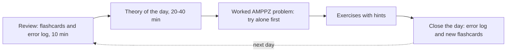

# Kurs AMPPZ 2026

> [!abstract] W skrócie
> 20 dni przygotowań do Akademickich Mistrzostw Polski w Programowaniu Zespołowym (zawody 29.11.2026),
> po 1-3 godziny dziennie. Start od zera: pierwszy tydzień uczy rozwiązywać zadania trywialne pewnie i szybko,
> drugi daje podstawowe algorytmy (grafy, programowanie dynamiczne, drzewa, struktury danych), trzeci uczy
> dostrzegać obserwacje, które otwierają zadania rozwiązywane przez nielicznych. Wszystko na zadaniach
> z archiwum AMPPZ z tego repozytorium. Kalendarz: [plan 20 dni](plan-20-dni.md).

## Jak otworzyć kurs

1. Zainstaluj [Obsidian](https://obsidian.md) i wybierz "Open folder as vault" na folderze `kurs` z tego repo.
2. Opcjonalnie włącz wtyczkę społeczności "Spaced Repetition": fiszki na końcu każdego dnia są w jej formacie
   (`pytanie::odpowiedź`). Bez wtyczki też działają: zasłoń odpowiedź i odpowiedz z pamięci.
3. Treści zadań są w PDF-ach poza folderem kursu: `202X/2024/A/A.pdf` itd. Notatki podają tę ścieżkę i link,
   który działa na GitHubie; w Obsidianie otwieraj PDF z eksploratora plików.

## Jak wygląda jeden dzień

Każdy dzień ma wersję **minimum** (ok. 1 h, wystarczy, żeby nie wypaść z rytmu) i **pełną** (do 3 h).

Jak czytać diagram: dzień zaczyna się od powtórki tego, co było wcześniej (fiszki i własny dziennik błędów),
potem przychodzi nowa teoria, zadanie omówione, ćwiczenia, a na końcu zapisujesz, czego się nauczyłeś
i gdzie się pomyliłeś. Przerywana strzałka pokazuje, że zapis z wieczora jest materiałem powtórki następnego
dnia. To nie jest przypadkowa kolejność: przypominanie sobie z pamięci (zamiast ponownego czytania) i powtórki
rozłożone w czasie to dwie najlepiej udokumentowane techniki nauki.

## Zasady pracy z zadaniem

- **Najpierw sam, z zegarkiem.** Zadanie łatwe: 15-20 minut samodzielnej walki, średnie: 30-40 minut, zanim
  otworzysz pierwszą podpowiedź. Walka z zadaniem uczy więcej niż czytanie rozwiązania, ale walka bez końca
  marnuje czas.
- **Podpowiedzi otwieraj po jednej.** Są zwinięte (kliknij strzałkę). Po każdej znowu próbujesz sam przez kilka
  minut.
- **Po rozwiązaniu zawsze czytaj omówienie.** Nawet gdy masz akceptację: omówienie pokazuje, czy Twoje
  rozwiązanie jest optymalne i jaki wspólny mianownik ma to zadanie z innymi.
- **Każdy błąd idzie do dziennika.** Jedna linijka: zadanie, co poszło źle, jak tego unikać. Wzór:
  [dziennik błędów](dziennik/szablon-dziennika.md). Własny dziennik trzymaj u siebie, nie w repo.
- **Kod piszesz sam od zera.** Kod z omówień czytasz po napisaniu własnego, nie przepisujesz go.

## Mapa kursu

- [Plan 20 dni](plan-20-dni.md): kalendarz, tematy dni, postęp.
- `dni/`: lekcje dzień po dniu, od [Dnia 1](dni/01-start.md).
- `zadania/`: omówienia zadań z archiwum AMPPZ, z kodem; spis: [zadania](zadania/README.md); całe archiwum
  z techniką i trudnością każdego zadania: [katalog](zadania/katalog.md).
- `myslenie/`: [moduł myślenia](myslenie/README.md): [sygnały w treści](myslenie/sygnaly-w-tresci.md) (po czym
  rozpoznać technikę), [protokół rozwiązywania](myslenie/protokol-rozwiazywania.md),
  [sztuczki obserwacji](myslenie/sztuczki-obserwacji.md), [wspólne mianowniki](myslenie/wspolne-mianowniki.md)
  i [jak się uczyć](myslenie/jak-sie-uczyc.md).
- `wzorce/`: [atlas wzorców](wzorce/README.md): sygnały, szablon w C++ i jak naginać każdy wzorzec.
- `szablony/`: [szablon programu](szablony/szablon.cpp), z którego zaczynasz każde zadanie.
- `dziennik/`: [wzór dziennika błędów](dziennik/szablon-dziennika.md).
- `taktyka/`: [taktyka zawodów](taktyka/README.md): 3 osoby, 1 komputer, 5 godzin; role, pierwsze 30 minut,
  kolejka zadań, ostatnia godzina, debugowanie, dzień próbny, checklisty, retrospektywa.
- W przygotowaniu (pojawi się przed dniem, w którym jest potrzebna): biblioteczka do druku (`biblioteczka/`).

## Skąd zadania i rozwiązania

Archiwum zadań AMPPZ z lat 1996-2024 leży w folderach `199X`-`202X` tego repo. Każde zadanie omówione w kursie
jest rozwiązane, skompilowane `g++ -std=c++17 -O2 -Wall`, sprawdzone na przykładach z treści i testami losowymi
(porównanie z rozwiązaniem siłowym), a tam, gdzie się da, porównane z oficjalnym omówieniem albo rozwiązaniem
z sieci. Notatka zadania mówi, jak zostało sprawdzone.
