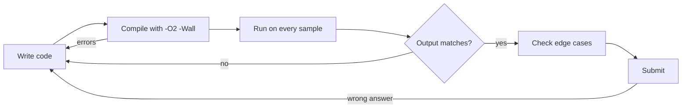
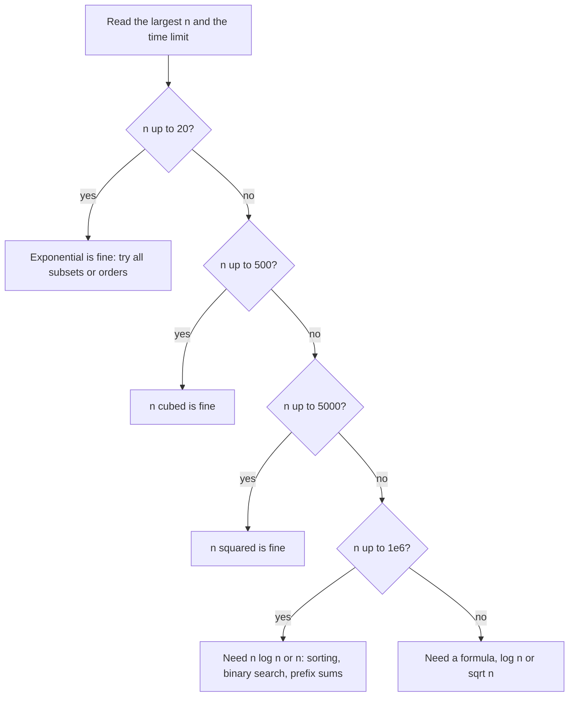

# Dzień 1 - Start: środowisko, szablon, złożoność i pierwsze zadania

> [!abstract] Cel dnia
> Po tym dniu: kompilujesz i uruchamiasz program w C++ z wejściem z pliku; masz szablon, od którego zaczynasz
> każde zadanie; z limitów w treści szacujesz, jakie rozwiązanie się zmieści; wiesz, kiedy potrzebny jest
> `long long`; rozwiązałeś trzy trywialne zadania z AMPPZ od początku do końca.
>
> - **Minimum (ok. 1 h):** sekcje 1-6, zadanie omówione 2024 A, ćwiczenie 2023 J.
> - **Pełna wersja (do 3 h):** wszystko, łącznie z 2024 K, quizem złożoności i czterema zadaniami z CSES.

## 1. Środowisko: cykl "napisz, skompiluj, sprawdź"

**Intuicja.** Na zawodach w kółko powtarzasz jeden cykl: piszesz kod, kompilujesz, uruchamiasz na przykładzie
z treści, porównujesz wynik, wysyłasz. Im mniej myślisz o narzędziach, tym więcej myślisz o zadaniu. Dziś
ustawiasz ten cykl tak, żeby działał bez zastanowienia.

**Instalacja kompilatora (Windows).** W PowerShellu:

```bash
winget install BrechtSanders.WinLibs.POSIX.UCRT
```

Zamknij i otwórz terminal na nowo, potem sprawdź `g++ --version` (powinno pokazać GCC). Na Linuksie: pakiet
`g++`; na macOS: `xcode-select --install`. Edytor dowolny (VS Code wystarczy). Na zawodach jest zwykle Linux
z gotowym g++; szczegóły środowiska AMPPZ 2026 dopiszę w taktyce, gdy potwierdzę je w regulaminie.

**Kompilacja.**

```bash
g++ -std=c++17 -O2 -Wall -Wextra -o a a.cpp
```

- `-std=c++17`: wersja języka; daje m.in. `auto [a, b] = para;`.
- `-O2`: optymalizacja, tak jak u sędziego; bez niej program bywa kilka razy wolniejszy.
- `-Wall -Wextra`: ostrzeżenia. Czytaj je: "unused variable" bywa śladem literówki, a "comparison of
  integer expressions of different signedness" przy `i < v.size()` jest zwykle niegroźne.
- `-o a`: nazwa programu wynikowego (na Windows powstaje `a.exe`).

**Uruchomienie z wejściem z pliku.** Zapisz przykład z treści do `in1.txt` i oczekiwany wynik do `out1.txt`.

```bash
./a < in1.txt
```

To działa w Git Bash i na Linuksie. PowerShell nie zna `<`; tam użyj `Get-Content in1.txt | .\a.exe`. Wynik
porównasz okiem albo poleceniem `diff <(./a < in1.txt) out1.txt` w Git Bash (brak wypisanych różnic oznacza
zgodność). Gdy treść mówi "wypisz dowolne poprawne rozwiązanie", wynik może się legalnie różnić od przykładu.



Jak czytać diagram: każda strzałka wstecz do "Write code" to powrót do poprawiania. Najważniejsze są dwie
bramki przed wysłaniem: zgodność ze wszystkimi przykładami i chwila na przypadki brzegowe. Każde błędne
zgłoszenie na zawodach kosztuje 20 minut kary (doliczanej, gdy zadanie w końcu zaliczysz), więc te dwie minuty
sprawdzania zwracają się z nawiązką.

## 2. Szablon

Każde zadanie zaczynasz od tego samego pliku: [szablon.cpp](../szablony/szablon.cpp).

```cpp
#include <bits/stdc++.h>
using namespace std;

typedef long long ll;

int main() {
    // fast input and output
    ios::sync_with_stdio(false);
    cin.tie(nullptr);

    // read input, solve, print answer

    return 0;
}
```

Linijka po linijce:

- `#include <bits/stdc++.h>`: nagłówek kompilatora GCC, który dołącza całą bibliotekę standardową (`vector`,
  `algorithm`, `map`...). Na zawodach oszczędza czas i nie trzeba pamiętać, gdzie co leży. Działa tylko z GCC,
  więc u sędziego (GCC) zawsze.
- `using namespace std;`: zamiast `std::vector` piszesz `vector`. W programie na zawody to w porządku.
- `typedef long long ll;`: krótka nazwa na typ 64-bitowy, którego będziesz używać ciągle (sekcja 5).
- `ios::sync_with_stdio(false); cin.tie(nullptr);`: domyślnie `cin` i `cout` są zsynchronizowane z funkcjami
  z C (`scanf`, `printf`) i `cin` opróżnia `cout` przed każdym wczytaniem. To bezpieczne, ale wolne: przy
  milionie liczb na wejściu potrafi zabrać sekundę. Te dwie linijki wyłączają oba mechanizmy. Konsekwencja:
  nie mieszaj potem `cin`/`cout` z `scanf`/`printf`.
- Koniec linii wypisuj przez `"\n"`, nie `endl`: `endl` dodatkowo opróżnia bufor, co przy dużym wyjściu
  spowalnia program.

## 3. Anatomia zadania AMPPZ

Otwórz `202X/2024/A/A.pdf` ([na GitHubie](../../202X/2024/A/A.pdf)). Każde zadanie ma te same części:

- **Nagłówek:** litera i tytuł, limit pamięci (w AMPPZ zwykle 1024 MB, czyli dużo), limit czasu (1-4 s).
- **Historia:** opowieść, w którą zawinięto zadanie. Często długa i w dużej części zbędna.
- **Wejście i Wyjście:** dokładny format i **ograniczenia** (np. 1 ≤ n ≤ 200). Najważniejsza część treści.
- **Przykład** i często **Wyjaśnienie przykładu.**

**Kolejność czytania** (nie od góry do dołu):

1. Wejście, Wyjście i limity: co dostaję, co mam wypisać, jak duże są dane.
2. Zdanie, które formalnie mówi, co policzyć (zwykle na końcu historii: "Sprawdź, czy...", "Znajdź...").
3. Przykład przeliczony ręcznie, z wyjaśnieniem.
4. Historia tylko wtedy, gdy czegoś brakuje.

Trzy rzeczy, które warto rozpoznawać od pierwszego dnia:

- **Wiele przypadków testowych:** "pierwszy wiersz zawiera t... suma n nie przekracza 4 · 10⁶". Złożoność liczysz
  względem tej sumy. Pułapka: czyszczenie w każdym teście tablicy o rozmiarze maksymalnym (t · max n operacji
  zamiast sumy n).
- **"Jeśli jest wiele rozwiązań, wypisz dowolne":** sędzia sprawdza poprawność programem, wolno wybrać
  najprostszą konstrukcję.
- **Litery nie mówią nic o trudności.** W AMPPZ tytuł zaczyna się od litery zadania (2024: Akronim, Bagaże,
  Cierpliwe krowy, ...), więc kolejność to alfabet, nie trudność. Które zadania są łatwe, widać na zawodach
  z rankingu (o tym w taktyce).

## 4. Złożoność obliczeniowa: limity mówią, czego szukać

**Intuicja.** Zanim wymyślisz rozwiązanie, możesz z limitów odczytać, jak szybkie musi być. To jak budżet
przed zakupami: wiesz, na co Cię stać, więc nie oglądasz rzeczy za drogich ani nie męczysz się szukaniem
taniej, gdy stać Cię na wszystko.

**Definicja.** Złożoność czasowa O(f(n)) mówi, że dla dużych n liczba operacji programu rośnie co najwyżej
proporcjonalnie do f(n). Stałe i mniejsze składniki pomijamy: 3n² + 5n + 7 to O(n²).

**Mechanizm.** Liczysz, ile razy wykona się najbardziej wewnętrzna pętla:

- jedna pętla do n: O(n); dwie zagnieżdżone: O(n²); trzy: O(n³);
- pętla, która za każdym razem dzieli zakres na pół: O(log n) (dla n = 10⁶ to tylko ok. 20 kroków);
- sortowanie: O(n log n); przegląd wszystkich podzbiorów: O(2ⁿ); wszystkich permutacji: O(n!).

Potem stosujesz regułę: **C++ wykonuje około 10⁸ prostych operacji na sekundę** (proste pętle nawet kilka razy
więcej, ale licz ostrożnie). Stąd tabela, którą warto znać na pamięć:

| Górna granica n | Złożoność, która się zmieści | Typowe rozwiązanie |
|---|---|---|
| ≤ 10-11 | O(n!) | wszystkie permutacje |
| ≤ 20-25 | O(2ⁿ · n) | wszystkie podzbiory, DP na maskach bitowych |
| ≤ 40 | O(2^(n/2)) | podział na dwie połowy (meet in the middle) |
| ≤ 300-500 | O(n³) | trzy pętle, Floyd-Warshall |
| ≤ 3000-5000 | O(n²) | dwie pętle, DP na parach |
| ≤ 10⁵-10⁶ | O(n log n) albo O(n) | sortowanie, wyszukiwanie binarne, struktury danych |
| ≤ 10¹² | O(√n) | dzielniki do pierwiastka |
| ≤ 10¹⁸ | O(log n) albo O(1) | wzór, szybkie potęgowanie |



Jak czytać diagram: idziesz od góry i zatrzymujesz się na pierwszym pasującym progu. Wynik to nie rozwiązanie,
tylko **kierunek**: jeśli wychodzi O(n log n), to szukasz sortowania, wyszukiwania binarnego albo struktury
danych, a pomysł z dwiema pętlami odrzucasz od razu. Jeśli wychodzi "wykładniczo", to nie szukasz sprytu,
tylko piszesz przegląd wszystkiego.

**Przykład.** W 2024 A n ≤ 200, a słowa mają do 8 liter: zmieści się wszystko wielomianowe. W 2023 J długość
napisu to najwyżej 50: zmieści się nawet O(n³). W 2024 E (Ekspresowe rotacje) n ≤ 500 000: potrzeba O(n log n).

**Pamięć.** Tablica `int` ma 4 bajty na element, `long long` 8. Milion `long long` to 8 MB, czyli nic przy
1024 MB. Problem zaczyna się dopiero przy tablicach dwuwymiarowych: `int t[10000][10000]` to 400 MB.

## 5. Typy liczbowe i przepełnienie

**Intuicja.** `int` to licznik w starym samochodzie: po przekroczeniu zakresu przekręca się na wartości ujemne,
nic nie mówiąc.

**Definicja.** `int` mieści liczby od -2 147 483 648 do 2 147 483 647 (około ±2,1 · 10⁹). `long long` mieści
około ±9,2 · 10¹⁸.

**Mechanizm.** Wynik działania na dwóch `int` jest `int`, nawet gdy przypisujesz go do `long long`:

```cpp
int a = 100000, b = 100000;
long long bad = a * b;        // overflow happens in int, before the assignment
long long good = 1LL * a * b; // 1LL makes the whole product long long
```

**Reguła na zawody:** wszystko, co jest sumą wielu liczb albo iloczynem dwóch dużych, trzymaj w `long long`.
Typowe przypadki: suma n liczb do 10⁹ (już dla n = 3 przekracza `int`), iloczyn dwóch liczb do 10⁵, wzór
n(n + 1)/2 dla n = 2 · 10⁵. Gdy nie masz pewności, `long long` nic nie kosztuje.

**Liczby rzeczywiste** (`double`) mają błędy zaokrągleń. Jeśli zadanie da się rozwiązać na liczbach
całkowitych, rób to na całkowitych (np. porównuj ułamki przez mnożenie na krzyż zamiast dzielenia).

## 6. Mini-protokół na zadanie trywialne

Pełny sposób myślenia przyjdzie w kolejnych dniach. Na start sześć kroków, które przerabiasz przy każdym
zadaniu, aż wejdą w nawyk:

1. **Jednym zdaniem:** co jest dane, co mam wypisać (własnymi słowami, bez historii).
2. **Limity:** jaka złożoność się zmieści (sekcja 4).
3. **Przykład ręcznie:** przelicz go sam, zanim pomyślisz o kodzie.
4. **Najprostszy pomysł, który mieści się w limitach.** Przy małych limitach to często przegląd wszystkiego.
5. **Przypadki brzegowe:** n = 1, wszystkie liczby równe, wartości maksymalne (przepełnienie), przypadek
   z odpowiedzią -1.
6. **Kod z szablonu, test na wszystkich przykładach, wysłanie.**

## 7. Zadania omówione

Przy każdym najpierw próbujesz sam (czas podany w notatce), potem czytasz podpowiedzi po jednej, na końcu
omówienie.

- **[AMPPZ 2024 A - Akronim](../zadania/2024/a-akronim.md)** (minimum): historia ukrywa jeden prosty warunek;
  przeformułowanie i "dowolna poprawna odpowiedź".
- **[AMPPZ 2024 K - Kwadracik](../zadania/2024/k-kwadracik.md)** (pełna wersja): zadanie na warunki
  z pułapką ukrytą w przykładzie z odpowiedzią -1.

## 8. Ćwiczenia

**AMPPZ (minimum):**

- **[AMPPZ 2023 J - Juliet Unifies Ones](../zadania/2023/j-juliet-unifies-ones.md):** sam, 20 minut, potem
  podpowiedzi. Treść jest po angielsku; to też trening, bo część zadań AMPPZ bywa tylko po angielsku.

**CSES (pełna wersja).** [CSES Problem Set](https://cses.fi/problemset/) to darmowy zbiór zadań z sędzią
online (trzeba założyć konto). Cztery zadania z działu Introductory Problems, każde ćwiczy coś z dzisiaj:

- **Weird Algorithm:** wypisz ciąg Collatza (parzyste dzielisz przez 2, nieparzyste zamieniasz na 3n + 1).
  Ćwiczy: wartości w ciągu wychodzą poza `int`.
- **Missing Number:** z liczb 1..n brakuje jednej, znajdź ją. Ćwiczy: sumę 1..n trzymasz w `long long`.
- **Repetitions:** najdłuższy fragment tego samego znaku w napisie długości do 10⁶. Ćwiczy: jeden przebieg
  z licznikiem, O(n).
- **Increasing Array:** najmniej operacji "zwiększ element o 1", żeby ciąg był niemalejący. Ćwiczy: wynik
  rzędu 10¹⁴, czyli `long long`.

> [!tip]- Podpowiedź do Missing Number
> Suma 1 + 2 + ... + n = n(n + 1)/2. Odejmij od niej sumę wczytanych liczb.

> [!tip]- Podpowiedź do Increasing Array
> Idź od lewej i pamiętaj największą wartość dotąd. Jeśli bieżący element jest mniejszy, trzeba go podnieść
> do tego maksimum; dodaj różnicę do wyniku.

**Quiz złożoności (pełna wersja).** Dla każdego zadania z archiwum odczytaj z limitów, jakiej złożoności
szukać. Odpowiedzi są zwinięte.

> [!question]- 2024 E Ekspresowe rotacje: n ≤ 500 000, limit 3 s
> O(n log n) albo O(n). Nawet O(n√n) to ok. 3,5 · 10⁸, czyli na granicy; O(n²) odpada.

> [!question]- 2023 G Game of Geniuses: plansza n × n, n ≤ 50
> Prawie dowolna: nawet O(n⁴) to 6,25 · 10⁶ operacji. Mały limit to sygnał, że trudność leży w pomyśle
> (tu: teoria gier), a nie w szybkości.

> [!question]- 2024 D Dodawanie ułamków: t ≤ 1000 testów, n ≤ 50 000, suma n ≤ 4 · 10⁶, limit 1 s
> Liniowo względem n w każdym teście (łącznie O(suma n), ewentualnie z logarytmem). Liczy się suma, nie
> t · max n.

> [!question]- 2023 F Fibonacci Fusion: do 200 000 liczb, każda do 2 milionów cyfr, łącznie do 5 · 10⁶ cyfr
> Prawie liniowo względem łącznej liczby cyfr. Ważniejsze: takie liczby nie mieszczą się w żadnym typie, więc
> trzeba je traktować jako napisy albo liczyć modulo (hashowanie). Ogromne liczby na wejściu to sygnał "nie
> licz dokładnie".

> [!question]- 2024 J Jedynki i zera: plansza h × w, ale h ≤ 8
> Jeden parametr jest malutki wśród dużych. To sygnał, że wolno coś wykładniczego względem h: 2⁸ = 256
> możliwości (np. które wiersze zanegować), a reszta liniowo względem w.

## 9. Fiszki

Pytanie po lewej, odpowiedź po prawej. Z wtyczką Spaced Repetition wejdą do powtórek same; bez niej zasłoń
prawą stronę.

Ile prostych operacji na sekundę zakładać w C++?::Około 10⁸; proste pętle bywają szybsze, ale licz ostrożnie.
Jakiej złożoności szukać przy n ≤ 20?::Wykładniczej: O(2ⁿ · n), przegląd wszystkich podzbiorów.
Jakiej złożoności szukać przy n ≤ 5000?::O(n²).
Jakiej złożoności szukać przy n ≤ 10⁵-10⁶?::O(n log n) albo O(n).
Jakiej złożoności szukać przy n ≤ 500?::O(n³).
Ile mieści int?::Około ±2,1 · 10⁹ (2³¹ - 1 = 2 147 483 647).
Dlaczego `long long c = a * b;` dla int a, b może dać zły wynik?::Mnożenie dzieje się w int i przepełnia się przed przypisaniem; pisz 1LL * a * b.
Co dają ios::sync_with_stdio(false) i cin.tie(nullptr)?::Szybkie wczytywanie i wypisywanie; potem nie wolno mieszać cin/cout z scanf/printf.
Dlaczego "\n" zamiast endl?::endl opróżnia bufor przy każdej linii, co spowalnia duże wyjście.
Co oznacza "suma n po wszystkich testach ≤ S"?::Złożoność liczysz względem S; nie czyść tablic maksymalnego rozmiaru w każdym teście.
Co mówi kolejność liter zadań w AMPPZ o trudności?::Nic: tytuły idą alfabetycznie z literami; łatwe zadania pokazuje ranking.
W jakiej kolejności czytać treść?::Wejście, Wyjście i limity; formalne zdanie zadania; przykład ręcznie; historia na końcu.
Co oznacza "wypisz dowolne poprawne rozwiązanie"?::Sędzia sprawdza programem; wybierz najprostszą konstrukcję, wynik nie musi być jak w przykładzie.
Co zrobić z przykładem, w którym odpowiedź to -1?::Rozebrać go: dlaczego tu się nie da? Często kryje pułapkę.
Mały parametr (np. h ≤ 8) wśród dużych sugeruje::Coś wykładniczego względem tego parametru (2⁸ = 256 możliwości), reszta liniowo.

## 10. Zamknięcie dnia

- [ ] `g++ --version` działa, umiem skompilować i uruchomić program z wejściem z pliku.
- [ ] Szablon zapisany u siebie, rozumiem każdą linijkę.
- [ ] 2024 A Akronim rozwiązane i porównane z omówieniem.
- [ ] 2023 J Juliet Unifies Ones rozwiązane samodzielnie.
- [ ] (pełna) 2024 K Kwadracik, quiz złożoności, 4 zadania z CSES.
- [ ] Dziennik błędów założony ([wzór](../dziennik/szablon-dziennika.md)), dzisiejsze błędy wpisane.
- [ ] Fiszki przejrzane raz na koniec dnia.

Następny dzień: C++ i STL w praktyce, implementacja i symulacja ([plan](../plan-20-dni.md)).
