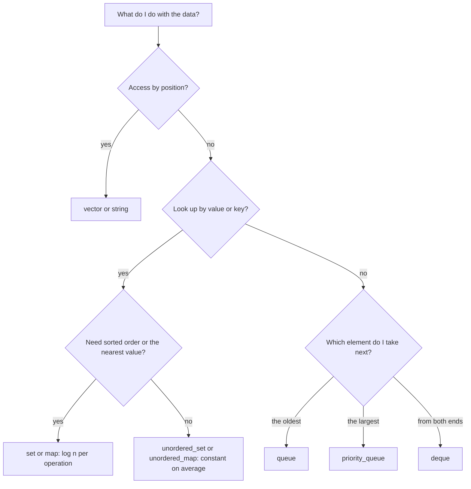
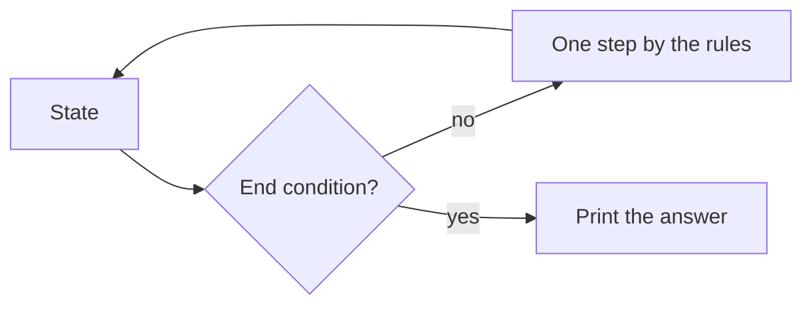
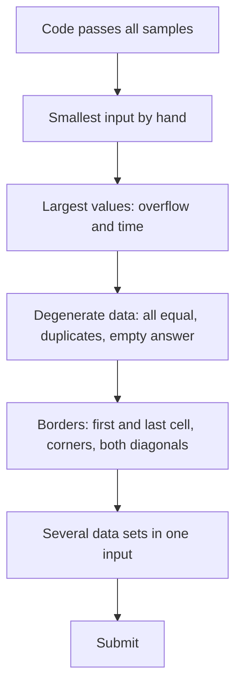

# Dzień 2 - C++ i STL w praktyce, implementacja i symulacja, przypadki brzegowe

> [!abstract] Cel dnia
> Po tym dniu: znasz kontenery i algorytmy STL, z których korzysta prawie każde zadanie, i wiesz, ile kosztuje każda
> operacja; wczytujesz napisy, plansze i wiele zestawów danych bez niespodzianek; piszesz symulację na planszy
> z tablicą kierunków; przed wysłaniem szukasz przypadków brzegowych według listy.
>
> - **Minimum (ok. 1 h):** sekcje 1, 3, 4 i 5 (sekcję 2 przejrzyj), zadanie omówione 2024 G, ćwiczenie 2021 H.
> - **Pełna wersja (do 3 h):** wszystko, łącznie z 2022 A, wyzwaniem 2022 K, polowaniem na przypadki brzegowe
>   i czterema zadaniami z CSES.

## 1. STL: kontenery

**Intuicja.** STL (Standard Template Library) to skrzynka z gotowymi narzędziami. Nie piszesz własnej tablicy, która
rośnie, ani własnego słownika: bierzesz gotowy, sprawdzony i szybki. Trzeba tylko wiedzieć, które narzędzie do czego
służy i ile kosztuje jego użycie, tak jak wiesz, że śrubokrętem nie wbija się gwoździ.

**Definicja.** Kontener to obiekt, który przechowuje elementy jednego typu i daje do nich operacje o znanym koszcie
(złożoności). Typ elementu podajesz w nawiasach ostrych: `vector<int>`, `map<string, int>`.

**Mechanizm.** Najczęstsze kontenery w jednym miejscu:

```cpp
vector<int> v(n);                                // n zeros
v.push_back(7);                                  // append at the end
vector<vector<int>> grid(h, vector<int>(w, 0));  // h x w table of zeros

string s = "ania";
s += 'x';                                        // "aniax"
string t = s.substr(1, 2);                       // "ni": 2 letters from position 1

pair<int, string> p = {3, "abc"};
auto [num, name] = p;                            // num = 3, name = "abc"

set<int> st;                                     // sorted, no duplicates
st.insert(5);
bool has = st.count(5);                          // 1 if present

map<string, int> cnt;                            // dictionary key -> value
cnt["ala"]++;                                    // a missing key starts at 0

unordered_map<long long, int> h;                 // like map, no order, faster on average

queue<int> q;                                    // first in, first out
q.push(1); int f = q.front(); q.pop();

priority_queue<int> pq;                          // the largest element on top
deque<int> d;                                    // push and pop at both ends
d.push_front(1); d.push_back(2);
```

| Kontener | Do czego | Koszt kluczowych operacji |
|---|---|---|
| `vector` | tablica o zmiennej długości | `v[i]` O(1), `push_back` O(1) zamortyzowane, wstawienie w środek O(n) |
| `string` | napis (tablica znaków) | jak `vector`; `substr` i porównanie O(długość) |
| `set`, `map` | posortowany zbiór, słownik | `insert`, `find`, `count`, `erase` O(log n); przegląd rosnąco |
| `multiset` | jak `set`, ale z powtórzeniami | O(log n) |
| `unordered_set`, `unordered_map` | zbiór, słownik bez porządku | O(1) średnio, w najgorszym razie O(n) |
| `queue` | kolejka (BFS, symulacja kolejki) | `push`, `pop`, `front` O(1) |
| `deque` | kolejka dwustronna | dodawanie i zdejmowanie z obu końców O(1) |
| `priority_queue` | kopiec: największy na wierzchu | `push`, `pop` O(log n), `top` O(1) |

"Zamortyzowane O(1)" znaczy: pojedyncze `push_back` czasem kosztuje więcej (wektor przenosi się do większej
pamięci), ale n wywołań razem kosztuje O(n).



Jak czytać diagram: zaczynasz od pytania, co robisz z danymi najczęściej, i schodzisz w dół. Dostęp po numerze to
`vector`; szukanie po wartości to rodzina `set` i `map` (posortowana, gdy potrzebny porządek albo "najbliższa
wartość", bez porządku, gdy liczy się tylko szybkość); a gdy zabierasz elementy w ustalonej kolejności, wybierasz
kolejkę według tego, który element ma wyjść jako następny.

**Przykład.** W [2022 A Aliasy](../zadania/2022/a-aliasy.md) trzeba policzyć największą grupę równych kluczy: albo
`map<long long, int>` z licznikami, albo `vector` + `sort` i jeden przebieg po równych sąsiadach. W
[2024 G Gra MPO](../zadania/2024/g-gra-mpo.md) plansza to `vector<string>`, a wersja optymalna używa `queue`.

## 2. STL: algorytmy i pułapki

**Intuicja.** Algorytmy STL to gotowe czynności na całym kontenerze naraz: posortuj, odwróć, znajdź największy.
Działają na zakresie od `begin()` do `end()` (iteratory to "wskaźniki" na początek i na miejsce za końcem).

```cpp
sort(v.begin(), v.end());                        // ascending, O(n log n)
sort(v.rbegin(), v.rend());                      // descending
sort(a.begin(), a.end(), [](const pair<int, int>& x, const pair<int, int>& y) {
    return x.second < y.second;                  // by the second element
});
v.erase(unique(v.begin(), v.end()), v.end());    // after sort: remove duplicates
reverse(v.begin(), v.end());
int mx = *max_element(v.begin(), v.end());
long long sum = accumulate(v.begin(), v.end(), 0LL);  // 0LL, not 0
```

Pułapki, które kosztują zgłoszenia:

- **`v.size()` jest bez znaku.** Dla pustego wektora `v.size() - 1` to ogromna liczba, a pętla
  `for (int i = 0; i < v.size() - 1; i++)` wychodzi poza tablicę. Pisz `i + 1 < v.size()` albo `(int)v.size() - 1`.
- **Komparator musi być ścisły:** `<`, nigdy `<=`. Przy `<=` i równych elementach `sort` potrafi wywrócić program.
- **`accumulate(..., 0)` sumuje w `int`** i przepełnia się; zaczynaj od `0LL`.
- **`m[key]` dla brakującego klucza wstawia go** z wartością 0. Samo sprawdzenie to `m.count(key)` albo
  `m.find(key) != m.end()`.
- **`multiset::erase(x)` usuwa wszystkie kopie x.** Jedną kopię usuwa `ms.erase(ms.find(x))`.
- **`priority_queue` daje największy.** Najmniejszy na wierzchu: `priority_queue<int, vector<int>, greater<int>>`.
- **Pary porównują się leksykograficznie:** najpierw pierwszy element, przy remisie drugi. Dlatego `sort` wektora
  par sortuje po pierwszym, a potem po drugim, bez pisania komparatora.

## 3. Wczytywanie danych

- `cin >> x` pomija spacje i końce linii; `cin >> s` czyta jedno słowo (do spacji albo końca linii).
- **Plansza** bez spacji w wierszach: `vector<string> g(n); for (auto& row : g) cin >> row;`. Pole to `g[r][c]`:
  wiersz r od góry, kolumna c od lewej, obie numerowane od 0.
- **Cała linia ze spacjami:** `getline(cin, line)`. Pułapka: po `cin >> n` w buforze zostaje znak końca linii, więc
  pierwsze `getline` zwraca pusty napis. Pomaga `getline(cin >> ws, line)` (`ws` zjada białe znaki).
- **Wiele zestawów danych** (`z` na początku): wszystko, co zależy od zestawu, deklaruj w środku pętli
  `while (z--) { ... }` albo czyść na początku zestawu. Nie czyść tablic maksymalnego rozmiaru (Dzień 1).
- **Do końca wejścia:** `while (cin >> x) { ... }`.
- **Znaki jako liczby:** `c - 'a'` daje numer litery od 0 do 25, `char('a' + k)` literę o numerze k, `c - '0'`
  wartość cyfry; przydają się `isdigit`, `isupper`, `toupper`, `tolower`. Tak działa całe
  [2021 H Hasła](../zadania/2021/h-hasla.md).

## 4. Implementacja i symulacja

**Intuicja.** Część zadań nie wymaga pomysłu: treść opisuje proces krok po kroku, a Ty masz go wykonać w komputerze,
jak sędzia, który odtwarza partię z zapisu. Trudność leży w dokładności: każdy szczegół treści to jedna linijka kodu,
a pominięty szczegół to błędna odpowiedź.

**Definicja.** Symulacja to program, który trzyma **stan** (plansza, pozycje, czas), wykonuje **krok** według reguł
z treści i kończy po spełnieniu **warunku końca**. Zadanie implementacyjne to takie, w którym droga do rozwiązania
jest oczywista, ale ma wiele szczegółów do dopilnowania.

**Mechanizm.**

1. Wypisz z treści trzy rzeczy: co jest stanem, czym jest jeden krok, kiedy koniec.
2. Policz koszt: liczba kroków × koszt jednego kroku. Jeśli mieści się w budżecie (ok. 10⁸ operacji na sekundę,
   Dzień 1), symuluj dosłownie. Jeśli nie, szukasz skrótu: proces, w którym wynik nie zależy od kolejności, cykl
   stanów, przeskok wielu kroków naraz (to wraca w dalszych dniach).
3. Na planszy używaj tablicy kierunków i jednej funkcji sprawdzającej granice:

```cpp
// 4 neighbours (sides) and 8 neighbours (sides and corners)
const int dr4[4] = {-1, 1, 0, 0}, dc4[4] = {0, 0, -1, 1};
const int dr8[8] = {-1, -1, -1, 0, 0, 1, 1, 1};
const int dc8[8] = {-1, 0, 1, -1, 1, -1, 0, 1};

bool inside(int r, int c) { return r >= 0 && r < n && c >= 0 && c < m; }

for (int d = 0; d < 8; d++) {
    int nr = r + dr8[d], nc = c + dc8[d];
    if (!inside(nr, nc)) continue;               // check before reading g[nr][nc]
    // use g[nr][nc]
}
```

4. Pary sąsiadów licz raz: albo tylko "w przód" (4 z 8 kierunków: prawo, dół, dwa skosy w dół), albo z obu stron
   i wtedy podziel licznik przez 2.
5. Kierunki z treści ("północ", "w górę") ustal raz na początku: wiersz 0 jest na górze, więc północ to `r - 1`.



Jak czytać diagram: program krąży między stanem a krokiem, dopóki nie zajdzie warunek końca. Przed pisaniem kodu
musisz umieć nazwać wszystkie trzy elementy; jeśli któregoś nie umiesz nazwać, nie zrozumiałeś jeszcze treści.

**Przykład.** W [2024 G Gra MPO](../zadania/2024/g-gra-mpo.md) stan to plansza, krok to najlepszy ruch, a koniec to
brak ruchu za co najmniej 2 punkty. Kroków jest najwyżej 100, krok kosztuje ok. 800 operacji, więc symulujemy wprost.

## 5. Przypadki brzegowe

**Intuicja.** Testy autorów to w dużej części skrajności, bo tam padają rozwiązania. Kod, który przechodzi przykład,
często nie przechodzi n = 1. Przypadki brzegowe są jak skrzynie biegów w samochodzie: na prostej drodze nie widać,
czy działają, wychodzi to dopiero na zakrętach.

**Definicja.** Przypadek brzegowy to dane na granicy dozwolonego zakresu albo o nietypowej budowie (najmniejsze,
największe, wszystkie równe, puste, zdegenerowane), dla których ogólne rozumowanie przestaje działać albo kod
wychodzi poza tablicę lub poza zakres typu.

**Mechanizm: lista do przejrzenia przed wysłaniem.**

- **Rozmiary:** najmniejsze dozwolone n (często 1), największe n (czas, pamięć), skrajne parametry (k = 1, k = n).
- **Wartości:** 0; wartości maksymalne (sumy i iloczyny w `long long`); liczby ujemne (w C++ dzielenie zaokrągla do
  zera: `-7 / 2 == -3` i `-7 % 2 == -1`); wszystkie liczby równe.
- **Budowa danych:** odpowiedź pusta, `-1` albo `NIE`; remisy; powtórzenia (dwie identyczne osoby w 2022 A);
  najkrótsze napisy (jedna litera).
- **Plansza:** pola przy krawędzi i w rogach, oba skosy (2022 K), zawijanie wiersza (2024 K z Dnia 1).
- **Wiele zestawów:** stan przeciekający z poprzedniego zestawu.
- **Format:** dowolna poprawna odpowiedź zamiast przykładowej; `TAK` i `NIE` dokładnie tak, jak w treści.



Jak czytać diagram: to kolejność sprawdzania po tym, jak program przechodzi przykłady. Każdy krok to jeden albo dwa
własne testy wpisane ręcznie, razem kilka minut. Przy 20 minutach kary za błędne zgłoszenie to się zawsze opłaca.

**Przykład.** Przykład z [2022 K Kółko i Krzyżyk](../zadania/2022/k-kolko-i-krzyzyk.md) ma siedem plansz, z czego
cztery z odpowiedzią `NIE`, każda z innego powodu. Gdy treść daje taki zestaw, to gotowa lista przypadków
brzegowych: Twój program musi rozumieć każdy z nich.

## 6. Zadania omówione

Przy każdym najpierw próbujesz sam (czas podany w notatce), potem czytasz podpowiedzi po jednej, na końcu omówienie.

- **[AMPPZ 2024 G - Gra MPO](../zadania/2024/g-gra-mpo.md)** (minimum): symulacja na planszy z tablicą 8 kierunków;
  w omówieniu też wersja optymalna i dlaczego kolejność ruchów nie zmienia wyniku.
- **[AMPPZ 2022 A - Aliasy](../zadania/2022/a-aliasy.md)** (pełna wersja): grupowanie przez sortowanie i obserwacja
  z limitów, która zamienia zadanie pozornie trudne w 28 przypadków.

## 7. Ćwiczenia

**AMPPZ:**

- **[AMPPZ 2021 H - Hasła](../zadania/2021/h-hasla.md)** (minimum): sam, 15 minut. Zanim napiszesz kod, ustal,
  kiedy odpowiedzią jest `NIE`.
- **[AMPPZ 2022 K - Kółko i Krzyżyk](../zadania/2022/k-kolko-i-krzyzyk.md)** (pełna, wyzwanie): sam, 40-60 minut.
  Rozwiązało je 27 z 50 drużyn, więc to już zadanie średnie; jego trudność to wyłącznie przypadki brzegowe.

> [!info] Gdzie wysłać zadania AMPPZ
> Zadania AMPPZ z lat 2011-2025 są na sędzi QOJ: https://qoj.ac/category/194 (po angielsku, potrzebne konto; listę
> znalazłem przez wyszukiwarkę, stronę sprawdzisz przy zakładaniu konta). Do zadań z 2021 organizatorzy udostępniają
> oficjalne testy i rozwiązania wzorcowe: https://amppz.tcs.uj.edu.pl/2021/data.html.

**Polowanie na przypadki brzegowe (pełna wersja).** Dla każdego opisu znajdź przypadek, który psuje proste
rozwiązanie. Odpowiedzi są zwinięte.

> [!question]- 2022 C Ctrl+C Ctrl+V: zmień najmniej liter, żeby w słowie nie było fragmentu `ania`.
> Wystąpienia mogą na siebie zachodzić: w `aniania` są dwa (od pierwszej i od czwartej litery) i dzielą środkowe
> `a`. Zmiana tej jednej litery usuwa oba, więc odpowiedź to 1, a nie 2. Policzenie wystąpień nie wystarcza.
> Zadanie wróci przy algorytmach zachłannych (Dzień 3).

> [!question]- Suma n liczb, n ≤ 2 · 10⁵, każda liczba do 10⁹.
> Wynik do 2 · 10¹⁴ nie mieści się w `int`. Suma w `long long`, a przy `accumulate` start od `0LL`.

> [!question]- Ostatni element wektora: `v[v.size() - 1]`.
> Dla pustego wektora `v.size() - 1` to ogromna liczba bez znaku i odczyt poza tablicą. Najpierw sprawdź, czy wektor
> nie jest pusty.

> [!question]- 2022 A Aliasy: grupujesz osoby po parze (prefiks imienia, prefiks nazwiska).
> Dwie różne pary mogą dać ten sam napis: "a" + "bc" i "ab" + "c" to oba `abc`. Grupuj po całym doklejonym napisie.

**CSES (pełna wersja).** Cztery zadania z działu Sorting and Searching, każde ćwiczy inny kontener:

- **[Distinct Numbers](https://cses.fi/problemset/task/1621):** ile różnych wartości jest wśród n liczb.
  Ćwiczy: `set` albo `sort` + liczenie zmian.
- **[Josephus Problem I](https://cses.fi/problemset/task/2162):** dzieci w kółku, co drugie odpada; wypisz kolejność
  odpadania. Ćwiczy: symulację na `queue`.
- **[Concert Tickets](https://cses.fi/problemset/task/1091):** każdy klient bierze najdroższy bilet nie droższy niż
  jego limit. Ćwiczy: `multiset` i usuwanie jednej kopii.
- **[Room Allocation](https://cses.fi/problemset/task/1164)** (najtrudniejsze): najmniej pokoi dla gości z datami
  przyjazdu i wyjazdu. Ćwiczy: `sort` z zapamiętanym numerem i `priority_queue` z najmniejszym na wierzchu.

> [!tip]- Podpowiedź do Josephus Problem I
> Wrzuć 1..n do kolejki. W pętli: zdejmij dziecko z przodu i wrzuć je na koniec (to jest pominięte), potem zdejmij
> następne i wypisz je (to odpada). Każde dziecko przechodzi przez kolejkę O(1) razy na rundę, razem O(n).

> [!tip]- Podpowiedź do Concert Tickets
> Ceny w `multiset`. Dla limitu x: `auto it = ms.upper_bound(x);` daje pierwszy bilet droższy niż x. Jeśli
> `it == ms.begin()`, nie ma biletu (wypisz -1); w przeciwnym razie cofnij się `--it`, wypisz `*it` i usuń tę jedną
> kopię `ms.erase(it)`.

> [!tip]- Podpowiedź do Room Allocation
> Posortuj gości po dniu przyjazdu, pamiętając ich numery z wejścia. Trzymaj kopiec par (dzień wyjazdu, numer
> pokoju) z najmniejszym wyjazdem na wierzchu. Gość może wejść do pokoju z wierzchu, gdy wyjazd poprzedniego jest
> wcześniejszy niż jego przyjazd; inaczej otwierasz nowy pokój.

## 8. Fiszki

Pytanie po lewej, odpowiedź po prawej. Z wtyczką Spaced Repetition wejdą do powtórek same; bez niej zasłoń prawą
stronę.

Ile kosztują insert, find i erase w set i map?::O(log n); elementy są trzymane posortowane.
Czym różni się unordered_map od map?::Brak porządku, operacje O(1) średnio zamiast O(log n).
Co robi m[key] dla klucza, którego nie ma w map?::Wstawia go z wartością domyślną (0); samo sprawdzenie to m.count(key).
Jak usunąć jedną kopię x z multiset?::ms.erase(ms.find(x)); ms.erase(x) usuwa wszystkie kopie.
Który element jest na wierzchu priority_queue<int>?::Największy; najmniejszy daje priority_queue<int, vector<int>, greater<int>>.
Dlaczego v.size() - 1 bywa groźne?::size() jest bez znaku; dla pustego wektora wynik to ogromna liczba.
Jaki komparator wolno dać do sort?::Ścisły (<); przy <= sort może wywrócić program.
Jak zacząć accumulate, żeby nie przepełnić sumy?::Od 0LL, bo 0 oznacza sumowanie w int.
Jak usunąć powtórzenia z wektora?::sort, potem v.erase(unique(v.begin(), v.end()), v.end()).
Jak wczytać całą linię ze spacjami po cin >> n?::getline(cin >> ws, line), bo po cin >> n zostaje znak końca linii.
Jakie trzy rzeczy wypisać przed pisaniem symulacji?::Stan, jeden krok, warunek końca; potem koszt: kroki × koszt kroku.
Jak przejść po 8 sąsiadach pola?::Tablice dr i dc z 8 przesunięciami i sprawdzenie inside(nr, nc) przed odczytem.
Jak policzyć każdą parę sąsiadów raz?::Tylko w 4 kierunkach "w przód" albo we wszystkich i podzielić przez 2.
Ile wynosi -7 / 2 i -7 % 2 w C++?::-3 i -1: dzielenie zaokrągla do zera.
Proces, w którym rzeczy tylko się dokłada, a nic nie znika::Zwykle kończy się tym samym stanem przy każdej kolejności; licz domknięcie kolejką.
Jak ograniczyć przeszukiwanie odpowiedzi?::Znajdź proste rozwiązanie, które zawsze działa (koszt X); optimum jest wśród tańszych od X.
Treść przewiduje odpowiedź NIE. Co sprawdzić najpierw?::Czy taki przypadek w ogóle istnieje (2021 H: nigdy).

## 9. Zamknięcie dnia

- [ ] Umiem dobrać kontener do zadania i podać koszt jego operacji.
- [ ] 2024 G Gra MPO rozwiązane i porównane z omówieniem (także wersja z kolejką).
- [ ] 2021 H Hasła rozwiązane samodzielnie.
- [ ] Przed każdym wysłaniem przeszedłem listę przypadków brzegowych z sekcji 5.
- [ ] (pełna) 2022 A Aliasy, 2022 K Kółko i Krzyżyk, polowanie na przypadki brzegowe, 4 zadania z CSES.
- [ ] Dzisiejsze błędy wpisane do dziennika ([wzór](../dziennik/szablon-dziennika.md)).
- [ ] Fiszki z Dnia 1 i Dnia 2 przejrzane.

Następny dzień: sortowanie i algorytmy zachłanne, dowód przez zamianę ([plan](../plan-20-dni.md)).
