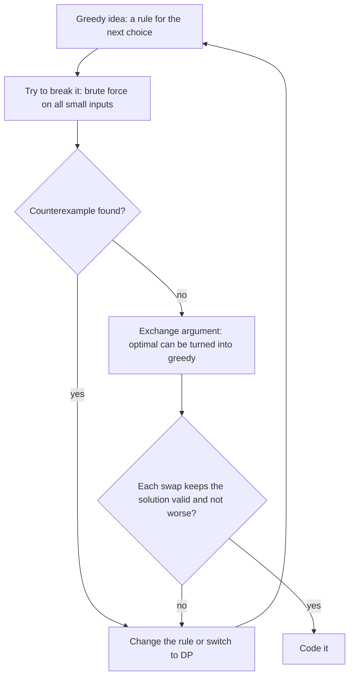

# Dzień 3 - Sortowanie i algorytmy zachłanne, dowód przez zamianę

> [!abstract] Cel dnia
> Po tym dniu: sortujesz wszystko, co trzeba (pary, struktury, z zapamiętanym numerem z wejścia, po własnym
> kluczu); rozpoznajesz zadanie zachłanne i znasz cztery najczęstsze schematy (najwcześniejszy koniec, najwcześniejszy
> termin, przebicie przedziałów, największy dostępny element); umiesz uzasadnić zachłanny wybór argumentem zamiany
> albo skrajnego elementu, a gdy nie umiesz, szukasz kontrprzykładu na małych danych.
>
> - **Minimum (ok. 1 h):** sekcje 1-3, zadanie omówione 2014 A, ćwiczenie 2022 C.
> - **Pełna wersja (do 3 h):** wszystko, łącznie z 2012 J, ćwiczeniami 2019 C i 2017 M (bez etykiety), wyzwaniem
>   2019 A, polowaniem na kontrprzykłady i zadaniami z CSES.

Na start 10 minut powtórki: fiszki z Dnia 1 i Dnia 2 oraz Twój dziennik błędów.

## 1. Sortowanie w praktyce

**Intuicja.** Wiele zadań jest trudnych tylko dlatego, że dane przychodzą w przypadkowej kolejności. Po posortowaniu
rzeczy podobne stoją obok siebie, najmniejszy jest na początku, największy na końcu, a odpowiedź często widać w jednym
przebiegu od lewej do prawej. Sortowanie to jak ułożenie kart w ręce przed rozgrywką: samo w sobie nic nie wygrywa,
ale dopiero potem widać, co masz.

**Definicja.** Sortowanie ustawia elementy rosnąco według **porządku**, czyli reguły "a idzie przed b". W C++ porządek
podajesz komparatorem: funkcją `less(a, b)`, która zwraca `true`, gdy a ma stać przed b. Komparator musi być ścisły
(`<`, nigdy `<=`, Dzień 2). `sort` działa w O(n log n) i nie zachowuje kolejności równych elementów; `stable_sort`
ją zachowuje.

**Mechanizm.** Pięć sytuacji, które pokrywają prawie wszystkie zadania:

```cpp
// 1. pairs sort by first, then by second
vector<pair<int, int>> v;                 // (deadline, duration)
sort(v.begin(), v.end());

// 2. remember the input index: sort indices, not values
vector<int> idx(n);
iota(idx.begin(), idx.end(), 0);          // 0, 1, ..., n-1
sort(idx.begin(), idx.end(), [&](int i, int j) { return a[i] < a[j]; });

// 3. own key in a struct
struct Meeting { int start, end, id; };
sort(m.begin(), m.end(), [](const Meeting& x, const Meeting& y) {
    if (x.end != y.end) return x.end < y.end;   // earliest end first
    return x.start < y.start;                   // tie: earlier start
});

// 4. descending
sort(v.rbegin(), v.rend());

// 5. counting sort: small values (here up to 100) need no sort at all
vector<int> cnt(101, 0);
for (int x : a) cnt[x]++;
```

Po sortowaniu najczęstsze ruchy to: przebieg z porównaniem sąsiadów (grupowanie równych, Dzień 2), przebieg z
bieżącą sumą albo bieżącym minimum, dwa wskaźniki (Dzień 4) i wyszukiwanie binarne (Dzień 5).

**Przykład.** Pary `(3, 1), (1, 5), (3, 0)` po `sort` to `(1, 5), (3, 0), (3, 1)`: najpierw pierwszy element,
przy remisie drugi. Gdy musisz wypisać numery z wejścia, a sortujesz po wartości, sortuj indeksy (sposób 2) albo
dołóż numer do pary.

> [!tip] Czy na pewno trzeba sortować?
> Sortowanie kosztuje O(n log n). Gdy potrzebujesz tylko minimum i maksimum, wystarcza jeden przebieg O(n), a gdy
> wartości są małe (do 10⁶), zliczanie. W [2014 A Adwokat](../zadania/2014/a-adwokat.md) całe zadanie sprowadza się
> do minimum i maksimum.

## 2. Algorytm zachłanny

**Intuicja.** Zachłanny algorytm podejmuje decyzje po kolei i za każdym razem bierze to, co w tej chwili wygląda
najlepiej, nigdy nie wracając do decyzji. Jak kasjer, który wydaje resztę zawsze największą monetą, jaka się mieści.
Przy polskich monetach to działa. Przy monetach 1, 3 i 4 i reszcie 6 kasjer wyda 4 + 1 + 1 (trzy monety), a wystarczą
3 + 3. Zachłanność jest więc szybka i prosta, ale **nie zawsze poprawna**, i cała sztuka polega na tym, żeby wiedzieć,
kiedy wolno.

**Definicja.** Algorytm zachłanny buduje rozwiązanie krok po kroku według stałej reguły wyboru (np. "weź spotkanie,
które kończy się najwcześniej") i nie cofa wyborów. Jest poprawny, gdy po każdym kroku istnieje rozwiązanie
optymalne, które zawiera wszystkie dotychczasowe wybory.

**Mechanizm: jak sprawdzić, czy wolno.** Trzy argumenty, od najczęstszego:

1. **Argument zamiany.** Weź dowolne rozwiązanie optymalne, które różni się od zachłannego. Znajdź pierwsze miejsce,
   w którym się różnią, i pokaż, że zamiana elementu z optymalnego na element zachłanny nie psuje rozwiązania.
   Powtarzając zamiany, przerobisz optymalne na zachłanne bez straty, więc zachłanne też jest optymalne.
2. **Skrajny element.** Pokaż, że jeśli jakiekolwiek rozwiązanie istnieje, to istnieje też takie zbudowane
   z elementów skrajnych (najmniejszego, największego, najwcześniej kończącego się).
3. **Zachłanny jest zawsze krok przed.** Pokaż przez indukcję, że po k krokach zachłanny ma co najmniej tyle (zasobów,
   wybranych elementów, czasu w zapasie), co dowolne inne rozwiązanie po k krokach.



Jak czytać diagram: pomysł zachłanny to hipoteza. Najpierw próbujesz go obalić, bo kontrprzykład znajduje się
szybciej niż dowód: brute force na wszystkich małych danych (Dzień 5 zrobi z tego narzędzie, na razie wystarczy kartka).
Gdy kontrprzykładu nie ma, szukasz argumentu zamiany. Na zawodach wystarcza przekonanie na poziomie szkicu; kiedy
szkic się nie składa, to sygnał, że reguła jest zła albo zadanie wymaga programowania dynamicznego (Dzień 10).

**Przykład.** Spotkania na jednej sali, chcesz zmieścić jak najwięcej. Reguła "najkrótsze najpierw" pada na
przykładzie `[1, 5], [4, 7], [6, 10]`: najkrótsze `[4, 7]` blokuje oba pozostałe, a `[1, 5]` i `[6, 10]` to dwa
spotkania. Reguła "najwcześniej kończące się najpierw" jest poprawna: zamiana pierwszego spotkania dowolnego
rozwiązania optymalnego na to, które kończy się najwcześniej, nie tworzy kolizji, bo kończy się ono nie później.

## 3. Cztery schematy zachłanne, które wracają w AMPPZ

| Schemat | Sygnał w treści | Reguła | Zadanie z archiwum |
|---|---|---|---|
| Najwcześniejszy koniec | najwięcej rozłącznych przedziałów, "nie nachodzą na siebie" | sortuj po końcu, bierz, co się mieści | 2014 A Adwokat (wersja skrajnych elementów) |
| Najwcześniejszy termin | terminy, "zdąży", "przed upływem" | sortuj po terminie, wykonuj w tej kolejności | 2012 J Jutro |
| Przebicie przedziałów | najmniej punktów (zmian), które trafią w każdy przedział | bierz prawy koniec pierwszego nietrafionego | 2022 C Ctrl+C Ctrl+V |
| Największy dostępny | zasób rośnie po każdym wyborze, "najmniej operacji" | kolejka priorytetowa dostępnych, bierz największy | 2019 A Asymilacja |

Do tego dochodzi schemat "usuń skrajny element, który na pewno nie może być w rozwiązaniu" (2019 C Koło (z)
Matematyków): to argument skrajnego elementu w drugą stronę.

**Najwcześniejszy termin (Jutro) w kodzie:**

```cpp
sort(tasks.begin(), tasks.end());              // (deadline, duration), earliest deadline first
ll start = LLONG_MAX;
for (int i = n - 1; i >= 0; i--)               // plan backwards from the latest deadline
    start = min(start, tasks[i].first) - tasks[i].second;
```

**Największy dostępny (Asymilacja) w kodzie:**

```cpp
sort(a.begin(), a.end());
priority_queue<ll> avail;                      // the largest affordable on top
while (have < need) {
    while (next < n && a[next] <= have) avail.push(a[next++]);
    if (avail.empty()) break;                  // stuck: answer -1
    have += avail.top(); avail.pop(); steps++;
}
```

## 4. Zadania omówione

Przy każdym najpierw sam, z zegarkiem (czas w notatce), potem podpowiedzi po jednej, na końcu omówienie.

- **[AMPPZ 2014 A - Adwokat](../zadania/2014/a-adwokat.md)** (minimum, 52 z 57 drużyn): dwa rozłączne spotkania
  w każdym dniu; skrajne elementy zamiast sortowania, O(n).
- **[AMPPZ 2012 J - Jutro](../zadania/2012/j-jutro.md)** (pełna, 50 z 54 drużyn): jak długo można zwlekać przy
  terminach; sortowanie po terminie i pełny argument zamiany.

## 5. Ćwiczenia

**AMPPZ z tematu dnia:**

- **[AMPPZ 2022 C - Ctrl+C Ctrl+V](../zadania/2022/c-ctrl-c-ctrl-v.md)** (minimum, 15 minut, 49 z 50 drużyn): najmniej
  zmian liter, żeby w słowie nie było `ania`. Przypomnij sobie polowanie na przypadki brzegowe z Dnia 2.
- **[AMPPZ 2019 C - Koło (z) Matematyków](../zadania/2019/c-kolo-z-matematykow.md)** (pełna, 20 minut, 42 z 46
  drużyn): największy obwód wielokąta z wybranych odcinków.
- **[AMPPZ 2019 A - Asymilacja](../zadania/2019/a-asymilacja.md)** (pełna, wyzwanie, 40 minut, 34 z 46 drużyn):
  najmniej mobilizacji planet. Zanim zaczniesz, policz, ile statków netto daje jedna mobilizacja.

**Zadanie bez etykiety** (od dziś w każdym dniu jedno; technika z wcześniejszego dnia, rozpoznaj ją sam):

- **[AMPPZ 2017 M - Maksymalna piaskownica](../zadania/2017/m-maksymalna-piaskownica.md)** (pełna, 15 minut, 43 z 44
  drużyn). Treść: `201X/2017/M/M.pdf` ([PDF](../../201X/2017/M/M.pdf)). Notatkę otwórz dopiero po swojej próbie, bo jej
  karta zdradza technikę.

**Polowanie na kontrprzykłady (pełna wersja).** Każda reguła poniżej jest błędna. Znajdź dane, na których daje zły
wynik, zanim rozwiniesz odpowiedź.

> [!question]- Jutro: wykonuj zadania od najkrótszego.
> Zadania (czas 1, termin 100) i (czas 5, termin 5). Od najkrótszego: drugie skończy się w dniu 6, za późno nawet przy
> starcie od razu. Po terminie: (5, 5), potem (1, 100), start od razu działa.

> [!question]- Jutro: wykonuj zadania od najmniejszego zapasu (termin minus czas).
> Zadania A (czas 1, termin 5, zapas 4) i B (czas 4, termin 6, zapas 2). Po zapasie: B, potem A, można zwlekać 0 dni.
> Po terminie: A, potem B, można zwlekać 1 dzień.

> [!question]- Najwięcej rozłącznych spotkań: bierz to, które zaczyna się najwcześniej.
> `[1, 10], [2, 3], [4, 5]`: najwcześniejsze `[1, 10]` blokuje dwa pozostałe, które razem dają 2.

> [!question]- Asymilacja: mobilizuj najmniejszą planetę, na którą Cię stać.
> 10 statków, planety 1, 10 i 19. Mobilizacja planety o m mieszkańcach daje netto +m statków, a koniec następuje, gdy
> statków jest co najmniej tyle, ile mieszkańców na planetach jeszcze niezmobilizowanych. Najmniejsza: planeta 1
> (11 statków, zostaje 10 + 19 = 29), potem 10 (21 statków, zostaje 19), czyli 2 mobilizacje. Największa dostępna:
> planeta 10 (20 statków, zostaje 1 + 19 = 20), czyli 1 mobilizacja.

> [!question]- Monety 1, 3, 4: wydawaj resztę zawsze największą monetą.
> Reszta 6: zachłannie 4 + 1 + 1, optymalnie 3 + 3. Przy monetach, które nie są "kanoniczne", reszta to zadanie na
> programowanie dynamiczne (Dzień 10).

**CSES (pełna wersja).** Dział Sorting and Searching:

- **[Apartments](https://cses.fi/problemset/task/1084):** dopasuj jak najwięcej osób do mieszkań w tolerancji k.
  Sortowanie obu list i dwa przebiegi naraz.
- **[Movie Festival](https://cses.fi/problemset/task/1629):** najwięcej filmów bez nakładania. Najwcześniejszy koniec.
- **[Tasks and Deadlines](https://cses.fi/problemset/task/1630):** nagroda to termin minus moment ukończenia. Którą
  kolejność wybrać i dlaczego terminy w ogóle nie mają tu znaczenia?
- **[Stick Lengths](https://cses.fi/problemset/task/1074):** wyrównaj patyki najmniejszym kosztem. Mediana.
- **[Missing Coin Sum](https://cses.fi/problemset/task/2183)** (najtrudniejsze): najmniejsza suma, której nie da się
  złożyć z monet. Sortuj rosnąco i pilnuj, do jakiej sumy umiesz złożyć wszystko.

> [!tip]- Podpowiedź do Tasks and Deadlines
> Suma nagród to suma terminów minus suma momentów ukończenia. Pierwszy składnik nie zależy od kolejności, więc
> minimalizujesz sumę momentów ukończenia: od najkrótszego zadania (argument zamiany dla sąsiednich zadań).

> [!tip]- Podpowiedź do Missing Coin Sum
> Jeśli z pierwszych monet umiesz złożyć każdą sumę od 1 do s, a następna moneta ma wartość c ≤ s + 1, to umiesz
> złożyć każdą sumę do s + c. Gdy c > s + 1, suma s + 1 jest nieosiągalna.

## 6. Fiszki

Jak posortować indeksy po wartościach a[i]?::iota(idx.begin(), idx.end(), 0); sort(idx.begin(), idx.end(), [&](int i, int j) { return a[i] < a[j]; });
Jak sortują się pary w C++?::Po pierwszym elemencie, przy remisie po drugim.
Czym różni się stable_sort od sort?::Zachowuje kolejność równych elementów z wejścia.
Kiedy zamiast sortowania wystarcza zliczanie?::Gdy wartości są małe (np. do 10⁶): tablica cnt[wartość].
Co to jest algorytm zachłanny?::Buduje rozwiązanie krok po kroku stałą regułą wyboru i nie cofa decyzji.
Na czym polega argument zamiany?::Optymalne rozwiązanie różne od zachłannego da się przerobić zamianami na zachłanne bez straty.
Na czym polega argument skrajnego elementu?::Jeśli jakieś rozwiązanie istnieje, to istnieje też zbudowane z elementów skrajnych.
Najwięcej rozłącznych przedziałów: jaka reguła?::Sortuj po końcu, bierz każdy, który zaczyna się po końcu ostatnio wziętego.
Zadania z terminami, czy zdążę: jaka kolejność?::Po terminie rosnąco (najwcześniejszy termin najpierw).
Najmniej punktów trafiających każdy przedział: jaka reguła?::Bierz prawy koniec pierwszego nietrafionego przedziału.
Zasób rośnie po każdym wyborze: jaka reguła?::Kolejka priorytetowa dostępnych elementów, bierz największy.
Kiedy istnieje niezdegenerowany wielokąt z odcinków?::Gdy są co najmniej 3 i najdłuższy jest krótszy niż suma pozostałych.
Dlaczego monety 1, 3, 4 psują zachłanne wydawanie reszty?::Reszta 6: zachłannie 4 + 1 + 1, optymalnie 3 + 3.
Co zrobić, gdy dowód zachłanności się nie składa?::Szukać kontrprzykładu brute force'em na małych danych; potem zmienić regułę albo przejść na DP.
Dwa spotkania nie nachodzą na siebie: jaki warunek przy "ściśle po zakończeniu"?::Start drugiego > koniec pierwszego (nie ≥).

## 7. Zamknięcie dnia

- [ ] Umiem posortować pary, indeksy i struktury z własnym kluczem.
- [ ] 2014 A Adwokat rozwiązane i porównane z omówieniem.
- [ ] 2022 C Ctrl+C Ctrl+V rozwiązane samodzielnie.
- [ ] Umiem w trzech zdaniach przeprowadzić argument zamiany dla Jutra.
- [ ] (pełna) 2012 J, 2019 C, 2017 M bez etykiety, 2019 A, polowanie na kontrprzykłady, zadania z CSES.
- [ ] Dzisiejsze błędy wpisane do dziennika ([wzór](../dziennik/szablon-dziennika.md)).
- [ ] Fiszki z Dnia 2 i Dnia 3 przejrzane.

Materiały obok: [sygnały w treści](../myslenie/sygnaly-w-tresci.md) (przeczytaj sekcje 1 i 2), [atlas wzorca
sortowania i zachłannych](../wzorce/sortowanie-i-zachlanne.md), [katalog zadań](../zadania/katalog.md) (więcej zadań
z grupy "zachłanne").

Następny dzień: sumy prefiksowe, tablice różnicowe i dwa wskaźniki ([plan](../plan-20-dni.md)).
