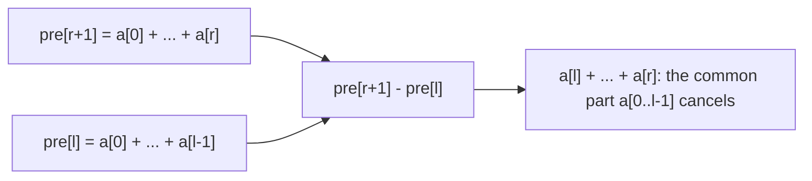
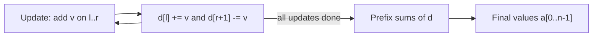
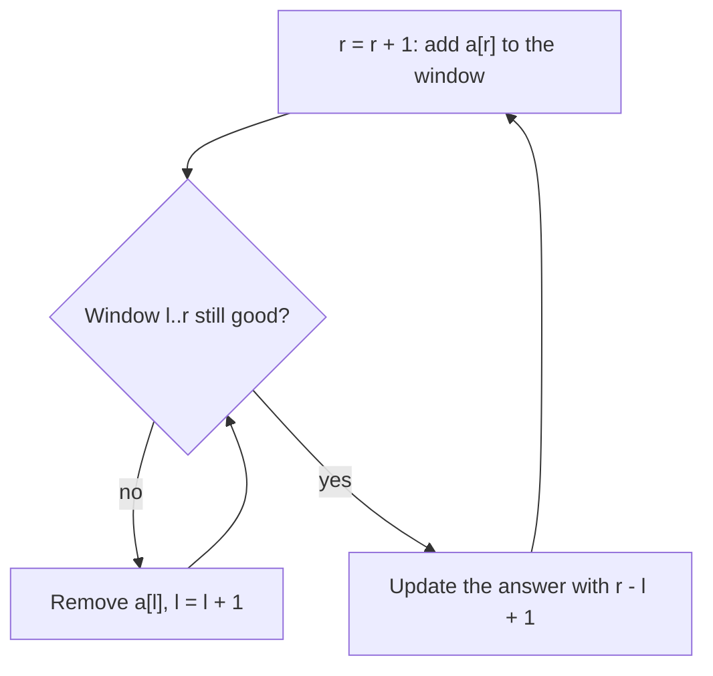

# Dzień 4 - Sumy prefiksowe, tablice różnicowe i dwa wskaźniki

> [!abstract] Cel dnia
> Po tym dniu: liczysz sumę dowolnego przedziału w O(1) po jednym przebiegu przygotowania (także na planszy);
> dodajesz wartość na wielu przedziałach naraz tablicą różnicową, a przy dużych współrzędnych zdarzeniami na
> posortowanych końcach; używasz maksimum i minimum prefiksu jako pamięci "najlepszego dotąd"; rozpoznajesz okno,
> które przesuwa się tylko w jedną stronę (dwa wskaźniki), i umiesz sprawdzić, czy wolno go użyć.
>
> - **Minimum (ok. 1 h):** sekcje 1-3, zadanie omówione 2015 D, ćwiczenie 2012 I.
> - **Pełna wersja (do 3 h, dziś święto, więc jest czas):** wszystko, łącznie z 2018 J, ćwiczeniem 2013 D,
>   wyzwaniem 2021 F, zadaniem bez etykiety 2017 G, pytaniami "czy tu działają dwa wskaźniki" i zadaniami z CSES.

Na start 10 minut powtórki: fiszki z Dni 1-3 oraz Twój dziennik błędów.

## 1. Sumy prefiksowe

**Intuicja.** Licznik kilometrów w samochodzie pokazuje, ile przejechałeś od początku. Żeby wiedzieć, ile jest
z Krakowa do Katowic, nie sumujesz odcinków, tylko odejmujesz dwa odczyty licznika. Suma prefiksowa to taki licznik
dla tablicy: raz przechodzisz od lewej do prawej i zapisujesz bieżącą sumę, a potem każda suma kawałka to jedno
odejmowanie.

**Definicja.** Dla tablicy a[0..n-1] suma prefiksowa to tablica pre[0..n], w której pre[0] = 0 oraz
pre[i] = a[0] + a[1] + ... + a[i-1]. Wtedy suma kawałka a[l..r] to pre[r+1] - pre[l]. Przygotowanie kosztuje O(n),
każde zapytanie O(1).

**Mechanizm.**

```cpp
vector<ll> pre(n + 1, 0);                      // pre[i] = a[0] + ... + a[i - 1]
for (int i = 0; i < n; i++) pre[i + 1] = pre[i] + a[i];
ll sum = pre[r + 1] - pre[l];                  // a[l] + ... + a[r]
```



Jak czytać diagram: obie sumy prefiksowe zaczynają się od a[0]. Dłuższa sięga do a[r], krótsza kończy się tuż przed
a[l]. Po odjęciu wspólny początek znika i zostaje dokładnie kawałek od l do r. Dlatego pre ma n + 1 elementów
i pre[0] = 0: kawałek zaczynający się od l = 0 też ma swój "odczyt licznika przed startem".

**Przykład.** a = 3, 1, 4, 1, 5, więc pre = 0, 3, 4, 8, 9, 14. Suma a[1..3] = pre[4] - pre[1] = 9 - 3 = 6, czyli
1 + 4 + 1.

Ten sam pomysł działa dla każdej operacji, którą da się "odjąć":

- **Zliczanie:** cnt[c][i] = ile razy litera c występuje w pierwszych i literach; ile razy w kawałku, to różnica.
- **Podział po parzystości indeksów:** osobne sumy dla parzystych i nieparzystych pozycji dają sumę co drugiego
  elementu kawałka ([2021 F Farba](../zadania/2021/f-farba.md)).
- **XOR:** px[r+1] ^ px[l] to XOR kawałka, bo x ^ x = 0.
- **Koszt kawałka:** suma |a[i] - m| po kawałku posortowanej tablicy to dwie sumy prefiksowe i dwa iloczyny
  ([2018 J Jednakowe szaliki](../zadania/2018/j-jednakowe-szaliki.md)).

**Sumy prefiksowe i mapa: ile kawałków ma sumę k.** Kawałek a[l..r] ma sumę k, gdy pre[r+1] - pre[l] = k, czyli
pre[l] = pre[r+1] - k. Idąc od lewej, trzymasz w mapie, ile razy wystąpiła każda dotychczasowa suma prefiksowa,
i dla każdego r dodajesz liczbę wystąpień pre[r+1] - k. Działa także dla liczb ujemnych, gdzie dwa wskaźniki zawodzą.

```cpp
map<ll, int> seen;                             // how many earlier prefixes had this sum
seen[0] = 1;
ll cur = 0, cnt = 0;
for (int i = 0; i < n; i++) {
    cur += a[i];                               // cur = pre[i + 1]
    cnt += seen[cur - k];                      // pieces ending at i with sum k
    seen[cur]++;
}
```

**Maksimum i minimum prefiksu.** Maksimum się nie odejmuje, więc nie da maksimum dowolnego kawałka, ale maksimum
prefiksu (największy z a[0..i]) liczy się w jednym przebiegu i zapamiętuje "najlepsze dotąd". Dwa częste użycia:

- **Najlepsza para i < j:** największe a[j] - a[i] to dla każdego j wartość a[j] minus minimum prefiksu przed j.
  Największa suma kawałka to to samo na sumach prefiksowych: pre[r+1] minus najmniejsze pre[l] dla l ≤ r.
- **Prefiks permutacji to dokładnie 1..i** wtedy i tylko wtedy, gdy jego maksimum równa się i. To dzieli permutację
  na kawałki, przez których granice "nic nie przechodzi" ([2012 I Inwersje](../zadania/2012/i-inwersje.md)).

**Plansza: sumy prefiksowe 2D.** pre[i][j] to suma prostokąta od (0, 0) do (i-1, j-1). Liczy się ją i odpytuje
z zasady włączeń i wyłączeń: dwa paski się dodaje, a róg policzony dwa razy odejmuje.

```cpp
// build: pre has (R + 1) x (C + 1) zeros
for (int i = 0; i < R; i++)
    for (int j = 0; j < C; j++)
        pre[i + 1][j + 1] = g[i][j] + pre[i][j + 1] + pre[i + 1][j] - pre[i][j];
// sum of rows r1..r2, columns c1..c2
ll s = pre[r2 + 1][c2 + 1] - pre[r1][c2 + 1] - pre[r2 + 1][c1] + pre[r1][c1];
```

## 2. Tablica różnicowa i zdarzenia

**Intuicja.** Tablica różnicowa to odwrotność sumy prefiksowej. Zamiast zapisywać, ile osób jest w sali o każdej
godzinie, zapisujesz tylko zmiany: "o 10:00 weszło 3", "o 12:00 wyszło 3". Stan o dowolnej godzinie to suma zmian
do tej pory. Dodanie grupy na pewien czas to dwa wpisy, niezależnie od tego, jak długo grupa zostaje.

**Definicja.** Dla tablicy a tablica różnic to d[0] = a[0] oraz d[i] = a[i] - a[i-1]. Suma prefiksowa d odtwarza a.
Dodanie v do każdego z a[l..r] zmienia tylko dwie różnice: d[l] += v i d[r+1] -= v. Każda taka operacja kosztuje
O(1), a odtworzenie całej tablicy na końcu O(n).

**Mechanizm.**

```cpp
vector<ll> d(n + 1, 0);                        // one extra cell for r + 1 == n
for (auto [l, r, v] : updates) {
    d[l] += v;                                 // from l on everything grows by v
    d[r + 1] -= v;                             // after r it stops
}
vector<ll> a(n);
ll cur = 0;
for (int i = 0; i < n; i++) a[i] = (cur += d[i]);
```



Jak czytać diagram: aktualizacje krążą w pętli i każda dotyka dwóch komórek d. Dopiero gdy wszystkie są zapisane,
jeden przebieg sum prefiksowych zamienia zmiany na wartości. To technika offline: działa, gdy najpierw są wszystkie
dodawania, a potem odczyty. Gdy odczyty przeplatają się z dodawaniem, potrzebne jest drzewo Fenwicka (tydzień 2).

**Przykład.** n = 6, dodaj 2 na [1, 3] i 5 na [2, 5]. d = 0, 2, 5, 0, -2, 0 (i -5 w dodatkowej komórce 6). Sumy
prefiksowe: a = 0, 2, 7, 7, 5, 5.

**Duże współrzędne: zdarzenia.** Gdy przedziały mają końce do 10⁹, tablicy nie założysz. Zamiast niej zapisujesz
zdarzenia (a, +1) i (b, -1), sortujesz je po czasie i idziesz od lewej. Między dwoma kolejnymi momentami liczba
aktywnych przedziałów jest stała, więc fragment osi liczysz w całości. To ta sama tablica różnicowa, tylko
przechowująca tylko niezerowe komórki. Oprócz liczby możesz trzymać, kto jest aktywny
([2013 D Demonstracje](../zadania/2013/d-demonstracje.md)).

```cpp
vector<pair<ll, int>> ev;                      // (time, +1 start or -1 end)
for (auto [a, b] : seg) { ev.push_back({a, +1}); ev.push_back({b, -1}); }
sort(ev.begin(), ev.end());                    // at equal times -1 goes first: touching ends do not overlap
int active = 0, most = 0;
for (auto [t, delta] : ev) most = max(most, active += delta);
```

**Plansza.** Dodanie v na prostokącie to cztery wpisy w rogach (+v, -v, -v, +v), a odtworzenie to suma prefiksowa
2D. Obie techniki na planszy łączy na przykład 2021 L Leniwce (na później: wymaga jeszcze obrotu planszy o 45 stopni).

## 3. Dwa wskaźniki

**Intuicja.** Gąsienica: przód idzie naprzód, tył podciąga się za nim i żadna część nigdy się nie cofa. Okno l..r
przesuwa się po tablicy tak samo. Skoro każdy z dwóch wskaźników przechodzi tablicę raz, cała praca to O(n), choć
okien jest n².

**Definicja.** Dwa wskaźniki to przegląd kawałków albo par, w którym dwa indeksy przesuwają się tylko w jedną stronę.
Wolno go użyć, gdy warunek jest **monotoniczny**: dla "najdłuższego dobrego okna" każde okno wewnątrz dobrego też jest
dobre (wtedy przy rosnącym r najlepsze l nie maleje); dla "najkrótszego okna, które wystarcza" każde okno zawierające
wystarczające też wystarcza.

**Mechanizm.** Trzy szablony:

```cpp
// 1. longest good window: a sub-window of a good window is good
int l = 0, best = 0;
for (int r = 0; r < n; r++) {
    add(a[r]);
    while (!good()) remove(a[l++]);            // shrink until good again
    best = max(best, r - l + 1);               // also: r - l + 1 good windows end at r
}

// 2. shortest window that is enough: a window containing an enough window is enough
for (int r = 0, l = 0; r < n; r++) {
    add(a[r]);
    while (enough()) { best = min(best, r - l + 1); remove(a[l++]); }
}

// 3. two sorted arrays or both ends of one: a pair with sum x
int i = 0, j = n - 1;                          // a sorted
while (i < j) {
    if (a[i] + a[j] < x) i++;                  // a[i] is too small even with the largest partner
    else if (a[i] + a[j] > x) j--;
    else break;                                // found
}
```



Jak czytać diagram: to szablon 1. Okno rośnie z prawej po jednym elemencie; gdy przestanie być dobre, ucinasz
z lewej, aż znów będzie dobre. Monotoniczność gwarantuje, że ucięty element nie przyda się żadnemu późniejszemu
r: skoro okno l..r jest złe, to l..r' dla r' > r też. Funkcje `add`, `remove` i `good` muszą działać w O(1) albo
O(log n): bieżąca suma, licznik wartości w tablicy albo mapie, liczba różnych wartości.

**Przykład.** Najdłuższy kawałek o sumie ≤ 7 w 2, 1, 3, 2, 4, 1 (liczby dodatnie, więc dłuższe okno ma większą
sumę). r = 0, 1, 2: sumy 2, 3, 6, okno długości 3. r = 3: suma 8, ucinamy 2, zostaje 1, 3, 2 o sumie 6. r = 4: 10,
ucinamy 1 i 3, zostaje 2, 4. r = 5: 2, 4, 1 o sumie 7. Wynik 3.

> [!warning] Kiedy dwa wskaźniki zawodzą
> Gdy liczby mogą być ujemne, dłuższe okno nie musi mieć większej sumy i warunek "suma ≤ S" przestaje być
> monotoniczny. Wtedy sumy prefiksowe (z mapą albo z wyszukiwaniem binarnym, Dzień 5). Zanim napiszesz gąsienicę,
> zadaj pytanie: czy podokno dobrego okna na pewno jest dobre?

**Pięć ruchów, które wracają w AMPPZ:**

| Ruch | Sygnał w treści | Zadanie z archiwum |
|---|---|---|
| Okno w posortowanej tablicy | "różnica nie przekracza k", podzbiór elementów "blisko siebie" | 2015 D Studniówka, 2018 J Jednakowe szaliki |
| Koszt okna z sum prefiksowych | zrównanie, przesunięcie, koszt zależny od odległości | 2018 J Jednakowe szaliki |
| Maksimum prefiksu | permutacja, "prefiks zawiera 1..i", podział na niezależne części | 2012 I Inwersje |
| Zdarzenia +1/-1 | przedziały czasu, "ile naraz", "łączny czas", duże współrzędne | 2013 D Demonstracje |
| Sumy po parzystości, szacowanie harmoniczne | "co drugi", dla każdego b od 1 do M | 2021 F Farba |

## 4. Zadania omówione

Przy każdym najpierw sam, z zegarkiem (czas w notatce), potem podpowiedzi po jednej, na końcu omówienie.

- **[AMPPZ 2015 D - Studniówka](../zadania/2015/d-studniowka.md)** (minimum, 47 zaakceptowanych zgłoszeń, ale też
  75 błędnych i 63 za wolne): ile par różni się wzrostem najwyżej o k; sortowanie i dwa wskaźniki, `long long`.
- **[AMPPZ 2018 J - Jednakowe szaliki](../zadania/2018/j-jednakowe-szaliki.md)** (pełna, 37 z 51 drużyn): najwięcej
  szalików wyrównanych w budżecie; okno w posortowanej tablicy, mediana, sumy prefiksowe i dwa wskaźniki naraz.

## 5. Ćwiczenia

**AMPPZ z tematu dnia:**

- **[AMPPZ 2012 I - Inwersje](../zadania/2012/i-inwersje.md)** (minimum, 20 minut, 39 z 54 drużyn): spójne składowe
  grafu inwersji permutacji n ≤ 10⁶. Grafu nie da się zbudować; narysuj kilka przykładów.
- **[AMPPZ 2013 D - Demonstracje](../zadania/2013/d-demonstracje.md)** (pełna, 35 minut, 27 z 52 drużyn): o ile
  najwięcej skróci się łączny czas demonstracji po odwołaniu dwóch.
- **[AMPPZ 2021 F - Farba](../zadania/2021/f-farba.md)** (pełna, wyzwanie, 45 minut, 18 z 45 drużyn): suma pomalowanych
  sztachet dla każdej wysokości płotu. Zanim zaczniesz, policz, ile desek jest dłuższych niż b, łącznie po wszystkich b.

**Zadanie bez etykiety** (technika z wcześniejszego dnia, rozpoznaj ją sam):

- **[AMPPZ 2017 G - Głowica drukarki](../zadania/2017/g-glowica-drukarki.md)** (pełna, 15 minut, 39 z 44 drużyn).
  Treść: `201X/2017/G/G.pdf` ([PDF](../../201X/2017/G/G.pdf)). Notatkę otwórz dopiero po swojej próbie, bo jej karta
  zdradza technikę.

**Czy tu działają dwa wskaźniki? (pełna wersja).** Odpowiedz tak albo nie z uzasadnieniem (albo kontrprzykładem),
zanim rozwiniesz odpowiedź.

> [!question]- Najdłuższy kawałek o sumie ≤ S, liczby dodatnie.
> Tak. Dokładanie elementu zwiększa sumę, ucinanie zmniejsza, więc podokno dobrego okna jest dobre (szablon 1).

> [!question]- Najdłuższy kawałek o sumie ≤ S, liczby mogą być ujemne.
> Nie. S = 0, ciąg 1, -5, 3: gąsienica przy r = 0 ma sumę 1 > 0 i ucina pierwszy element, potem znajduje -5, 3 (długość
> 2), a cały ciąg ma sumę -1 ≤ 0 (długość 3). Poprawnie: dla każdego r najmniejsze l z pre[l] ≥ pre[r+1] - S, czyli
> wyszukiwanie binarne po maksimach prefiksów (Dzień 5).

> [!question]- Najdłuższy kawałek, w którym jest najwyżej d różnych wartości.
> Tak. Usunięcie elementu nie zwiększa liczby różnych wartości. W oknie trzymasz licznik każdej wartości (tablica
> albo `map`) i liczbę wartości z licznikiem > 0.

> [!question]- Najkrótszy kawałek, w którym występuje każda z liczb 1..m.
> Tak, szablon 2: okno zawierające wystarczające okno też wystarcza. Licznik wartości i liczba wartości z 1..m już
> obecnych.

> [!question]- Największe a[j] - a[i] dla i < j (kup tanio, sprzedaj drogo).
> To nie jest okno, tylko para; wystarcza minimum prefiksu: dla każdego j odejmij od a[j] najmniejsze a[i] przed j.
> Jeden przebieg, O(n).

> [!question]- Ile jest kawałków o sumie dokładnie k, liczby mogą być ujemne.
> Nie dwa wskaźniki, tylko sumy prefiksowe i mapa (sekcja 1): dla każdego r dodaj liczbę wcześniejszych prefiksów
> równych pre[r+1] - k.

**CSES (pełna wersja).** Dział Range Queries i Sorting and Searching:

- **[Static Range Sum Queries](https://cses.fi/problemset/task/1646):** sumy prefiksowe wprost.
- **[Forest Queries](https://cses.fi/problemset/task/1652):** sumy prefiksowe 2D, liczba drzew w prostokącie.
- **[Maximum Subarray Sum](https://cses.fi/problemset/task/1643):** minimum prefiksu na sumach prefiksowych.
- **[Subarray Sums I](https://cses.fi/problemset/task/1660):** liczby dodatnie, ile kawałków ma sumę x. Dwa wskaźniki.
- **[Subarray Sums II](https://cses.fi/problemset/task/1661):** to samo z liczbami ujemnymi. Sumy prefiksowe i mapa.
- **[Sum of Three Values](https://cses.fi/problemset/task/1641)** (najtrudniejsze): trzy liczby o sumie x, n ≤ 5000.

> [!tip]- Podpowiedź do Subarray Sums II
> Sumy prefiksowe mogą się powtarzać i być ujemne, więc zliczasz je w `map<ll, int>` (O(n log n) wystarcza).
> `unordered_map` z domyślnym haszowaniem bywa celowo spowalniany specjalnie dobranymi testami, więc bezpieczniej
> `map` albo posortowanie wszystkich sum prefiksowych i zliczanie na tablicy.

> [!tip]- Podpowiedź do Sum of Three Values
> Posortuj (z zapamiętanymi numerami). Ustal pierwszą liczbę i, a dla pozostałych dwóch użyj szablonu 3 na kawałku
> za i. Razem O(n²), przy n = 5000 to 2,5 · 10⁷ kroków.

## 6. Fiszki

Jak zdefiniować pre, żeby suma a[l..r] była jednym odejmowaniem?::pre[0] = 0, pre[i] = a[0] + ... + a[i-1]; suma a[l..r] = pre[r+1] - pre[l].
Dlaczego pre ma n + 1 elementów?::Żeby kawałek od l = 0 też miał "odczyt przed startem" pre[0] = 0.
Jakie operacje nadają się na sumy prefiksowe?::Odwracalne: dodawanie, zliczanie, XOR. Maksimum i minimum tylko dla prefiksów.
Jak policzyć liczbę kawałków o sumie k, także z ujemnymi?::Mapa wcześniejszych sum prefiksowych; dla każdego r dodaj liczbę wystąpień pre[r+1] - k.
Jak liczy się sumę prostokąta z sum prefiksowych 2D?::pre[r2+1][c2+1] - pre[r1][c2+1] - pre[r2+1][c1] + pre[r1][c1].
Kiedy prefiks permutacji to dokładnie 1..i?::Gdy jego maksimum równa się i.
Jak znaleźć największe a[j] - a[i] dla i < j?::Jeden przebieg z minimum prefiksu: a[j] minus najmniejsze a[i] przed j.
Jak dodać v na przedziale [l, r] w tablicy różnicowej?::d[l] += v, d[r+1] -= v; na końcu sumy prefiksowe d.
Kiedy tablica różnicowa nie wystarcza?::Gdy odczyty przeplatają się z dodawaniem (online); wtedy drzewo Fenwicka.
Co zamiast tablicy różnicowej przy końcach do 10⁹?::Zdarzenia (czas, +1) i (czas, -1), posortowane; między zdarzeniami stan stały.
Kiedy wolno użyć dwóch wskaźników dla najdłuższego dobrego okna?::Gdy każde podokno dobrego okna jest dobre (warunek monotoniczny).
Ile dobrych okien kończy się na r w szablonie gąsienicy?::r - l + 1, gdzie l to najmniejszy dobry początek.
Dlaczego dwa wskaźniki działają w O(n)?::Każdy wskaźnik tylko rośnie i przechodzi tablicę najwyżej raz.
Najdłuższy kawałek o sumie ≤ S z ujemnymi: czy gąsienica?::Nie: dłuższe okno może mieć mniejszą sumę; sumy prefiksowe i wyszukiwanie binarne.
Do jakiej wartości najtaniej zrównać kilka liczb (koszt to suma odległości)?::Do mediany.
Ile jest elementów większych niż b, gdy suma wszystkich to S?::Najwyżej S / b; po wszystkich b łącznie najwyżej S (szacowanie harmoniczne).

## 7. Zamknięcie dnia

- [ ] Umiem napisać z pamięci sumy prefiksowe, tablicę różnicową i szablon gąsienicy.
- [ ] 2015 D Studniówka rozwiązane i porównane z omówieniem.
- [ ] 2012 I Inwersje rozwiązane samodzielnie.
- [ ] Umiem w dwóch zdaniach powiedzieć, kiedy dwa wskaźniki nie działają, i podać kontrprzykład.
- [ ] (pełna) 2018 J, 2013 D, 2021 F, 2017 G bez etykiety, pytania o dwa wskaźniki, zadania z CSES.
- [ ] Dzisiejsze błędy wpisane do dziennika ([wzór](../dziennik/szablon-dziennika.md)).
- [ ] Fiszki z Dnia 3 i Dnia 4 przejrzane.

Materiały obok: [sygnały w treści](../myslenie/sygnaly-w-tresci.md) (sekcja 2, wiersze o parach i fragmentach, oraz
sekcja 3 o planszy), [karta wzorca sum prefiksowych i dwóch wskaźników](../wzorce/sumy-prefiksowe-i-dwa-wskazniki.md),
[katalog zadań](../zadania/katalog.md) (grupy "sumy prefiksowe" i "dwa wskaźniki" oraz zadania z tymi technikami
pobocznie). Po tym dniu przeczytaj [protokół rozwiązywania](../myslenie/protokol-rozwiazywania.md) i
[sztuczki obserwacji](../myslenie/sztuczki-obserwacji.md) z modułu myślenia.

Następny dzień: wyszukiwanie binarne (także po wyniku) i testowanie z brute force ([plan](../plan-20-dni.md)).
