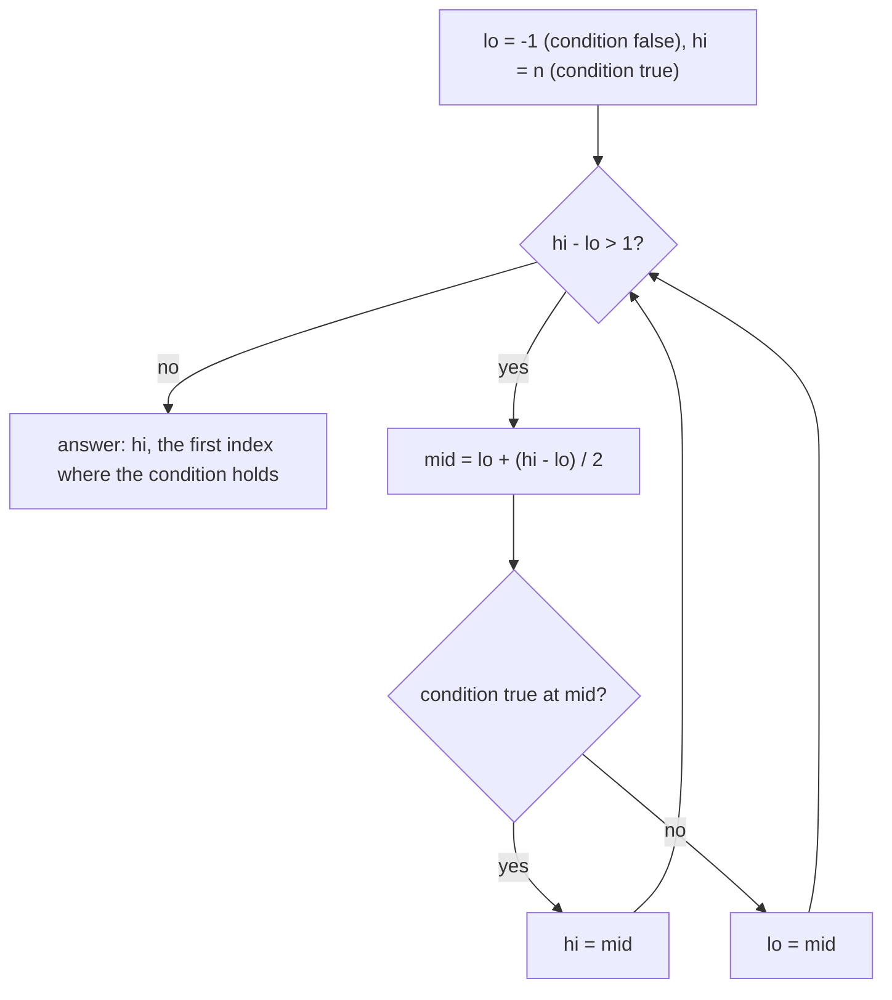
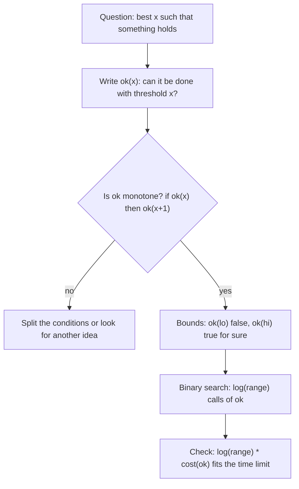
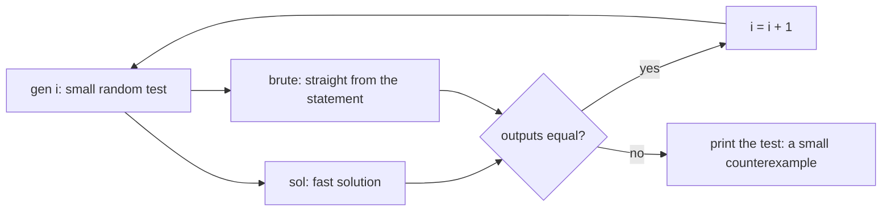

# Dzień 5 - Wyszukiwanie binarne i testowanie z brute force

> [!abstract] Cel dnia
> Po tym dniu: w posortowanej tablicy znajdujesz pierwszy element ≥ x i liczysz elementy w przedziale w O(log n);
> piszesz wyszukiwanie binarne z niezmiennikiem, bez błędów o jeden i bez zapętlenia; rozpoznajesz pytania typu
> "największe minimum", "najmniejszy czas" i zamieniasz je na pytanie tak/nie, które sprawdzasz zachłannie
> (wyszukiwanie binarne po wyniku), także na liczbach rzeczywistych; umiesz w 10 minut postawić generator, brute
> force i pętlę porównującą, a potem użyć ich do znalezienia błędu albo kontrprzykładu dla zachłanności.
>
> - **Minimum (ok. 1 h):** sekcje 1-3, zadanie omówione 2017 L, ćwiczenie 2011 E.
> - **Pełna wersja (do 3 h):** wszystko, łącznie z 2011 F (zachłanność sprawdzana brute force), wyzwaniem 2013 A,
>   zadaniem bez etykiety 2017 H, pytaniami "czy tu działa wyszukiwanie binarne" i zadaniami z CSES.

Na start 10 minut powtórki: fiszki z Dni 1-4 oraz Twój dziennik błędów.

## 1. Wyszukiwanie binarne w posortowanej tablicy

**Intuicja.** Zgadywanie liczby od 1 do 100, gdy słyszysz "więcej" albo "mniej": pytasz o środek i odrzucasz połowę.
Po 7 pytaniach zostaje jedna liczba, bo 2⁷ > 100. Tak samo szukasz hasła w papierowym słowniku: otwierasz w środku
i wiesz, w której połowie jest szukane słowo, bo słownik jest posortowany.

**Definicja.** W tablicy posortowanej niemalejąco a[0..n-1]:

- `lower_bound(x)` to pierwszy indeks i z a[i] ≥ x (albo n, gdy takiego nie ma);
- `upper_bound(x)` to pierwszy indeks i z a[i] > x;
- liczba elementów równych x to upper_bound(x) - lower_bound(x), a liczba elementów w przedziale [lo, hi] to
  upper_bound(hi) - lower_bound(lo).

Każde z tych zapytań kosztuje O(log n), bo każdy krok połowi przedział poszukiwań.

**Mechanizm.** Wyszukiwanie binarne szuka granicy między dwoma kawałkami: warunek a[i] ≥ x jest fałszywy na początku
tablicy i prawdziwy na końcu. Najbezpieczniejszy szablon trzyma dwa indeksy z **niezmiennikiem**: na lo warunek jest
fałszywy, na hi prawdziwy (lo = -1 i hi = n to wirtualne komórki "przed" i "za" tablicą).

```cpp
// first index i with a[i] >= x, or n if there is none
int lo = -1, hi = n;                           // invariant: a[lo] < x, a[hi] >= x (virtual cells)
while (hi - lo > 1) {
    int mid = lo + (hi - lo) / 2;              // lo < mid < hi, so mid is a real cell
    if (a[mid] >= x) hi = mid; else lo = mid;
}
// hi is the answer: lo and hi are neighbours, the border lies between them

// the same with the standard library
int i = lower_bound(a.begin(), a.end(), x) - a.begin();
int cnt = upper_bound(a.begin(), a.end(), hiv) - lower_bound(a.begin(), a.end(), lov);   // values in [lov, hiv]
auto it = s.lower_bound(x);                    // set and multiset: the member function, O(log n)
```



Jak czytać diagram: przedział (lo, hi) zawsze zawiera granicę między "fałsz" i "prawda", a każdy krok przesuwa jeden
z końców na środek, więc przedział maleje o połowę. Pętla kończy się, gdy lo i hi są sąsiadami: wtedy hi to pierwsza
pozycja z prawdą, a lo ostatnia z fałszem. Ponieważ mid leży ściśle między lo i hi, nigdy nie czytamy wirtualnych
komórek i pętla nie może stanąć w miejscu.

**Przykład.** a = 1, 3, 3, 5, 8 i x = 3: lower_bound = 1, upper_bound = 3, więc trójki są dwie. Elementów
w przedziale [2, 6] jest upper_bound(6) - lower_bound(2) = 4 - 1 = 3 (to 3, 3, 5).

> [!warning] Dwie częste pomyłki
> `std::lower_bound(s.begin(), s.end(), x)` na `set` działa w czasie liniowym, bo iteratory zbioru nie pozwalają
> skakać do środka; zawsze `s.lower_bound(x)`. Druga pomyłka: `(lo + hi) / 2` przy granicach rzędu 10¹⁸ przepełnia
> `long long`; pisz `lo + (hi - lo) / 2`.

## 2. Wyszukiwanie binarne po wyniku

**Intuicja.** Trudno od razu powiedzieć, w jakim najkrótszym czasie fabryka wyprodukuje 1000 sztuk. Łatwo za to
sprawdzić, czy zdąży w 50 godzin: każda maszyna robi 50 / (jej czas) sztuk, sumujesz. A jeśli zdąży w 50 godzin, to
zdąży i w 51. Zamiast liczyć wynik, zgadujesz go i sprawdzasz, za każdym razem odrzucając połowę możliwości.

**Definicja.** Funkcja ok(x) przyjmująca wartości tak/nie jest **monotoniczna**, gdy dla rosnącego x zmienia się tylko
raz: nie, nie, ..., nie, tak, tak, ..., tak (albo odwrotnie). Wyszukiwanie binarne po wyniku znajduje miejsce zmiany,
czyli najmniejsze x z ok(x) = tak, w log₂(zakres) wywołaniach ok. Cała praca to log₂(zakres) · (koszt ok).

**Mechanizm.** Ten sam szablon co w tablicy, tylko "komórkami" są możliwe wyniki, a warunkiem ok(x):

```cpp
// smallest x with ok(x); ok(lo) is false, ok(hi) is true
ll lo = MIN - 1, hi = MAX;                     // MAX must really satisfy ok
while (hi - lo > 1) {
    ll mid = lo + (hi - lo) / 2;
    if (ok(mid)) hi = mid; else lo = mid;
}
// answer: hi

// largest x with good(x) (good is true, then false): roles swap
ll lo2 = MIN, hi2 = MAX + 1;                   // good(lo2) is true, good(hi2) is false
while (hi2 - lo2 > 1) {
    ll mid = lo2 + (hi2 - lo2) / 2;
    if (good(mid)) lo2 = mid; else hi2 = mid;
}
// answer: lo2
```



Jak czytać diagram: najpierw zmieniasz pytanie "jaki jest najlepszy x?" na "czy x wystarcza?". Ta zamiana opłaca się
tylko wtedy, gdy odpowiedź jest monotoniczna, i to trzeba sprawdzić, zanim zaczniesz pisać. Granice muszą być
bezpieczne: dolna na pewno za mała, górna na pewno wystarczająca. Koszt to liczba kroków (ok. 60 dla zakresu 10¹⁸)
razy koszt jednego sprawdzenia, które zwykle jest zachłanne i liniowe.

**Przykład (CSES Factory Machines).** Maszyny robią sztukę w 3, 2 i 5 sekund, potrzeba 7 sztuk. ok(T) = "suma T / kᵢ
≥ 7". ok(7): 2 + 3 + 1 = 6, nie. ok(8): 2 + 4 + 1 = 7, tak. Wynik 8.

**Sygnały w treści.** "Największe minimum" i "najmniejsze maksimum" (odległość, obciążenie, suma kawałka); "najmniejszy
czas, po którym", "najmniejsza pojemność, przy której"; "k-ta najmniejsza wartość" spośród zbyt wielu, żeby je wypisać
(ok(x) = "co najmniej k wartości ≤ x", liczone na przykład dwoma wskaźnikami); duże limity wyniku (10⁹, 10¹⁸) przy
małym n.

**Liczby rzeczywiste.** Gdy wynik jest rzeczywisty, zamiast `while (hi - lo > eps)` rób stałą liczbę kroków (100
połowień zwęża przedział 2¹⁰⁰ razy) i licz na `long double`. Warunek z eps przy wartościach rzędu 10⁹ może się nigdy
nie skończyć, bo sąsiednie liczby `double` różnią się tam o ok. 10⁻⁷. Gdy funkcja najpierw rośnie, potem maleje,
pomaga wyszukiwanie ternarne, ale częściej da się warunek rozdzielić na dwa monotoniczne
([2013 A Autostrada](../zadania/2013/a-autostrada.md)).

> [!warning] Zanim napiszesz wyszukiwanie binarne po wyniku
> Sprawdź trzy rzeczy: czy ok jest monotoniczne (podaj jednym zdaniem dlaczego), czy górna granica na pewno jest
> dobra (inaczej wynik "wyjdzie" na granicy, choć powinno być NIE), czy ok nie przepełnia się przy dużych x (suma
> T / kᵢ przy T = 10¹⁸ potrafi przekroczyć `long long`; przerwij sumowanie, gdy przekroczy cel).

## 3. Testowanie z brute force

**Intuicja.** Druga opinia od powolnego, ale pewnego lekarza. Twoje szybkie rozwiązanie może mieć błąd, którego nie
widać na przykładach z treści. Rozwiązanie siłowe, które przegląda wszystkie możliwości wprost z treści, na małych
danych jest prawie na pewno poprawne. Gdy oba programy policzą tysiące losowych małych testów tak samo, błąd jest mało
prawdopodobny, a gdy się różnią, masz w ręku mały test, na którym widać błąd.

**Definicja.** Stress test to trzy programy i pętla: **generator** losowych małych testów (ziarno z numeru testu),
**brute force** pisany wprost z treści (wykładniczy albo O(n³) jest w porządku) i **rozwiązanie**. Pętla generuje test,
uruchamia oba programy, porównuje wyniki i przy pierwszej różnicy wypisuje test.

**Mechanizm.** Na zawodach (zwykle Linux) wystarcza pętla w bashu i generator w C++:

```cpp
// gen.cpp: the test number is the seed, so a failing test can be reproduced
#include <bits/stdc++.h>
using namespace std;
int main(int argc, char** argv) {
    mt19937 rng(atoi(argv[1]));
    auto rnd = [&](int a, int b) { return (int)(rng() % (b - a + 1)) + a; };
    int n = rnd(1, 8);                         // small: the counterexample stays readable
    printf("%d\n", n);
    for (int i = 0; i < n; i++) printf("%d ", rnd(1, 10));
    printf("\n");
}
```

```bash
g++ -O2 -o sol sol.cpp && g++ -O2 -o brute brute.cpp && g++ -O2 -o gen gen.cpp
for i in $(seq 1 2000); do
    ./gen $i > in.txt
    ./sol < in.txt > out1.txt
    ./brute < in.txt > out2.txt
    if ! cmp -s out1.txt out2.txt; then echo "difference on test $i"; cat in.txt; break; fi
done
```

W kursie testy losowe chodzą w skrypcie Pythona tej samej budowy (generator jako funkcja, porównanie wyników,
tolerancja dla liczb rzeczywistych), bo na Windows to wygodniejsze.



Jak czytać diagram: ten sam losowy test trafia do obu programów, a porównanie decyduje, czy idziemy dalej. Pętla kończy
się na pierwszej różnicy i zostawia test w pliku. Ponieważ testy są małe, często od razu widać, który program się myli
i dlaczego.

**Zasady dobrego stress testu:**

- **Małe dane** (n do 8, wartości do 10): kontrprzykład ma kilka liczb i da się go prześledzić na kartce. Dorzuć
  wartości brzegowe: 1, maksimum, wszystkie równe.
- **Brute force wprost z treści, nie z Twojej obserwacji.** Jeśli brute force korzysta z tego samego pomysłu, ma ten
  sam błąd i niczego nie wykryje.
- **Wiele poprawnych odpowiedzi:** zamiast porównywać napisy, napisz sprawdzarkę (czy wynik spełnia warunki i czy ma tę
  samą wartość co brute force).
- **Liczby rzeczywiste:** porównanie z tolerancją, tak jak u sędziów.
- **Kiedy na zawodach:** WA bez pomysłu, co jest źle; zachłanność bez dowodu; komputer wolny, a rozwiązanie
  skomplikowane. Generator i brute force to zwykle 10-15 minut, często krócej niż szukanie błędu wzrokiem.

**Przykład.** Zachłanność z [2011 F Frania](../zadania/2011/f-frania.md) obsługuje osoby od największego d. Wersja
"od najmniejszego d" przechodzi oba przykłady z treści, ale pętla znajduje mały test: osoby 2 i 3 z kolorami 6, 14,
5, 8. Wersja błędna wypisuje NIE, brute force 4.

**Ruchy, które wracają w AMPPZ:**

| Ruch | Sygnał w treści | Zadanie z archiwum |
|---|---|---|
| Liczenie w przedziale posortowanej tablicy | "ile elementów w zasięgu", zapytania po zmianach | 2011 E Eksterminacja świstaków |
| Największe minimum, sprawdzenie zachłanne | "jak najdalej od siebie", "największa najmniejsza odległość" | 2017 L Leśny kemping |
| Najmniejszy pasujący zasób (`multiset::lower_bound`) | przydział kolorów, pokoi, biletów do żądań | 2011 F Frania |
| Przedział dopuszczalnych wartości na liczbach rzeczywistych | "najmniejsza i największa możliwa wartość" | 2013 A Autostrada |
| Test z brute force | zachłanność, której nie umiesz udowodnić | 2011 F Frania |

## 4. Zadania omówione

Przy każdym najpierw sam, z zegarkiem (czas w notatce), potem podpowiedzi po jednej, na końcu omówienie.

- **[AMPPZ 2017 L - Leśny kemping](../zadania/2017/l-lesny-kemping.md)** (minimum, 19 z 44 drużyn): k domków na okręgu
  jak najdalej od siebie; wyszukiwanie binarne po wyniku, skoki zachłanne liczone od prawej i rozcięcie okręgu.
- **[AMPPZ 2011 F - Frania](../zadania/2011/f-frania.md)** (pełna, 24 z 55 drużyn): najmniej kolorów klamerek;
  zachłanność "najtrudniejszy pierwszy, najmniejszy pasujący" z `multiset::lower_bound`, dowód przez wymianę i stress
  test, który łapie błędną kolejność.

## 5. Ćwiczenia

**AMPPZ z tematu dnia:**

- **[AMPPZ 2011 E - Eksterminacja świstaków](../zadania/2011/e-eksterminacja-swistakow.md)** (minimum, 30 minut, 24 z 55
  drużyn): ile norek jest w zasięgu magnetofonów po każdym przestawieniu. Policz najpierw, ile kosztuje przeliczanie
  wszystkiego od nowa.
- **[AMPPZ 2013 A - Autostrada](../zadania/2013/a-autostrada.md)** (pełna, wyzwanie, 45 minut, 6 z 52 drużyn):
  najmniejszy i największy odstęp kas. Zanim zaczniesz wyszukiwanie binarne, sprawdź, czy warunek "da się" jest
  monotoniczny.

**Zadanie bez etykiety** (technika z wcześniejszego dnia, rozpoznaj ją sam):

- **[AMPPZ 2017 H - Hasła](../zadania/2017/h-hasla.md)** (pełna, 30 minut, 17 z 44 drużyn). Treść: `201X/2017/H/H.pdf`
  ([PDF](../../201X/2017/H/H.pdf)). Notatkę otwórz dopiero po swojej próbie, bo jej karta zdradza technikę.

**Czy tu działa wyszukiwanie binarne? (pełna wersja).** Odpowiedz tak albo nie z uzasadnieniem, zanim rozwiniesz
odpowiedź.

> [!question]- Najmniejsza największa suma kawałka przy podziale tablicy liczb dodatnich na k spójnych kawałków.
> Tak, po wyniku S. ok(S) = "zachłanny podział (dokładaj do kawałka, póki suma ≤ S) daje najwyżej k kawałków". Większe
> S nigdy nie wymaga więcej kawałków. Granice: lo = max(a) - 1, hi = suma (CSES Array Division).

> [!question]- Najmniejsze x z x² ≥ N, N do 10¹⁸.
> Tak, x² rośnie. Pułapka: z odruchową granicą hi = N iloczyn mid · mid przepełnia `long long`, gdy mid > 3 · 10⁹.
> Ustaw hi = 2 · 10⁹ (wynik nie przekracza 10⁹) albo porównuj mid ≥ (N + mid - 1) / mid, albo licz w `__int128`.

> [!question]- Najdłuższy kawałek o sumie ≤ S, liczby mogą być ujemne (pytanie z Dnia 4).
> Tak, ale po tablicy, nie po wyniku. Dla każdego r szukasz najmniejszego l z pre[l] ≥ pre[r+1] - S. Maksima prefiksów
> M[l] = max(pre[0..l]) są niemalejące, a najmniejsze l z M[l] ≥ v to też najmniejsze l z pre[l] ≥ v, więc wystarczy
> `lower_bound` na M. Razem O(n log n).

> [!question]- Najdłuższy kawałek o sumie ≤ S, liczby dodatnie.
> Tak (długość L jest dobra, to L - 1 też), O(n log n). Ale dwa wskaźniki z Dnia 4 robią to w O(n), więc wyszukiwanie
> binarne jest tu niepotrzebne.

> [!question]- Liczba całkowita x, dla której f(x) = |x - 3| + |x - 10| + |x - 4| jest najmniejsza.
> Nie po samej f, bo f najpierw maleje, potem rośnie. Tak po warunku "f(x + 1) - f(x) ≥ 0", który jest monotoniczny dla
> funkcji wypukłej. Tu prościej: wynik to mediana 3, 4, 10, czyli 4.

> [!question]- Najmniejsza liczba kolorów klamerek we Frani: wyszukiwanie binarne po liczbie kolorów?
> Warunek "da się w c kolorach" jest monotoniczny, ale nie ma prostego sprawdzenia dla ustalonego c. Zachłanność z
> omówienia od razu daje najmniejszą liczbę, więc wyszukiwanie binarne nic nie dokłada. Monotoniczność to warunek
> konieczny, nie powód, żeby szukać binarnie.

**CSES (pełna wersja).** Dział Sorting and Searching:

- **[Factory Machines](https://cses.fi/problemset/task/1620):** najmniejszy czas, przykład z sekcji 2.
- **[Array Division](https://cses.fi/problemset/task/1085):** najmniejsza największa suma kawałka.
- **[Concert Tickets](https://cses.fi/problemset/task/1091):** `multiset::lower_bound` jak we Frani.
- **[Traffic Lights](https://cses.fi/problemset/task/1163):** sąsiedzi w `set` po każdej zmianie jak w 2011 E.
- **[Sum of Two Values](https://cses.fi/problemset/task/1640):** wyszukiwanie binarne albo dwa wskaźniki po sortowaniu.
- **[Maximum Subarray Sum II](https://cses.fi/problemset/task/1644)** (najtrudniejsze): kawałek długości od a do b.

> [!tip]- Podpowiedź do Factory Machines
> Górna granica: najszybsza maszyna sama robi wszystko w min(k) · t (do 2 · 10¹⁴). W ok(T) przerwij sumowanie, gdy
> suma przekroczy t, bo T / kᵢ dla 2 · 10⁵ maszyn razem może przepełnić `long long`.

> [!tip]- Podpowiedź do Maximum Subarray Sum II
> Suma kawałka to pre[r] - pre[l]. Dla r szukasz najmniejszego pre[l] dla l w [r - b, r - a]; okno przesuwa się
> w prawo, więc wystarcza `multiset` z dodawaniem i usuwaniem (albo kolejka monotoniczna).

## 6. Fiszki

Co zwraca lower_bound(x), a co upper_bound(x) w posortowanej tablicy?::Pierwszy indeks z a[i] ≥ x oraz pierwszy indeks z a[i] > x.
Jak policzyć elementy z przedziału [lo, hi] w posortowanej tablicy?::upper_bound(hi) - lower_bound(lo), dwa wyszukiwania po O(log n).
Jaki niezmiennik trzyma szablon lo/hi?::Na lo warunek fałszywy, na hi prawdziwy; koniec, gdy hi - lo = 1.
Dlaczego pętla while (hi - lo > 1) z mid = lo + (hi - lo) / 2 nie zapętla się?::mid leży ściśle między lo i hi, więc każdy krok zmniejsza przedział.
Jak wywołać lower_bound na set, żeby działało w O(log n)?::Funkcją składową s.lower_bound(x); std::lower_bound na iteratorach set jest liniowe.
Kiedy wolno szukać binarnie po wyniku?::Gdy ok(x) jest monotoniczne: po pierwszym "tak" zawsze "tak".
Jakie słowa w treści sugerują wyszukiwanie binarne po wyniku?::Największe minimum, najmniejsze maksimum, najmniejszy czas, k-ta najmniejsza wartość.
Ile kroków wyszukiwania binarnego dla zakresu 10¹⁸?::Około 60, bo 2⁶⁰ ≈ 10¹⁸.
Jak szukać binarnie na liczbach rzeczywistych?::Stała liczba kroków (np. 100) i long double, nie while (hi - lo > eps).
Co zrobić, gdy warunek "da się" jest prawdziwy tylko w środku przedziału?::Rozdzielić warunki na dolne i górne; każda rodzina daje osobne wyszukiwanie binarne.
Jak sprawdzić "k domków z przerwami ≥ d" na odcinku?::Zachłannie: zawsze najbliższy domek w odległości co najmniej d.
Jak poradzić sobie z okręgiem w zadaniu o wyborze punktów?::Zgadnij wybrany punkt o najmniejszym numerze i rozetnij tam okrąg.
Jaki jest szablon przydziału zasobów do żądań?::Najtrudniejsze żądanie pierwsze, najmniejszy pasujący zasób (multiset::lower_bound).
Z czego składa się stress test?::Generator małych testów, brute force z treści, rozwiązanie i pętla porównująca.
Dlaczego brute force pisze się wprost z treści?::Żeby nie miał tego samego błędu co rozwiązanie.
Dlaczego testy losowe mają być małe?::Kontrprzykład z kilku liczb da się prześledzić na kartce.

## 7. Zamknięcie dnia

- [ ] Umiem napisać z pamięci szablon lo/hi i powiedzieć, jaki trzyma niezmiennik.
- [ ] 2017 L Leśny kemping rozwiązane i porównane z omówieniem.
- [ ] 2011 E Eksterminacja świstaków rozwiązane samodzielnie.
- [ ] Mam na dysku działający zestaw gen + brute + pętla (dla dowolnego zadania z dziś) i umiem go postawić w 10 minut.
- [ ] (pełna) 2011 F, 2013 A, 2017 H bez etykiety, pytania o wyszukiwanie binarne, zadania z CSES.
- [ ] Dzisiejsze błędy wpisane do dziennika ([wzór](../dziennik/szablon-dziennika.md)).
- [ ] Fiszki z Dnia 4 i Dnia 5 przejrzane.

Materiały obok: [sygnały w treści](../myslenie/sygnaly-w-tresci.md) (sekcja 1 o limitach i sekcja 2, wiersze
o wyszukiwaniu binarnym po wyniku), [karta wzorca wyszukiwania binarnego](../wzorce/wyszukiwanie-binarne.md),
[katalog zadań](../zadania/katalog.md) (grupa "wyszukiwanie binarne" i zadania z nim pobocznie),
[protokół rozwiązywania](../myslenie/protokol-rozwiazywania.md) (krok sprawdzania przed wysłaniem).

Następny dzień: matematyka I, czyli modulo, potęgowanie, NWD, sito i parzystość ([plan](../plan-20-dni.md)).
