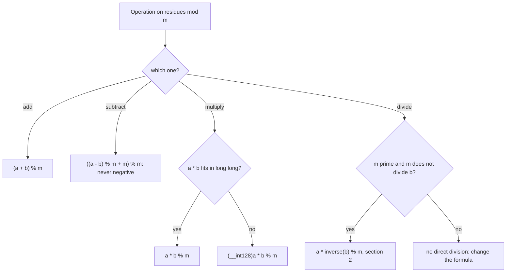
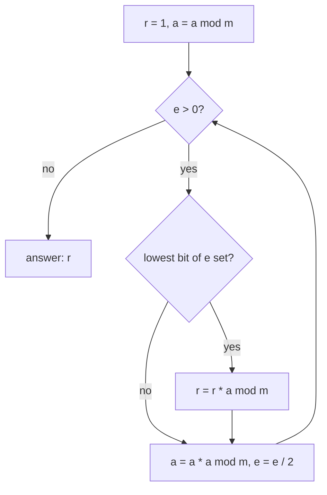
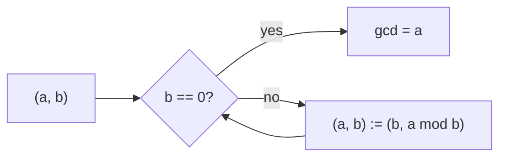
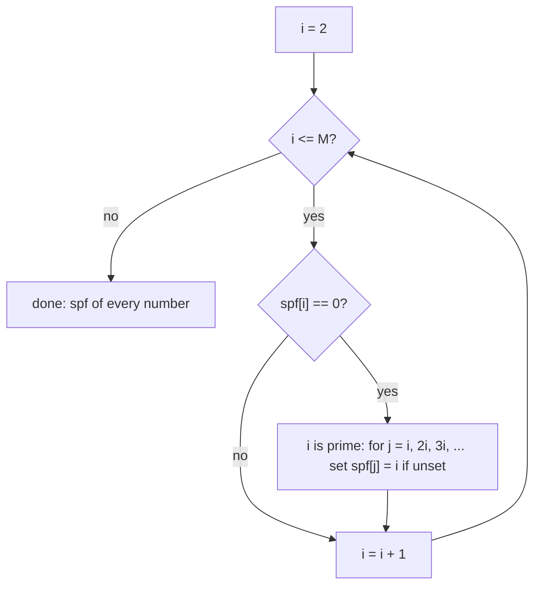
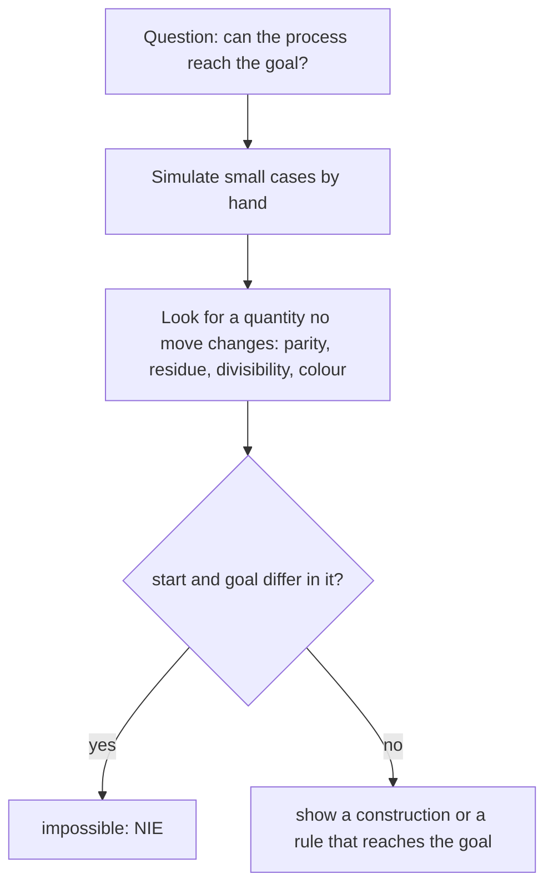

# Dzień 6 - Matematyka I: modulo, potęgowanie, NWD, sito, zliczanie i parzystość

> [!abstract] Cel dnia
> Po tym dniu: liczysz reszty z dzielenia bez przepełnień i poprawnie dla liczb ujemnych; podnosisz do potęgi modulo
> w O(log e) i dzielisz modulo liczby pierwszej przez odwrotność z małego twierdzenia Fermata; liczysz NWD i NWW
> algorytmem Euklidesa; sitem Eratostenesa wyznaczasz liczby pierwsze i rozkłady, a pętlą po wielokrotnościach robisz
> coś "dla każdego dzielnika" w O(M log M); liczysz elementy podzielne przez d w przedziale bez przeglądania;
> w zadaniach z procesem szukasz niezmiennika (parzystość, reszta, zapis dwójkowy).
>
> - **Minimum (ok. 1 h):** sekcje 1, 3, 4 i 5, zadanie omówione 2014 D, ćwiczenie 2011 C.
> - **Pełna wersja (do 3 h):** wszystko, łącznie z sekcją 2 i zadaniem 2017 F (reszta modulo 11 i odwrotność),
>   ćwiczeniem 2013 J, wyzwaniem 2012 C, zadaniem bez etykiety 2023 D, rachunkami w pamięci i zadaniami z CSES.

Na start 10 minut powtórki: fiszki z Dni 1-5 oraz Twój dziennik błędów. Jutro (sobota) symulacja zawodów: wieczorem
przeczytaj [taktykę](../taktyka/README.md) i [Dzień 7](07-symulacja-1.md), żeby rano od razu zacząć.

## 1. Arytmetyka modulo

**Intuicja.** Zegar: 10 + 5 godzin to godzina 3, bo po 12 liczysz od nowa. Liczy się tylko reszta z dzielenia przez 12.
Na zawodach reszta pojawia się w trzech przebraniach: "wypisz wynik modulo 10⁹ + 7" (bo pełny wynik ma tysiące cyfr),
ostatnia cyfra liczby (reszta modulo 10) i parzystość (reszta modulo 2).

**Definicja.** a mod m to reszta r z równości a = q · m + r, gdzie 0 ≤ r < m. Piszemy a ≡ b (mod m) ("a przystaje do
b"), gdy m dzieli a - b, czyli gdy a i b dają tę samą resztę.

**Mechanizm.** Resztę wolno brać po każdym dodawaniu, odejmowaniu i mnożeniu, bo wynik zależy tylko od reszt
składników: (a + b) mod m = ((a mod m) + (b mod m)) mod m, i tak samo dla - oraz ·. Dzielenia tak nie wolno (6 / 2 = 3,
ale modulo 4: 6 ≡ 2, a 2 / 2 = 1 ≠ 3); dzielenie wymaga odwrotności z sekcji 2.

```cpp
const ll MOD = 1'000'000'007;                  // prime; residues fit in int, a product of two fits in long long
ll add(ll a, ll b) { return (a + b) % MOD; }
ll sub(ll a, ll b) { return ((a - b) % MOD + MOD) % MOD; }   // in c++ % of a negative number is negative
ll mul(ll a, ll b) { return a * b % MOD; }     // a, b < 2^30, so a * b < 2^60

// residue of a huge number written as a string of digits (horner's rule)
ll r = 0;
for (char ch : s) r = (r * 10 + (ch - '0')) % m;
```



Jak czytać diagram: dodawanie i mnożenie zawsze kończysz `% m`, odejmowanie dodatkowo poprawiasz o +m, bo w C++ wynik
`%` ma znak dzielnej. Przy mnożeniu sprawdzasz rozmiar: dwie reszty mniejsze od 10⁹ + 7 dają iloczyn ok. 10¹⁸, który
mieści się w `long long` (do 9,2 · 10¹⁸), ale dwie reszty modulo 10¹⁸ już nie. Dzielenie to osobna historia.

**Przykład.** W C++ `-7 % 3` daje -1, a reszta matematyczna to 2: `((-7 % 3) + 3) % 3 = 2`. Ostatnia cyfra 7¹⁰⁰: reszty
kolejnych potęg 7 modulo 10 to 7, 9, 3, 1 i dalej powtarzają się co 4, a 100 dzieli się przez 4, więc cyfra to 1.
Cecha podzielności przez 9 to też modulo: 10 ≡ 1 (mod 9), więc liczba przystaje do sumy swoich cyfr.

> [!warning] Przepełnienie przed resztą
> `a * b % MOD` liczy najpierw iloczyn, potem resztę. Jeśli a i b nie są już resztami (np. wczytane liczby do 10¹⁸),
> iloczyn przepełni się, zanim reszta coś pomoże. Najpierw `a %= MOD; b %= MOD;`, a przy module większym niż ok.
> 3 · 10⁹ mnóż w `__int128`.

## 2. Szybkie potęgowanie i odwrotność modulo

**Intuicja.** a¹³ = a⁸ · a⁴ · a¹, bo 13 = 8 + 4 + 1 (dwójkowo 1101). Potęgi a, a², a⁴, a⁸ dostajesz kolejnymi
podniesieniami do kwadratu, każdą jednym mnożeniem. Zamiast 12 mnożeń wystarczy 6, a dla wykładnika 10¹⁸ ok. 120
zamiast 10¹⁸.

**Definicja.** Szybkie potęgowanie (potęgowanie przez podnoszenie do kwadratu) liczy aᵉ mod m w O(log e) mnożeniach:
przegląda bity wykładnika od najmłodszego i mnoży wynik przez a^(2^j) dla każdego zapalonego bitu j.

**Mechanizm.**

```cpp
// a^e mod m in O(log e)
ll power(ll a, ll e, ll m) {
    ll r = 1 % m;
    a %= m;
    while (e > 0) {
        if (e & 1) r = r * a % m;              // this bit of e is set: take the current square
        a = a * a % m;                         // a, a^2, a^4, a^8, ...
        e >>= 1;
    }
    return r;
}
ll inverse(ll a, ll p) { return power(a, p - 2, p); }   // p prime, p does not divide a (fermat)
```



Jak czytać diagram: w każdym obrocie pętli a jest kolejną potęgą a^(2^j), a najmłodszy bit e mówi, czy ta potęga wchodzi
do wyniku. Przesunięcie e w prawo przechodzi do następnego bitu, więc obrotów jest tyle, ile bitów ma wykładnik.

**Przykład.** 3¹³ mod 7. Bity 13 od najmłodszego: 1, 0, 1, 1. Kolejne a: 3, 2 (9 mod 7), 4, 2. Wynik r = 3 · 4 · 2 = 24
≡ 3 (mod 7).

**Odwrotność modulo.** Dzielenie przez b modulo m to mnożenie przez takie x, że b · x ≡ 1 (mod m). Takie x istnieje
dokładnie wtedy, gdy NWD(b, m) = 1. Gdy m = p jest liczbą pierwszą i p nie dzieli b, **małe twierdzenie Fermata**
mówi, że b^(p-1) ≡ 1 (mod p), więc b^(p-2) to odwrotność. Przykład: odwrotność 4 modulo 11 to 4⁹ mod 11 = 3, bo
4 · 3 = 12 ≡ 1. Tak liczy się na przykład dwumian Newtona modulo 10⁹ + 7: n! · (k!)⁻¹ · ((n - k)!)⁻¹, i tak w zadaniu
[2017 F](../zadania/2017/f-funkcja-szyfrujaca.md) cyfra wychodzi z c ≡ n · (2^len)⁻¹ (mod 11).

> [!tip] Wykładnik też można zmniejszyć
> Z twierdzenia Fermata aᵉ ≡ a^(e mod (p-1)) (mod p), gdy p nie dzieli a. Tak liczy się a^(b^c) mod p: najpierw
> b^c mod (p - 1), potem a do tej potęgi mod p (CSES Exponentiation II).

## 3. NWD i NWW

**Intuicja.** Największy kwadratowy kafelek, którym bez cięcia wyłożysz podłogę 12 × 18, ma bok 6: to NWD(12, 18).
Dwa autobusy odjeżdżają razem i potem co 12 i co 18 minut; znowu odjadą razem po 36 minutach: to NWW(12, 18).

**Definicja.** NWD(a, b) (największy wspólny dzielnik, `gcd`) to największa liczba dzieląca a i b; NWW(a, b)
(najmniejsza wspólna wielokrotność, `lcm`) to najmniejsza dodatnia liczba podzielna przez a i b. Zachodzi
NWD(a, b) · NWW(a, b) = a · b.

**Mechanizm.** Algorytm Euklidesa: NWD(a, b) = NWD(b, a mod b) i NWD(a, 0) = a. Działa, bo a mod b = a - q · b, więc
każdy wspólny dzielnik a i b dzieli też a mod b, i na odwrót: obie pary mają te same wspólne dzielniki. Co dwa kroki
większa liczba co najmniej się połowi, więc kroków jest O(log min(a, b)), dla liczb do 10¹⁸ najwyżej ok. 90.

```cpp
ll gcd_(ll a, ll b) { return b == 0 ? a : gcd_(b, a % b); }   // the same as std::gcd from <numeric> (c++17)
ll lcm_(ll a, ll b) { return a / gcd_(a, b) * b; }            // divide first: a * b may overflow
```



Jak czytać diagram: para liczb zamienia się w parę (mniejsza, reszta z dzielenia większej przez mniejszą). Reszta jest
mniejsza od dzielnika, więc liczby maleją, a wspólne dzielniki się nie zmieniają. Gdy reszta to 0, mniejsza liczba
dzieli większą i jest szukanym NWD.

**Przykład.** NWD(84, 36): 84 mod 36 = 12, 36 mod 12 = 0, więc NWD = 12, a NWW = 84 / 12 · 36 = 252.

**Gdzie wraca.** Skracanie ułamków do jednoznacznego klucza (kierunek (dx, dy) dzielony przez NWD to ta sama prosta
dla wszystkich punktów; przyda się w geometrii); NWD całej tablicy (`g = gcd(g, a[i])`); **tożsamość Bézouta**:
liczby postaci a · x + b · y (x, y całkowite) to dokładnie wielokrotności NWD(a, b), więc krokami długości a i b da się
dojść dokładnie do wielokrotności NWD. Sygnały: "co ile", "kiedy znowu razem", "czy da się odmierzyć".

## 4. Sito Eratostenesa i dzielniki

**Intuicja.** Wypisz liczby od 2 do M. Pierwsza niewykreślona to 2: jest pierwsza, wykreśl jej wielokrotności. Następna
niewykreślona to 3: wykreśl jej wielokrotności. Co zostanie niewykreślone, jest pierwsze, bo nie ma mniejszego
dzielnika.

**Definicja.** Liczba pierwsza ma dokładnie dwa dzielniki: 1 i siebie. Sito Eratostenesa wyznacza wszystkie liczby
pierwsze do M w czasie O(M log log M). Wersja z **najmniejszym dzielnikiem pierwszym** (`spf`) zapamiętuje dla każdej
liczby jej najmniejszy dzielnik pierwszy, co daje rozkład dowolnej liczby ≤ M w O(log M).

**Mechanizm.**

```cpp
vector<int> spf(M + 1, 0);                     // smallest prime factor, 0 = not known yet
for (int i = 2; i <= M; i++)
    if (spf[i] == 0)                           // nothing smaller divides i: i is prime
        for (int j = i; j <= M; j += i)
            if (spf[j] == 0) spf[j] = i;

// factorization of x <= M: divide by spf, at most log2(x) steps
while (x > 1) { int p = spf[x]; x /= p; /* p is a prime factor */ }

// one number up to 10^12: trial division up to sqrt(x), divisors come in pairs (d, x / d)
for (ll d = 1; d * d <= x; d++) if (x % d == 0) { /* d and x / d divide x */ }

// for every d up to M walk its multiples: M/1 + M/2 + ... + M/M = O(M log M)
for (int d = 1; d <= M; d++) for (int w = d; w <= M; w += d) divisors[w]++;
```



Jak czytać diagram: liczba, której żadna mniejsza liczba pierwsza nie oznaczyła, sama jest pierwsza i oznacza swoje
wielokrotności. Każda liczba pierwsza p kosztuje M / p kroków, a suma M / p po liczbach pierwszych rośnie jak
M log log M. Ostatni fragment kodu (po wszystkich d, nie tylko pierwszych) kosztuje M / 1 + M / 2 + ... ≈ M ln M, czyli
dla M = 10⁶ ok. 1,4 · 10⁷ kroków.

**Przykład.** M = 30: pierwsze to 2, 3, 5, 7, 11, 13, 17, 19, 23, 29; spf[12] = 2, spf[25] = 5. Rozkład 360 = 2³ · 3² · 5,
więc 360 ma (3 + 1)(2 + 1)(1 + 1) = 24 dzielniki (wykładnik każdej liczby pierwszej w dzielniku wybierasz od 0 do jej
wykładnika). Przydatne liczby: liczba do 10⁶ ma najwyżej 240 dzielników, do 10⁹ najwyżej 1344, więc "przejrzyj
wszystkie dzielniki" bywa tanie.

## 5. Proste zliczanie i parzystość

**Intuicja.** Wiele pytań "ile jest" ma odpowiedź bez przeglądania: liczb podzielnych przez 7 wśród 1..100 jest
⌊100 / 7⌋ = 14, bez sprawdzania każdej. A wiele pytań "czy da się" ma odpowiedź NIE z jednego powodu: jakaś cecha nie
zmienia się w żadnym ruchu, a cel jej nie ma.

**Definicja.** Zliczanie: liczb podzielnych przez d w [1, x] jest ⌊x / d⌋, w [a, b] jest ⌊b / d⌋ - ⌊(a - 1) / d⌋.
Włączanie i wyłączanie dla dwóch zbiorów: |A ∪ B| = |A| + |B| - |A ∩ B|; podzielnych przez 2 lub 3 w [1, x] jest
⌊x / 2⌋ + ⌊x / 3⌋ - ⌊x / 6⌋ (6 = NWW). Par nieuporządkowanych z n elementów jest n(n - 1) / 2, uporządkowanych bez
powtórzeń n(n - 1), a 1 + 2 + ... + n = n(n + 1) / 2. **Niezmiennik** to wielkość, której żaden ruch nie zmienia
(albo zmienia w przewidywalny sposób, na przykład zawsze o 2).

**Mechanizm.** Trzy narzędzia, które wracają w zadaniach z parzystością i procesami:

- **Parzystość sumy:** suma jest parzysta, gdy nieparzystych składników jest parzyście wiele; sąsiednie okna długości k
  różnią się tylko wyrazami aᵢ i aᵢ₊ₖ ([2012 C Ciąg](../zadania/2012/c-ciag.md)).
- **Niezmiennik procesu:** znajdź cechę zachowywaną przez każdy ruch (reszta, podzielność, parzystość sumy, kolor
  pola). Jeśli start ją ma, a cel nie, odpowiedź to NIE ([2011 C](../zadania/2011/c-czy-sie-zatrzyma.md)).
- **Zapis dwójkowy:** połowienie to przesunięcie bitów w prawo, odjęcie 1 od liczby nieparzystej gasi ostatni bit,
  `n & (n - 1)` gasi najmłodszą jedynkę (zero oznacza potęgę dwójki), `__builtin_popcountll(n)` liczy jedynki,
  `63 - __builtin_clzll(n)` to ⌊log₂ n⌋ ([2013 J Janosik](../zadania/2013/j-janosik.md)).



Jak czytać diagram: niezmiennik dowodzi niemożliwości, ale nie możliwości. Gdy start i cel zgadzają się w niezmienniku,
trzeba jeszcze pokazać przepis, który prowadzi do celu (albo znaleźć drugi niezmiennik). Małe przypadki przeliczone na
kartce zwykle podsuwają, która wielkość się nie zmienia.

**Przykład.** Szachownicy 8 × 8 bez dwóch przeciwległych narożników nie da się pokryć kostkami domina 1 × 2: każda kostka
zakrywa jedno pole białe i jedno czarne, a usunięte narożniki mają ten sam kolor, więc pól jednego koloru jest o dwa
więcej. Niezmiennik: "zakryte białe = zakryte czarne".

**Ruchy, które wracają w AMPPZ:**

| Ruch | Sygnał w treści | Zadanie z archiwum |
|---|---|---|
| Pętla po wielokrotnościach (suma harmoniczna) | "dzielnik", "podzielne", wartości do 10⁶ | 2014 D Dzielniki |
| Reszta wymusza ostatnią cyfrę, odwrotność modulo | funkcja liczona po cyfrach do odwrócenia, n do 10¹⁸ | 2017 F Funkcja szyfrująca |
| Niezmiennik procesu | "czy się zatrzyma", "czy da się osiągnąć" | 2011 C Czy się zatrzyma? |
| Zapis dwójkowy, bloki potęg dwójki | połowienie, parzyste i nieparzyste liczby, n do 10⁹ | 2013 J Janosik |
| Sąsiednie okna, klasy reszt modulo k | "każdy fragment długości k", "parzysta suma" | 2012 C Ciąg |

## 6. Zadania omówione

Przy każdym najpierw sam, z zegarkiem (czas w notatce), potem podpowiedzi po jednej, na końcu omówienie.

- **[AMPPZ 2014 D - Dzielniki](../zadania/2014/d-dzielniki.md)** (minimum, 44 z 57 drużyn): ile par aᵢ | aⱼ wśród
  2 · 10⁶ liczb; tablica liczników i pętla po wielokrotnościach w O(M log M), do tego wariant z sitem w
  O(M log log M).
- **[AMPPZ 2017 F - Funkcja szyfrująca](../zadania/2017/f-funkcja-szyfrujaca.md)** (pełna, 31 z 44 drużyn): odwróć
  funkcję sumującą wszystkie podciągi cyfr; rekurencja przez dopisanie cyfry, reszta modulo 11 i odwrotność.

## 7. Ćwiczenia

**AMPPZ z tematu dnia:**

- **[AMPPZ 2011 C - Czy się zatrzyma?](../zadania/2011/c-czy-sie-zatrzyma.md)** (minimum, 15 minut, 55 z 55 drużyn):
  czy pętla "połów albo 3n + 3" dojdzie do 1. Prześledź małe n na kartce, zanim zaczniesz pisać.
- **[AMPPZ 2013 J - Janosik](../zadania/2013/j-janosik.md)** (pełna, 20 minut, 48 z 52 drużyn): ile mieszków zostanie
  w kieszeni; policz najpierw wynik dla jednej szkatułki.
- **[AMPPZ 2012 C - Ciąg](../zadania/2012/c-ciag.md)** (pełna, wyzwanie, 40 minut, 28 z 54 drużyn): najmniej zmian,
  żeby każdy fragment długości k miał parzystą sumę. Nie zaglądaj wcześniej do sekcji 6 atlasu sygnałów, bo jest tam
  to zadanie z rozwiązaniem.

**Zadanie bez etykiety** (technika z wcześniejszego dnia, rozpoznaj ją sam):

- **[AMPPZ 2023 D - Data Determination](../zadania/2023/d-data-determination.md)** (pełna, 30 minut, rankingu 2023
  brak). Treść po angielsku: `202X/2023/D/D.pdf` ([PDF](../../202X/2023/D/D.pdf)). Notatkę otwórz dopiero po swojej
  próbie, bo jej karta zdradza technikę.

**Rachunki w pamięci (pełna wersja).** Odpowiedz, zanim rozwiniesz.

> [!question]- Ile wynosi `-7 % 3` w C++ i jak dostać resztę z 0..2?
> -1, bo wynik ma znak dzielnej. Reszta: `((a % m) + m) % m` = 2.

> [!question]- 2¹⁰⁰ mod 7?
> 2³ = 8 ≡ 1 (mod 7), a 100 = 3 · 33 + 1, więc 2¹⁰⁰ ≡ 2.

> [!question]- Ile liczb od 1 do 1000 dzieli się przez 6 lub przez 10?
> ⌊1000/6⌋ + ⌊1000/10⌋ - ⌊1000/30⌋ = 166 + 100 - 33 = 233. Część wspólna to wielokrotności NWW(6, 10) = 30, nie 60.

> [!question]- Ile dzielników ma 720?
> 720 = 2⁴ · 3² · 5, więc (4 + 1)(2 + 1)(1 + 1) = 30.

> [!question]- Dlaczego `a * b % MOD` jest bezpieczne dla MOD = 10⁹ + 7, a dla MOD = 10¹⁸ nie?
> Reszty modulo 10⁹ + 7 dają iloczyn poniżej ok. 10¹⁸ < 9,2 · 10¹⁸. Reszty modulo 10¹⁸ dają iloczyn do 10³⁶: trzeba
> `(__int128)a * b % MOD`.

> [!question]- NWW liczb 1, 2, ..., 30: czy mieści się w `long long`?
> To iloczyn najwyższych potęg liczb pierwszych ≤ 30: 2⁴ · 3³ · 5² · 7 · 11 · 13 · 17 · 19 · 23 · 29 ≈ 2,3 · 10¹².
> Mieści się, ale NWW kolejnych liczb rośnie wykładniczo: przy liczeniu `lcm` w pętli sprawdzaj, czy nie przekracza
> granicy z treści.

> [!question]- Odwrotność 3 modulo 7?
> 5, bo 3 · 5 = 15 ≡ 1. Z Fermata: 3⁵ mod 7 = 243 mod 7 = 5.

**CSES (pełna wersja).** Dział Mathematics:

- **[Exponentiation](https://cses.fi/problemset/task/1095):** szybkie potęgowanie, wiele zapytań.
- **[Exponentiation II](https://cses.fi/problemset/task/1712):** a^(b^c) mod p, wykładnik zmniejszony z Fermata.
- **[Counting Divisors](https://cses.fi/problemset/task/1713):** liczba dzielników dla wielu liczb do 10⁶.
- **[Common Divisors](https://cses.fi/problemset/task/1081):** największe NWD pary w tablicy.
- **[Binomial Coefficients](https://cses.fi/problemset/task/1079):** dwumiany modulo 10⁹ + 7 z silni i odwrotności.
- **[Sum of Divisors](https://cses.fi/problemset/task/1082)** (najtrudniejsze): suma dzielników wszystkich liczb do 10¹².

> [!tip]- Podpowiedź do Exponentiation II
> Najpierw e = b^c mod (p - 1), potem a^e mod p. Uważaj na a = 0: Fermat wymaga, żeby p nie dzieliło a, więc ten
> przypadek rozpatrz osobno (0 do potęgi dodatniej to 0).

> [!tip]- Podpowiedź do Common Divisors
> Dla każdego d od 10⁶ w dół policz, ile elementów dzieli się przez d (pętla po wielokrotnościach jak w 2014 D).
> Pierwsze d z co najmniej dwoma elementami to wynik.

> [!tip]- Podpowiedź do Sum of Divisors
> Suma to Σ d · ⌊n / d⌋ po d od 1 do n. Wartość ⌊n / d⌋ przyjmuje tylko O(√n) różnych wartości; dla bloku d, w którym
> jest stała, dodaj (suma d w bloku) · ⌊n / d⌋, sumę ciągu arytmetycznego licząc modulo z odwrotnością 2.

## 8. Fiszki

Jak dostać resztę z 0..m-1 dla ujemnego a w C++?::((a % m) + m) % m, bo % ma znak dzielnej.
Które działania wolno wykonywać na resztach?::Dodawanie, odejmowanie i mnożenie; dzielenie tylko przez odwrotność.
Kiedy a * b % m przepełnia long long?::Gdy a i b nie są już resztami albo m jest większe niż ok. 3 · 10⁹; wtedy __int128.
Ile mnożeń potrzebuje szybkie potęgowanie a^e?::O(log e): podnoszenie do kwadratu i mnożenie dla zapalonych bitów e.
Jak policzyć odwrotność b modulo liczby pierwszej p?::b^(p-2) mod p (małe twierdzenie Fermata), gdy p nie dzieli b.
Kiedy istnieje odwrotność b modulo m?::Gdy NWD(b, m) = 1.
Na czym opiera się algorytm Euklidesa?::NWD(a, b) = NWD(b, a mod b), NWD(a, 0) = a; O(log) kroków.
Jak policzyć NWW bez przepełnienia?::a / NWD(a, b) * b, najpierw dzielenie.
Jakie liczby da się zapisać jako a·x + b·y?::Dokładnie wielokrotności NWD(a, b) (tożsamość Bézouta).
Ile kosztuje sito Eratostenesa do M?::O(M log log M).
Ile kosztuje pętla "dla każdego d po wszystkich wielokrotnościach d do M"?::O(M log M), bo M/1 + M/2 + ... + M/M ≈ M ln M.
Jak rozłożyć liczbę ≤ M na czynniki szybko?::Sito z najmniejszym dzielnikiem pierwszym spf, potem dzielenie przez spf, O(log M).
Ile dzielników ma liczba p₁^e₁ · ... · pₖ^eₖ?::(e₁ + 1) · ... · (eₖ + 1).
Ile liczb z [a, b] dzieli się przez d?::⌊b / d⌋ - ⌊(a - 1) / d⌋.
Jak sprawdzić, czy n jest potęgą dwójki?::(n & (n - 1)) == 0 dla n ≥ 1.
Czym jest niezmiennik i co dowodzi?::Wielkością, której żaden ruch nie zmienia; dowodzi, że cel bez tej cechy jest nieosiągalny.
Co mówi porównanie dwóch sąsiednich okien długości k?::Różnią się tylko wyrazami a[i] i a[i + k].

## 9. Zamknięcie dnia

- [ ] Umiem napisać z pamięci `power`, `gcd` i sito z `spf`.
- [ ] 2014 D Dzielniki rozwiązane i porównane z omówieniem.
- [ ] 2011 C Czy się zatrzyma? rozwiązane i umiem powiedzieć dowód jednym zdaniem.
- [ ] (pełna) 2017 F, 2013 J, wyzwanie 2012 C, 2023 D bez etykiety, rachunki w pamięci, zadania z CSES.
- [ ] Dzisiejsze błędy wpisane do dziennika ([wzór](../dziennik/szablon-dziennika.md)).
- [ ] Fiszki z Dnia 5 i Dnia 6 przejrzane.
- [ ] Przed jutrem: przeczytana [taktyka](../taktyka/README.md), ustalone, kto siedzi przy komputerze na starcie.

Materiały obok: [sygnały w treści](../myslenie/sygnaly-w-tresci.md) (sekcja 1 o limitach i wiersz o "modulo
10⁹ + 7"), [karta wzorca matematyki](../wzorce/matematyka.md), [katalog zadań](../zadania/katalog.md) (grupy
"matematyka" i "teoria liczb"), [wspólne mianowniki](../myslenie/wspolne-mianowniki.md) (sekcja o liczbach).

Następny dzień: symulacja zawodów 1 drużyną na zestawie AMPPZ 2018, 5 godzin, z retrospektywą
([Dzień 7](07-symulacja-1.md)).
