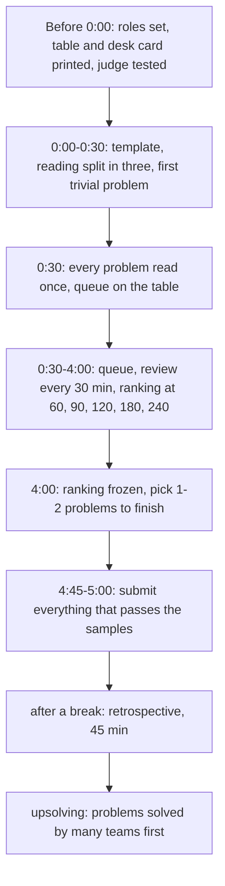

# Dzień 7 - Symulacja zawodów 1: AMPPZ 2018 drużyną

> [!abstract] Cel dnia
> Pierwsza próba generalna: 5 godzin, trzy osoby, jeden komputer, pełny zestaw AMPPZ 2018 (13 zadań), zasady jak
> na zawodach. Potem retrospektywa i upsolving. Po tym dniu wiecie, ile zadań trywialnych rozwiązujecie w warunkach
> zawodów i ile czasu na nie potrzebujecie, gdzie gubi się czas (czytanie, komputer, odrzucenia) i jakie trzy zasady
> zmienić przed symulacją 2 (Dzień 14).
>
> - **Minimum (ok. 3 h):** gdy nie da się zebrać drużyny: 2,5 godziny w pojedynkę albo we dwoje na tym samym
>   zestawie, według tych samych zasad, potem 30 minut retrospektywy.
> - **Pełna wersja (ok. 6-7 h):** 5 godzin drużyną, 45 minut retrospektywy, upsolving (dziś albo jutro rano przed
>   Dniem 8).

## 1. Przed symulacją (piątek wieczorem)

- [ ] Każdy przeczytał [taktykę](../taktyka/README.md) (ok. 40 minut), szczególnie pierwsze 30 minut i ostatnią
  godzinę.
- [ ] Role na start ustalone: kto pierwszy przy komputerze (kierowca), kto czyta od zadania A w górę, kto od M w dół
  i koordynuje ([role](../taktyka/role-i-komputer.md)).
- [ ] Wydrukowane: [tablica zadań](../taktyka/przebieg-zawodow.md) (sekcja "Tablica zadań") i
  [karta na biurko](../taktyka/dzien-probny-i-checklisty.md) (sekcja "Karta na biurko"). Treści zadań wydrukowane
  albo przygotowane do otwarcia: `201X/2018/A/A.pdf` ... `201X/2018/M/M.pdf` (13 plików, litery A-M).
- [ ] Sędzia przygotowany (sekcja 2) i jeden komputer z kompilatorem, edytorem i szablonem.
- [ ] Materiały drukowane dozwolone tak jak na zawodach (regulamin 2022 pozwalał na wydruki): karty wzorców
  i własne notatki na papierze tak, ale bez internetu poza sędzią.

> [!warning] Czego nie oglądać przed symulacją
> Wiersza 2018 w [katalogu zadań](../zadania/katalog.md) (technika i liczba rozwiązań każdego zadania), rankingu
> i omówienia jury 2018. Zadanie 2018 J znacie z Dnia 4, a kilka notatek kursu wspomina 2018 H, B i K jako przykłady
> sygnałów (atlas sygnałów, karty wzorców). To w porządku: na zawodach też korzystacie z tego, co już umiecie, tylko
> przy porównaniu z rankingiem pamiętajcie, że J był dla Was znany.

## 2. Sędzia

**Pierwszy wybór: QOJ.** Zadania AMPPZ z lat 2011-2025 są na sędzi QOJ (https://qoj.ac/category/194, po angielsku;
treści polskie macie w repo). Dzień wcześniej załóżcie jedno konto drużynowe, znajdźcie zestaw 2018 i wyślijcie
rozwiązanie zadania 2018 J z Dnia 4, żeby sprawdzić, że wszystko działa.

> [!question] Do weryfikacji
> Obecność zestawu 2018 na QOJ i dostęp do niego nie były sprawdzone (strona odrzuca automaty). Jeśli go nie ma,
> poszukajcie wirtualnego udziału w Codeforces Gym albo użyjcie zapasowego sposobu niżej.

**Zapas: sędzia na papierze.** Zgłoszenie to zapis w tablicy (minuta, zadanie). Program musi przejść wszystkie
przykłady z treści i Wasze testy brzegowe; po zawodach porównujecie pomysł z omówieniem jury i dla zadań z wątpliwą
poprawnością robicie stress test z brute force. Zgłoszenie, którego pomysł okazuje się błędny, liczy się jako
odrzucone (20 minut kary, jeśli później było AC). Ten sposób zawyża wynik, więc przy porównaniu z rankingiem traktujcie
go jako górną granicę.

## 3. Zasady symulacji

- 5 godzin bez przerwy, start o ustalonej godzinie, zegar widoczny dla wszystkich.
- Jeden komputer i jedna klawiatura; pozostali tylko papier i wydruki. Telefony wyłączone.
- Bez internetu poza sędzią; dokumentacja C++ tylko na papierze (jak na zawodach, gdzie są tylko `man` i własne
  wydruki).
- Punktacja jak na zawodach ([zasady i punktacja](../taktyka/zasady-i-punktacja.md)): liczba zadań, potem czas z karą
  20 minut za odrzucone zgłoszenie zadania rozwiązanego; błąd kompilacji bez kary.
- Koordynator prowadzi tablicę zadań przez całe zawody: z niej powstaje oś czasu do retrospektywy.
- **Ranking w trakcie.** Na prawdziwych zawodach widzicie, ile drużyn rozwiązało każde zadanie. Tu zastępuje go
  tabela poniżej, odczytana z oficjalnego rankingu 2018: koordynator odsłania ją w podanych minutach (i tylko wtedy),
  a po 4:00, jak na zawodach, ranking jest zamrożony.

> [!example]- Ranking w trakcie: liczba drużyn (z 51) z akceptacją do danej minuty
> | Minuta | A | B | C | D | E | F | G | H | I | J | K | L | M |
> |---|---|---|---|---|---|---|---|---|---|---|---|---|---|
> | 15 | 0 | 0 | 19 | 0 | 0 | 2 | 0 | 1 | 0 | 2 | 0 | 0 | 0 |
> | 30 | 0 | 0 | 31 | 0 | 0 | 12 | 0 | 4 | 0 | 3 | 0 | 0 | 0 |
> | 60 | 0 | 0 | 41 | 0 | 0 | 23 | 0 | 14 | 3 | 8 | 0 | 0 | 0 |
> | 90 | 1 | 0 | 44 | 0 | 1 | 27 | 0 | 29 | 3 | 13 | 2 | 0 | 0 |
> | 120 | 1 | 0 | 46 | 0 | 2 | 29 | 0 | 34 | 5 | 20 | 4 | 0 | 0 |
> | 180 | 2 | 2 | 46 | 0 | 5 | 34 | 0 | 38 | 11 | 26 | 10 | 0 | 0 |
> | 240 | 3 | 4 | 46 | 0 | 7 | 38 | 0 | 42 | 17 | 33 | 18 | 0 | 0 |
>
> Źródło: https://amppz.ii.uni.wroc.pl/ranking2018/ranking.html (minuty akceptacji wszystkich drużyn, policzone
> do danej minuty).

## 4. Plan pięciu godzin

Jak czytać diagram: przebieg jest taki sam jak w [taktyce](../taktyka/przebieg-zawodow.md), z dwoma dodatkami
symulacji. Ranking w trakcie zastępuje prawdziwy ranking, więc koordynator zagląda do niego w ustalonych minutach.
Po zawodach przerwa na jedzenie, a potem od razu retrospektywa, póki pamiętacie powody decyzji.

Cele na pierwszą symulację, realne dla drużyny po tygodniu kursu:

- pierwsza akceptacja przed 30. minutą;
- wszystkie zadania przeczytane do 30. minuty, każde z oceną T/Z/N w tablicy;
- zadania, które w rankingu do 60. minuty rozwiązało ponad 10 drużyn, rozwiązane albo świadomie odłożone;
- żadne zgłoszenie bez przejścia przykładów przez `diff`.

## 5. Po zawodach: wynik

Przeliczcie wynik (zadania i czas z karą) i porównajcie z rankingiem 2018. Liczba rozwiązanych zadań wyznacza
przedział miejsc, a dokładne miejsce w przedziale daje porównanie łącznego czasu z rankingiem:

| Zadania | Miejsca w 2018 (51 drużyn) |
|---|---|
| 10 | 1 |
| 9 | 2-3 |
| 8 | 4-5 |
| 7 | 6-10 |
| 6 | 11-18 |
| 5 | 19-28 |
| 4 | 29-35 |
| 3 | 36-41 |
| 2 | 42 |
| 1 | 43-46 |
| 0 | 47-51 |

Mediana sali to 5 zadań; zwycięzca (Uniwersytet Warszawski) rozwiązał 10 z 13 w łącznym czasie 985 minut.

## 6. Retrospektywa

Według [szablonu](../taktyka/retrospektywa.md), 45 minut, cała drużyna. Pytania szczególnie ważne po pierwszej
symulacji:

- Ile minut minęło do pierwszej akceptacji i co działo się w tym czasie przy komputerze?
- Które zadania z wieloma akceptacjami w rankingu ocenialiście jako trudne i dlaczego?
- Ile było odrzuceń i które dało się wyłapać checklistą przed zgłoszeniem?
- Czy komputer stał bezczynnie albo był zajęty przez kogoś, kto myślał przy klawiaturze? Jak długo?
- Co wydarzyło się po 4:00: czy decyzja o wyborze zadań była trafna?

Wynik retrospektywy: najwyżej trzy zmiany zasad, dopisane w [taktyce](../taktyka/README.md) (sekcja "Zasady naszej
drużyny"), i lista upsolvingu z osobami i terminami.

## 7. Upsolving

Otwórzcie dopiero po zawodach. Kolejność: od zadań rozwiązanych przez najwięcej drużyn. Cel minimum: wszystkie
zadania, które rozwiązało co najmniej 10 drużyn (C, H, F, J, K, I); chętni dalej E i A.

> [!example]- Zadania AMPPZ 2018: liczby rozwiązań i omówienie jury
> | Zadanie | Treść | Drużyny z AC (z 51) | Pierwsze AC (minuta) | Omówienie jury (strony PDF) | W kursie |
> |---|---|---|---|---|---|
> | C Chińskie twierdzenie o resztach | [C.pdf](../../201X/2018/C/C.pdf) | 46 | 5 | 3 | |
> | H Hobby | [H.pdf](../../201X/2018/H/H.pdf) | 42 | 15 | 2 | |
> | F Foremki na ciasta | [F.pdf](../../201X/2018/F/F.pdf) | 38 | 7 | 5 | |
> | J Jednakowe szaliki | [J.pdf](../../201X/2018/J/J.pdf) | 37 | 15 | 4 | [omówienie](../zadania/2018/j-jednakowe-szaliki.md) |
> | K Kieszonkowe | [K.pdf](../../201X/2018/K/K.pdf) | 26 | 67 | 6-7 | |
> | I Indeks | [I.pdf](../../201X/2018/I/I.pdf) | 18 | 31 | 8-11 | |
> | E Ewaluacja | [E.pdf](../../201X/2018/E/E.pdf) | 9 | 76 | 42-66 | |
> | A Aparat na dronie | [A.pdf](../../201X/2018/A/A.pdf) | 6 | 87 | 19-35 | |
> | B Bony Fibonacciego | [B.pdf](../../201X/2018/B/B.pdf) | 5 | 151 | 12-13 | |
> | D Droga | [D.pdf](../../201X/2018/D/D.pdf) | 1 | 287 | 36-41 | |
> | G Gusta malarskie | [G.pdf](../../201X/2018/G/G.pdf) | 1 | 245 | 14-15 | |
> | M Magiczny labirynt | [M.pdf](../../201X/2018/M/M.pdf) | 0 | | od 67 | |
> | L Linie | [L.pdf](../../201X/2018/L/L.pdf) | 0 | | 16-18 | |
>
> Omówienie jury (slajdy Uniwersytetu Wrocławskiego): https://amppz.ii.uni.wroc.pl/files/prez.pdf; numery to strony
> pliku PDF. Ranking: https://amppz.ii.uni.wroc.pl/ranking2018/ranking.html. Rozwiązania zadań 2018 poza J nie są
> jeszcze sprawdzone w kursie: przy upsolvingu traktujcie omówienie jury jako źródło, a swoje rozwiązanie testujcie
> brute force jak na Dniu 5. Technika według treści (szacunek): [katalog](../zadania/katalog.md), wiersz 2018.

Zasady upsolvingu: najpierw sam, z omówieniem jury otwieranym po jednym slajdzie jak podpowiedzi; rozwiązanie
z przykładami i stress testem; błąd z zawodów do dziennika; wspólny mianownik zadania do własnej listy
([wspólne mianowniki](../myslenie/wspolne-mianowniki.md)).

## 8. Fiszki

Co decyduje o miejscu w rankingu AMPPZ?::Najpierw liczba rozwiązanych zadań, przy remisie łączny czas z karą.
Ile kosztuje odrzucone zgłoszenie?::20 minut doliczane do czasu zadania, ale tylko jeśli zadanie zostanie w końcu rozwiązane.
Czy błąd kompilacji daje karę?::Nie (regulamin 2022), ale zabiera czas komputera.
Dlaczego zadania trywialne rozwiązuje się od najkrótszego?::Suma momentów ukończenia jest najmniejsza, gdy krótsze idą pierwsze (argument zamiany).
Kiedy opłaca się 5 minut testów przed zgłoszeniem?::Gdy szansa, że testy złapią błąd, przekracza 1 na 4 (5 minut wobec 20 minut kary).
Co robi się z komputerem po odrzuceniu?::Autor drukuje kod i szuka błędu na papierze, komputer przejmuje następna osoba.
Co mówi się w 30-sekundowym przekazaniu, zanim usiądziesz do komputera?::Pomysł, złożoność, przypadki brzegowe, największe ryzyko.
Co robi drużyna o 4:00 przy zamrożonym rankingu?::Wybiera 1-2 zadania do dokończenia i nie zaczyna nowego trudnego.
Dlaczego w ostatnim kwadransie wysyła się także rozwiązania niepewne?::Kara liczy się tylko dla zadań rozwiązanych, więc takie zgłoszenie nie może pogorszyć wyniku.
Co pokazuje ranking w pierwszej godzinie?::Które zadania są łatwe: dużo akceptacji oznacza zadanie do ponownego przeczytania, jeśli go nie macie.

## 9. Zamknięcie dnia

- [ ] Symulacja rozegrana (albo wersja minimum), wynik przeliczony i porównany z rankingiem 2018.
- [ ] Retrospektywa wypełniona, najwyżej trzy zmiany zasad dopisane do [taktyki](../taktyka/README.md).
- [ ] Lista upsolvingu z osobami i terminami; zadania C, H, F, J dokończone najpóźniej jutro.
- [ ] Błędy z zawodów w dzienniku ([wzór](../dziennik/szablon-dziennika.md)), fiszki z Dnia 7 przejrzane.

Następny dzień: grafy I, czyli reprezentacja, BFS, DFS, składowe i siatki ([plan](../plan-20-dni.md)).
