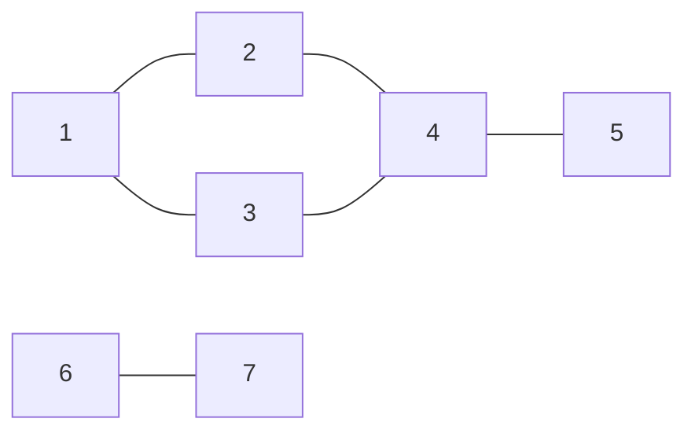
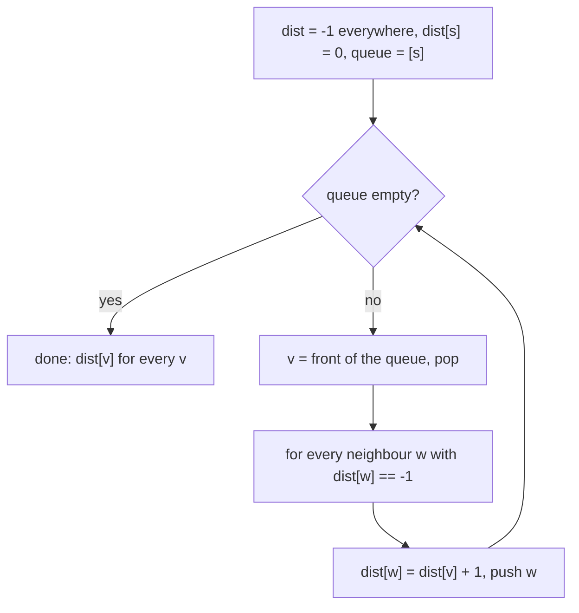
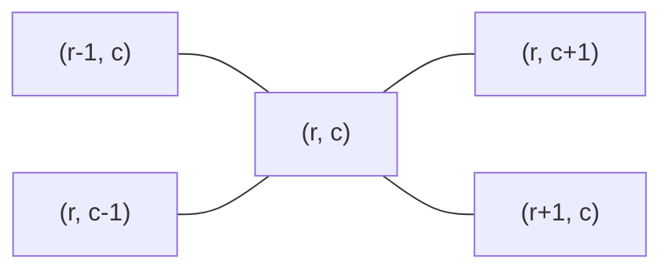
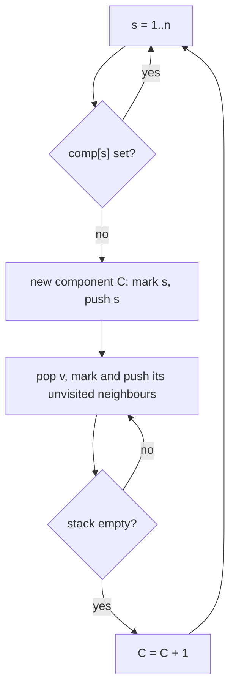
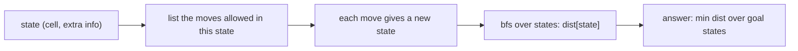
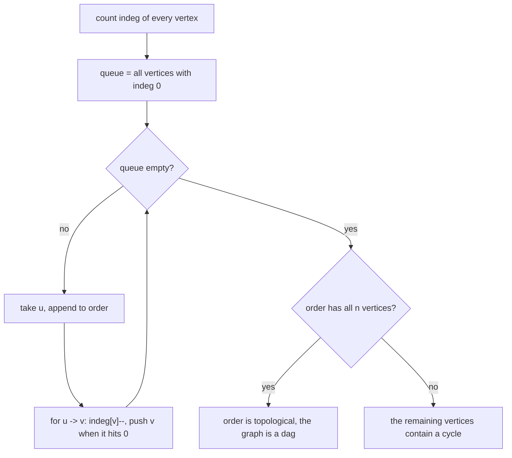

# Dzień 8 - Grafy I: reprezentacja, BFS, DFS, składowe, siatki, sortowanie topologiczne

> [!abstract] Cel dnia
> Po tym dniu: zapisujesz graf listą sąsiedztwa i wiesz, kiedy wystarczy siatka bez żadnej listy; BFS-em liczysz
> najkrótsze odległości w grafie bez wag (z jednego źródła, z wielu naraz, od celu) i odtwarzasz drogę; DFS-em
> i flood fillem liczysz składowe spójne; budujesz graf stanów, gdy sama pozycja nie wystarcza; sortowaniem
> topologicznym (algorytm Kahna) porządkujesz graf skierowany, wykrywasz cykl i liczysz najdłuższą ścieżkę w DAG.
>
> - **Minimum (ok. 1 h):** sekcje 1-4, zadanie omówione 2005 G, ćwiczenie 1996 C.
> - **Pełna wersja (do 3 h):** wszystko, łącznie z sekcjami 5-6 i zadaniem 2015 B (nierówności jako graf), ćwiczeniem
>   2022 M, wyzwaniem 1998 F, zadaniem bez etykiety 2011 H, rachunkami w pamięci i zadaniami z CSES.

Na start 10 minut: fiszki z Dni 1-6, dziennik błędów i wnioski z wczorajszej retrospektywy symulacji
([Dzień 7](07-symulacja-1.md)). Jeśli w symulacji padło zadanie grafowe, wróć do niego po tym dniu.

## 1. Graf i jego zapis w pamięci

**Intuicja.** Mapa miast i dróg: miasta to punkty, drogi to linie między nimi. Graf to ta sama mapa bez geografii:
liczy się tylko, co z czym jest połączone. Graf kryje się w treści pod słowami "znajomi", "połączenia", "przejścia",
"zależności", "sąsiednie pola", a czasem nie ma go w treści wcale, tylko w rozwiązaniu (stany, nierówności, dni).

**Definicja.** Graf G = (V, E) to zbiór wierzchołków V (n = |V|) i krawędzi E (m = |E|), czyli par wierzchołków.
W grafie **nieskierowanym** krawędź {u, v} działa w obie strony, w **skierowanym** krawędź u → v tylko od u do v.
Stopień wierzchołka to liczba krawędzi, które go dotykają (w skierowanym osobno wejściowy i wyjściowy). **Ścieżka** to
ciąg wierzchołków połączonych kolejnymi krawędziami, **cykl** to ścieżka, która wraca do początku.

**Mechanizm.** Trzy zapisy grafu:

- **Lista sąsiedztwa** `vector<vector<int>> adj(n)`: dla każdego wierzchołka lista sąsiadów. Pamięć O(n + m), przejście
  po sąsiadach v kosztuje tyle, ilu ich jest. Domyślny wybór na zawodach.
- **Macierz sąsiedztwa** `adj[u][v]`: pytanie "czy jest krawędź u-v" w O(1), ale pamięć n². Tylko dla n do kilku
  tysięcy (n = 10⁵ to 10¹⁰ komórek).
- **Lista krawędzi** `vector<array<int, 3>>`: trójki (u, v, waga); przyda się jutro (Kruskal sortuje krawędzie).

```cpp
int n, m;
cin >> n >> m;
vector<vector<int>> adj(n + 1);                // vertices 1..n as in most statements
for (int i = 0; i < m; i++) {
    int u, v;
    cin >> u >> v;
    adj[u].push_back(v);
    adj[v].push_back(u);                       // skip this line for a directed graph
}
```



Jak czytać diagram: to graf nieskierowany z 7 wierzchołkami i 6 krawędziami. Lista sąsiedztwa: 1: [2, 3], 2: [1, 4],
3: [1, 4], 4: [2, 3, 5], 5: [4], 6: [7], 7: [6]. Wierzchołki 6 i 7 nie mają drogi do reszty: graf ma dwie **składowe
spójne** (sekcja 4). Odległość z 1 do 5 to 3 krawędzie (1-2-4-5 albo 1-3-4-5).

**Przykład.** n = 10⁵, m = 2 · 10⁵: lista sąsiedztwa to ok. 4 · 10⁵ liczb `int` (każda krawędź nieskierowana dwa razy),
ok. 1,6 MB plus narzut wektorów. Macierz to 10¹⁰ bajtów, czyli 10 GB: odpada.

> [!tip] Szybciej niż `vector<vector<int>>`
> Przy m rzędu 10⁶ i więcej wektor na wierzchołek bywa wolny (osobna alokacja). Zamiast tego jedna tablica sąsiadów
> posortowana po źródle (zliczanie stopni, sumy prefiksowe z Dnia 4, rozłożenie): tak robi kod do
> [2015 B](../zadania/2015/b-bogacze.md).

## 2. BFS: najkrótsze ścieżki w grafie bez wag

**Intuicja.** Kamień wrzucony do wody: fala dociera najpierw do punktów w odległości 1, potem 2, potem 3. BFS
(przeszukiwanie wszerz) odwiedza wierzchołki w tej samej kolejności: warstwami według odległości od startu.

**Definicja.** BFS ze źródła s liczy dist[v] = najmniejszą liczbę krawędzi na ścieżce z s do v (albo "nieosiągalny")
dla wszystkich v naraz, w czasie O(n + m).

**Mechanizm.** Kolejka FIFO. Na starcie dist[s] = 0 i s w kolejce. Zdejmujemy wierzchołek v z przodu kolejki i każdego
nieodwiedzonego sąsiada w oznaczamy dist[w] = dist[v] + 1 i wkładamy na koniec. Wierzchołek oznaczamy w chwili
**wkładania** do kolejki, nie zdejmowania, żeby nie wpadł do niej dwa razy.

```cpp
vector<int> dist(n + 1, -1);                   // -1 = not visited yet
queue<int> q;
dist[s] = 0;
q.push(s);
while (!q.empty()) {
    int v = q.front(); q.pop();
    for (int w : adj[v])
        if (dist[w] == -1) {                   // first visit is the shortest
            dist[w] = dist[v] + 1;
            parent[w] = v;                     // to rebuild the path later
            q.push(w);
        }
}
```



Jak czytać diagram: w kolejce leżą najpierw wierzchołki odległości d, za nimi odległości d + 1, i nigdy nie ma tam
innych. Dlatego pierwszy raz, gdy BFS dotyka wierzchołka, robi to najkrótszą drogą. Każdy wierzchołek wchodzi do
kolejki raz, każda krawędź jest oglądana raz (dwa razy w nieskierowanym): O(n + m).

**Przykład.** Graf z diagramu w sekcji 1, start 1. Warstwa 0: {1}. Warstwa 1: {2, 3}. Warstwa 2: {4} (z 2; z 3 już
odwiedzony). Warstwa 3: {5}. Wierzchołki 6 i 7 zostają z dist = -1.

Trzy warianty, które wracają w zadaniach:

- **Odtwarzanie drogi.** `parent[w] = v` przy odwiedzeniu, potem od celu po rodzicach do startu i odwrócenie.
  Albo bez rodziców: z celu idź do dowolnego sąsiada o dist mniejszym o 1.
- **BFS od celu.** Gdy pytanie brzmi "z każdego pola do wyjścia" albo trzeba wybrać drogę krok po kroku od startu,
  licz odległości od celu: wtedy z każdego pola wiesz, który ruch przybliża do celu
  ([2005 G Skarb](../zadania/2005/g-skarb.md)).
- **Wiele źródeł naraz.** Wszystkie źródła wkładasz do kolejki na starcie z dist = 0: dostajesz odległość do
  najbliższego źródła (najbliższy szpital, pożar rozchodzący się z kilku miejsc).

> [!warning] Wiele testów w jednym wejściu
> Tablicę dist i kolejkę zakładaj od nowa w każdym teście (albo czyść tylko to, czego test dotknął). Stary dist = 5
> z poprzedniego testu wygląda jak odwiedzony wierzchołek.

## 3. Siatka jako graf

**Intuicja.** Plansza z polami i ścianami to graf, którego nie trzeba budować: sąsiedzi pola (r, c) to pola obok.
Lista sąsiedztwa dla mapy 1000 × 1000 kosztowałaby 4 · 10⁶ liczb na nic, bo sąsiadów i tak liczymy w locie.

**Definicja.** Siatka w × k: wierzchołki to pola (r, c), 0 ≤ r < w, 0 ≤ c < k; krawędzie łączą pola sąsiednie
(4 kierunki: bokiem, albo 8: także po przekątnej), o ile żadne nie jest ścianą.

**Mechanizm.** Tablice przesunięć i sprawdzenie granic. Pole zapisane jedną liczbą id = r · k + c pozwala trzymać dist
w jednym wektorze, a kolejkę jako zwykłą tablicę.

```cpp
const int dr[4] = {1, -1, 0, 0}, dc[4] = {0, 0, -1, 1};   // down, up, left, right
vector<int> dist(w * k, -1), q;                // the queue is a plain array, head moves forward
dist[sr * k + sc] = 0;
q.push_back(sr * k + sc);
for (size_t head = 0; head < q.size(); head++) {
    int r = q[head] / k, c = q[head] % k;
    for (int d = 0; d < 4; d++) {
        int nr = r + dr[d], nc = c + dc[d];
        if (nr < 0 || nr >= w || nc < 0 || nc >= k) continue;      // outside the map
        if (g[nr][nc] == '#' || dist[nr * k + nc] != -1) continue; // wall or seen
        dist[nr * k + nc] = dist[q[head]] + 1;
        q.push_back(nr * k + nc);
    }
}
```



Jak czytać diagram: pole (r, c) ma najwyżej 4 sąsiadów bokiem; przy łączności 8-kierunkowej dochodzą 4 narożniki
(dr, dc z {-1, 0, 1} oprócz (0, 0)). Na brzegu mapy część sąsiadów nie istnieje, stąd sprawdzenie granic przed
odczytem `g[nr][nc]`.

**Przykład.** Mapa 3 × 3 ze ścianą w środku, start w lewym górnym rogu: róg prawy dolny ma odległość 4 (dwie drogi
dookoła ściany), środek zostaje z -1.

**Flood fill** ("algorytm malarza", jak wiadro z farbą w programie graficznym) to BFS albo DFS z każdego
nieodwiedzonego pola, który zamalowuje cały obszar: tyle startów, ile obszarów. Tak liczy się wyspy, pokoje
i kształty ([1996 C Shapes](../zadania/1996/c-shapes.md)).

## 4. DFS i składowe spójne

**Intuicja.** Zwiedzanie labiryntu z kłębkiem nici: idziesz w głąb pierwszym nieznanym korytarzem, a gdy dalej nie
ma nic nowego, cofasz się po nici do ostatniego rozwidlenia. To DFS (przeszukiwanie w głąb).

**Definicja.** DFS z wierzchołka v oznacza v jako odwiedzony i wywołuje się dla każdego nieodwiedzonego sąsiada.
Odwiedza dokładnie wierzchołki osiągalne z v, w czasie O(n + m). **Składowa spójna** grafu nieskierowanego to
maksymalny zbiór wierzchołków, w którym z każdego da się dojść do każdego.

**Mechanizm.** Składowe liczy pętla po wszystkich wierzchołkach: każdy jeszcze nieodwiedzony to nowa składowa,
z której DFS (albo BFS) zaznacza resztę.

```cpp
vector<int> comp(n + 1, -1);                   // component id, -1 = not visited
int C = 0;
for (int s = 1; s <= n; s++) {
    if (comp[s] != -1) continue;
    vector<int> st = {s};                      // explicit stack: no recursion depth limit
    comp[s] = C;
    while (!st.empty()) {
        int v = st.back(); st.pop_back();
        for (int w : adj[v])
            if (comp[w] == -1) { comp[w] = C; st.push_back(w); }
    }
    C++;                                       // C = number of components so far
}
```



Jak czytać diagram: zewnętrzna pętla szuka wierzchołka bez składowej, wewnętrzna (stos) zaznacza wszystko, co z niego
osiągalne. Każdy wierzchołek i każda krawędź są przerabiane raz, więc całość to O(n + m), choć pętle są dwie.

**Przykład.** Graf z sekcji 1: s = 1 zaznacza {1, 2, 3, 4, 5} jako składową 0, s = 2..5 są już zaznaczone, s = 6
zaznacza {6, 7} jako składową 1. Wynik: 2 składowe. Żeby połączyć graf w całość, trzeba dołożyć C - 1 = 1 krawędź
(CSES Building Roads).

> [!warning] Rekurencja i stos wywołań
> Rekurencyjny DFS na ścieżce długości 10⁵-10⁶ schodzi tyle poziomów w głąb. Domyślny stos (często 1-8 MB) bywa za
> mały i program kończy się błędem wykonania (RE). W omówieniu 2015 B jury podaje 44 zgłoszenia z RE na 93: to
> prawdopodobnie właśnie rekurencja. Na zawodach pisz DFS ze stosem jawnym (jak wyżej) albo używaj BFS, gdy kolejność
> nie gra roli.

**Kolejność DFS ma znaczenie** w dwóch miejscach: przy wykrywaniu cyklu w grafie skierowanym (wierzchołek "w trakcie",
do którego wraca krawędź, to cykl) i przy porządku "po zakończeniu" (odwrócony daje porządek topologiczny). Oba
zadania robi też algorytm Kahna z sekcji 6, bez rekurencji, i jego używamy w kursie.

## 5. Graf stanów

**Intuicja.** Czasem pozycja nie wystarcza, żeby wiedzieć, co dalej. Skoczek, który nie może dwa razy pod rząd zrobić
tego samego ruchu, musi pamiętać ostatni ruch; ktoś z kluczem otwiera drzwi, a bez klucza nie. Wtedy wierzchołkiem
grafu jest **stan**: pozycja plus to, co trzeba pamiętać.

**Definicja.** Graf stanów: wierzchołki to wszystkie możliwe stany (pozycja, dodatkowe informacje), krawędzie to ruchy
dozwolone w danym stanie. Najmniejsza liczba ruchów to BFS w tym grafie. Liczba stanów to iloczyn zakresów
składowych stanu i to ona decyduje o złożoności.

**Mechanizm.** Zakoduj stan jedną liczbą (np. id = pole · 4 + ostatni_ruch) albo tablicą wielowymiarową dist[r][c][x];
reszta to zwykły BFS. Cel bywa zbiorem stanów (dowolny ostatni ruch), więc odpowiedź to minimum po nich.



Jak czytać diagram: zmienia się tylko to, co jest wierzchołkiem; BFS jest ten sam. Przed pisaniem policz stany:
1000 × 1000 pól razy 4 kierunki to 4 · 10⁶ stanów, w porządku; razy 2²⁰ zebranych kluczy już nie.

**Przykład.** Dwa dzbanki 3 l i 5 l, cel: 4 l w jednym. Stan to para (a, b) zawartości, 4 · 6 = 24 stany; ruchy:
napełnij, wylej, przelej. BFS daje 6 ruchów: (0,5), (3,2), (0,2), (2,0), (2,5), (3,4).

## 6. Sortowanie topologiczne, cykle i najdłuższa ścieżka w DAG

**Intuicja.** Ubieranie się: skarpetki przed butami, koszula przed marynarką. Zależności to strzałki "najpierw to, potem
tamto", a szukamy kolejności, która ich nie łamie. Jeśli zależności tworzą koło (A przed B, B przed C, C przed A),
takiej kolejności nie ma.

**Definicja.** **DAG** to graf skierowany bez cykli. **Porządek topologiczny** to ustawienie wierzchołków w ciąg tak,
że każda krawędź u → v prowadzi w prawo (u przed v). Istnieje dokładnie wtedy, gdy graf nie ma cyklu.

**Mechanizm (algorytm Kahna).** Wierzchołek bez krawędzi wchodzących może iść pierwszy. Zabieramy go, usuwamy jego
krawędzie wychodzące (zmniejszamy stopnie wejściowe sąsiadów) i powtarzamy. Jeśli zabraliśmy wszystkie wierzchołki,
mamy porządek; jeśli utknęliśmy, to reszta ma w każdym wierzchołku krawędź wchodzącą, a wtedy zawiera cykl (idąc
wstecz po krawędziach wchodzących, musimy kiedyś powtórzyć wierzchołek).

```cpp
vector<int> indeg(n + 1, 0), order, len(n + 1, 0);
for (int u = 1; u <= n; u++) for (int v : adj[u]) indeg[v]++;
for (int v = 1; v <= n; v++) if (indeg[v] == 0) order.push_back(v);
for (size_t h = 0; h < order.size(); h++) {    // order doubles as the queue
    int u = order[h];
    for (int v : adj[u]) {
        len[v] = max(len[v], len[u] + 1);      // longest path ending at v (dp on a dag)
        if (--indeg[v] == 0) order.push_back(v);
    }
}
bool has_cycle = (int)order.size() < n;        // vertices on a cycle never reach indeg 0
```



Jak czytać diagram: kolejka trzyma wierzchołki, których wszyscy poprzednicy są już w porządku. Wierzchołek na cyklu
zawsze ma poprzednika na tym samym cyklu, więc jego stopień nigdy nie spada do zera i nie trafia do porządku.

**Przykład.** Krawędzie 1 → 2, 1 → 3, 2 → 4, 3 → 4. Stopnie: 1:0, 2:1, 3:1, 4:2. Porządek: 1, potem 2 i 3, potem 4.
Najdłuższa ścieżka: len[4] = 2 (1 → 2 → 4). Dodanie krawędzi 4 → 1 tworzy cykl: żaden wierzchołek nie ma stopnia 0,
porządek jest pusty.

**Najdłuższa ścieżka w DAG** to pierwsze programowanie dynamiczne w kursie (Dzień 10): len[v] zależy tylko od
poprzedników v, a porządek topologiczny gwarantuje, że są policzeni wcześniej. W grafie z cyklami najdłuższa ścieżka
jest problemem trudnym, w DAG kosztuje O(n + m).

**Ruchy, które wracają w AMPPZ:**

| Ruch | Sygnał w treści | Zadanie z archiwum |
|---|---|---|
| BFS od celu, wybór ruchu krok po kroku | "najkrótsza, a z nich pierwsza leksykograficznie" | 2005 G Skarb |
| Flood fill, łączność 8-kierunkowa | "obszar", "spójny", "sąsiaduje także po przekątnej" | 1996 C Shapes |
| Nierówności jako krawędzie, cykl = sprzeczność | "czy układ ma rozwiązanie", "x > y" | 2015 B Bogacze |
| Przejście po czasie od końca | "kolejne dni", "jeśli obaj jeszcze żyją" | 2022 M Mniejsze zło |
| Składowe równości, DAG, najdłuższa ścieżka | "<, =, >", "najmniejsze k" | 1998 F Relations |

## 7. Zadania omówione

Przy każdym najpierw sam, z zegarkiem (czas w notatce), potem podpowiedzi po jednej, na końcu omówienie.

- **[AMPPZ 2005 G - Skarb](../zadania/2005/g-skarb.md)** (minimum, rankingu 2005 brak): najkrótsza droga na mapie
  1000 × 1000, a z najkrótszych pierwsza leksykograficznie; BFS od skarbu i zachłanny wybór litery.
- **[AMPPZ 2015 B - Bogacze](../zadania/2015/b-bogacze.md)** (pełna, rankingu 2015 brak; jury: 41 zaakceptowanych
  zgłoszeń na 93): czy układ nierówności ±xᵢ ± xⱼ > 0 ma rozwiązanie; graf na 2n literałach i wykrywanie cyklu.

## 8. Ćwiczenia

**AMPPZ z tematu dnia:**

- **[AMPPZ 1996 C - Shapes](../zadania/1996/c-shapes.md)** (minimum, 20 minut, treść po angielsku): policz kształty
  każdego koloru na mapie liter i kolory sąsiadujące. Treść: `199X/1996/C/C.pdf` ([PDF](../../199X/1996/C/C.pdf)).
- **[AMPPZ 2022 M - Mniejsze zło](../zadania/2022/m-mniejsze-zlo.md)** (pełna, 35 minut, 30 z 50 drużyn): w których
  dniach rzucić urok, żeby zginęli wszyscy wskazani. Zanim napiszesz kod, zastanów się, kto naprawdę musi zginąć.
- **[AMPPZ 1998 F - Relations](../zadania/1998/f-relations.md)** (pełna, wyzwanie, 45 minut, treść po angielsku):
  najmniejsze k, dla którego da się ponumerować wierzchołki liczbami 0..k zgodnie z relacjami <, =, > na krawędziach.

**Zadanie bez etykiety** (technika z wcześniejszego dnia, rozpoznaj ją sam):

- **[AMPPZ 2011 H - Herbata z mlekiem](../zadania/2011/h-herbata-z-mlekiem.md)** (pełna, 20 minut, 38 z 55 drużyn).
  Treść: `201X/2011/H/H.pdf` ([PDF](../../201X/2011/H/H.pdf)). Notatkę otwórz dopiero po swojej próbie, bo jej karta
  zdradza technikę.

**Rachunki w pamięci (pełna wersja).** Odpowiedz, zanim rozwiniesz.

> [!question]- Ile pamięci zajmie macierz sąsiedztwa `bool` dla n = 5 · 10⁴, a ile lista dla m = 10⁵?
> Macierz: 2,5 · 10⁹ bajtów, czyli 2,5 GB: odpada. Lista: 2 · 10⁵ liczb `int` (krawędź w obie strony), ok. 0,8 MB.

> [!question]- Graf ma n = 10 wierzchołków i 3 składowe. Ile krawędzi trzeba dodać, żeby był spójny?
> 2: każda nowa krawędź między różnymi składowymi łączy dwie w jedną, a z 3 składowych trzeba zrobić 1.

> [!question]- BFS na mapie 1000 × 1000 przy z = 10 mapach: ile operacji?
> Ok. 10 · 10⁶ pól · 4 kierunki = 4 · 10⁷ prostych kroków: mieści się w sekundzie, jeśli nie budujesz list sąsiedztwa.

> [!question]- Graf stanów: pole na mapie 500 × 500, kierunek (4) i liczba użytych teleportów (0..10). Ile stanów?
> 250 000 · 4 · 11 = 1,1 · 10⁷: BFS się zmieści, tablica dist `int` to ok. 44 MB.

> [!question]- Krawędzie a → b, b → c, a → c, c → d. Ile jest porządków topologicznych?
> Jeden: a, b, c, d. a jako jedyne ma stopień 0, potem b (c czeka na b), potem c, potem d.

> [!question]- Dlaczego BFS oznacza wierzchołek przy wkładaniu do kolejki, a nie przy zdejmowaniu?
> Bo inaczej ten sam wierzchołek trafi do kolejki od każdego sąsiada: pamięć i czas rosną do O(m) wpisów, a przy
> siatkach z wieloma testami to różnica między AC i TLE. Odległość i tak jest dobra przy pierwszym dotknięciu.

**CSES (pełna wersja).** Dział Graph Algorithms:

- **[Counting Rooms](https://cses.fi/problemset/task/1192):** flood fill, liczba pokoi na mapie.
- **[Labyrinth](https://cses.fi/problemset/task/1193):** BFS na siatce z odtworzeniem drogi (litery L, R, U, D).
- **[Building Roads](https://cses.fi/problemset/task/1666):** składowe i C - 1 krawędzi, które je łączą.
- **[Message Route](https://cses.fi/problemset/task/1667):** BFS z rodzicami i wypisanie ścieżki.
- **[Building Teams](https://cses.fi/problemset/task/1668):** kolorowanie grafu na dwa kolory BFS-em (graf dwudzielny).
- **[Course Schedule](https://cses.fi/problemset/task/1679):** porządek topologiczny albo IMPOSSIBLE (algorytm Kahna).

> [!tip]- Podpowiedź do Building Teams
> BFS z każdego niepokolorowanego wierzchołka: start dostaje kolor 1, sąsiad zawsze kolor przeciwny. Jeśli krawędź
> łączy dwa wierzchołki tego samego koloru, odpowiedź to IMPOSSIBLE (w grafie jest cykl nieparzystej długości).

> [!tip]- Podpowiedź do Course Schedule
> Kahn dokładnie jak w sekcji 6. Jeśli porządek ma mniej niż n wierzchołków, wypisz IMPOSSIBLE.

## 9. Fiszki

Kiedy lista sąsiedztwa, a kiedy macierz?::Lista prawie zawsze (pamięć O(n + m)); macierz tylko dla n do kilku tysięcy, gdy pytasz "czy jest krawędź u-v".
Co liczy BFS i w jakim czasie?::Najmniejszą liczbę krawędzi z jednego źródła do każdego wierzchołka, O(n + m).
Kiedy BFS oznacza wierzchołek jako odwiedzony?::Przy wkładaniu do kolejki, żeby nie trafił do niej drugi raz.
Jak odtworzyć najkrótszą drogę po BFS?::parent[w] = v przy odwiedzeniu, potem od celu po rodzicach i odwrócenie; albo z celu do sąsiada o dist mniejszym o 1.
Jak policzyć odległość do najbliższego z wielu źródeł?::BFS z wieloma źródłami: wszystkie do kolejki na starcie z dist = 0.
Jak zapisać sąsiadów pola na siatce?::Tablice dr, dc i sprawdzenie granic; pole jako id = r · k + c.
Jak policzyć składowe spójne?::Pętla po wierzchołkach; każdy nieodwiedzony to nowa składowa, BFS lub DFS zaznacza resztę; O(n + m).
Dlaczego rekurencyjny DFS bywa groźny?::Głębokość do n wywołań przepełnia stos (RE); stos jawny albo BFS.
Czym jest graf stanów?::Graf, w którym wierzchołek to pozycja plus to, co trzeba pamiętać; BFS po stanach daje najmniej ruchów.
Kiedy istnieje porządek topologiczny?::Dokładnie wtedy, gdy graf skierowany nie ma cyklu (jest DAG-iem).
Jak działa algorytm Kahna?::Zabieraj wierzchołki o stopniu wejściowym 0 i zmniejszaj stopnie ich następników; zostały wierzchołki, to jest cykl.
Jak policzyć najdłuższą ścieżkę w DAG?::W porządku topologicznym len[v] = max(len[u] + 1) po krawędziach u → v; O(n + m).
Jak sprawdzić, czy układ nierówności x > y ma rozwiązanie?::Krawędź od mniejszego do większego; sprzeczny dokładnie wtedy, gdy graf ma cykl.

## 10. Zamknięcie dnia

- [ ] Umiem z pamięci napisać BFS na liście sąsiedztwa i na siatce oraz liczenie składowych stosem.
- [ ] 2005 G Skarb rozwiązane, umiem powiedzieć, dlaczego BFS liczę od skarbu, a nie od startu.
- [ ] 1996 C Shapes rozwiązane.
- [ ] (pełna) 2015 B, 2022 M, wyzwanie 1998 F, 2011 H bez etykiety, rachunki w pamięci, zadania z CSES.
- [ ] Dzisiejsze błędy wpisane do dziennika ([wzór](../dziennik/szablon-dziennika.md)).
- [ ] Fiszki z Dnia 6 i Dnia 8 przejrzane.

Materiały obok: [sygnały w treści](../myslenie/sygnaly-w-tresci.md), [karta wzorca grafów](../wzorce/grafy.md),
[katalog zadań](../zadania/katalog.md) (grupa "grafy BFS/DFS"), [wspólne mianowniki](../myslenie/wspolne-mianowniki.md)
(sekcja o grafach).

Następny dzień: grafy II, czyli Dijkstra, BFS 0-1, Find-Union i minimalne drzewo rozpinające
([plan](../plan-20-dni.md)).
