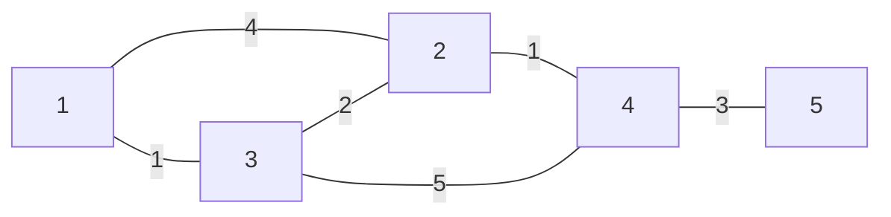
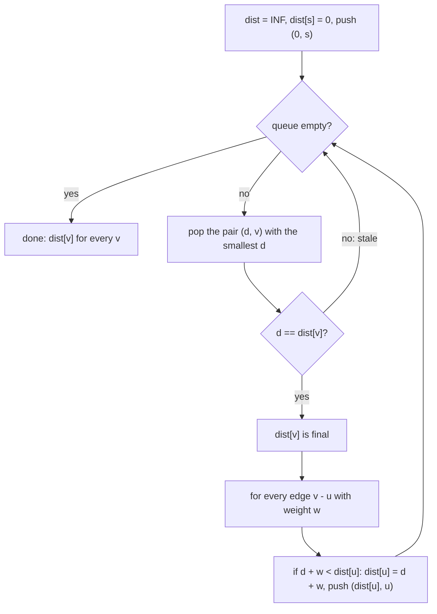
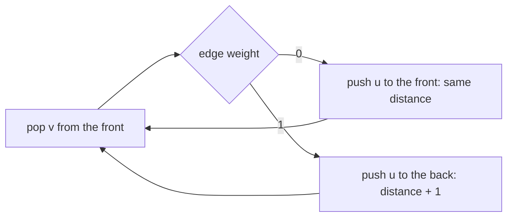
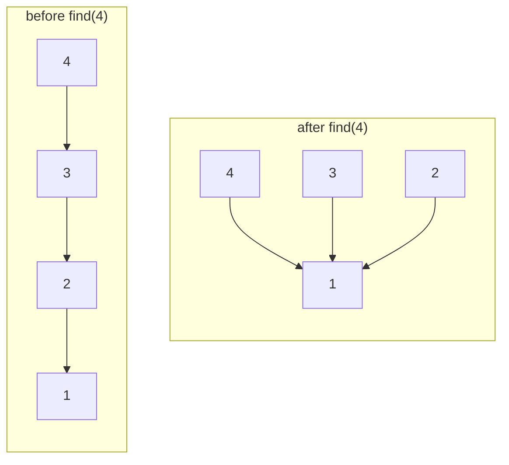
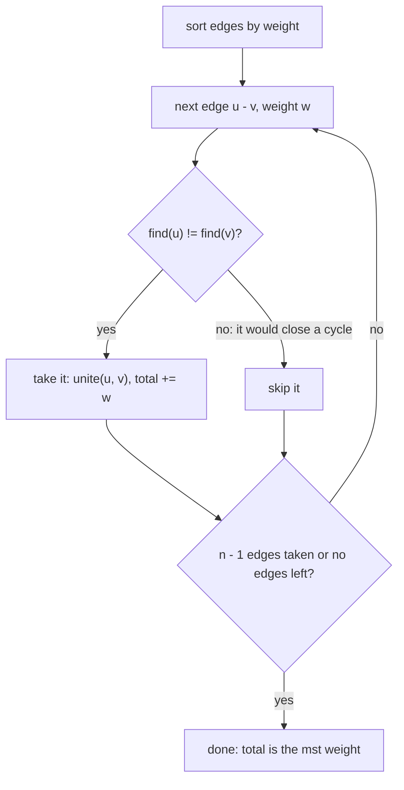
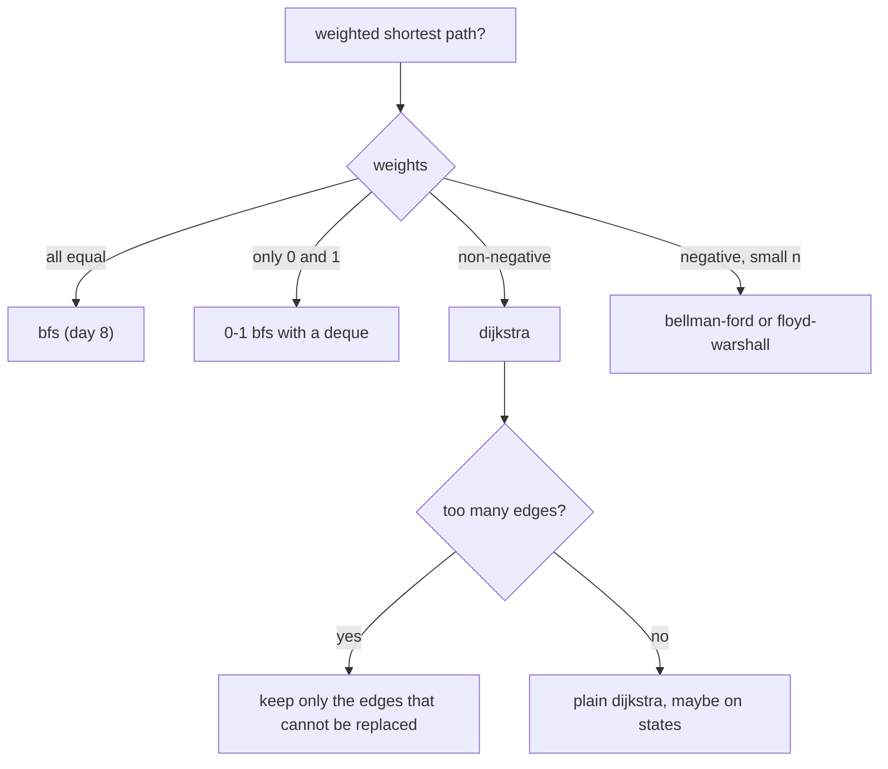

# Dzień 9 - Grafy II: Dijkstra, BFS 0-1, Find-Union, minimalne drzewo rozpinające

> [!abstract] Cel dnia
> Po tym dniu: liczysz najkrótsze ścieżki w grafie z wagami algorytmem Dijkstry (z jednego źródła, z wielu naraz,
> z odtworzeniem drogi) i wiesz, kiedy zawodzi; przy wagach 0 i 1 używasz BFS 0-1; utrzymujesz składowe przy
> dodawaniu krawędzi strukturą Find-Union; budujesz minimalne drzewo rozpinające algorytmem Kruskala i odpowiadasz
> offline na pytania "czy da się przejść krawędziami nie dłuższymi niż b". Najważniejsza umiejętność dnia: naginanie
> Dijkstry, gdy graf jest ukryty, wagi zależą od czasu albo koszt wierzchołka zależy od kosztów innych.
>
> - **Minimum (ok. 1 h):** sekcje 1, 2 i 4, zadanie omówione 2014 K, ćwiczenie 2004 I.
> - **Pełna wersja (do 3 h):** wszystko, łącznie z sekcjami 3, 5 i 6, zadaniem 2012 H (uogólniony Dijkstra),
>   wyzwaniem 2014 B, zadaniem bez etykiety 2023 B, rachunkami w pamięci i zadaniami z CSES.

Na start 10 minut: fiszki z Dnia 8 (BFS, składowe, Kahn) i dziennik błędów. Dzisiejszy dzień to BFS, któremu
krawędzie dostały długości: kolejka FIFO zamienia się w kolejkę priorytetową.

## 1. Graf z wagami i dlaczego BFS nie wystarcza

**Intuicja.** Na mapie drogowej liczy się nie liczba odcinków, tylko kilometry. Droga przez dwa krótkie odcinki bywa
krótsza niż jeden długi, a BFS z Dnia 8 tego nie widzi, bo liczy krawędzie.

**Definicja.** Graf ważony to graf, w którym każda krawędź e ma wagę w(e) (długość, czas, koszt). Długość ścieżki to
suma wag jej krawędzi, odległość dist(s, v) to najmniejsza długość ścieżki z s do v. W całym dniu wagi są
**nieujemne**, chyba że tekst mówi inaczej.

**Mechanizm.** Lista sąsiedztwa trzyma pary (sąsiad, waga). Sumy wag szybko przekraczają `int`: ścieżka z 2 · 10⁵
krawędzi po 10⁴ to 2 · 10⁹, tuż pod granicą 2³¹ - 1 ≈ 2,147 · 10⁹, a suma dwóch takich już nie. Odległości trzymaj
w `long long`.

```cpp
vector<vector<pair<int, long long>>> adj(n + 1);   // (neighbour, weight)
for (int i = 0; i < m; i++) {
    int u, v; long long w;
    cin >> u >> v >> w;
    adj[u].push_back({v, w});
    adj[v].push_back({u, w});                  // skip for a directed graph
}
```



Jak czytać diagram: liczba na krawędzi to jej waga. BFS z wierzchołka 1 powie, że 2 jest w odległości 1 (jedna
krawędź), ale ta krawędź kosztuje 4, a droga 1-3-2 tylko 1 + 2 = 3. Ten graf wraca w sekcjach 2 i 5.

**Przykład.** Odległości z 1 w grafie z diagramu: 1: 0, 3: 1, 2: 3 (przez 3), 4: 4 (1-3-2-4), 5: 7. Krawędź 3-4
o wadze 5 nie leży na żadnej najkrótszej ścieżce z 1.

## 2. Algorytm Dijkstry

**Intuicja.** Woda wlewana do wierzchołka startowego płynie rurami z prędkością 1 na jednostkę długości. Wierzchołki
zalewa w kolejności odległości od startu. Dijkstra symuluje tę wodę: zawsze rozszerza się z wierzchołka, do którego
woda dotarła najwcześniej spośród jeszcze nierozszerzonych.

**Definicja.** Algorytm Dijkstry liczy dist(s, v) dla wszystkich v w grafie o wagach nieujemnych w czasie
O((n + m) log n).

**Mechanizm.** Tablica dist (na starcie nieskończoność, dist[s] = 0) i kolejka priorytetowa par (dist, wierzchołek),
z której wychodzi para o najmniejszym dist. Zdejmujemy wierzchołek v; jeśli zdjęta wartość jest większa niż
aktualne dist[v], to wpis jest **przeterminowany** (v poprawiono później) i go pomijamy. W przeciwnym razie dist[v]
jest ostateczne i **relaksujemy** krawędzie v: jeśli dist[v] + w < dist[u], poprawiamy dist[u] i wkładamy nową parę.
Starej pary nie usuwamy z kolejki, tylko pomijamy ją przy zdjęciu (to tańsze niż usuwanie).

```cpp
vector<long long> dist(n + 1, LLONG_MAX);
priority_queue<pair<long long, int>, vector<pair<long long, int>>, greater<>> pq;   // min first
dist[s] = 0;
pq.push({0, s});
while (!pq.empty()) {
    auto [d, v] = pq.top(); pq.pop();
    if (d != dist[v]) continue;                // stale entry, v was improved later
    for (auto [u, w] : adj[v])
        if (d + w < dist[u]) {
            dist[u] = d + w;
            parent[u] = v;                     // to rebuild the path later
            pq.push({dist[u], u});
        }
}
```



Jak czytać diagram: to BFS z Dnia 8, w którym kolejka FIFO stała się kolejką priorytetową, a "nieodwiedzony" zmieniło
się na "da się poprawić". Gałąź "stale" to sprawdzenie, które zastępuje usuwanie starych wpisów.

**Dlaczego to działa.** Gdy zdejmujemy v z najmniejszym d spośród wierzchołków nieostatecznych, każda inna droga do v
musi kiedyś opuścić zbiór wierzchołków ostatecznych przez jakiś wierzchołek x o dist[x] ≥ d (bo d było najmniejsze),
a dalsze krawędzie mają wagi ≥ 0. Żadna droga nie da więc mniej niż d. Ten argument wymaga wag nieujemnych.

**Przykład** (graf z sekcji 1, start 1):

| Krok | Zdjęte (d, v) | Co się dzieje | dist[1..5] |
|---|---|---|---|
| 1 | (0, 1) | relaksacja: 2 dostaje 4, 3 dostaje 1 | 0, 4, 1, ∞, ∞ |
| 2 | (1, 3) | 2 poprawione na 1 + 2 = 3, 4 dostaje 6 | 0, 3, 1, 6, ∞ |
| 3 | (3, 2) | 4 poprawione na 3 + 1 = 4 | 0, 3, 1, 4, ∞ |
| 4 | (4, 2) | przeterminowane (dist[2] = 3), pominięte | bez zmian |
| 5 | (4, 4) | 5 dostaje 7 | 0, 3, 1, 4, 7 |
| 6 | (6, 4) | przeterminowane, pominięte | bez zmian |
| 7 | (7, 5) | nic do poprawienia | 0, 3, 1, 4, 7 |

**Złożoność.** Każda krawędź może włożyć do kolejki jeden wpis, więc wpisów jest najwyżej m + 1, a każda operacja na
kolejce kosztuje O(log m) = O(log n). Razem O((n + m) log n).

Warianty, które wracają w zadaniach:

- **Wiele źródeł naraz:** wszystkie źródła z dist = 0 w kolejce na starcie; dist[v] to odległość do najbliższego
  źródła ([2014 B Benzyna](../zadania/2014/b-benzyna.md)).
- **Odległości do celu:** Dijkstra od celu w grafie z odwróconymi krawędziami.
- **Odtwarzanie drogi:** `parent[u] = v` przy każdej poprawie, potem od celu po rodzicach.
- **Graf stanów z wagami:** wierzchołek to (pozycja, dodatkowa informacja), jak w Dniu 8, tylko kolejka priorytetowa.

> [!warning] Ujemne wagi
> Dijkstra z ujemną krawędzią daje złe wyniki: wierzchołek uznany za ostateczny może później dostać krótszą drogę.
> Przykład: krawędzie 1 → 2 (2), 1 → 3 (3), 3 → 2 (-2). Dijkstra zamyka 2 z dist = 2, a droga 1-3-2 ma długość 1.
> Wtedy Bellman-Ford (n - 1 razy relaksuj wszystkie krawędzie, O(nm)) albo, dla n do ok. 400-500,
> Floyd-Warshall (wszystkie pary, O(n³)):
>
> ```cpp
> // d[i][j] = weight of edge i -> j, 0 on the diagonal, INF if there is no edge
> for (int k = 0; k < n; k++)                    // k must be the outer loop
>     for (int i = 0; i < n; i++)
>         for (int j = 0; j < n; j++)
>             d[i][j] = min(d[i][j], d[i][k] + d[k][j]);
> ```

## 3. BFS 0-1: wagi tylko 0 i 1

**Intuicja.** Na mapie część ruchów jest darmowa (idziesz po pustym polu), a część kosztuje 1 (burzysz ścianę). BFS
pomyli się, bo liczy ruchy, a Dijkstra działa, ale dokłada log n. Przy dwóch wagach wystarczy kolejka z dwoma końcami.

**Definicja.** BFS 0-1 liczy najkrótsze ścieżki w grafie o wagach z {0, 1} w czasie O(n + m).

**Mechanizm.** `deque` zamiast kolejki priorytetowej: wierzchołek osiągnięty krawędzią 0 idzie na **przód** (ma tę samą
odległość co bieżący), krawędzią 1 na **tył** (odległość większa o 1). W deque leżą wtedy zawsze wierzchołki o dwóch
sąsiednich odległościach d i d + 1, posortowane, więc przód to zawsze minimum, jak w Dijkstrze.

```cpp
vector<int> dist(n + 1, INT_MAX);
deque<int> dq;
dist[s] = 0;
dq.push_back(s);
while (!dq.empty()) {
    int v = dq.front(); dq.pop_front();
    for (auto [u, w] : adj[v])                 // w is 0 or 1
        if (dist[v] + w < dist[u]) {
            dist[u] = dist[v] + w;
            if (w == 0) dq.push_front(u); else dq.push_back(u);
        }
}
```



Jak czytać diagram: przód deque trzyma wierzchołki odległości d, tył odległości d + 1. Krawędź 0 nie zmienia odległości,
więc nowy wierzchołek należy do przodu; krawędź 1 dokłada go za wszystkimi z odległością d. Wierzchołek może wejść do
deque więcej niż raz (gdy zostanie poprawiony), ale tylko przy poprawie dist, więc pracy jest O(n + m).

**Przykład.** Mapa 1 × 4: `S#.#` z celem w ostatnim polu, wejście na `#` kosztuje 1 (burzenie), na `.` 0. Odległości:
S: 0, pierwsze `#`: 1, `.`: 1 (wejście darmowe, przód deque), ostatnie `#`: 2. Wynik: 2 ściany. Ten sam ruch to "ile
najmniej razy trzeba zmienić kierunek" (zmiana kosztuje 1, jazda prosto 0) w grafie stanów (pole, kierunek).

## 4. Find-Union: składowe przy dodawaniu krawędzi

**Intuicja.** Grupy znajomych, w każdej jeden "szef". Każdy wie, kto jest nad nim, a szef nad sobą nie ma nikogo. Żeby
sprawdzić, czy dwie osoby są w tej samej grupie, idziesz od każdej w górę do szefa i porównujesz szefów. Żeby połączyć
grupy, jeden szef zaczyna słuchać drugiego.

**Definicja.** Find-Union (DSU, ang. disjoint set union) przechowuje podział elementów 0..n-1 na rozłączne zbiory
i daje dwie operacje: `find(v)` zwraca reprezentanta zbioru v, `unite(a, b)` łączy zbiory a i b. Dwa usprawnienia
(kompresja ścieżek i łączenie według rozmiaru) dają czas zamortyzowany O(α(n)) na operację, gdzie α (odwrotna
funkcja Ackermanna) nie przekracza 4 dla żadnego n spotykanego w praktyce: w praktyce O(1).

**Mechanizm.** Tablica `p` (rodzic); reprezentant to element, dla którego p[r] = r.

- **Kompresja ścieżek:** po znalezieniu reprezentanta podpinamy pod niego wszystkie elementy z przebytej drogi, żeby
  następne `find` było krótkie.
- **Łączenie według rozmiaru:** mniejsze drzewo podpinamy pod większe, więc wysokość rośnie najwyżej logarytmicznie.

```cpp
struct DSU {
    vector<int> p, sz;
    DSU(int n) : p(n), sz(n, 1) { iota(p.begin(), p.end(), 0); }
    int find(int v) {
        int r = v;
        while (p[r] != r) r = p[r];
        while (p[v] != r) { int nx = p[v]; p[v] = r; v = nx; }   // path compression
        return r;
    }
    bool unite(int a, int b) {                 // false if already in one set
        a = find(a); b = find(b);
        if (a == b) return false;
        if (sz[a] < sz[b]) swap(a, b);         // union by size
        p[b] = a;
        sz[a] += sz[b];
        return true;
    }
};
```



Jak czytać diagram: strzałka prowadzi od elementu do jego rodzica, 1 to reprezentant. Przed `find(4)` droga z 4 do
reprezentanta ma trzy kroki; `find(4)` przechodzi ją raz i podpina 4, 3 i 2 bezpośrednio pod 1. Każde następne
`find` dla tych elementów to jeden krok. `find` napisany pętlą nie ma rekurencji, więc nie grozi mu przepełnienie
stosu.

**Przykład.** Elementy 1..6. `unite(1, 2)`, `unite(3, 4)`: zbiory {1, 2}, {3, 4}, {5}, {6}. `unite(2, 4)`: {1, 2, 3, 4}.
`find(3) == find(1)`: tak. `unite(1, 3)` zwraca false: krawędź 1-3 zamyka cykl. Liczba zbiorów po każdym udanym
`unite` spada o 1: tak liczy się składowe, gdy krawędzie przychodzą jedna po drugiej.

Kiedy DSU, a kiedy BFS z Dnia 8: BFS liczy składowe gotowego grafu raz; DSU odpowiada na pytania **w trakcie
dodawania** krawędzi (online) i sprawdza, czy nowa krawędź zamyka cykl. Usuwania krawędzi DSU nie umie: wtedy przejdź
po czasie od końca, a usuwanie stanie się dodawaniem.

## 5. Minimalne drzewo rozpinające (MST) i algorytm Kruskala

**Intuicja.** Trzeba połączyć kablem wszystkie miasta tak, żeby z każdego dało się dojść do każdego, płacąc za
położone odcinki. Cyklu nie opłaca się zamykać (jedną krawędź cyklu można wyrzucić), więc wynik jest drzewem.
Zachłannie: bierz najtańsze odcinki, o ile łączą coś, co jeszcze nie jest połączone.

**Definicja.** Drzewo rozpinające grafu spójnego to zbiór n - 1 krawędzi, który łączy wszystkie wierzchołki bez
cyklu. **Minimalne drzewo rozpinające** (MST) ma najmniejszą sumę wag.

**Mechanizm (algorytm Kruskala).** Posortuj krawędzie rosnąco po wadze. Przeglądaj je po kolei; krawędź u-v bierz,
jeśli u i v są w różnych składowych (DSU), i łącz te składowe. Koniec po n - 1 wziętych krawędziach.

```cpp
sort(edges.begin(), edges.end());              // (weight, u, v), lightest first
DSU dsu(n + 1);
long long total = 0;
int taken = 0;
for (auto [w, u, v] : edges)
    if (dsu.unite(u, v)) { total += w; taken++; }
// taken < n - 1 means the graph is not connected
```



Jak czytać diagram: jedyna decyzja to "czy ta krawędź łączy dwie różne składowe". DSU odpowiada na nie w czasie
prawie stałym, więc całość kosztuje tyle, co sortowanie: O(m log m).

**Dlaczego to działa (własność przekroju).** Podziel wierzchołki na dwie dowolne części. Najlżejsza krawędź między
częściami należy do pewnego MST: gdyby MST jej nie zawierało, dodanie jej tworzy cykl, który przecina podział jeszcze
inną krawędzią, nie lżejszą; zamiana tych krawędzi nie zwiększa sumy. Kruskal bierze krawędź u-v dokładnie wtedy,
gdy jest najlżejsza między składową u a resztą grafu.

**Przykład** (graf z sekcji 1). Krawędzie rosnąco: 1-3 (1), 2-4 (1), 3-2 (2), 4-5 (3), 1-2 (4), 3-4 (5). Bierzemy
1-3, 2-4, 3-2 (łączy {1, 3} z {2, 4}), 4-5; 1-2 i 3-4 zamknęłyby cykl. Suma 1 + 1 + 2 + 3 = 7, cztery krawędzie
dla pięciu wierzchołków.

**Własność minimax (ścieżka wąskiego gardła).** Najmniejsze możliwe "najdłuższe ogniwo" na drodze z x do y daje
ścieżka w MST. Pytanie "czy x i y łączy droga, na której każda krawędź ma wagę ≤ b" to pytanie, czy x i y są w jednej
składowej po dodaniu wszystkich krawędzi o wadze ≤ b. Przy wielu pytaniach: posortuj je po b i dodawaj krawędzie
do DSU w kolejności Kruskala (**offline**, [2014 B Benzyna](../zadania/2014/b-benzyna.md)).

> [!tip] Prim
> Drugi klasyczny algorytm MST rośnie z jednego wierzchołka jak Dijkstra, tylko priorytetem jest waga krawędzi, a nie
> odległość. Dla grafu pełnego z n do kilku tysięcy (krawędzie liczone z współrzędnych) wersja O(n²) bez kolejki bywa
> wygodniejsza niż Kruskal na n² krawędziach.

## 6. Naginanie Dijkstry

Sam Dijkstra rzadko wystarcza: zadania AMPPZ ukrywają graf albo zmieniają, czym jest koszt. Cztery ruchy z dzisiejszych
zadań:

- **Graf ukryty, za dużo krawędzi.** Z każdego punktu do każdego to n² krawędzi. Pytanie: które krawędzie da się
  zastąpić drogą przez inne bez straty? Często zostają tylko sąsiedzi po posortowaniu
  ([2014 K Kapitan](../zadania/2014/k-kapitan.md)).
- **Czas zależny od chwili.** Krawędź otwarta tylko w pewnych chwilach, ale wolno czekać: wcześniejsze przybycie nigdy
  nie szkodzi, więc Dijkstra na czasach przybycia, a relaksacja liczy najbliższą dozwoloną chwilę wyjazdu
  ([2004 I Obóz Babilon](../zadania/2004/i-oboz-babilon.md)).
- **Koszt wierzchołka z kosztów innych.** koszt[i] = min(z_i, u_i + suma kosztów j z listy i): to nie jest zwykła
  ścieżka, ale ten sam argument "najmniejszy nieostateczny jest ostateczny" działa, gdy u_i > 0 (uogólniony Dijkstra,
  [2012 H Hydra](../zadania/2012/h-hydra.md)).
- **Dijkstra jako krok przygotowawczy.** Odległość do najbliższej stacji z wielu źródeł zamienia pytanie o paliwo na
  wagi krawędzi, a resztę robi Kruskal ([2014 B Benzyna](../zadania/2014/b-benzyna.md)).



Jak czytać diagram: najpierw wagi decydują o algorytmie, potem liczba krawędzi o tym, czy graf trzeba odchudzić.
Gałąź "negative" w AMPPZ prawie się nie zdarza; gdy n ≤ 400-500 i trzeba odległości między wszystkimi parami,
Floyd-Warshall jest najkrótszy w pisaniu.

**Ruchy, które wracają w AMPPZ:**

| Ruch | Sygnał w treści | Zadanie z archiwum |
|---|---|---|
| Krawędzie tylko do sąsiadów po posortowaniu | "dowolna trasa", koszt z różnic współrzędnych, n do 2 · 10⁵ | 2014 K Kapitan |
| Koszt = min(zrób od razu, rozbij na części), uogólniony Dijkstra | "odrastają", "rozpada się na", cykliczne zależności | 2012 H Hydra |
| Czekanie i okna czasowe, najwcześniejsze przybycie | "można przeczekać", "okresowo", "w jakich chwilach" | 2004 I Obóz Babilon |
| Dijkstra z wielu źródeł, potem Kruskal offline po zapytaniach | "tankować", "pojemność", "czy da się przy limicie b" | 2014 B Benzyna |

## 7. Zadania omówione

Przy każdym najpierw sam, z zegarkiem (czas w notatce), potem podpowiedzi po jednej, na końcu omówienie.

- **[AMPPZ 2014 K - Kapitan](../zadania/2014/k-kapitan.md)** (minimum, 28 z 57 drużyn): najmniej godzin kapitana przy
  sterze; koszt odcinka między wyspami to min(|dx|, |dy|), a z n² krawędzi wystarczą 4n.
- **[AMPPZ 2012 H - Hydra](../zadania/2012/h-hydra.md)** (pełna, 34 z 54 drużyn): najmniej machnięć mieczem, gdy ucięta
  głowa odrasta jako kilka innych; koszt głowy zależy od kosztów innych, kolejność liczenia jak w Dijkstrze.

## 8. Ćwiczenia

**AMPPZ z tematu dnia:**

- **[AMPPZ 2004 I - Obóz Babilon](../zadania/2004/i-oboz-babilon.md)** (minimum, 35 minut, rankingu 2004 brak):
  najszybszy przejazd, gdy z każdej drogi wolno wyruszać tylko w okresowych oknach czasowych, a w bazach można czekać.
  Treść: `200X/2004/I/I - Oboz Babilon.pdf` ([PDF](../../200X/2004/I/I%20-%20Oboz%20Babilon.pdf)).
- **[AMPPZ 2014 B - Benzyna](../zadania/2014/b-benzyna.md)** (pełna, wyzwanie, 50 minut, 15 z 57 drużyn): czy cysterna
  z bakiem b przejedzie między dwiema stacjami, tankując tylko na stacjach; do 2 · 10⁵ zapytań.

**Zadanie bez etykiety** (technika z wcześniejszego dnia, rozpoznaj ją sam):

- **[AMPPZ 2023 B - Missing Boundaries](../zadania/2023/b-missing-boundaries.md)** (pełna, 30 minut, treść po angielsku).
  Treść: `202X/2023/B/B.pdf` ([PDF](../../202X/2023/B/B.pdf)). Notatkę otwórz dopiero po swojej próbie, bo jej karta
  zdradza technikę.

**Rachunki w pamięci (pełna wersja).** Odpowiedz, zanim rozwiniesz.

> [!question]- Dijkstra dla n = 2 · 10⁵ i 8 · 10⁵ krawędzi skierowanych: ile operacji?
> Ok. 8 · 10⁵ wpisów do kolejki, każdy po ok. log₂(8 · 10⁵) ≈ 20 kroków: ok. 1,6 · 10⁷. Mieści się z zapasem.

> [!question]- Ścieżka 2 · 10⁵ krawędzi po 10⁴. Czy suma dwóch odległości zmieści się w `int`?
> Nie. Jedna odległość to do 2 · 10⁹ (tuż pod 2³¹ - 1 ≈ 2,147 · 10⁹), suma dwóch to 4 · 10⁹. Odległości w `long long`.

> [!question]- Floyd-Warshall dla n = 500, a dla n = 2000?
> 500³ = 1,25 · 10⁸ prostych kroków: zmieści się. 2000³ = 8 · 10⁹: za dużo, wtedy Dijkstra z każdego wierzchołka albo
> inny pomysł.

> [!question]- Graf spójny ma 10 wierzchołków i 30 krawędzi. Ile krawędzi ma jego MST, a ile z nich Kruskal odrzuci?
> MST ma 9 krawędzi; Kruskal odrzuci 21, bo każda z nich zamknęłaby cykl (o ile przejrzy wszystkie).

> [!question]- Dlaczego DSU bez obu usprawnień bywa wolne?
> `unite(1, 2)`, `unite(2, 3)`, ... z podpinaniem zawsze w tę samą stronę buduje łańcuch długości n; każde `find` na
> końcu łańcucha to n kroków, razem O(n²). Kompresja albo łączenie według rozmiaru to naprawia, oba razem dają prawie O(1).

> [!question]- Graf z wagami 0 i 1 ma 10⁶ wierzchołków. Ile zyskuje BFS 0-1 względem Dijkstry?
> Czynnik log n ≈ 20 na operacji kolejki, a deque jest dużo prostszy od kopca. Przy 10⁶ wierzchołków i kilku
> milionach krawędzi to różnica między ok. 0,1 s a ok. 1 s.

**CSES (pełna wersja).** Dział Graph Algorithms:

- **[Shortest Routes I](https://cses.fi/problemset/task/1671):** Dijkstra z jednego źródła, graf skierowany.
- **[Flight Discount](https://cses.fi/problemset/task/1195):** jeden lot za pół ceny; graf stanów (miasto, czy zniżka
  już użyta).
- **[Investigation](https://cses.fi/problemset/task/1202):** poza długością najkrótszej trasy liczba najkrótszych tras
  i najmniejsza oraz największa liczba lotów na nich.
- **[Road Reparation](https://cses.fi/problemset/task/1675):** MST albo IMPOSSIBLE (Kruskal).
- **[Road Construction](https://cses.fi/problemset/task/1676):** po każdej nowej drodze liczba składowych i rozmiar
  największej (DSU).

> [!tip]- Podpowiedź do Flight Discount
> Dwie kopie każdego miasta: "zniżka jeszcze jest" i "zniżka zużyta". Lot u → v o cenie c to krawędzie (u, 0) → (v, 0)
> z wagą c, (u, 1) → (v, 1) z wagą c i (u, 0) → (v, 1) z wagą c / 2. Odpowiedź to dist do (n, 1).

> [!tip]- Podpowiedź do Investigation
> W Dijkstrze przy równości d + w == dist[u] dodaj liczbę dróg v do liczby dróg u; przy ostrej poprawie zastąp. Liczba
> lotów: min i max po tych samych równościach. Wierzchołek zdejmowany z kolejki ma już ostateczne wszystkie trzy
> wartości.

## 9. Fiszki

Dlaczego BFS nie liczy najkrótszych ścieżek w grafie z wagami?::BFS liczy krawędzie, a dwie krótkie krawędzie mogą ważyć mniej niż jedna długa.
Co robi Dijkstra i w jakim czasie?::Najkrótsze ścieżki z jednego źródła przy wagach nieujemnych, O((n + m) log n) z kolejką priorytetową.
Czym jest przeterminowany wpis w kolejce Dijkstry?::Para (d, v) z d > dist[v], bo v poprawiono później; przy zdjęciu ją pomijamy.
Dlaczego zdjęty wierzchołek w Dijkstrze ma ostateczną odległość?::Każda inna droga wychodzi ze zbioru gotowych przez wierzchołek o dist ≥ d, a wagi są nieujemne.
Kiedy Dijkstra daje zły wynik?::Gdy są krawędzie o ujemnej wadze; wtedy Bellman-Ford albo Floyd-Warshall.
Jak policzyć odległość do najbliższej z wielu stacji?::Dijkstra z wieloma źródłami: wszystkie stacje w kolejce na starcie z dist = 0.
Kiedy Floyd-Warshall?::Odległości między wszystkimi parami przy n do ok. 400-500; O(n³), pętla po k na zewnątrz.
Jak działa BFS 0-1?::Deque: krawędź 0 wkłada na przód, krawędź 1 na tył; O(n + m).
Jakie operacje daje Find-Union?::find(v): reprezentant zbioru v; unite(a, b): łączy zbiory; prawie O(1) z kompresją ścieżek i łączeniem według rozmiaru.
Czego Find-Union nie umie i co wtedy?::Usuwać krawędzi; przejść po czasie od końca, żeby usuwanie stało się dodawaniem.
Jak działa algorytm Kruskala?::Krawędzie rosnąco po wadze; bierz krawędź, jeśli łączy różne składowe DSU; O(m log m).
Co mówi własność przekroju?::Najlżejsza krawędź między dwiema częściami podziału należy do pewnego MST.
Jak odpowiadać na pytania "czy x i y łączą krawędzie o wadze ≤ b"?::Offline: zapytania rosnąco po b, krawędzie rosnąco po wadze dodawane do DSU, odpowiedź find(x) == find(y).
Jak przyspieszyć Dijkstrę na grafie pełnym z punktów?::Zostaw tylko krawędzie, których nie da się zastąpić drogą przez inne punkty, np. sąsiadów po posortowaniu.
Jak liczyć Dijkstrę, gdy krawędź jest otwarta tylko w pewnych chwilach, a wolno czekać?::Na czasach przybycia; relaksacja bierze najbliższą dozwoloną chwilę wyjazdu nie wcześniejszą niż przybycie.

## 10. Zamknięcie dnia

- [ ] Umiem z pamięci napisać Dijkstrę z kolejką priorytetową i pominięciem przeterminowanych wpisów.
- [ ] Umiem z pamięci napisać DSU (find pętlą z kompresją, unite według rozmiaru) i Kruskala.
- [ ] 2014 K Kapitan rozwiązane, umiem powiedzieć, dlaczego wystarczą krawędzie do sąsiadów po posortowaniu.
- [ ] 2004 I Obóz Babilon rozwiązane.
- [ ] (pełna) 2012 H, wyzwanie 2014 B, 2023 B bez etykiety, rachunki w pamięci, zadania z CSES.
- [ ] Dzisiejsze błędy wpisane do dziennika ([wzór](../dziennik/szablon-dziennika.md)).
- [ ] Fiszki z Dnia 8 i Dnia 9 przejrzane.

Materiały obok: [sygnały w treści](../myslenie/sygnaly-w-tresci.md), [karta wzorca grafów z wagami](../wzorce/grafy-z-wagami.md),
[karta wzorca grafów I](../wzorce/grafy.md), [katalog zadań](../zadania/katalog.md) (grupy "najkrótsze ścieżki"
i "DSU/MST"), [wspólne mianowniki](../myslenie/wspolne-mianowniki.md) (sekcja o grafach).

Następny dzień: programowanie dynamiczne I, czyli stan i przejście, plecak i najdłuższy podciąg
([plan](../plan-20-dni.md)). Najdłuższa ścieżka w DAG z Dnia 8 i dzisiejszy Dijkstra to już programowanie dynamiczne:
wartość wierzchołka liczona z wartości wcześniejszych w dobrej kolejności.
