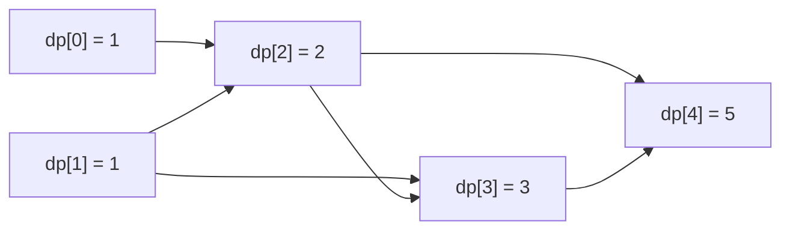
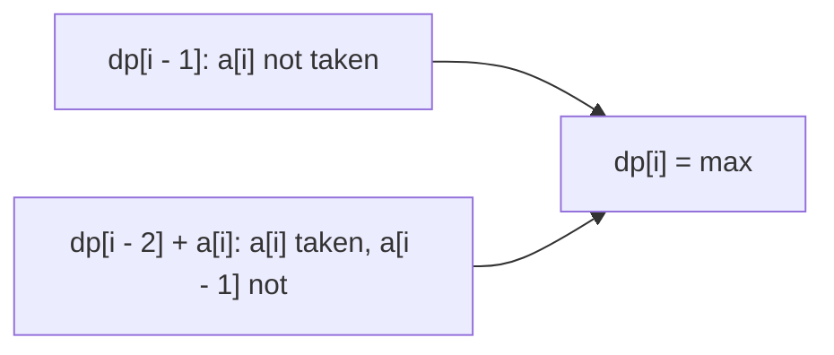
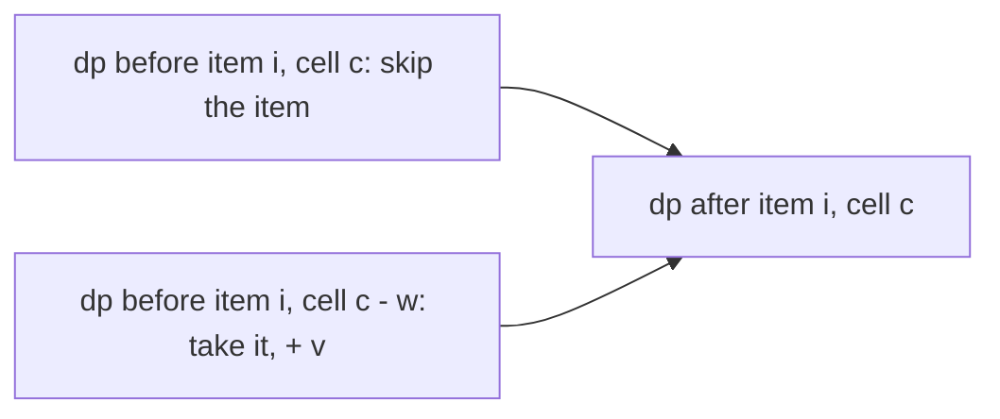
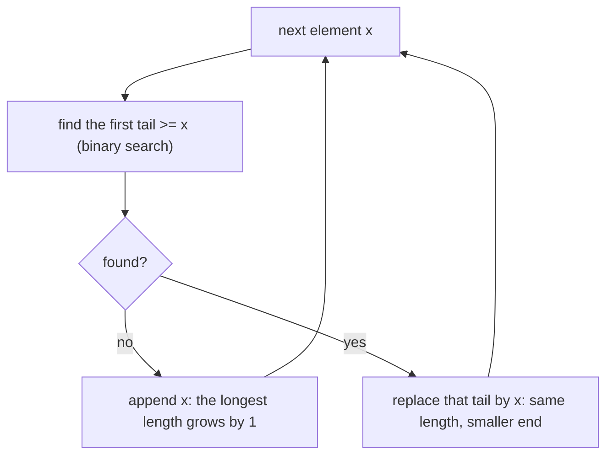
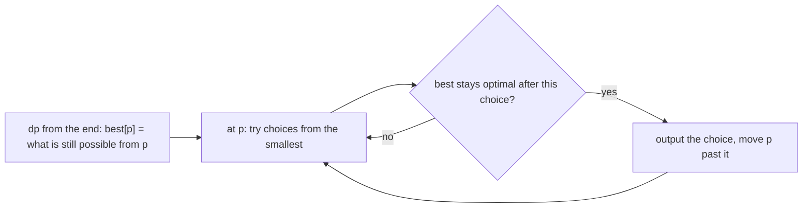
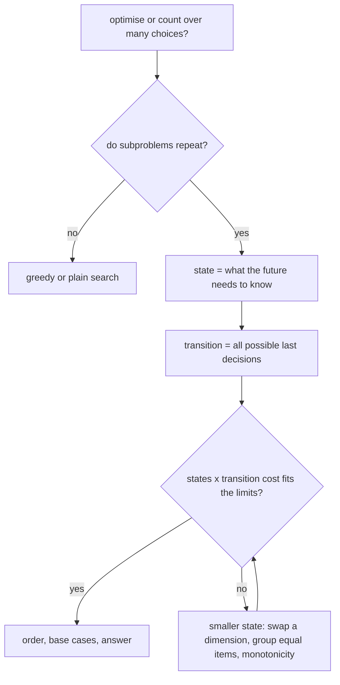

# Dzień 10 - Programowanie dynamiczne I: stan i przejście, plecak, najdłuższy podciąg

> [!abstract] Cel dnia
> Po tym dniu: rozpoznajesz zadanie na programowanie dynamiczne (DP) i zapisujesz je czterema decyzjami: stan,
> przejście, początek, kolejność; liczysz DP na prefiksach ciągu, plecak 0/1 i nieograniczony (najlepsza wartość
> i liczba sposobów), najdłuższy rosnący podciąg w O(n log n) i najdłuższy wspólny podciąg dwóch ciągów; odtwarzasz
> samo rozwiązanie, także najmniejsze leksykograficznie. Najważniejsza umiejętność dnia: znaleźć stan, czyli najmniej
> informacji o przeszłości, która wystarcza do decyzji o przyszłości.
>
> - **Minimum (ok. 1 h):** sekcje 1, 2 i 4, zadanie omówione 2002 H, ćwiczenie 1998 B.
> - **Pełna wersja (do 3 h):** wszystko, łącznie z sekcjami 3, 5 i 6, zadaniem 2013 I (odtwarzanie najmniejszego
>   leksykograficznie wyniku), ćwiczeniem 2005 D, wyzwaniem 2017 J, zadaniem bez etykiety 2024 I, rachunkami
>   w pamięci i zadaniami z CSES.

Na start 10 minut: fiszki z Dnia 9 (Dijkstra, Find-Union, Kruskal) i dziennik błędów. Dwa razy już liczyłeś DP, nie
nazywając go: najdłuższa ścieżka w DAG z Dnia 8 (wartość wierzchołka z wartości poprzedników w kolejności
topologicznej) i Hydra z Dnia 9 (koszt głowy z kosztów innych głów, w kolejności jak w Dijkstrze).

## 1. Stan, przejście, kolejność

**Intuicja.** Na ile sposobów można wejść po n schodach, robiąc kroki o 1 albo 2 stopnie? Ostatni krok przyszedł albo
ze stopnia n - 1, albo z n - 2, więc sposoby(n) = sposoby(n - 1) + sposoby(n - 2). Rekurencja wprost liczy te same
wartości wiele razy: sposoby(n - 2) raz z gałęzi n - 1 i raz bezpośrednio, a liczba wywołań rośnie jak 1,6ⁿ. Wystarczy
każdą wartość policzyć raz i zapamiętać.

**Definicja.** Programowanie dynamiczne rozwiązuje zadanie przez wyniki tego samego zadania dla mniejszych danych
(podproblemów), z których każdy liczy się raz i zapamiętuje. Zapis DP to cztery decyzje:

- **stan:** co opisuje podproblem (tu: numer stopnia i, wartość dp[i] = liczba sposobów dojścia do i);
- **przejście:** wzór na dp ze stanów mniejszych, zwykle przez rozważenie **ostatniej decyzji**
  (tu: dp[i] = dp[i - 1] + dp[i - 2]);
- **początek:** stany, które zna się od razu (dp[0] = 1, dp[1] = 1);
- **kolejność i wynik:** w jakiej kolejności liczyć, żeby potrzebne wartości były gotowe, i który stan jest odpowiedzią
  (rosnąco po i, wynik dp[n]).

**Mechanizm.** Stany z przejściami tworzą graf skierowany bez cykli (DAG): krawędź prowadzi od stanu, z którego się
korzysta, do stanu, który się liczy. Kolejność liczenia to kolejność topologiczna z Dnia 8. Są dwa sposoby zapisu:

```cpp
// bottom-up: a loop in a good order
vector<long long> dp(n + 1);
dp[0] = 1; dp[1] = 1;
for (int i = 2; i <= n; i++) dp[i] = (dp[i - 1] + dp[i - 2]) % MOD;

// top-down: recursion with memory (memo[i] = -1 means not computed yet)
long long ways(int i) {
    if (i <= 1) return 1;
    if (memo[i] != -1) return memo[i];
    return memo[i] = (ways(i - 1) + ways(i - 2)) % MOD;
}
```



Jak czytać diagram: każdy stan zbiera wartości z dwóch strzałek, które do niego wchodzą (ostatni krok o 1 albo o 2).
Strzałki idą tylko w prawo, więc liczenie od lewej zawsze ma gotowe dane. Rekurencja bez pamięci przechodziłaby ten
graf wszystkimi ścieżkami naraz; DP odwiedza każdy stan raz.

**Przykład.** dp[0..5] = 1, 1, 2, 3, 5, 8: na 5 schodów da się wejść na 8 sposobów. Złożoność DP to zawsze **liczba
stanów razy koszt jednego przejścia**: tu n · O(1).

**Kiedy DP, a kiedy zachłanne.** DP pasuje, gdy (a) zadanie to optymalizacja albo liczenie sposobów po ciągu decyzji,
(b) te same podproblemy wracają wiele razy, (c) najlepsze rozwiązanie składa się z najlepszych rozwiązań
podproblemów. Zachłanne (Dzień 3) bierze jedną decyzję i nie wraca; DP sprawdza wszystkie możliwe ostatnie decyzje.
Monety 1, 3, 4 i kwota 6: zachłannie 4 + 1 + 1 (trzy monety), DP znajduje 3 + 3 (dwie). Gdy zależności mają cykle
(Hydra), zwykłej kolejności nie ma i trzeba porządku jak w Dijkstrze z Dnia 9.

## 2. DP na prefiksach ciągu

**Intuicja.** Idziesz po ciągu od lewej. Wszystko, co trzeba wiedzieć o już przejrzanej części, to najlepszy wynik dla
niej, czasem z jedną małą dodatkową informacją (ostatni element, ostatnia litera, liczba zmian).

**Definicja.** Stan dp[i] = najlepszy wynik (albo liczba sposobów) dla pierwszych i elementów. Przejście patrzy na
element i: jest wzięty albo nie, kończy kawałek albo nie.

**Mechanizm.** Klasyk: wybierz elementy ciągu bez dwóch sąsiednich o największej sumie. Element i albo nie jest
wzięty (dp[i - 1]), albo jest, a wtedy i - 1 nie jest (dp[i - 2] + a[i]).

```cpp
vector<long long> dp(n + 1, 0);               // dp[i] = best sum among the first i elements
dp[1] = a[1];
for (int i = 2; i <= n; i++) dp[i] = max(dp[i - 1], dp[i - 2] + a[i]);
```



Jak czytać diagram: dwie możliwości dla ostatniego elementu to dwa źródła wartości. Gdy element może zakończyć
kawałek dowolnej długości, źródeł jest więcej: dp[i] bierze maksimum po wszystkich możliwych początkach ostatniego
kawałku (j, i], jak w [2002 H Słoneczne wczasy](../zadania/2002/h-sloneczne-wczasy.md), gdzie warunek "kawałek jest
dobry" sprawdza suma prefiksowa z Dnia 4.

**Przykład.** a = 2, 7, 9, 3, 1: dp[1..5] = 2, 7, 11, 11, 12. Wynik 12 (2 + 9 + 1). Odczyt od końca: dp[5] = dp[3] + 1,
dp[3] = dp[1] + 9, dp[1] = 2.

**Gdy stan potrzebuje więcej.** Jeśli przyszła decyzja zależy od czegoś więcej niż sam numer pozycji, dopisz to do
stanu: dp[i][c] = wynik dla pierwszych i elementów, gdy ostatni ma kolor c. Liczba stanów rośnie razy liczba kolorów,
więc dopisuje się tylko to, czego naprawdę wymaga przejście: przy zakazanych trójkach liter dwie ostatnie litery
([2005 D Szaszłyki](../zadania/2005/d-szaszlyki.md)).

## 3. Plecak

**Intuicja.** Plecak ma pojemność W, przedmioty mają wagi i wartości, każdy można wziąć raz. Brute force przegląda 2ⁿ
podzbiorów; ale dla decyzji o kolejnym przedmiocie z przeszłości liczy się tylko to, ile pojemności już zajęto.

**Definicja.** Plecak 0/1: wybierz podzbiór przedmiotów o sumie wag ≤ W i największej sumie wartości. Stan: dp[c] =
największa wartość przedmiotów już przejrzanych o łącznej wadze ≤ c. Czas O(n · W), pamięć O(W). Taka złożoność
zależy od wartości liczby W, a nie od długości wejścia (pseudowielomianowa): działa, gdy W ≤ ok. 10⁵-10⁶ i n · W
≤ ok. 10⁸.

**Mechanizm.** Dla każdego przedmiotu (w, v): dp[c] = max(dp[c], dp[c - w] + v) dla c od W **w dół** do w. Kierunek
pętli jest istotny: idąc w dół, dp[c - w] jest jeszcze wartością sprzed tego przedmiotu, więc przedmiot liczy się raz.
Idąc w górę, dp[c - w] mógł już użyć tego przedmiotu: to jest plecak nieograniczony (każdy przedmiot dowolnie wiele
razy).

```cpp
vector<long long> dp(W + 1, 0);
for (int i = 0; i < n; i++)
    for (int c = W; c >= w[i]; c--)            // downwards: each item at most once
        dp[c] = max(dp[c], dp[c - w[i]] + v[i]);
// dp[W] is the answer; for an unbounded knapsack loop c upwards from w[i]
```



Jak czytać diagram: to tabela "przedmioty × pojemności" zapisana w jednym wierszu. Nowa wartość komórki c bierze
starą wartość komórki c (nie biorę) albo starą wartość komórki c - w powiększoną o v (biorę). Pętla w dół gwarantuje,
że obie wartości są jeszcze "stare".

**Przykład.** W = 5, przedmioty (waga, wartość): (2, 3), (3, 4), (4, 5).

| Po przedmiocie | dp[0..5] |
|---|---|
| start | 0, 0, 0, 0, 0, 0 |
| (2, 3) | 0, 0, 3, 3, 3, 3 |
| (3, 4) | 0, 0, 3, 4, 4, 7 |
| (4, 5) | 0, 0, 3, 4, 5, 7 |

Wynik dp[5] = 7: dwa pierwsze przedmioty.

Warianty, które wracają w zadaniach:

- **Czy da się uzyskać sumę dokładnie c:** dp[c] typu bool, dp[0] = true, dp[c] |= dp[c - w]; dla dużego W `bitset`
  i `dp |= dp << w` (64 razy szybciej).
- **Liczba sposobów:** dp[c] += dp[c - w] modulo; podzbiory to pętla w dół, monety bez limitu w górę. Przy monetach
  pętla po monetach na zewnątrz liczy zbiory (3 + 1 to to samo co 1 + 3), pętla po kwotach na zewnątrz liczy ciągi.
- **Najmniej monet:** dp[c] = min(dp[c], dp[c - w] + 1), dp[0] = 0, reszta nieskończoność.
- **Dodatkowy wymiar:** "dokładnie k przedmiotów" to stan (t, c); przedmioty nierozróżnialne dla warunku liczy się
  klasami i dwumianami zamiast po jednym ([2017 J Jesienne porządki](../zadania/2017/j-jesienne-porzadki.md)).
- **W do 10⁹, ale wartości małe:** zamień role: dp[v] = najmniejsza waga dająca wartość v.

## 4. Najdłuższy podciąg

**Intuicja.** Podciąg to elementy wybrane z ciągu z zachowaniem kolejności, niekoniecznie sąsiednie (z `3 1 4 1 5`
podciągiem jest `3 4 5`, a `4 3` nie jest). Dwa klasyki: najdłuższy rosnący podciąg jednego ciągu (LIS) i najdłuższy
wspólny podciąg dwóch ciągów (LCS).

**LIS w O(n²).** dp[i] = długość najdłuższego rosnącego podciągu kończącego się na a[i] = 1 + max dp[j] po j < i
z a[j] < a[i]. Wynik to maksimum dp. Przy n do kilku tysięcy wystarcza.

**LIS w O(n log n).** Trzymaj tablicę tails: tails[L] = najmniejszy możliwy ostatni element rosnącego podciągu
długości L + 1. Mniejszy koniec jest zawsze lepszy (łatwiej go przedłużyć), a tails jest rosnąca. Dla kolejnego x
znajdź binarnie pierwszy element tails ≥ x: zastąp go przez x, a jeśli takiego nie ma, dopisz x na końcu. Długość
tails to długość LIS.

```cpp
vector<int> tails;
for (int x : a) {
    auto it = lower_bound(tails.begin(), tails.end(), x);   // upper_bound for non-decreasing
    if (it == tails.end()) tails.push_back(x);
    else *it = x;                              // a smaller end for this length
}
// tails.size() is the length; tails itself is usually not a subsequence of a
```



Jak czytać diagram: tails nigdy nie traci długości, a każdy element albo ją wydłuża, albo poprawia koniec dla
jakiejś długości. To wyszukiwanie binarne z Dnia 5 po tablicy, która jest rosnąca z konstrukcji.

**Przykład.** a = 3, 1, 4, 1, 5, 9, 2, 6. tails po kolejnych elementach: [3], [1], [1, 4], [1, 4], [1, 4, 5],
[1, 4, 5, 9], [1, 2, 5, 9], [1, 2, 5, 6]. LIS ma długość 4 (np. 1, 4, 5, 9). Końcowe tails = [1, 2, 5, 6] nie jest
podciągiem a (2 stoi za 5 i 9): do odtworzenia trzeba pamiętać poprzedników.

**LCS.** L[i][j] = LCS pierwszych i elementów a i pierwszych j elementów b. Jeśli a[i] = b[j], to L[i - 1][j - 1] + 1,
w przeciwnym razie max(L[i - 1][j], L[i][j - 1]). Czas O(n · m), pamięć O(m) przy liczeniu wierszami.

```cpp
vector<vector<int>> L(n + 1, vector<int>(m + 1, 0));
for (int i = 1; i <= n; i++)
    for (int j = 1; j <= m; j++)
        L[i][j] = (a[i - 1] == b[j - 1]) ? L[i - 1][j - 1] + 1 : max(L[i - 1][j], L[i][j - 1]);
```

Pełna tabela z przykładem jest w [1998 B Cross-country](../zadania/1998/b-cross-country.md). Ta sama tabela z innymi
kosztami to odległość edycyjna (najmniej wstawień, usunięć i zamian liter, żeby z a zrobić b):
E[i][j] = min(E[i - 1][j] + 1, E[i][j - 1] + 1, E[i - 1][j - 1] + (a[i] ≠ b[j])).

## 5. Odtwarzanie rozwiązania

Zadania często każą wypisać nie tylko wartość, ale samo rozwiązanie. Trzy sposoby:

- **Cofanie po tabeli.** Od stanu końcowego sprawdź, które przejście dało jego wartość, i przejdź do stanu źródłowego.
  Tak odczytaliśmy turnusy w 2002 H i elementy w przykładzie z sekcji 2.
- **Wskaźnik wyboru.** Przy liczeniu zapamiętaj dla każdego stanu, skąd przyszła najlepsza wartość (jak `parent`
  w Dijkstrze), potem idź po wskaźnikach od końca. Dla LIS: pozycja poprzednika dla każdego elementu.
- **Najmniejsze leksykograficznie.** Policz DP od końca ("ile da się jeszcze osiągnąć od pozycji p"), a odpowiedź
  buduj od początku, biorąc w każdym kroku najmniejszy wybór, który nie psuje optimum
  ([2013 I Inżynieria genetyczna](../zadania/2013/i-inzynieria-genetyczna.md)).

```cpp
// lcs itself from the full table L, walking back from (n, m)
string res;
for (int i = n, j = m; i > 0 && j > 0; ) {
    if (a[i - 1] == b[j - 1]) { res += a[i - 1]; i--; j--; }
    else if (L[i - 1][j] >= L[i][j - 1]) i--;
    else j--;
}
reverse(res.begin(), res.end());
```



Jak czytać diagram: DP od końca odpowiada na pytanie "czy po tym wyborze da się jeszcze osiągnąć optimum", a pętla od
początku wybiera najmniejszy wybór, na który odpowiedź brzmi tak. Wybory porównuje się od pierwszego, więc pierwszy
zły krok przesądza o porządku.

## 6. Naginanie: jak znaleźć stan

Wzorów DP jest nieskończenie wiele, ale pytania, które do nich prowadzą, są te same:

- **Co z przeszłości wpływa na przyszłość?** Tylko to idzie do stanu. Zakazane trójki: dwie ostatnie litery. Plecak:
  zajęta pojemność. Napisy, które różnią się tylko nieistotną przeszłością, liczysz razem.
- **Jaka jest ostatnia decyzja?** Ostatni element wzięty albo nie, ostatni kawałek (j, i], ostatnia moneta, ostatnie
  dopasowanie dwóch ciągów. Przejście przegląda wszystkie możliwe ostatnie decyzje.
- **Za dużo stanów?** Zamień wymiar (wartość zamiast wagi), zgrupuj nierozróżnialne elementy, trzymaj tylko poprzedni
  wiersz tabeli, poszukaj monotoniczności, która wskazuje najlepsze przejście od razu (2002 H w O(n)).
- **Zależności z cyklami?** To nie jest DP w stałej kolejności: uogólniony Dijkstra z Dnia 9 albo zmiana stanu.



Jak czytać diagram: najpierw pytanie, czy podproblemy się powtarzają (bez tego DP nic nie daje), potem stan
i przejście, a na końcu rachunek z limitów. Pętla w prawym dole to typowa praca nad zadaniem: stan, który nie
mieści się w limitach, trzeba zmniejszyć.

**Ruchy, które wracają w AMPPZ:**

| Ruch | Sygnał w treści | Zadanie z archiwum |
|---|---|---|
| Podział na kawałki: dp po prefiksach, warunek z sumy prefiksowej | "rozłączne odcinki", "każdy fragment musi", n do kilku tysięcy | 2002 H Słoneczne wczasy |
| DP od końca, budowa od początku | "najmniejszy leksykograficznie", "wypisz", "jak najmniej usunąć" | 2013 I Inżynieria genetyczna |
| Dwa ciągi, dopasowania w kolejności: LCS | "w tej samej kolejności", "spotkania", "wspólne", dwa ciągi do kilku tysięcy | 1998 B Cross-country |
| Stan = ostatnie znaki, liczenie modulo | "zabronione kombinacje", "ile napisów", "modulo" | 2005 D Szaszłyki |
| Plecak po klasach z dwumianami | "dokładnie k", "podzielna przez r", r małe, n duże | 2017 J Jesienne porządki |

## 7. Zadania omówione

Przy każdym najpierw sam, z zegarkiem (czas w notatce), potem podpowiedzi po jednej, na końcu omówienie.

- **[AMPPZ 2002 H - Słoneczne wczasy](../zadania/2002/h-sloneczne-wczasy.md)** (minimum, rankingu 2002 brak):
  rozłączne turnusy, w których słonecznych dni jest więcej niż pochmurnych, o największej łącznej długości; dp po
  prefiksach z sumą prefiksową, potem obserwacja, która daje O(n).
- **[AMPPZ 2013 I - Inżynieria genetyczna](../zadania/2013/i-inzynieria-genetyczna.md)** (pełna, 24 z 52 drużyn):
  najdłuższy podciąg złożony z bloków po k równych liczb, najmniejszy leksykograficznie; DP po sufiksach i odtwarzanie
  od początku.

## 8. Ćwiczenia

**AMPPZ z tematu dnia:**

- **[AMPPZ 1998 B - Cross-country](../zadania/1998/b-cross-country.md)** (minimum, 25 minut, rankingu 1998 brak):
  najwięcej spotkań z Agnes na trasie biegu; treść po angielsku, przykład w PDF ma zlepione liczby.
  Treść: `199X/1998/B/B.pdf` ([PDF](../../199X/1998/B/B.pdf)).
- **[AMPPZ 2005 D - Szaszłyki](../zadania/2005/d-szaszlyki.md)** (pełna, 30 minut, rankingu 2005 brak): ile napisów
  długości n bez zabronionych par i trójek liter, modulo m.
  Treść: `200X/2005/D/D - Szaszlyki.pdf` ([PDF](../../200X/2005/D/D%20-%20Szaszlyki.pdf)).
- **[AMPPZ 2017 J - Jesienne porządki](../zadania/2017/j-jesienne-porzadki.md)** (pełna, wyzwanie, 50 minut, 11 z 44
  drużyn): ile zbiorów k rzeczy ma sumę cen podzielną przez r, przy n do 10⁶ i pamięci 16 MB.
  Treść: `201X/2017/J/J.pdf` ([PDF](../../201X/2017/J/J.pdf)).

**Zadanie bez etykiety** (technika z wcześniejszego dnia, rozpoznaj ją sam):

- **[AMPPZ 2024 I - Intensywny trening](../zadania/2024/i-intensywny-trening.md)** (pełna, 30 minut).
  Treść: `202X/2024/I/I.pdf` ([PDF](../../202X/2024/I/I.pdf)). Notatkę otwórz dopiero po swojej próbie, bo jej karta
  zdradza technikę. Uwaga: w dniu o DP łatwo szukać DP tam, gdzie go nie ma.

**Rachunki w pamięci (pełna wersja).** Odpowiedz, zanim rozwiniesz.

> [!question]- Plecak 0/1: n = 100 przedmiotów, W = 10⁵. A gdy W = 10⁹?
> 100 · 10⁵ = 10⁷ kroków: bez problemu. Przy W = 10⁹ to 10¹¹: za dużo; trzeba zamienić role (dp po wartości, jeśli
> suma wartości jest mała) albo innego pomysłu.

> [!question]- Na ile sposobów można wejść po 100 schodach krokami 1 i 2? Czy wynik zmieści się w `long long`?
> To 101. liczba Fibonacciego, ok. 5,7 · 10²⁰, a `long long` sięga 9,2 · 10¹⁸. Nie zmieści się; dlatego takie zadania
> każą liczyć modulo.

> [!question]- LIS dla n = 10⁶: O(n²) czy O(n log n)?
> n² = 10¹²: za dużo. n log n ≈ 2 · 10⁷: ułamek sekundy.

> [!question]- LCS dwóch napisów długości 10⁴: ile kroków i ile pamięci?
> 10⁸ prostych kroków: mieści się w sekundzie. Pełna tabela intów to 10⁸ · 4 B = 400 MB: za dużo, więc dwa wiersze
> (80 KB), chyba że trzeba odtworzyć sam podciąg.

> [!question]- Rekurencja bez pamięci dla schodów n = 50: ile wywołań?
> Około 2 · F(51) ≈ 4 · 10¹⁰: kilkadziesiąt sekund. Z pamięcią 51 stanów.

> [!question]- Stan (pozycja, dwie ostatnie litery) dla n = 1000 i alfabetu 26 liter: ile stanów i przejść?
> 1000 · 26² ≈ 6,8 · 10⁵ stanów, z każdego 26 przejść: ok. 1,8 · 10⁷. Mieści się z zapasem.

**CSES (pełna wersja).** Dział Dynamic Programming:

- **[Dice Combinations](https://cses.fi/problemset/task/1633):** ile ciągów rzutów kostką sumuje się do n; schody
  z krokami 1-6.
- **[Minimizing Coins](https://cses.fi/problemset/task/1634):** najmniej monet na kwotę x; plecak nieograniczony.
- **[Book Shop](https://cses.fi/problemset/task/1158):** największa liczba stron za budżet x; plecak 0/1.
- **[Increasing Subsequence](https://cses.fi/problemset/task/1145):** LIS dla n = 2 · 10⁵, czyli O(n log n).
- **[Edit Distance](https://cses.fi/problemset/task/1639):** odległość edycyjna dwóch napisów do 5000 liter.
- **[Grid Paths](https://cses.fi/problemset/task/1638):** liczba ścieżek w siatce z pułapkami, ruchy w prawo i w dół.

> [!tip]- Podpowiedź do Book Shop
> Pętla po książkach na zewnątrz, po budżecie od x w dół do ceny książki w środku. Pętla w górę pozwoliłaby kupić tę
> samą książkę kilka razy.

> [!tip]- Podpowiedź do Grid Paths
> dp[i][j] = dp[i - 1][j] + dp[i][j - 1] modulo, a pole z pułapką ma dp = 0. Kolejność: wierszami z góry, w wierszu od
> lewej.

## 9. Fiszki

Z jakich czterech decyzji składa się zapis DP?::Stan, przejście (zwykle przez ostatnią decyzję), początek, kolejność liczenia i wynik.
Jak oszacować złożoność DP?::Liczba stanów razy koszt jednego przejścia.
Kiedy DP, a kiedy zachłanne?::DP, gdy podproblemy się powtarzają i trzeba rozważyć wszystkie ostatnie decyzje; zachłanne bierze jedną decyzję i wymaga dowodu wymiany.
Czym różni się DP bottom-up od top-down?::Bottom-up liczy pętlą w dobrej kolejności, top-down to rekurencja z pamięcią, która sama znajduje potrzebne stany.
Jak powiązać DP z grafami z Dnia 8?::Stany i przejścia tworzą DAG, kolejność liczenia to kolejność topologiczna, najdłuższa ścieżka w DAG to DP.
Jak wygląda przejście dla wyboru elementów bez dwóch sąsiednich?::dp[i] = max(dp[i - 1], dp[i - 2] + a[i]).
Jak liczyć plecak 0/1 w jednej tablicy?::Dla każdego przedmiotu c od W w dół: dp[c] = max(dp[c], dp[c - w] + v).
Czym różni się plecak nieograniczony od 0/1 w kodzie?::Pętla po pojemności idzie w górę, więc przedmiot może być użyty wiele razy.
Kiedy plecak O(nW) się mieści?::Gdy W jest małe (do ok. 10⁵-10⁶) i n · W ≤ ok. 10⁸; złożoność jest pseudowielomianowa.
Co robić przy plecaku z W do 10⁹ i małymi wartościami?::Zamienić role: dp[v] = najmniejsza waga dająca wartość v.
Co trzyma tablica tails w LIS O(n log n)?::tails[L] = najmniejszy możliwy koniec rosnącego podciągu długości L + 1; jest rosnąca.
lower_bound czy upper_bound w LIS?::lower_bound dla ściśle rosnącego, upper_bound dla niemalejącego.
Jakie jest przejście w LCS?::Równe ostatnie elementy: L[i - 1][j - 1] + 1; różne: max(L[i - 1][j], L[i][j - 1]).
Jak oszczędzić pamięć w LCS i plecaku?::Wiersz zależy tylko od poprzedniego, więc wystarczą dwa wiersze (albo jeden przy pętli w dobrą stronę).
Jak odtworzyć najmniejsze leksykograficznie rozwiązanie?::DP od końca, odpowiedź od początku: w każdym kroku najmniejszy wybór, po którym nadal da się osiągnąć optimum.
Jak znaleźć stan DP?::Zapytać, co z przeszłości wpływa na przyszłe decyzje, i trzymać tylko to.

## 10. Zamknięcie dnia

- [ ] Umiem dla dowolnego zadania z dnia wypowiedzieć stan, przejście, początek i kolejność.
- [ ] Umiem z pamięci napisać plecak 0/1 w jednej tablicy i wyjaśnić kierunek pętli.
- [ ] Umiem z pamięci napisać LIS w O(n log n) i LCS.
- [ ] 2002 H Słoneczne wczasy rozwiązane (co najmniej O(n²)).
- [ ] 1998 B Cross-country rozwiązane.
- [ ] (pełna) 2013 I, 2005 D, wyzwanie 2017 J, 2024 I bez etykiety, rachunki w pamięci, zadania z CSES.
- [ ] Dzisiejsze błędy wpisane do dziennika ([wzór](../dziennik/szablon-dziennika.md)).
- [ ] Fiszki z Dnia 9 i Dnia 10 przejrzane.

Materiały obok: [sygnały w treści](../myslenie/sygnaly-w-tresci.md), [karta wzorca programowania dynamicznego](../wzorce/programowanie-dynamiczne.md),
[karta wzorca sum prefiksowych](../wzorce/sumy-prefiksowe-i-dwa-wskazniki.md), [katalog zadań](../zadania/katalog.md)
(grupa "DP"), [wspólne mianowniki](../myslenie/wspolne-mianowniki.md) (sekcja o programowaniu dynamicznym).

Następny dzień: programowanie dynamiczne II, czyli maski bitowe, przedziały i DP na drzewie
([plan](../plan-20-dni.md)). Stan dalej będzie "tym, co przyszłość musi wiedzieć", tylko czasem będzie nim zbiór
(maska bitów), przedział [l, r] albo poddrzewo.
