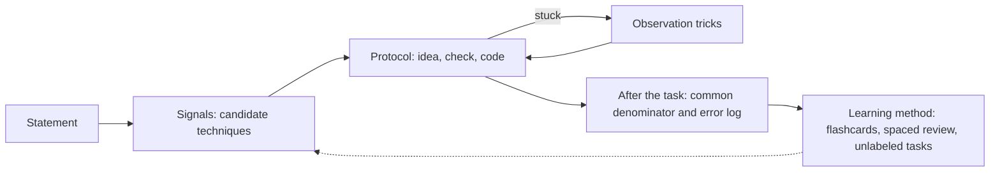

# Moduł myślenia

> [!abstract] W skrócie
> Dni kursu uczą technik; ten moduł uczy, jak dojść do techniki, której nikt nie podpisał w treści, i jak się uczyć,
> żeby to, co przerobisz, zostało na zawody. Pięć notatek: sygnały w treści, protokół rozwiązywania, sztuczki
> obserwacji, wspólne mianowniki i metoda nauki.

## Notatki

| Notatka | O czym | Kiedy czytać |
|---|---|---|
| [Sygnały w treści](sygnaly-w-tresci.md) | po czym poznać technikę: limity, słowa, budowa danych, format wyjścia | po Dniu 3, potem przy każdym zadaniu bez etykiety |
| [Protokół rozwiązywania](protokol-rozwiazywania.md) | sześć faz pracy nad zadaniem, kontrola przed pisaniem, co robić, gdy utkniesz | po Dniu 4; karta do wydruku na zawody |
| [Sztuczki obserwacji](sztuczki-obserwacji.md) | niezmienniki, skrajny element, praca od końca, małe przypadki, bilans, zmiana punktu widzenia | po Dniu 4, przed dniami spostrzeżeń (15-16) jeszcze raz |
| [Wspólne mianowniki](wspolne-mianowniki.md) | jak z zadania wyłuskać ruch, który pasuje do innych zadań; lista ruchów z kursu | po każdym dniu: dopisz mianowniki swoich zadań |
| [Jak się uczyć](jak-sie-uczyc.md) | co mówią badania i zawodnicy, dlaczego dzień kursu wygląda tak, a nie inaczej | na początku kursu i gdy kusi, żeby skracać powtórki |

## Jak notatki łączą się z dniem kursu

Jak czytać diagram: sygnały dają kandydatów, protokół prowadzi od pomysłu do kodu, a sztuczki obserwacji są pętlą na
wypadek, gdy kandydaci zawiodą. Po zadaniu wspólny mianownik i dziennik zamieniają jedno rozwiązane zadanie w ruch,
który rozpoznasz następnym razem; metoda nauki pilnuje, żeby ten ruch wrócił w powtórkach. Przerywana strzałka mówi,
że dobrze prowadzone powtórki to dokładnie to, co później widzisz jako "sygnał w treści".

Atlas wzorców z szablonami w C++ jest osobno: [wzorce](../wzorce/README.md).
