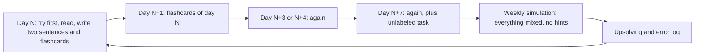

# Jak się uczyć

> [!abstract] W skrócie
> Najmocniejsze dowody w badaniach nad uczeniem się mają dwie techniki: przywoływanie z pamięci (testowanie siebie)
> i powtórki rozłożone w czasie. Umiarkowane: przeplatanie tematów, samowyjaśnianie i próba rozwiązania przed
> instrukcją. Zawodnicy dodają do tego: walcz z zadaniem 15-40 minut przed podpowiedzią, implementuj każde przeczytane
> omówienie, rozwiązuj po zawodach zadania, których nie zdążyłeś. Ta notatka mówi, co z tego wynika i jak kurs to
> realizuje, żebyś wiedział, dlaczego dzień wygląda tak, a nie inaczej, i nie skracał go w złych miejscach.

## Złudzenie zrozumienia

**Intuicja.** Przeczytanie omówienia daje uczucie "jasne, to proste". To uczucie mierzy, czy rozpoznajesz
rozwiązanie, gdy je widzisz, a nie, czy umiesz je wymyślić. Na zawodach nikt nie pokaże rozwiązania do rozpoznania:
trzeba je przywołać z pamięci i dopasować do nowej historii.

**Definicja.** Nauka to zmiana tego, co umiesz zrobić bez pomocy, po czasie. Dlatego kurs mierzy postęp tym, co
robisz sam i z opóźnieniem (fiszki następnego dnia, zadania bez etykiety, symulacje), a nie tym, co przeczytałeś.

## Siedem technik z badań

Siła dowodów według przeglądu dziesięciu technik (Dunlosky i in. 2013): **wysoka** dla testowania siebie i powtórek
rozłożonych; **umiarkowana** dla przeplatania, pytań rozwijających i samowyjaśniania; **niska** dla streszczania,
wielokrotnego czytania, podkreślania i słów-kluczy. Przegląd dotyczy głównie nauki materiału szkolnego, nie
programowania, więc przełożenie na zadania jest wnioskiem, nie wynikiem badania.

1. **Testowanie siebie.** Przywołanie z pamięci utrwala lepiej niż ponowne czytanie (Roediger i Karpicke 2006),
   mocniej przy teście odroczonym i z informacją zwrotną. W kursie: fiszki, "Zanim przeczytasz dalej" przed każdym
   omówieniem, pytania w zwiniętych calloutach.
2. **Powtórki rozłożone.** Nauka rozłożona była lepsza od skupionej w 259 z 271 porównań (Cepeda i in. 2006).
   Najlepsza przerwa rośnie z odległością do testu, a za krótka szkodzi bardziej niż za długa (Cepeda i in. 2008).
   W kursie: fiszki dnia powtarzasz po 1, ok. 3-4 i ok. 7 dniach (ten harmonogram to wniosek z tych liczb dla
   trzytygodniowego kursu, nie wynik badania).
3. **Przeplatanie.** Mieszane zestawy zadań dały 61 % wobec 38 % poprawnych odpowiedzi w teście po miesiącu (Rohrer
   i in. 2020, 787 uczniów, matematyka). Działa, bo wymusza rozpoznanie, jaki to typ zadania, a tego blok zadań
   z jednego tematu nie ćwiczy. W kursie: temat dnia w bloku, a obok zadanie bez etykiety z wcześniejszego dnia;
   symulacje to pełne przeplatanie.
4. **Próba przed instrukcją.** Rozwiązywanie przed wykładem, nawet nieudane, daje lepsze wyniki niż wykład przed
   zadaniem (Sinha i Kapur 2021, metaanaliza 53 badań, efekt g = 0,36, po korekcie na błąd publikacji większy). W kursie:
   każde zadanie omówione zaczyna się od Twojej próby z zegarkiem.
5. **Przykłady rozwiązane i wygaszanie.** Początkujący uczą się lepiej z rozwiązanych przykładów niż z samodzielnego
   błądzenia, ale z rosnącą wiedzą ten efekt się odwraca; pomaga stopniowe usuwanie kroków przykładu (Renkl
   i Atkinson). W kursie: dni 1-6 mają pełne omówienia, od tygodnia 2 więcej ćwiczeń z samymi podpowiedziami,
   w symulacjach nie ma podpowiedzi wcale.
6. **Samowyjaśnianie.** Tłumaczenie sobie, dlaczego każdy krok rozwiązania jest potrzebny: efekt g = 0,55 (Bisra
   i in. 2018). W kursie: "Droga myślenia" w notatkach i dwa zdania do dziennika po każdym zadaniu.
7. **Praktyka celowa.** Zadania na granicy możliwości z szybką informacją zwrotną (Ericsson i in. 1993); sama liczba
   godzin wyjaśnia małą część różnic w wynikach (Macnamara i in. 2014). W kursie: wyzwanie w każdym dniu i zadania,
   które rozwiązujesz mniej więcej w połowie przypadków.

> [!question] To verify
> Część liczb pochodzi ze streszczeń prac i przeglądów, nie z pełnych tekstów (Dunlosky 2013, Renkl i Atkinson). Nie
> zmienia to wniosków praktycznych, ale cytując je dalej, sprawdź źródło.

## Rady zawodników i trenerów

- **Poziom zadań:** nieco powyżej obecnego, rozwiązywalne mniej więcej w połowie przypadków (Errichto, USACO Guide).
- **Ile walczyć przed podpowiedzią:** opinie się różnią, od 15-20 minut dla początkujących i 30-40 minut wyżej
  (USACO Guide) do "dopóki pojawiają się nowe pomysły". Kurs przyjmuje: tydzień 1 15-20 minut, tydzień 2 25-30 minut,
  tydzień 3 40 minut i więcej.
- **Omówienie czytaj po jednym zdaniu** i wracaj do zadania przy pierwszym nowym pomyśle.
- **Implementuj każde zadanie, którego omówienie przeczytałeś,** od zera i bez patrzenia w cudzy kod; dopiero potem
  porównaj z krótszymi cudzymi rozwiązaniami.
- **Upsolving:** po każdej symulacji rozwiąż 1-2 zadania, których nie zdążyłeś; bardzo trudne pomiń.
- **Dziennik błędów i biblioteczka:** zapisuj najdroższe własne błędy jako przypominajki; do biblioteczki trafia tylko
  kod napisany samodzielnie i przetestowany (Rujia Liu).

## Twój dzień i tydzień w kursie

Jak czytać diagram: materiał jednego dnia wraca trzy razy w rosnących odstępach (przywoływanie z pamięci i powtórki
rozłożone), potem w zadaniu bez etykiety i w symulacji (przeplatanie). Upsolving i dziennik po symulacji zamykają pętlę:
błędy z symulacji to materiał powtórek w kolejnych dniach.

Praktycznie, na każdy dzień:

- **Start (10 minut):** fiszki z wczoraj, sprzed 3-4 dni i sprzed tygodnia; przegląd dziennika błędów.
- **Zadanie:** najpierw sam z zegarkiem, potem podpowiedzi po jednej, na końcu omówienie i własna implementacja.
- **Koniec dnia:** dwa zdania do dziennika (dlaczego działa, po czym rozpoznam), błędy, nowe fiszki, wspólny
  mianownik ([wspólne mianowniki](wspolne-mianowniki.md)).

## Dziennik błędów

Jedna linijka na błąd: zadanie, co poszło źle, jak tego uniknąć następnym razem. Liczą się błędy, które się
powtarzają (przepełnienie, indeks o jeden, zły format wyjścia, za wolne wejście), bo z nich powstaje Twoja osobista
lista kontrolna przed wysłaniem. Wzór: [dziennik błędów](../dziennik/szablon-dziennika.md). Dziennik trzymaj u siebie,
nie w repo.

## Fiszki

Fiszki w kursie mają format `pytanie::odpowiedź` (wtyczka Spaced Repetition w Obsidianie sama ustala odstępy). Bez
wtyczki zasłoń odpowiedź i powiedz ją na głos, zanim spojrzysz. Fiszka, na którą odpowiadasz "mniej więcej", jest
fiszką, której nie umiesz. Własne fiszki pisz z tego, co było dla Ciebie nowe, a nie z tego, co już wiesz.

## Drużyna

Zasady treningu drużynowego Rujii Liu, przyjęte w symulacjach kursu: na początku każdy rozwiązuje ten sam zestaw
osobno, potem porównujecie mocne i słabe strony; specjalizacje (tydzień 3 kursu), ale każdy zna podstawy każdego
działu; zamiast sztywnych ról zasady (np. "po zgłoszeniu wydruk kodu", "żadne zadanie nieprzeczytane po pierwszej
godzinie"); po każdym treningu omówienie i zmiana zasad. Szczegóły pracy na jednym komputerze: [taktyka](../taktyka/role-i-komputer.md).

## Źródła

- J. Dunlosky i in., Improving Students' Learning With Effective Learning Techniques, 2013 (przegląd dziesięciu
  technik).
- H. L. Roediger, J. D. Karpicke, Test-Enhanced Learning, 2006.
- N. J. Cepeda i in., Distributed practice in verbal recall tasks, 2006; Spacing effects in learning, 2008.
- D. Rohrer i in., A randomized controlled trial of interleaved mathematics practice, 2020.
- A. Renkl, R. K. Atkinson, prace o wygaszaniu rozwiązanych przykładów (fading).
- T. Sinha, M. Kapur, When Problem Solving Followed by Instruction Works, 2021 (metaanaliza).
- K. Bisra i in., Inducing Self-Explanation: a Meta-Analysis, 2018.
- K. A. Ericsson i in., The Role of Deliberate Practice, 1993; B. N. Macnamara i in., Deliberate Practice and
  Performance, 2014.
- USACO Guide (https://usaco.guide), rady Errichto, Rujia Liu o treningu drużyn ICPC.
