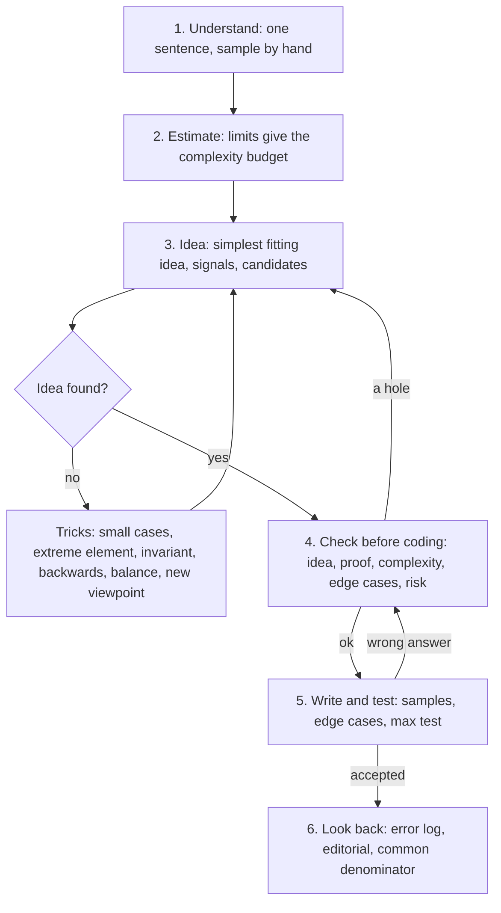

# Protokół rozwiązywania zadania

> [!abstract] W skrócie
> Stała kolejność pytań, które zadajesz każdemu zadaniu: od przeczytania treści, przez szukanie pomysłu i sprawdzenie
> go przed pisaniem, po zapis wniosków po zadaniu. Rozwija sześć kroków mini-protokołu z
> [Dnia 1](../dni/01-start.md) (sekcja 6) o to, co robić, gdy pomysłu nie ma, i o kontrolę przed zajęciem komputera.
> Czytaj po Dniu 4; wracaj przy każdym zadaniu bez etykiety i w symulacjach, aż kroki wejdą w nawyk.

## Po co protokół

**Intuicja.** Pilot przed startem przechodzi listę kontrolną, choć leciał tysiąc razy. Nie dlatego, że nie umie
latać, tylko dlatego, że pod presją człowiek pomija kroki, które "przecież są oczywiste". Na zawodach jest tak samo:
po trzech godzinach i dwóch błędnych zgłoszeniach najłatwiej pominąć przeliczenie przykładu albo sprawdzenie
przepełnienia, a to właśnie one kosztują kary.

**Definicja.** Protokół rozwiązywania to stała kolejność faz pracy nad zadaniem i pytań w każdej fazie. Nie mówi,
jaki jest pomysł; mówi, gdzie go szukać i co sprawdzić, zanim zaczniesz pisać. Opiera się na schemacie George'a Polyi
(How to Solve It: zrozumieć, ułożyć plan, wykonać, spojrzeć wstecz) w wersji dla zawodników (małe przypadki,
limity jako budżet, brute force jako źródło pomysłów i wyrocznia do testów).

## Sześć faz

Jak czytać diagram: główna ścieżka idzie z góry na dół, a trzy pętle wracają do szukania pomysłu. Pętla przez
sztuczki obserwacji to normalna praca nad trudnym zadaniem. Pętla z kontroli przed pisaniem kosztuje minuty, a pętla
po błędnym zgłoszeniu kosztuje 20 minut kary i zwykle więcej czasu, więc dziurę w pomyśle opłaca się znaleźć w fazie
4, nie 5. Faza 6 jest poza zegarem zawodów, ale to w niej powstaje to, co pozwala rozwiązać następne zadanie szybciej.

### 1. Zrozum (ok. 5 minut)

- **Jednym zdaniem:** co jest dane, co mam wypisać. Własnymi słowami, bez historii (bajtazarów, leniwców, szalików).
- **Dane, niewiadoma, warunek** (pytania Polyi). Co dokładnie jest szukane: liczba, konstrukcja, `TAK`/`NIE`?
  Czy wystarczy dowolna poprawna odpowiedź?
- **Rysunek** dla wszystkiego, co ma położenie: oś, plansza, graf, przedziały.
- **Przykład ręcznie,** razem z wyjaśnieniem pod nim. Przykład z odpowiedzią `-1` albo `NIE` rozbierz na części:
  dlaczego tu się nie da? Autorzy często wkładają tam pułapkę ([2024 K Kwadracik](../zadania/2024/k-kwadracik.md)).

### 2. Oszacuj (ok. 2 minuty)

- **Limity to budżet:** n ≤ 20 to podzbiory, n ≤ 5000 to O(n²), n ≤ 10⁶ to O(n) albo O(n log n) (tabela w Dniu 1,
  sekcja 4). Licz około 10⁸ prostych operacji na sekundę.
- **Typy:** największa liczba w obliczeniach (sumy, iloczyny, liczba par) decyduje o `long long`.
- **Sygnały:** słowa, format wyjścia, budowa danych ([sygnały w treści](sygnaly-w-tresci.md)). Zapisz dwie albo
  trzy techniki-kandydatki.
- **Czy każde dane coś znaczą?** Nietypowy limit (suma długości ≤ 10⁶, wartości ≤ 100, k ≤ 1000) jest zwykle
  podpowiedzią.

### 3. Szukaj pomysłu

W tej kolejności, od najtańszego:

1. **Najprostszy pomysł, który mieści się w limitach.** Przy małych limitach przegląd wszystkiego; nie szukaj sprytu,
   gdy nie trzeba ([2023 J](../zadania/2023/j-juliet-unifies-ones.md)).
2. **Kandydaci z sygnałów:** każdego od razu na przykładzie i na małym przypadku, który przeliczysz ręcznie.
3. **Czy znam podobne zadanie?** Nie po historii, tylko po ruchu, który je rozwiązał
   ([wspólne mianowniki](wspolne-mianowniki.md)).
4. **Wersja łatwiejsza:** mniejsze limity, szczególny przypadek (wszystkie liczby równe, k = 1, drzewo to ścieżka).
   Rozwiązanie łatwiejszej wersji często jest pierwszym krokiem trudniejszej.
5. **Sztuczki obserwacji,** gdy nic z powyższego nie działa: małe przypadki i brute force, skrajny element,
   niezmiennik, praca od końca, bilans, zmiana punktu widzenia ([sztuczki obserwacji](sztuczki-obserwacji.md)).

### 4. Sprawdź przed pisaniem

Powiedz na głos (na zawodach koledze z drużyny, na treningu sobie albo na kartce) pięć rzeczy:

- **Pomysł** w dwóch zdaniach.
- **Dlaczego działa:** szkic dowodu albo przynajmniej "na czym by się wywrócił, gdyby był zły".
- **Złożoność z liczbami:** nie "n log n", tylko "10⁶ · 20 = 2 · 10⁷, mieści się".
- **Przypadki brzegowe:** n = 1, wszystko równe, wartości maksymalne, odpowiedź `NIE`.
- **Ryzyko:** co jest najbardziej prawdopodobnym błędem (indeksy, przepełnienie, format wyjścia)?

Jeśli któregoś punktu nie umiesz powiedzieć, wracasz do fazy 3. Ta rozmowa trwa 2-3 minuty i jest najtańszym testem,
jaki masz.

### 5. Napisz i przetestuj

- Kod z [szablonu](../szablony/szablon.cpp), zmienne nazwane jak w treści.
- Wszystkie przykłady z treści, potem ręczne przypadki brzegowe z fazy 4.
- Test maksymalny, gdy złożoność jest na granicy budżetu: wygeneruj największe dane i zmierz czas.
- Gdy wynik jest podejrzany albo zgłoszenie odrzucone: brute force i porównanie na małych losowych danych (Dzień 5).
  Na zawodach, zanim wyślesz drugi raz, wróć do fazy 4.

### 6. Spójrz wstecz (po zadaniu)

- **Dwa zdania do dziennika:** dlaczego rozwiązanie działa i po czym rozpoznam ten wzorzec następnym razem.
- **Omówienie,** także po akceptacji: czy jest prostsze albo szybsze rozwiązanie?
- **Wspólny mianownik:** jaki ruch rozwiązał zadanie i gdzie już go widziałem.
- **Błąd do dziennika,** jeśli był ([wzór](../dziennik/szablon-dziennika.md)), i fiszka z tego, co było nowe.

## Gdy utkniesz

- **Limit samodzielnej walki** przed pierwszą podpowiedzią: w tygodniu 1 15-20 minut, w tygodniu 2 25-30 minut,
  w tygodniu 3 40 minut i więcej. Walka uczy, ale walka bez końca marnuje czas
  ([jak się uczyć](jak-sie-uczyc.md)).
- **Przeczytaj treść jeszcze raz,** zdanie po zdaniu. Połowa blokad to źle przeczytany warunek.
- **Opowiedz zadanie komuś** (albo kartce). Zmuszenie się do pełnych zdań często pokazuje lukę.
- **Zapisz, co wiesz:** fakty o rozwiązaniu, nawet oczywiste ("odpowiedź ≤ n", "kolejność nie ma znaczenia"). Z listy
  faktów często wychodzi obserwacja.
- **Na zawodach:** po umówionym czasie bez postępu zadanie wraca do kolejki, a Ty bierzesz następne (taktyka drużyny:
  [przebieg zawodów](../taktyka/przebieg-zawodow.md)).

## Przykład: protokół na 2012 I Inwersje

1. **Zrozum.** Permutacja; krawędź między wartościami, które tworzą inwersję. Wypisać spójne składowe. Rysunek dla
   2 3 1 4 jest w treści: {1, 2, 3} i {4}.
2. **Oszacuj.** n ≤ 10⁶, więc O(n) albo O(n log n). Krawędzi jest do 5 · 10¹¹: grafu nie wolno budować. Wyjście ma
   do 2 · 10⁶ liczb, więc szybkie wypisywanie.
3. **Pomysł.** Sygnały mówią "graf", ale BFS odpada przez liczbę krawędzi. Wersja łatwiejsza i małe przypadki: rysuję
   3 1 2 5 4 (składowe {1, 2, 3}, {4, 5}) i 2 1 4 3 (dwie składowe). Zawsze spójne kawałki pozycji. Hipoteza: kawałek
   kończy się tam, gdzie wszystkie liczby z lewej są mniejsze od wszystkich z prawej, czyli maksimum prefiksu równa
   się liczbie elementów.
4. **Sprawdź.** Dowód: brak krawędzi przez granicę to dokładnie warunek "z lewej 1..i"; składowa nie ma dziur, bo
   krawędź x, z łączy też każde y między nimi z x albo z z. Złożoność O(n). Brzegowe: permutacja identycznościowa
   (n składowych, największe wyjście), odwrócona (jedna składowa). Ryzyko: wolne wyjście.
5. **Napisz.** Jedna pętla z maksimum, wyjście w jednym napisie; przykład zgodny.
6. **Spójrz wstecz.** Dziennik: "graf z n² krawędzi: zgadnij kształt składowych na małych przypadkach". Mianownik:
   maksimum prefiksu jako test "prefiks to 1..i" ([notatka](../zadania/2012/i-inwersje.md)).

## Karta do wydruku

1. Jednym zdaniem: dane, szukane. Przykład ręcznie, także ten z `NIE`.
2. Limity: budżet złożoności, największa liczba, typy. Nietypowe limity to podpowiedź.
3. Pomysł: najprostszy w limitach, kandydaci z sygnałów, podobne zadanie, wersja łatwiejsza, sztuczki obserwacji.
4. Przed pisaniem na głos: pomysł, dowód, złożoność z liczbami, przypadki brzegowe, ryzyko.
5. Przykłady, przypadki brzegowe, test maksymalny; po odrzuceniu najpierw faza 4, potem brute force.
6. Po zadaniu: dwa zdania do dziennika, omówienie, wspólny mianownik, fiszka.
