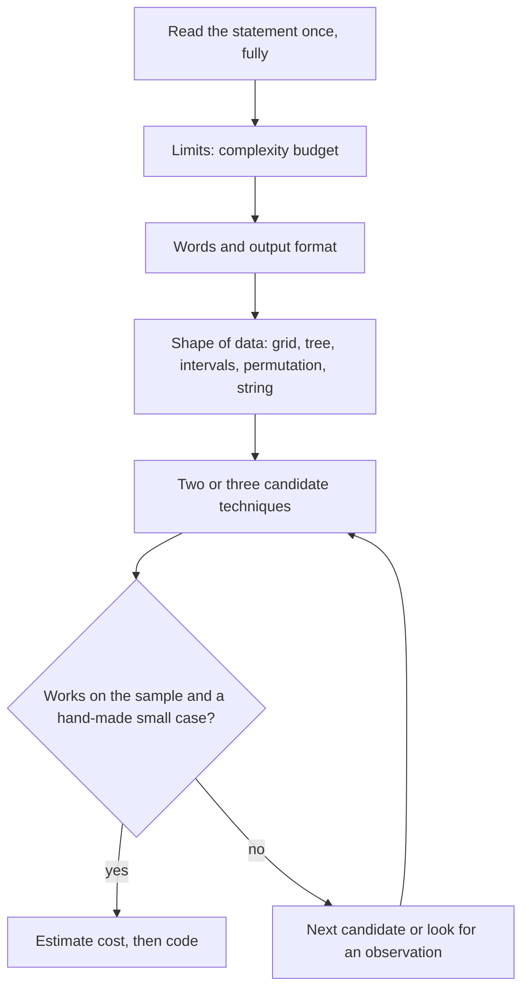

# Sygnały w treści: po czym rozpoznać technikę

> [!abstract] W skrócie
> Treść zadania AMPPZ prawie zawsze zdradza technikę, zanim zaczniesz myśleć o rozwiązaniu: limity mówią, jaka
> złożoność się zmieści, słowa w treści i format wyjścia zawężają rodzinę technik, a budowa danych (plansza,
> drzewo, przedziały, permutacja) podsuwa narzędzia. Ten atlas zbiera sygnały, które powtarzają się w archiwum
> 2011-2024, każdy z przykładem zadania. Czytaj go po Dniu 3, wracaj do niego przy każdym zadaniu bez etykiety
> i w symulacjach.

## Jak z tego korzystać

**Intuicja.** Lekarz nie zaczyna od przeglądania wszystkich chorób z podręcznika. Patrzy na objawy: gorączka
i wysypka zawężają listę do kilku chorób, a dopiero potem robi badanie, które rozstrzyga. Treść zadania ma swoje
objawy: "n ≤ 20", "modulo 10⁹ + 7", "wypisz dowolne". Każdy objaw sam w sobie niczego nie przesądza, ale dwa albo
trzy razem zostawiają zwykle jedną lub dwie techniki do sprawdzenia.

**Definicja.** Sygnał to cecha treści (limit, sformułowanie, format wejścia lub wyjścia, budowa danych), która
zmienia prawdopodobieństwo, że zadanie rozwiązuje się daną techniką. Sygnał to hipoteza, nie dowód: potwierdzasz
ją na przykładzie z treści i na małym przypadku, który przeliczysz ręcznie.

**Mechanizm.**

Jak czytać diagram: sygnały zbierasz w stałej kolejności, od najbardziej wiarygodnego (limity są liczbami, nie da
się ich źle przeczytać) do najmniej (słowa bywają mylące). Z sygnałów powstaje krótka lista kandydatów, a każdego
kandydata od razu sprawdzasz na przykładzie. Pętla H, E to zwykła praca nad zadaniem: odrzucony kandydat też coś
mówi, bo pokazuje, co w zadaniu przeszkadza.

**Przykład.** 2023 J Juliet Unifies Ones ([omówienie](../zadania/2023/j-juliet-unifies-ones.md)): napis do 50 znaków
i pytanie o najmniejszą liczbę usunięć. Limit 50 mówi "stać Cię na O(n³), nawet na więcej", więc pierwszy kandydat
to przegląd wszystkich wyborów fragmentu, który zostaje. Działa na przykładzie, koszt ok. 50³, koniec myślenia.

> [!warning] Skąd są przykłady
> Techniki zadań, które mają notatkę w kursie (link "omówienie"), są sprawdzone: zadanie zostało rozwiązane
> i przetestowane. Pozostałe przykłady pochodzą z przeglądu treści całego archiwum, bez rozwiązywania, i są hipotezą
> (trudność i technika każdego zadania: [katalog](../zadania/katalog.md)).

## 1. Sygnały z limitów

Najpewniejszy sygnał. Pełna tabela "limit → złożoność" jest w [Dniu 1, sekcja 4](../dni/01-start.md); tu to, co z niej
wynika dla wyboru techniki.

- **n ≤ 10, plansza 3 × 3, n ≤ 6:** przegląd wszystkiego albo symulacja wprost. 2018 H Hobby (9! rozmieszczeń
  cyfr na planszy 3 × 3, 42 z 51 drużyn), 2022 K Kółko i Krzyżyk ([omówienie](../zadania/2022/k-kolko-i-krzyzyk.md)),
  2024 G Gra MPO ([omówienie](../zadania/2024/g-gra-mpo.md)).
- **n ≤ 16-20:** maski bitowe, czyli przegląd podzbiorów albo DP po podzbiorach (2023 M: n ≤ 16; 2015 J: n ≤ 20).
- **Jeden malutki parametr wśród dużych** (h ≤ 8 przy w do 10⁵, k ≤ 6, k ≤ 20): rozwiązanie wykładnicze względem
  małego parametru, a liniowe względem dużych. 2024 J Jedynki i zera (h ≤ 8), 2019 F Fantastyczna kompresja
  (k ≤ 6), 2021 A (k ≤ 20).
- **n ≤ 2000-5000:** O(n²): dwie pętle, DP na parach, przedziały. 2015 H Harcerze (n ≤ 2000, DP po przedziałach),
  2022 I Inwestorzy (n ≤ 6000).
- **n do 2 · 10⁵-10⁶:** O(n log n) albo O(n): sortowanie, wyszukiwanie binarne, dwa wskaźniki, sumy prefiksowe,
  struktury danych. To najczęstszy limit w archiwum, więc sam w sobie mało mówi; rozstrzygają słowa i dane.
- **n do 10⁹-10¹⁸:** wzór, zależność od log n (potęgowanie, wyszukiwanie binarne po wyniku, rozkład na cyfry), O(√n)
  przy 10¹². 2018 B Bony Fibonacciego (n ≤ 10¹⁸: liczb Fibonacciego do 10¹⁸ jest tylko ok. 87).
- **"Suma n we wszystkich zestawach nie przekracza ...":** koszt liczysz od sumy, nie od liczby zestawów razy
  maksimum; rozwiązanie liniowe w zestawie wystarcza.
- **Bardzo mały limit pamięci** (8-16 MB przy dużym n): nie wolno trzymać całego wejścia; przetwarzanie w locie
  albo wzór. 2022 E Euklides (8 MB), 2019 L Obwarzanek (8 MB).
- **Ogromne liczby na wejściu** (miliony cyfr, k ≤ 10¹⁰⁰⁰⁰): liczba to napis; potrzebne są operacje na cyfrach,
  nie arytmetyka w `long long`. 2023 F Fibonacci Fusion (do 5 · 10⁶ cyfr), 2017 I.

## 2. Sygnały ze słów w treści

| Sformułowanie | Pierwszy kandydat | Przykład z archiwum |
|---|---|---|
| "minimalna liczba zmian, żeby nie było ..." | zachłanne skanowanie od lewej | 2022 C Ctrl+C Ctrl+V (49/50) |
| "terminy", "zdąży", "najpóźniej" | sortowanie po terminie, argument zamiany | 2012 J Jutro (50/54) |
| "minimalny czas", "po której minucie" przy dużych wartościach | wyszukiwanie binarne po wyniku | 2024 C Cierpliwe krowy |
| "zmaksymalizuj najmniejszą odległość", "zminimalizuj maksimum" | wyszukiwanie binarne po wyniku | 2017 L Leśny kemping |
| "różnica nie przekracza k", "pary, w których ..." | sortowanie i dwa wskaźniki | 2015 D Studniówka |
| "każdy podprzedział", "ile fragmentów spełnia ..." | sumy prefiksowe, dwa wskaźniki | 2017 B Bajki |
| "modulo 10⁹ + 7", "zlicz" | kombinatoryka albo DP zliczające | 2024 I, 2015 K Klocki |
| "wartość oczekiwana", "błąd 10⁻⁶" | liniowość wartości oczekiwanej, DP na prawdopodobieństwach | 2024 H Hop, 2021 K |
| "optymalnie", "obaj gracze grają najlepiej" | teoria gier: stany wygrywające i przegrywające | 2023 G, 2014 E |
| "wypisz dowolne", "skonstruuj", "wypisz plan" | konstrukcja: najpierw kiedy się da, potem przepis | 2022 J, 2021 J |
| "najmniejszy leksykograficznie" | zachłanne od lewej z kontrolą, czy da się dokończyć | 2017 H, 2013 I |
| "dla każdego k", "dla każdego p" | jedna struktura liczona dla wszystkich k naraz, nie k osobnych rozwiązań | 2021 F Farba, 2024 F |
| "online", zakodowane zapytania | struktura danych z aktualizacjami, bez sortowania zapytań | 2021 E Epidemia |
| zapytania, które można przetworzyć w dowolnej kolejności | offline: posortuj zapytania, DSU albo zamiatanie | 2014 B Benzyna |
| "do oporu", "aż nie da się nic zrobić" | proces monotoniczny, wynik nie zależy od kolejności | 2024 G Gra MPO, 2021 D |
| "czy stan jest osiągalny", "czy taka plansza mogła powstać" | warunki konieczne i wystarczające | 2022 K Kółko i Krzyżyk |

## 3. Sygnały z budowy danych

- **Plansza (siatka znaków):** symulacja z tablicą kierunków, BFS po polach, sumy prefiksowe 2D. Sprawdź, czy
  sąsiedztwo jest przez bok (4) czy też przez róg (8): 2024 G i 2023 E liczą róg.
- **Drzewo** ("n - 1 krawędzi", "rodzic ma mniejszy numer"): DFS z liczeniem poddrzew, DP na drzewie, LCA. "Rodzic
  ma mniejszy numer" (2011 J) pozwala liczyć poddrzewa jedną pętlą od n do 1, bez rekurencji.
- **Przedziały, spotkania, terminy:** sortowanie po końcu albo po początku, zamiatanie po zdarzeniach. 2014 A
  Adwokat, 2013 D Demonstracje.
- **Permutacja:** cykle permutacji, inwersje, pozycja każdej wartości. 2012 I Inwersje, 2017 G Głowica drukarki.
- **Napis:** zliczanie liter, wystąpienia wzorca, hashowanie, palindromy. Gdy alfabet jest mały (binarny, 4 litery),
  często wystarcza zliczanie.
- **Punkty na płaszczyźnie:** geometria na liczbach całkowitych (iloczyn wektorowy), sortowanie po współrzędnej,
  odległość Manhattan rozkłada się na osie.
- **Graf z wagami:** Dijkstra, MST. "Koszt to maksimum na ścieżce" zamiast sumy: MST albo DSU po posortowanych
  krawędziach.

## 4. Sygnały z formatu wyjścia

- **"Wypisz -1" albo "NIE":** najpierw ustal, kiedy odpowiedź nie istnieje. Czasem nie istnieje nigdy: w 2021 H
  Hasła ([omówienie](../zadania/2021/h-hasla.md)) odpowiedź NIE jest w treści, ale nigdy nie wystąpi.
- **"Wypisz dowolne poprawne":** jest sprawdzaczka, więc nie trzeba trafić w odpowiedź z przykładu; wystarcza
  najprostsza konstrukcja.
- **Wynik rzeczywisty z tolerancją:** `double` albo `long double`, wypisanie z `fixed` i `setprecision`; czasem
  wyszukiwanie binarne po liczbie rzeczywistej.
- **Wynik "modulo":** wszystkie iloczyny w `long long`, odejmowanie z dodaniem modułu.
- **Wynik do ok. 10¹⁸ bez modulo:** `long long`, a przy iloczynach dwóch dużych liczb sprawdź, czy nie potrzeba
  `__int128`.

## 5. Fałszywe sygnały

- **Długa treść nie znaczy trudnego zadania.** 2024 G Gra MPO ma długą treść z punktacją, a jest symulacją na
  planszy 10 × 10. Długość treści bierze się z historii i reguł, nie z algorytmu.
- **Krótka treść nie znaczy łatwego zadania.** Zadania z jednym zdaniem i dużymi limitami (2022 E Euklides, 3 z 50
  drużyn) zwykle wymagają obserwacji.
- **Reguła z treści bywa zasłoną.** W 2024 G "zawsze najlepszy ruch" sugeruje coś sprytnego, a wynik nie zależy od
  kolejności ruchów. W 2022 A Aliasy ([omówienie](../zadania/2022/a-aliasy.md)) zadanie wygląda na trudne napisowe,
  a obserwacja z limitów zostawia 28 przypadków.
- **Szacunek trudności z treści jest zawyżony.** Liczy się ranking: w [katalogu](../zadania/katalog.md) trudność
  bez tyldy to liczba drużyn, które zadanie rozwiązały.

## 6. Ćwiczenie: nazwij technikę

Dla każdego opisu sygnałów nazwij jedną albo dwie techniki, zanim rozwiniesz odpowiedź. Opisy pochodzą z zadań
archiwum; nie zaglądaj do treści.

> [!question]- Ciąg n ≤ 10⁶ liczb, zmień jak najmniej liczb, żeby każdy fragment k kolejnych miał parzystą sumę.
> Zmiana jednej liczby wpływa na wiele fragmentów, ale warunek dla sąsiednich fragmentów daje równość parzystości
> a[i] i a[i + k]. Pozycje rozpadają się na k klas reszt modulo k; w każdej klasie parzystość musi być stała, a suma
> parzystości klas parzysta. Zliczanie po klasach i jedna poprawka (2012 C Ciąg, 28 z 54 drużyn).

> [!question]- Plansza 3 × 3, cyfry parami różne, warunki na sumy, "wypisz dowolne albo NIE".
> Przegląd wszystkich 9! = 362 880 rozmieszczeń i sprawdzenie warunków (2018 H Hobby, 42 z 51 drużyn).

> [!question]- n do 2,5 · 10⁵ uczniów z wzrostami, policz pary, w których różnica wzrostów nie przekracza k.
> Sortowanie i dwa wskaźniki albo wyszukiwanie binarne dla każdego ucznia; wynik do 6,25 · 10¹⁰ w `long long`
> ([2015 D Studniówka](../zadania/2015/d-studniowka.md), omówienie w Dniu 4).

> [!question]- n ≤ 16 zawodników, każdy z liczbą punktów, także ujemną; "zmaksymalizuj końcowy wynik jednego".
> n ≤ 16 to maski bitowe: DP po podzbiorach już rozegranych albo przegląd podzbiorów (2023 M).

> [!question]- Krowy, wysokość h do 10⁹, "po której minucie najwcześniej ...".
> Gdy dla czasu t umiesz szybko sprawdzić, czy wystarczy, a odpowiedź "tak" dla t daje "tak" dla każdego większego
> czasu: wyszukiwanie binarne po czasie (2024 C Cierpliwe krowy).

> [!question]- Graf miast, "cysterna o pojemności c", wiele zapytań "czy dojedzie".
> Zapytania można posortować po pojemności i dokładać krawędzie rosnąco w DSU (offline). Tu jeszcze trzeba
> sprowadzić graf do stacji: Dijkstra ze wszystkich stacji naraz (2014 B Benzyna, 15 z 57 drużyn).
