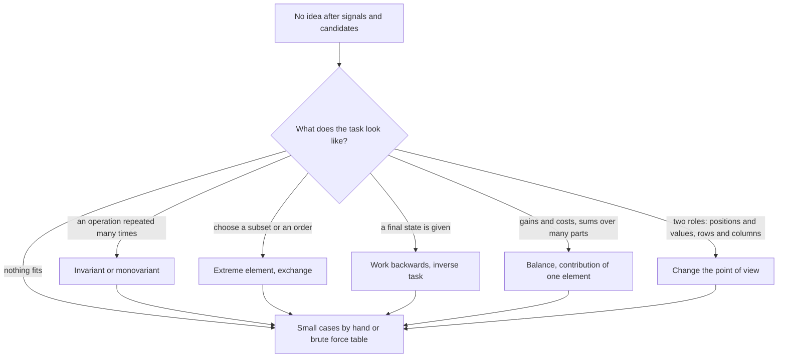

# Sztuczki obserwacji

> [!abstract] W skrócie
> Sześć sposobów szukania obserwacji, gdy sygnały z treści nie podsuwają techniki: niezmienniki, skrajny element,
> praca od końca i zadanie odwrotne, małe przypadki z brute force, bilans i wkład elementu, zmiana punktu widzenia.
> Każdy z intuicją, definicją, pytaniami do zadania i przykładami z kursu. To faza 3 [protokołu](protokol-rozwiazywania.md):
> sięgasz tu, kiedy najprostszy pomysł i kandydaci z sygnałów zawiodą.

## Która sztuczka na początek

Jak czytać diagram: kształt zadania podpowiada, od której sztuczki zacząć, ale każda droga kończy się na małych
przypadkach. To nie przypadek: hipotezę z dowolnej sztuczki sprawdzasz na kilku przykładach przeliczonych ręcznie
albo brute force'em, zanim w nią uwierzysz. Gdy nic nie pasuje, małe przypadki są też punktem startu.

## 1. Niezmienniki i monowarianty

**Intuicja.** Jeśli przelewasz wodę między szklankami, łączna ilość wody się nie zmienia, choćbyś przelewał godzinę.
Zamiast śledzić każde przelanie, patrzysz na to, co stoi w miejscu.

**Definicja.** Niezmiennik to wielkość, której operacja nie zmienia (suma, parzystość, reszta z dzielenia, różnica
dwóch liczników). Monowariant to wielkość, która zmienia się tylko w jedną stronę (rośnie liczba zajętych pól,
maleje suma). Niezmiennik daje warunek konieczny: stan z inną wartością jest nieosiągalny. Monowariant daje
skończoność procesu i często niezależność wyniku od kolejności ruchów.

**Pytania do zadania.** Co operacja zmienia, a czego nie? Jak zmienia się suma, parzystość, liczba elementów? Czy
coś tylko rośnie? Czy końcowy stan może zależeć od kolejności ruchów?

**Przykłady.**

- Klasyka: szachownicy 8 × 8 bez dwóch przeciwległych narożników nie da się pokryć kostkami domina. Każda kostka
  zakrywa jedno pole białe i jedno czarne, a oba narożniki są tego samego koloru, więc zostaje 30 pól jednego koloru
  i 32 drugiego.
- [2022 K Kółko i Krzyżyk](../zadania/2022/k-kolko-i-krzyzyk.md): gracze ruszają się na zmianę, więc liczby znaków
  różnią się najwyżej o 1 w każdym stanie gry. To pierwszy warunek konieczny poprawnej planszy.
- [2024 G Gra MPO](../zadania/2024/g-gra-mpo.md): rzeczy tylko się dokłada, nic nie znika (monowariant), więc proces
  kończy się tym samym stanem przy każdej kolejności i wystarcza kolejka zamiast symulacji wyborów.
- Z atlasu sygnałów (2012 C Ciąg, bez omówienia w kursie): warunek "każdy fragment k kolejnych ma parzystą sumę" dla
  sąsiednich fragmentów daje równość parzystości a[i] i a[i + k]; parzystość jest stała w każdej klasie reszt
  modulo k.

## 2. Skrajny element

**Intuicja.** Gdy chcesz wiedzieć, czy cały zespół zmieści się pod niskim sufitem, wystarczy zmierzyć najwyższą
osobę. Najwyższy jest "najtrudniejszy", więc jeśli on się mieści, mieszczą się wszyscy.

**Definicja.** Rozważasz element najmniejszy, największy, najwcześniejszy albo najdalszy i pytasz, gdzie może on stać
w rozwiązaniu. Dwie wersje: "jeśli jakieś rozwiązanie istnieje, to istnieje też z elementów skrajnych" i "skrajny
element, który łamie warunek w najkorzystniejszej sytuacji, nie należy do żadnego rozwiązania". Argument zamiany
z Dnia 3 to ten sam ruch wykonany krok po kroku.

**Pytania do zadania.** Co wiem o największym (najmniejszym) elemencie? Czy da się go zawsze postawić na początku
albo na końcu? Czy można go od razu wyrzucić albo od razu wziąć?

**Przykłady.**

- [2014 A Adwokat](../zadania/2014/a-adwokat.md): dwa rozłączne spotkania w danym dniu istnieją wtedy i tylko wtedy,
  gdy spotkanie kończące się najwcześniej nie nachodzi na spotkanie zaczynające się najpóźniej; wystarcza minimum
  końców i maksimum początków.
- [2019 C Koło (z) Matematyków](../zadania/2019/c-kolo-z-matematykow.md): najdłuższy odcinek, który nie spełnia
  warunku wielokąta nawet ze wszystkimi krótszymi, odpada na zawsze.
- [2012 J Jutro](../zadania/2012/j-jutro.md): zadanie z najwcześniejszym terminem idzie pierwsze (zamiana sąsiadów).

## 3. Praca od końca i zadanie odwrotne

**Intuicja.** Labirynt w gazecie łatwiej rozwiązać od mety: od mety prowadzi zwykle mniej rozgałęzień. Jeśli wiesz,
gdzie masz być, często łatwiej zapytać, skąd mogłeś tam przyjść.

**Definicja.** Trzy odmiany: (1) planowanie od końca: ostatnią decyzję podejmujesz pierwszą, bo jest najmniej
skrępowana; (2) zadanie odwrotne: zamiast budować stan, pytasz, jakie warunki musi spełniać stan osiągalny, a potem
pokazujesz, że te warunki wystarczają; (3) odwrócenie procesu: usuwanie elementów czytane od końca to dokładanie,
które jest zwykle łatwiejsze.

**Pytania do zadania.** Czy znam stan końcowy albo ostatni ruch? Co musiało być prawdą tuż przed nim? Czy proces
czytany wstecz jest prostszy (dokładanie zamiast usuwania)?

**Przykłady.**

- [2012 J Jutro](../zadania/2012/j-jutro.md): planujemy od zadania z najpóźniejszym terminem; każde kończy się jak
  najpóźniej, a najpóźniejszy start wychodzi na końcu.
- [2022 K Kółko i Krzyżyk](../zadania/2022/k-kolko-i-krzyzyk.md): zwycięzca wygrał ostatnim ruchem, więc pole tego
  ruchu leży na każdej jego linii; warunki konieczne, potem kolejność, która pokazuje, że wystarczają.
- Odwrócenie procesu wróci w tygodniu 2: usuwanie krawędzi grafu czytane od końca to dokładanie krawędzi w DSU.

## 4. Małe przypadki i brute force

**Intuicja.** Matematycy nie zgadują wzorów z powietrza: wypisują pierwsze wyrazy ciągu i patrzą. W zadaniu robisz to
samo: kilka przypadków na kartce albo tabela wyników z prostego programu pokazuje kształt rozwiązania.

**Definicja.** Rozwiązujesz zadanie dla bardzo małych danych (ręcznie albo programem, który przegląda wszystko)
i szukasz regularności: wzoru, kształtu optymalnego rozwiązania, warunku na `NIE`. Brute force ma trzy role:
źródło hipotez, sprawdzian hipotez (kontrprzykład znajduje się szybciej niż dowód) i wyrocznia do testów losowych
(Dzień 5).

**Pytania do zadania.** Jak wygląda odpowiedź dla n = 1, 2, 3, 4? Jaki kształt ma rozwiązanie optymalne w małych
przypadkach (spójny kawałek? posortowane? symetryczne?)? Czy brute force na n ≤ 8 da mi tabelę, z której zobaczę
wzór?

**Przykłady.**

- [2012 I Inwersje](../zadania/2012/i-inwersje.md): kilka narysowanych permutacji pokazuje, że składowe są zawsze
  spójnymi kawałkami pozycji; stąd pomysł z maksimum prefiksu.
- [2021 H Hasła](../zadania/2021/h-hasla.md): zapisanie warunku wzorem i uproszczenie pokazuje, że przypadek `NIE`
  w ogóle nie istnieje.
- Dzień 3, polowanie na kontrprzykłady: każda błędna reguła zachłanna pada na danych z 2-3 elementów.

## 5. Bilans i wkład elementu

**Intuicja.** Księgowy nie śledzi każdego banknotu, tylko patrzy na saldo: ile przybyło, ile ubyło. Podobnie przy
liczeniu sumy po wielu częściach: zamiast przeglądać części, pytasz, ile do sumy dokłada każdy element.

**Definicja.** Bilans: policz, co netto zmienia jeden ruch, i sprawdź, czy wszystkie szczegóły ruchu się nie
skracają. Wkład (contribution): sumę po wielu obiektach (kawałkach, parach, podzbiorach) zapisz jako sumę po
elementach, z których każdy dokłada swoją wartość razy liczbę obiektów, w których występuje.

**Pytania do zadania.** Ile netto daje jeden ruch? Czy któryś parametr ruchu w ogóle nie wpływa na wynik? Ile razy
dany element jest liczony w szukanej sumie? Od czego zależy zysk z usunięcia elementu?

**Przykłady.**

- [2019 A Asymilacja](../zadania/2019/a-asymilacja.md): inwazja i mobilizacja planety m dają netto +m statków,
  niezależnie od liczby statków użytych do inwazji. Gra z wieloma decyzjami staje się jedną liczbą.
- [2013 D Demonstracje](../zadania/2013/d-demonstracje.md): zysk z odwołania pary to suma wkładów fragmentów osi
  pokrytych tylko przez te demonstracje.
- Klasyka: suma sum wszystkich kawałków tablicy. Element a[i] (indeksy od 0) leży w (i + 1) · (n - i) kawałkach,
  więc wynik to suma a[i] · (i + 1) · (n - i), w O(n) zamiast O(n²).

## 6. Zmiana punktu widzenia

**Intuicja.** Rozkład jazdy można czytać po przystankach ("kiedy odjeżdża coś z mojego przystanku") albo po kursach
("gdzie jest autobus o 8:15"). Te same dane, a jedno pytanie jest w jednym widoku trywialne, w drugim trudne.

**Definicja.** Zamieniasz role w danych: pozycje i wartości (permutacja odwrotna), elementy i granice między nimi,
obiekty i zapytania, wiersze i kolumny, współrzędne (x, y) i (x + y, x - y). Szukasz widoku, w którym warunek zadania
staje się prosty.

**Pytania do zadania.** Co jest "kolejne" dla operacji z treści: pozycje czy wartości? Czy łatwiej myśleć
o elementach, czy o miejscach między nimi? Czy zamiast "dla każdego elementu, co pokrywa" policzyć "dla każdego
miejsca, kto je pokrywa"?

**Przykłady.**

- [2017 G Głowica drukarki](../zadania/2017/g-glowica-drukarki.md): zamiast wysokości na polach patrzymy na pola
  kolejnych wysokości; przebieg głowicy staje się monotonicznym kawałkiem ciągu.
- [2012 I Inwersje](../zadania/2012/i-inwersje.md): zamiast krawędzi grafu patrzymy na granice między pozycjami,
  przez które krawędź nie przechodzi.
- [2021 F Farba](../zadania/2021/f-farba.md): dla ustalonej wysokości b deski dzielą się na długie (ciekawe) i krótkie
  (jednakowe), a długich jest mało.
- Obrót o 45 stopni: romb |dx| + |dy| ≤ k w nowych współrzędnych (x + y, x - y) jest zwykłym kwadratem
  ([karta wzorca Dnia 4](../wzorce/sumy-prefiksowe-i-dwa-wskazniki.md), 2021 L Leniwce).

## Ćwiczenie

Przy każdym zadaniu z kursu, które rozwiązałeś, sprawdź w notatce "Drogę myślenia" i nazwij sztuczkę, która dała
kluczową obserwację. Wpisz ją do dziennika obok wspólnego mianownika ([wspólne mianowniki](wspolne-mianowniki.md)).
Po tygodniu zobaczysz, po które sztuczki sięgasz sam, a które przychodzą dopiero z omówienia: te drugie ćwicz
świadomie na zadaniach bez etykiety.
