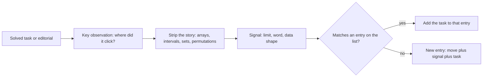

# Wspólne mianowniki

> [!abstract] W skrócie
> Wspólny mianownik zadania to ruch myślowy, który je rozwiązał, zapisany bez historii z treści, tak żeby pasował do
> innych zadań, razem z sygnałem, po którym go rozpoznać. Ta notatka mówi, jak taki ruch wyłuskać po każdym zadaniu,
> i zbiera mianowniki wszystkich zadań omówionych w kursie, pogrupowane w rodziny. Lista rośnie razem z kursem.

## Czym jest wspólny mianownik

**Intuicja.** Ułamki 1/2 i 1/3 wyglądają różnie, dopóki nie sprowadzisz ich do wspólnego mianownika 6. Zadania są
podobne: tancerze na studniówce ([2015 D](../zadania/2015/d-studniowka.md)) i szaliki do wyrównania
([2018 J](../zadania/2018/j-jednakowe-szaliki.md)) nie mają ze sobą nic wspólnego w historii, ale po odarciu z niej
oba są tym samym: "posortuj, a szukane elementy stoją obok siebie w oknie". Kto to zobaczy, drugie zadanie rozwiązuje
w kilka minut.

**Definicja.** Wspólny mianownik to para: **ruch** (obserwacja albo technika, sformułowana słowami tablicy, zbioru,
przedziału, permutacji, a nie bohaterów treści) i **sygnał** (cecha treści, po której ten ruch warto spróbować).
Mianownik jest dobry, gdy pasuje co najmniej do dwóch zadań o różnych historiach.

## Jak go szukać

Po każdym zadaniu, które rozwiązałeś albo którego omówienie przeczytałeś, cztery pytania:

1. **Kiedy zadanie puściło?** Która obserwacja zamieniła "nie wiem" w "wiem, co pisać"?
2. **Jak to powiedzieć bez historii?** Zamień szaliki na liczby, demonstracje na przedziały, drukarkę na permutację.
3. **Po czym mogłem to rozpoznać wcześniej?** Limit, słowo, kształt danych, nietypowa gwarancja.
4. **Gdzie jeszcze to zadziała?** Wymyśl wariant zadania albo przypomnij sobie inne, w którym był ten sam ruch.

Jak czytać diagram: z zadania wyciągasz moment, w którym "kliknęło", zdejmujesz z niego historię i dopisujesz sygnał.
Potem porównujesz z listą: jeśli ruch już na niej jest, zadanie staje się jego kolejnym przykładem (i to jest
najcenniejsze, bo widać, jak ten sam ruch wygląda w różnych przebraniach); jeśli nie, zakładasz nowy wpis.

**Przykład.** Po [2013 D Demonstracje](../zadania/2013/d-demonstracje.md): zadanie puściło, gdy długość każdego
fragmentu osi przypisaliśmy do jednej albo dwóch demonstracji, które go pokrywają. Bez historii: "suma długości
zależy od fragmentów między posortowanymi końcami; każdy fragment przypisz do tych, od których zależy". Sygnał:
przedziały na osi, końce do 10⁹, pytanie o łączną długość. Ten sam ruch to tablica różnicowa z Dnia 4, tylko na
zdarzeniach zamiast na tablicy, więc wpis trafia do rodziny "porządek, okna i prefiksy".

## Mianowniki z kursu

### Przeformułuj, zanim zaczniesz liczyć

- **Historia ukrywa prosty warunek.** Zapisz jednym zdaniem, czego dokładnie potrzeba, żeby odpowiedź istniała.
  Sygnał: długa historia, krótkie limity, "wypisz dowolne". [2024 A Akronim](../zadania/2024/a-akronim.md).
- **Zapisz wszystkie warunki obiektu, także "oczywisty".** Sygnał: zadanie na sprawdzenie, czy coś jest kwadratem,
  ścieżką, poprawnym stanem. [2024 K Kwadracik](../zadania/2024/k-kwadracik.md).
- **Sprawdź, czy przypadek "nie da się" w ogóle istnieje.** Zapisz warunki wzorem i uprość.
  Sygnał: wyjście `NIE` w treści, ale żaden przykład go nie pokazuje. [2021 H Hasła](../zadania/2021/h-hasla.md).
- **Zadanie odwrotne: warunki konieczne, potem przykład, że wystarczają.** Sygnał: "czy ten stan jest osiągalny".
  [2022 K Kółko i Krzyżyk](../zadania/2022/k-kolko-i-krzyzyk.md).
- **Wypisz elementy w kolejności, w której obsługuje je operacja, i potnij ciąg.** Jeśli warunek na kawałek jest
  dziedziczny, najdłuższe kawałki są optymalne. Sygnał: operacja obsługuje "kolejne" wartości albo pozycje.
  [2017 G Głowica drukarki](../zadania/2017/g-glowica-drukarki.md).

### Przejrzyj tylko to, co trzeba

- **Małe limity to zaproszenie do brute force.** Sygnał: n ≤ 50, n ≤ 20, mało zapytań.
  [2023 J Juliet Unifies Ones](../zadania/2023/j-juliet-unifies-ones.md).
- **Ustal jedną rzecz i policz resztę.** Przejrzyj wszystkie możliwości jednego fragmentu odpowiedzi; dla każdej
  reszta jest łatwa. [2023 J](../zadania/2023/j-juliet-unifies-ones.md).
- **Ogranicz odpowiedź prostym rozwiązaniem.** Jeśli proste rozwiązanie kosztuje X, szukasz tylko tańszych niż X.
  Sygnał: ogromne limity, a odpowiedź "na pewno niewielka". [2022 A Aliasy](../zadania/2022/a-aliasy.md).
- **Grupuj po tym, co ma być różne.** Klucz grupowania to cały obiekt, który ma się nie powtarzać, a nie jego części.
  [2022 A Aliasy](../zadania/2022/a-aliasy.md).
- **Symulacja przy małych limitach; proces monotoniczny to domknięcie.** Policz liczbę kroków razy koszt kroku. Gdy
  rzeczy tylko się dokłada, wynik nie zależy od kolejności, więc wystarcza kolejka.
  [2024 G Gra MPO](../zadania/2024/g-gra-mpo.md).
- **Mały zakres wartości to tablica liczników.** Sygnał: wartości do 100 albo do 10⁶.
  [2017 M Maksymalna piaskownica](../zadania/2017/m-maksymalna-piaskownica.md).

### Skrajny element i zamiana

- **Skrajny element.** Jeśli jakieś rozwiązanie istnieje, to istnieje z elementów skrajnych; wystarcza minimum
  i maksimum. [2014 A Adwokat](../zadania/2014/a-adwokat.md).
- **Usuń skrajny element, który na pewno nie pasuje.** Łamie warunek w najkorzystniejszej sytuacji, więc łamie go
  zawsze. [2019 C Koło (z) Matematyków](../zadania/2019/c-kolo-z-matematykow.md).
- **Argument zamiany sąsiadów.** Porównaj dwa sąsiednie elementy w obu kolejnościach; lepsza kolejność to komparator.
  Sygnał: "w jakiej kolejności". [2012 J Jutro](../zadania/2012/j-jutro.md).
- **Przebicie przedziałów.** Najmniej punktów trafiających każdy przedział: prawy koniec pierwszego nietrafionego.
  Sygnał: "najmniej zmian, żeby nigdzie nie było ...". [2022 C Ctrl+C Ctrl+V](../zadania/2022/c-ctrl-c-ctrl-v.md).
- **Bilans, potem największy dostępny.** Policz, co netto daje jeden ruch; gdy zasób rośnie, bierz największy dostępny
  element z kopca. [2019 A Asymilacja](../zadania/2019/a-asymilacja.md).
- **Najtrudniejsze żądanie pierwsze, najmniejszy pasujący zasób.** Przydział kolorów, pokoi, biletów: sortuj żądania
  od najtrudniejszego, zasób bierz `lower_bound` z `multiset`; dowód przez wymianę, a gdy go nie widać, test z brute
  force. [2011 F Frania](../zadania/2011/f-frania.md).
- **Ruch, który nigdy nie zamyka drogi: bierz najmniejszy dozwolony.** Gdy wzięcie dozwolonego elementu tylko
  zmniejsza ograniczenia, zachłanność po najmniejszym numerze daje kolejność najmniejszą leksykograficznie.
  [2017 H Hasła](../zadania/2017/h-hasla.md).
- **Zliczanie optymalnych: kształt optimum, potem swoboda na granicy.** Po sortowaniu optimum jest wyznaczone poza
  remisami na progu; liczba rozwiązań to dwumiany po grupach równych wartości na granicy, osobno gdy granice się
  stykają albo obiekty są nierozróżnialne. [2024 I Intensywny trening](../zadania/2024/i-intensywny-trening.md).

### Porządek, okna i prefiksy

- **Pary przez okno w posortowanej tablicy.** "Ile par różni się najwyżej o k": posortuj, partnerzy każdego elementu
  to przedział, który przesuwa się w jedną stronę. [2015 D Studniówka](../zadania/2015/d-studniowka.md).
- **Najlepszy podzbiór to okno, koszt okna z sum prefiksowych.** Koszt zależny od odległości od wspólnego celu:
  posortuj, cel to mediana. [2018 J Jednakowe szaliki](../zadania/2018/j-jednakowe-szaliki.md).
- **Maksimum prefiksu jako test "prefiks to 1..i".** Dzieli permutację na kawałki, przez których granice nic nie
  przechodzi. [2012 I Inwersje](../zadania/2012/i-inwersje.md).
- **Zdarzenia na posortowanych końcach i przypisanie fragmentu do tych, od których zależy.** Tablica różnicowa bez
  tablicy, z informacją, kto jest aktywny. [2013 D Demonstracje](../zadania/2013/d-demonstracje.md).
- **Mediana i próg: policz mniejsze, równe i większe.** Pytanie o medianę albo k-ty element to trzy liczniki względem
  progu i warunek "najwyżej h z każdej strony"; mediana jako średnia dwóch wartości dokłada parę o danej sumie.
  [2023 D Data Determination](../zadania/2023/d-data-determination.md).
- **Posortuj to, co pewne, i opisz każdą przerwę przedziałem [najmniej, najwięcej].** Niezależne przerwy sumują się
  do przedziału, więc odpowiedź to jedno porównanie. [2023 B Missing Boundaries](../zadania/2023/b-missing-boundaries.md).

### Odwróć pytanie: zgadnij i sprawdź

- **"Najlepszy x" zamień na "czy x wystarcza".** Gdy odpowiedź tak/nie jest monotoniczna, wyszukiwanie binarne po
  wyniku; sprawdzenie dla ustalonego x zwykle jest zachłanne. Sygnał: "największe minimum", "najmniejszy czas".
  [2017 L Leśny kemping](../zadania/2017/l-lesny-kemping.md).
- **Rozetnij okrąg w zgadniętym punkcie.** Ustal element rozwiązania o najmniejszym numerze; reszta leży na odcinku
  i zostaje jeden warunek zamykający. [2017 L Leśny kemping](../zadania/2017/l-lesny-kemping.md).
- **Rozdziel warunki na dolne i górne.** Gdy "da się" jest prawdziwe tylko w środku przedziału, usuń niewiadomą
  pomocniczą: każde ograniczenie dolne porównane z każdym górnym daje dwie rodziny, każda monotoniczna.
  [2013 A Autostrada](../zadania/2013/a-autostrada.md).
- **Licz tylko zmianę wokół zmienionego elementu.** Przy wstawianiu i usuwaniu sąsiedzi w `set` wyznaczają wszystko,
  co się zmienia, a liczenie w przedziale robią dwa `lower_bound`.
  [2011 E Eksterminacja świstaków](../zadania/2011/e-eksterminacja-swistakow.md).

### Policz pracę, zanim ją odrzucisz

- **Szacowanie harmoniczne.** Elementów większych niż b jest najwyżej suma / b, więc praca "dla każdego b po dużych
  elementach" to suma, a nie n · M. [2021 F Farba](../zadania/2021/f-farba.md).
- **Odwróć pętlę: z dzielnika po wielokrotnościach.** Zamiast szukać dzielników każdej liczby, dla każdej wartości v
  przejdź po v, 2v, 3v, ...: razem M/1 + M/2 + ... = O(M log M). Sygnał: "dzielnik", "podzielne", wartości do 10⁶.
  [2014 D Dzielniki](../zadania/2014/d-dzielniki.md).

### Liczby: reszty, bity i niezmienniki

- **Dopisz ostatni element; reszta modulo go wymusza.** Zapisz, jak wynik zmienia się po dopisaniu cyfry; gdy część
  wzoru znika modulo jakiejś liczby, ostatnia cyfra jest jedna i całość odtwarzasz od końca.
  [2017 F Funkcja szyfrująca](../zadania/2017/f-funkcja-szyfrujaca.md).
- **Niezmiennik: cecha, którą proces zachowuje, a której cel nie ma.** Podzielność, parzystość, reszta, kolor pola;
  dowodzi odpowiedzi NIE. Sygnał: "czy się zatrzyma", "czy da się osiągnąć".
  [2011 C Czy się zatrzyma?](../zadania/2011/c-czy-sie-zatrzyma.md).
- **Zapisz liczbę dwójkowo.** Połowienie to przesunięcie bitów, odjęcie 1 od nieparzystej gasi ostatni bit; wyrażenia
  stałe na blokach [2^j, 2^(j+1)) sumujesz blokami. Do tego licz to, co łatwiejsze (oddane zamiast schowanych).
  [2013 J Janosik](../zadania/2013/j-janosik.md).
- **Porównaj sąsiednie okna.** Okna długości k różnią się tylko wyrazami aᵢ i aᵢ₊ₖ, więc warunek na każde okno to
  k niezależnych klas reszt modulo k i jeden warunek na pierwsze okno; potem wybór zachłanny w klasach i jedna
  najtańsza poprawka. [2012 C Ciąg](../zadania/2012/c-ciag.md).
- **Bilans zamiast symulacji, remis rozstrzyga największy składnik reszty.** Gdy wielkości nie da się zapisać (ułamki
  o mianowniku 2ⁿ), porównaj duże składniki, a resztę oszacuj: jest mniejsza od jednego składnika, a jej największy
  kawałek przeważa nad sumą mniejszych. [2011 H Herbata z mlekiem](../zadania/2011/h-herbata-z-mlekiem.md).

### Grafy: co jest wierzchołkiem, skąd liczyć

- **Odległości od celu, potem zachłanny krok po kroku.** Najmniejsza leksykograficznie wśród najkrótszych: BFS od celu,
  z każdego pola najmniejsza litera, która zbliża do celu. [2005 G Skarb](../zadania/2005/g-skarb.md).
- **Obszary to składowe grafu niejawnego.** Pętla po polach, przeszukiwanie z każdego nieodwiedzonego; cechy par
  sąsiadów zbieraj przy tym samym przeglądzie. [1996 C Shapes](../zadania/1996/c-shapes.md).
- **Ograniczenia "a > b" to strzałki, sprzeczność to cykl.** Zmienne z minusem dostają osobne wierzchołki -x, a każda
  strzałka u → v ma parę -v → -u. [2015 B Bogacze](../zadania/2015/b-bogacze.md).
- **Równości sklej, nierówności zostaw jako DAG; zakres wartości to najdłuższa ścieżka.**
  [1998 F Relations](../zadania/1998/f-relations.md).
- **Czas od końca: odsuwaj zdarzenie, które kończy użyteczność, najpóźniej, jak się da.** Obiekt "zabity" później służy
  dłużej. [2022 M Mniejsze zło](../zadania/2022/m-mniejsze-zlo.md).
- **Graf pełny z punktów odchudź do sąsiadów po posortowaniu.** Długą krawędź o koszcie z różnicy współrzędnych
  rozbij na kroki przez punkty pośrednie; zostaje O(n) krawędzi. [2014 K Kapitan](../zadania/2014/k-kapitan.md).
- **Wartość z wartości innych, z cyklami: zamykaj najmniejszą.** Jeśli wartość nigdy nie jest mniejsza od części,
  z których powstaje, kolejność Dijkstry działa także dla sum i minimów. [2012 H Hydra](../zadania/2012/h-hydra.md).
- **Gdy wolno czekać, wcześniej znaczy lepiej.** Dijkstra na czasach przybycia, relaksacja do najbliższej dozwolonej
  chwili. [2004 I Obóz Babilon](../zadania/2004/i-oboz-babilon.md).
- **Warunek na trasie zamień na wagę krawędzi, progi obsłuż offline.** Odległość do najbliższej stacji przenosi
  warunek na drogę u-v, a pytania z progiem sortuje się i dokłada krawędzie do Find-Union.
  [2014 B Benzyna](../zadania/2014/b-benzyna.md).

### Programowanie dynamiczne: co przyszłość musi wiedzieć

- **Ostatni element albo wolny, albo kończy ostatni kawałek.** Podział ciągu na dobre kawałki to dp po prefiksach;
  warunek na kawałek z sum prefiksowych, a monotoniczność wskazuje najlepsze j od razu.
  [2002 H Słoneczne wczasy](../zadania/2002/h-sloneczne-wczasy.md).
- **Najmniejsza leksykograficznie odpowiedź: DP od końca, budowa od początku.** DP po sufiksach mówi, ile da się
  jeszcze zrobić od pozycji p; idąc od przodu bierz najmniejszy wybór, po którym optimum zostaje.
  [2013 I Inżynieria genetyczna](../zadania/2013/i-inzynieria-genetyczna.md).
- **Dwa ciągi i dopasowania w kolejności: tablica po prefiksach obu.** Spotkania, wspólne etapy, poprawki to LCS albo
  odległość edycyjna. [1998 B Cross-country](../zadania/1998/b-cross-country.md).
- **Stan = najmniej informacji, która wystarcza do następnej decyzji.** Zakazane fragmenty długości L: L - 1 ostatnich
  znaków; resztę historii zapomnij i licz grupy zamiast obiektów. [2005 D Szaszłyki](../zadania/2005/d-szaszlyki.md).
- **Nierozróżnialne dla warunku: zlicz klasy, licz dwumianem.** Plecak po klasach reszt zamiast po przedmiotach;
  C(c, x) sposobów na wybór x z klasy. [2017 J Jesienne porządki](../zadania/2017/j-jesienne-porzadki.md).

## Ćwiczenie: który mianownik?

Zadania z CSES i drobne łamigłówki z poprzednich dni. Nazwij mianownik, zanim rozwiniesz odpowiedź.

> [!question]- Tasks and Deadlines: nagroda za zadanie to termin minus moment ukończenia; jaka kolejność?
> Argument zamiany sąsiadów: zamiana dwóch sąsiednich zadań zmienia tylko ich momenty ukończenia, więc krótsze
> powinno iść pierwsze (Dzień 3).

> [!question]- Stick Lengths: wyrównaj patyki do jednej długości najmniejszym kosztem.
> Koszt zależy od odległości od wspólnego celu: cel to mediana; to szaliki bez budżetu, jedno okno na całą tablicę.

> [!question]- Restaurant Customers: największa liczba klientów naraz, czasy do 10⁹.
> Zdarzenia +1/-1 na posortowanych końcach (tablica różnicowa bez tablicy).

> [!question]- Movie Festival: najwięcej filmów bez nakładania.
> Skrajny element w wersji zamiany: najwcześniej kończący się film można zawsze wziąć pierwszy (Dzień 3).

> [!question]- Ile najwięcej kawałków permutacji można posortować osobno, żeby po sklejeniu całość była posortowana?
> Maksimum prefiksu: kawałek można zamknąć na pozycji i, gdy maksimum prefiksu równa się i, czyli dokładnie ten sam
> test co w Inwersjach.

> [!question]- Factory Machines: najmniejszy czas, w którym maszyny zrobią t sztuk.
> "Najlepszy x" zamień na "czy x wystarcza": w czasie T maszyny robią suma T / kᵢ sztuk, a to rośnie z T (Dzień 5).

> [!question]- Concert Tickets: każdy klient kupuje najdroższy bilet nie droższy niż jego limit.
> Najmniejszy (tu największy) pasujący zasób z `multiset`: `upper_bound(limit)` i krok wstecz, bilet usuwany przez
> iterator; to ten sam szablon co we Frani (Dzień 5).

> [!question]- Common Divisors: największe NWD pary liczb w tablicy, wartości do 10⁶.
> Z dzielnika po wielokrotnościach: dla każdego d policz elementy podzielne przez d (M/d kroków); największe d z co
> najmniej dwoma elementami to wynik. Ten sam ruch co w Dzielnikach (Dzień 6).

> [!question]- Ile razy trzeba przekręcić zegar o 7 godzin (tarcza 12-godzinna), żeby wskazówka wróciła na start?
> Reszty i NWD: po k krokach wskazówka przesunęła się o 7k, a wraca, gdy 12 dzieli 7k; NWD(7, 12) = 1, więc k = 12
> (ogólnie m / NWD(a, m), Dzień 6).

> [!question]- Minimizing Coins: najmniej monet na kwotę x; czy wystarczy brać zawsze największą monetę?
> Nie: przy monetach 1, 3, 4 i kwocie 6 zachłannie wychodzi 4 + 1 + 1, a optimum to 3 + 3. Ostatnia moneta jest
> dowolna, więc dp[c] = min po monetach w z dp[c - w] + 1: plecak nieograniczony (Dzień 10).

## Jak prowadzić własną listę

- W dzienniku błędów załóż sekcję "Mianowniki": jeden wiersz na ruch, a przy nim zadania, w których go spotkałeś.
- Wpis bez sygnału jest prawie bezużyteczny: na zawodach nie pamiętasz zadania, tylko rozpoznajesz objaw.
- Raz w tygodniu (przed symulacją) przeczytaj listę i dla trzech losowych wpisów przypomnij sobie zadanie z pamięci.
- Najcenniejsze są wpisy z dwoma zadaniami o różnych historiach: to one uczą rozpoznawać ruch w nowym przebraniu.
