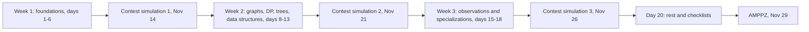

# Plan 20 dni

> [!abstract] W skrócie
> Dzień 1 to niedziela 8.11, dzień 20 to piątek 27.11 (przyjazd), zawody w niedzielę 29.11. Trzy tygodnie:
> podstawy, algorytmy, obserwacje i specjalizacje. Soboty 14.11 i 21.11 oraz czwartek 26.11 to symulacje
> zawodów drużyną (5 h, jeden komputer). Odhaczaj dni na liście. Tematy dni 3-20 mogą się jeszcze lekko
> przesunąć po analizie całego archiwum (które techniki wracają w AMPPZ najczęściej); link pojawia się, gdy
> dzień jest gotowy.

Jak czytać diagram: każdy tydzień kończy się symulacją zawodów, a po każdej symulacji jest retrospektywa,
która mówi, co poprawić w następnym tygodniu. Wiedza z tygodnia 1 jest potrzebna w każdym zadaniu, dlatego idzie
pierwsza; tydzień 3 nie wprowadza już wielu nowych algorytmów, tylko uczy widzieć, który znany schemat pasuje
do nowego zadania.

## Tydzień 1: podstawy, które dają zadania trywialne

Cel tygodnia: każde zadanie trywialne z AMPPZ rozwiązujesz od początku do końca bez zastanawiania się nad
narzędziami, a w zestawie umiesz je szybko znaleźć.

- [ ] Dzień 1 (nd 8.11): [Start: środowisko, szablon, złożoność, typy i pierwsze zadania](dni/01-start.md)
- [ ] Dzień 2 (pn 9.11): [C++ i STL w praktyce, implementacja i symulacja, przypadki brzegowe](dni/02-stl-symulacja.md)
- [ ] Dzień 3 (wt 10.11): [Sortowanie i algorytmy zachłanne, dowód przez zamianę](dni/03-sortowanie-zachlanne.md)
- [ ] Dzień 4 (śr 11.11, święto, więcej czasu): [Sumy prefiksowe, tablice różnicowe i dwa wskaźniki](dni/04-prefiksy-dwa-wskazniki.md)
- [ ] Dzień 5 (czw 12.11): [Wyszukiwanie binarne (także po wyniku) i testowanie z brute force](dni/05-wyszukiwanie-binarne.md)
- [ ] Dzień 6 (pt 13.11): [Matematyka I: modulo, potęgowanie, NWD, sito, proste zliczanie, parzystość](dni/06-matematyka.md)
- [ ] Dzień 7 (sob 14.11): [Symulacja zawodów 1 drużyną (5 h, AMPPZ 2018) i retrospektywa; taktyka](dni/07-symulacja-1.md)

## Tydzień 2: algorytmy, które wracają co roku

Cel tygodnia: znasz i umiesz napisać z pamięci podstawowe algorytmy na grafach i drzewach, programowanie
dynamiczne i dwie struktury danych, a w treści rozpoznajesz, kiedy są potrzebne.

- [ ] Dzień 8 (nd 15.11): [Grafy I: reprezentacja, BFS, DFS, składowe, siatki, sortowanie topologiczne](dni/08-grafy-1.md)
- [ ] Dzień 9 (pn 16.11): [Grafy II: Dijkstra, BFS 0-1, Find-Union, minimalne drzewo rozpinające](dni/09-grafy-2.md)
- [ ] Dzień 10 (wt 17.11): [Programowanie dynamiczne I: stan i przejście, plecak, najdłuższy podciąg](dni/10-dp-1.md)
- [ ] Dzień 11 (śr 18.11): programowanie dynamiczne II: maski bitowe, przedziały, DP na drzewie
- [ ] Dzień 12 (czw 19.11): drzewa: poddrzewa, LCA, przeliczanie dla każdego korzenia
- [ ] Dzień 13 (pt 20.11): struktury danych: drzewo Fenwicka, drzewo przedziałowe, zamiatanie
- [ ] Dzień 14 (sob 21.11): symulacja zawodów 2 drużyną (5 h) i retrospektywa; taktyka, część 2

## Tydzień 3: obserwacje i specjalizacje

Cel tygodnia: umiesz znaleźć obserwację, która zamienia trudne zadanie w znany schemat, a każdy członek drużyny
ma swój dział, w którym jest najmocniejszy.

- [ ] Dzień 15 (nd 22.11): spostrzeżenia I: niezmienniki, odwracanie problemu, małe przypadki, zgadywanie
  wzorca brute force'em, redukcja do znanego zadania
- [ ] Dzień 16 (pn 23.11): specjalizacje, część 1 (każdy swoją ścieżką, lista niżej)
- [ ] Dzień 17 (wt 24.11): specjalizacje, część 2; wspólnie: teoria gier i konstrukcje
- [ ] Dzień 18 (śr 25.11): spostrzeżenia II: zadania z AMPPZ rozwiązane przez nieliczne drużyny, krok po kroku
- [ ] Dzień 19 (czw 26.11): symulacja zawodów 3 drużyną (5 h), ostatnia retrospektywa, podział ról na zawody
- [ ] Dzień 20 (pt 27.11, przyjazd): lekki dzień: fiszki, biblioteczka, checklisty, sen

Ścieżki specjalizacji (dni 16-17), po jednej na osobę:

- **M: matematyka i geometria**: kombinatoryka i teoria liczb, prawdopodobieństwo, geometria na liczbach
  całkowitych (iloczyn wektorowy, otoczka wypukła, pola).
- **G: grafy i struktury**: silnie spójne składowe, mosty, zaawansowane drzewo przedziałowe, techniki offline.
- **S: napisy i programowanie dynamiczne**: hashowanie, funkcja prefiksowa (KMP), trudniejsze stany DP.

Na zawodach właściciel ścieżki jest pierwszym czytelnikiem zadań ze swojego działu (szczegóły w taktyce).
