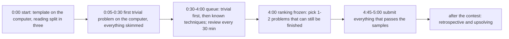

# Taktyka zawodów

> [!abstract] W skrócie
> Jak drużyna trzech osób z jednym komputerem przechodzi przez 5 godzin AMPPZ: zasady i punktacja (co naprawdę
> kosztuje), role i praca przy jednym komputerze, plan zawodów od pierwszych 30 minut po ostatnią godzinę przy
> zamrożonym rankingu, zgłoszenia i debugowanie na wydruku, dzień próbny i checklisty, szablon retrospektywy po
> symulacji. Taktykę ćwiczycie w trzech symulacjach (Dni 7, 14 i 19) i poprawiacie po każdej.

Zasady opisane tu pochodzą z regulaminu AMPPZ 2022 i z formatu ICPC, który AMPPZ stosuje od lat. Regulaminu AMPPZ
2026 jeszcze nie znamy: miejsca, które od niego zależą, są oznaczone ramką "Do sprawdzenia w regulaminie 2026".
Sprawdźcie je, gdy regulamin pojawi się na https://amppz.edu.pl/, najpóźniej na dniu próbnym.

## Moduł

1. [Zasady i punktacja](zasady-i-punktacja.md): format zawodów, ranking, kara 20 minut, zamrożenie, werdykty, i co
   z nich wynika dla decyzji.
2. [Role i jeden komputer](role-i-komputer.md): kto pisze, kto czyta, kto pilnuje kolejki; zasady pracy przy jednej
   klawiaturze i przekazanie komputera.
3. [Przebieg zawodów](przebieg-zawodow.md): pierwsze 30 minut, tablica zadań i kolejka, środek zawodów, ostatnia
   godzina.
4. [Zgłoszenia i debugowanie](zgloszenia-i-debugowanie.md): sprawdzenie przed wysłaniem, co robić po każdym
   werdykcie, debugowanie na wydruku, stress test na zawodach.
5. [Dzień próbny i checklisty](dzien-probny-i-checklisty.md): co sprawdzić na sesji próbnej, co zabrać, karta na
   biurko.
6. [Retrospektywa](retrospektywa.md): szablon omówienia po symulacji i po zawodach.

## Pięć godzin w jednym obrazku

Jak czytać diagram: zawody mają cztery fazy o różnych celach. Na starcie liczy się tempo (szablon, podział czytania,
pierwsze zadanie trywialne bez czekania na resztę). W środku liczy się kolejka: komputer pracuje nad zadaniem z
najlepszym stosunkiem szansy do czasu, a myślenie odbywa się na papierze. Od zamrożenia rankingu decyduje wybór kilku
zadań, które da się dokończyć. Po zawodach zostaje to, co zmienia następne zawody: retrospektywa i dokończenie zadań.

## Jak tego używać w kursie

- **Przed Dniem 7:** przeczytaj cały moduł (ok. 40 minut). Ustalcie role na pierwszą symulację i wydrukujcie
  [tablicę zadań](przebieg-zawodow.md) (sekcja "Tablica zadań") oraz [kartę na biurko](dzien-probny-i-checklisty.md)
  (sekcja "Karta na biurko").
- **Po każdej symulacji:** [retrospektywa](retrospektywa.md), a z niej najwyżej trzy zmiany zasad, które wpisujecie
  tutaj, do sekcji "Zasady naszej drużyny" niżej.
- **Przed zawodami (Dzień 20):** checklisty z [dnia próbnego](dzien-probny-i-checklisty.md) i ponowne przeczytanie
  sekcji o pierwszych 30 minutach i ostatniej godzinie.

## Zasady naszej drużyny

Zasady zamiast sztywnych ról (za radą Rujii Liu, trenera drużyn ICPC): krótka lista reguł, które obowiązują na
zawodach i które zmieniacie po każdej retrospektywie. Start:

1. Przy komputerze siada się z planem na kartce (pomysł, złożoność, przypadki brzegowe, ryzyko), nigdy po to, żeby
   myśleć.
2. Po każdym zgłoszeniu wydruk kodu; po odrzuceniu autor szuka błędu na wydruku, a komputer przejmuje ktoś inny.
3. Żadne zadanie nieprzeczytane po pierwszych 30 minutach.
4. Zadanie bez postępu przez 30 minut wraca do kolejki albo dostaje drugą parę oczu.
5. Od 4:00 nie zaczynamy nowego trudnego zadania, jeśli któreś zaczęte da się dokończyć.

Zmiany po symulacjach (data, zasada, dlaczego):

- (uzupełnij po Dniu 7)
