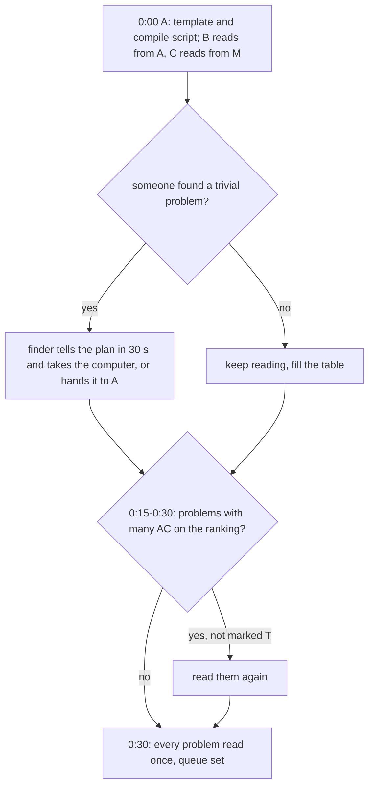
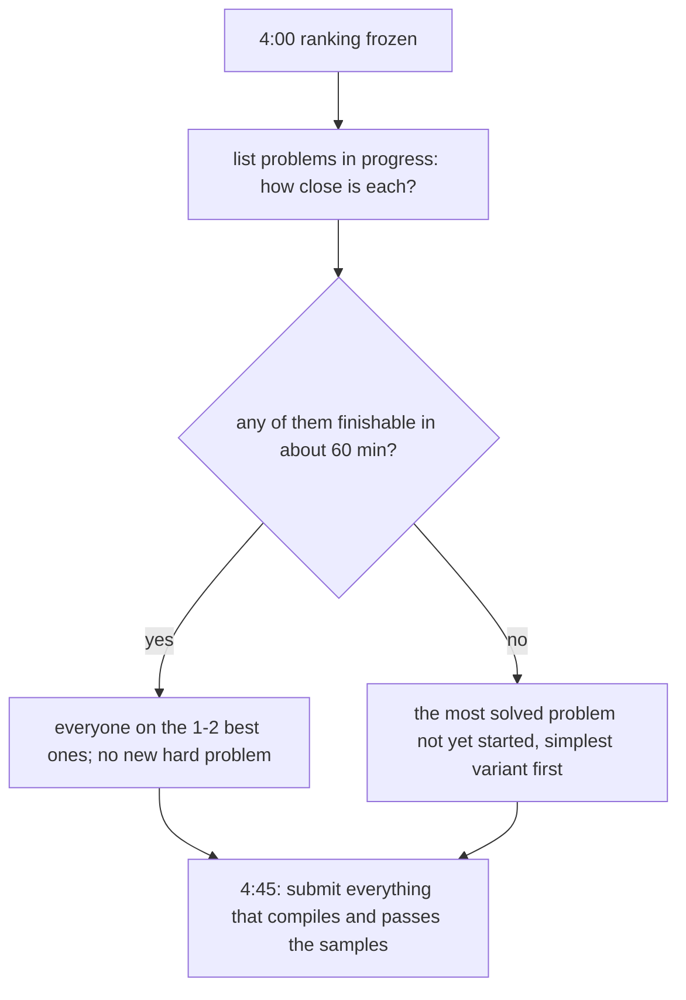

# Przebieg zawodów

> [!abstract] W skrócie
> Plan pięciu godzin: pierwsze 30 minut to szablon na komputerze, czytanie zestawu w trzech kawałkach i pierwsze
> zadanie trywialne bez czekania na resztę; potem kolejka zadań prowadzona na papierowej tablicy i przeglądana co 30
> minut; od zamrożenia rankingu (4:00) wybór jednego-dwóch zadań do dokończenia, a w ostatnim kwadransie wysyłanie
> wszystkiego, co przechodzi przykłady.

## Pierwsze 30 minut

**Intuicja.** Na starcie wszystkie drużyny mają te same zadania i zero informacji. Kto najszybciej znajdzie zadanie
trywialne, ten zdobywa punkt z małym czasem i zaczyna dostawać informacje z rankingu, kiedy inni jeszcze czytają.

**Plan minuta po minucie** (13 zadań, osoby A, B, C):

| Czas | A (pierwszy kierowca) | B | C (koordynator) |
|---|---|---|---|
| 0:00-0:05 | szablon, skrypt kompilacji, test na przykładzie z pierwszego zadania | czyta od A w górę | czyta od M w dół |
| 0:05-0:20 | czyta zadania ze środka (G-I), dopóki nikt nie przyniesie trywialnego | czyta dalej, pierwsze trywialne od razu na komputer | czyta dalej, wypełnia tablicę |
| 0:20-0:30 | pisze pierwsze trywialne (albo B pisze, A czyta) | | sprawdza ranking: które zadania mają już AC |
| 0:30 | | wszystkie zadania przeczytane przez co najmniej jedną osobę | ustala kolejkę |

**Czytanie w 2-3 minuty na zadanie.** Tytuł, limity, przykład, jedno zdanie streszczenia i ocena:

- **T** (trywialne): wiem, co napisać, i napiszę to w 15 minut;
- **Z** (znane): rozpoznaję technikę, ale trzeba pomyśleć albo dużo pisać;
- **N** (nie wiem): nie widzę rozwiązania.

Sygnały zadania trywialnego: krótka treść, małe limity albo jedna liczba na wejściu, prosty przykład, historia
"policz", "sprawdź", "zasymuluj" ([sygnały w treści](../myslenie/sygnaly-w-tresci.md)).

**Pierwsze T idzie na komputer od razu**, nie po przeczytaniu całego zestawu. Ranking po 10-20 minutach pokazuje
pierwsze akceptacje innych drużyn: zadanie z wieloma AC, którego nie macie oznaczonego jako T, czytacie jeszcze raz.
W 2018 pierwsze akceptacje padły w 5. minucie (C), 7. (F) i 15. (H, J), a te cztery zadania rozwiązało potem 37-46
z 51 drużyn.

Jak czytać diagram: czytanie i pisanie biegną równolegle od pierwszej minuty. Znalezione zadanie trywialne przerywa
czytanie tylko osobie, która je znalazła. Ranking działa jak podpowiedź z zewnątrz: przy rozbieżności między Waszą
oceną a liczbą akceptacji ufa się rankingowi i czyta jeszcze raz.

## Tablica zadań

Kartka A4 na biurku, prowadzona przez koordynatora; jeden wiersz na zadanie. Wydrukujcie ją przed symulacją:

| Zadanie | Czytał | Ocena (T/Z/N) | Pomysł w 5 słowach | AC w rankingu | Kto | Stan | Od kiedy |
|---|---|---|---|---|---|---|---|
| A | | | | | | | |
| B | | | | | | | |
| C | | | | | | | |
| ... | | | | | | | |

Stan to jedno z: przeczytane, pomysł, na komputerze, wysłane, odrzucone (werdykt), AC, porzucone.

## Kolejka zadań

**Definicja.** Kolejka to kolejność, w jakiej zadania trafiają na komputer. Priorytet zadania to szansa na
akceptację podzielona przez czas potrzebny do niej.

**Zasady kolejki:**

1. Najpierw T, od najkrótszego (argument z [punktacji](zasady-i-punktacja.md): krótsze najpierw minimalizuje sumę
   czasów).
2. Potem Z, zaczynając od tych z największą liczbą AC w rankingu.
3. N tylko wtedy, gdy T i Z się skończyły; najpierw te, które w rankingu ktoś już rozwiązał.
4. Zadanie z gotowym planem na kartce wyprzedza zadanie, nad którym ktoś jeszcze myśli.
5. Co 30 minut koordynator przegląda tablicę: czy ktoś nie siedzi za długo, czy w rankingu nie pojawiło się łatwe
   zadanie, którego nikt nie ruszył.

**Kiedy porzucić.** Zadanie bez postępu przez 30 minut (brak pomysłu albo trzecie odrzucenie bez znalezionej
przyczyny) wraca do kolejki. Zanim je odłożysz, opowiedz je drugiej osobie w dwie minuty: świeże oko często widzi
źle przeczytany warunek. Porzucenie nie jest ostateczne: zapiszcie w tablicy, na czym stanęło.

## Środek zawodów (0:30-4:00)

- Komputer zawsze coś robi: gdy nikt nie ma gotowego planu, kierowca pisze brute force albo generator do zadania,
  które czeka na stress test, albo przepisuje gotowy fragment z biblioteczki.
- Dwie osoby nad jednym zadaniem tylko wtedy, gdy to najważniejsze zadanie w kolejce i ktoś utknął; trzy prawie nigdy.
- Co godzinę krótka narada (2 minuty): ile mamy, co jest blisko, co bierzemy dalej.
- Jedzenie i woda w trakcie, po kolei, nie wszyscy naraz.

## Ostatnia godzina

**Intuicja.** Po 4:00 ranking jest zamrożony, więc nie wiecie, jak idzie innym. To dobrze: zamiast gonić konkretną
drużynę, kończycie to, co realne.

**Zasady:**

- **4:00: decyzja koordynatora.** Które 1-2 zadania mają realną szansę w godzinę? Wszyscy pracują nad nimi;
  nowego trudnego zadania już nie zaczynacie, chyba że nic zaczętego nie da się dokończyć.
- **4:00-4:45:** jedno zadanie na komputerze, drugie na papierze; testy przed wysłaniem nadal obowiązują, bo
  odrzucenie zadania, które w końcu wejdzie, nadal kosztuje 20 minut.
- **4:45-5:00:** wysyłacie wszystko, co się kompiluje i przechodzi przykłady, także rozwiązania niepewne
  (heurystyka, wolniejsza wersja, która może zmieścić się w czasie). Kara liczy się tylko dla zadań rozwiązanych,
  więc takie zgłoszenie nie może pogorszyć wyniku.
- **Ostatnie 2-3 minuty:** nie zaczynajcie poprawek, których nie zdążycie skompilować; system bywa zatłoczony.

Jak czytać diagram: decyzja o 4:00 zawęża pracę do kilku zadań, bo w godzinę rzadko udaje się zacząć i skończyć coś
nowego. W ostatnim kwadransie reguła się zmienia: zgłoszenie bez pewności staje się darmowe, więc wysyłacie wszystko,
co ma choć cień szansy.

## Po zawodach

Retrospektywa tego samego dnia albo następnego ranka ([szablon](retrospektywa.md)) i upsolving: dokończenie zadań,
które były blisko, z omówieniem jury.
