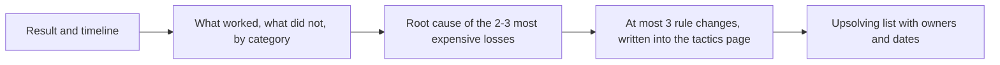

# Retrospektywa po symulacji

> [!abstract] W skrócie
> Szablon omówienia po każdej symulacji (Dni 7, 14, 19) i po zawodach: wynik, oś czasu, co zadziałało, co nie
> (w podziale na czytanie, pomysł, kod, testowanie i taktykę), najwyżej trzy zmiany zasad i lista upsolvingu.
> 30-45 minut, cała drużyna, najlepiej tego samego dnia. Skopiuj plik do swojego dziennika i wypełnij.

Retrospektywa nie szuka winnych, tylko zasad, które następnym razem zapobiegną temu samemu błędowi. Omówienie
po zawodach jest według Rujii Liu ważniejsze niż samo miejsce: to z niego bierze się postęp drużyny.

Jak czytać diagram: najpierw fakty (wynik i oś czasu z tablicy zadań), potem ocena, potem przyczyny tylko dla
największych strat czasu, bo drobiazgów nie da się naprawić wszystkich naraz. Wynikiem są zmiany zasad (zapisane
w [taktyce](README.md), sekcja "Zasady naszej drużyny") i lista zadań do dokończenia.

## Szablon

**Symulacja:** (zestaw, data, skład)

**Wynik:** zadania rozwiązane: ..., łączny czas z karą: ..., miejsce, które dałby ten wynik w oryginalnym rankingu: ...

**Oś czasu** (z tablicy zadań):

| Zadanie | Ocena na starcie (T/Z/N) | Kto | Na komputerze od | Zgłoszenia (werdykty i minuty) | AC w minucie | Uwagi |
|---|---|---|---|---|---|---|
| | | | | | | |

**Co zadziałało** (zostawiamy):

- ...

**Co nie zadziałało**, w kategoriach z [dziennika błędów](../dziennik/szablon-dziennika.md):

- Czytanie (źle przeczytany warunek, zadanie łatwe przeczytane za późno): ...
- Pomysł (zły pomysł, za długo bez pomysłu): ...
- Implementacja (przepełnienie, indeksy, za długie pisanie): ...
- Testowanie (odrzucenia, których dało się uniknąć): ...
- Taktyka (kolejka, komputer, czas, ostatnia godzina): ...

**Największe straty czasu** (2-3, z przyczyną):

1. ... minut na ..., bo ...
2. ...

**Zmiany zasad** (najwyżej trzy; każda konkretna i sprawdzalna, na przykład "po 25 minutach bez postępu zadanie
wraca do kolejki", a nie "lepiej pilnować czasu"):

1. ...

**Upsolving** (zadania, które były blisko albo które rozwiązało dużo drużyn; z omówieniem jury):

| Zadanie | Kto | Do kiedy | Zrobione |
|---|---|---|---|
| | | | |

**Wpisy do dziennika błędów i nowe fiszki:** każdy dopisuje swoje.

## Jak wyciągać wnioski

- **Porównaj z rankingiem.** Zadania rozwiązane przez większość drużyn, których nie zrobiliście, to pierwsza
  pozycja upsolvingu i pytanie "dlaczego ich nie przeczytaliśmy albo nie oceniliśmy jako łatwe".
- **Licz minuty.** Odrzucenie to 20 minut kary plus czas szukania błędu; godzina nad zadaniem, które nie weszło, to
  godzina zabrana innym. Największe liczby wskazują, co poprawiać.
- **Jedna przyczyna, jedna zasada.** Jeśli błąd już był w poprzedniej retrospektywie, zasada nie działa: zmieńcie ją
  albo sposób, w jaki jej pilnujecie.
