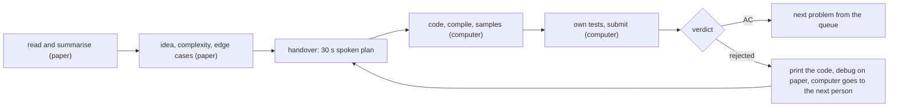

# Role i jeden komputer

> [!abstract] W skrócie
> Trzy osoby i jedna klawiatura: komputer jest wąskim gardłem, więc służy tylko do pisania i uruchamiania kodu,
> a myślenie, czytanie i szukanie błędów odbywa się na papierze. Role (kierowca, zwiadowca, koordynator) są
> przypisane do chwili, nie do osoby; stałe są zasady: plan na kartce, zanim usiądziesz do klawiatury, przekazanie
> w 30 sekund, wydruk po każdym zgłoszeniu.

## Komputer jako wąskie gardło

**Intuicja.** Trzy osoby mogą myśleć jednocześnie, ale pisać może tylko jedna. To jak kuchnia z trzema kucharzami
i jedną kuchenką: kto stoi przy kuchence z niepokrojonymi warzywami, blokuje dwóch pozostałych.

**Definicja.** Czas komputera to zasób, który dzielicie: w każdej minucie zawodów komputer albo coś produkuje (pisanie,
kompilacja, testy), albo stoi bezczynnie, albo jest zajęty przez kogoś, kto myśli przy klawiaturze. Dwa ostatnie stany
to strata.

**Mechanizm.** Każde zadanie przechodzi przez etapy, z których tylko środkowe wymagają komputera:

Jak czytać diagram: zadanie trafia na komputer dopiero z gotowym planem i wraca z niego na papier przy każdym
odrzuceniu. Dzięki temu komputer obsługuje kolejne zadania, a szukanie błędu i myślenie nad nowymi zadaniami odbywa
się równolegle obok.

**Przykład.** Osoba A pisze zadanie C. W tym czasie B kończy na kartce pomysł do zadania H i wypisuje testy brzegowe,
a C czyta zadania od końca zestawu. A wysyła C, drukuje kod i od razu oddaje klawiaturę B. Gdy przychodzi WA na C,
A szuka błędu na wydruku, a komputer dalej pracuje nad H.

## Role

Role zmieniają się w trakcie zawodów; na start przydzielcie je na stałe, żeby pierwsze minuty szły bez dyskusji.

- **Kierowca** (przy klawiaturze): pisze kod według planu, kompiluje, uruchamia przykłady. Na starcie najszybciej
  piszący w C++. Wstaje po każdym zgłoszeniu albo po 5-10 minutach bez postępu przy klawiaturze.
- **Zwiadowcy** (dwie osoby na początku, potem jedna): czytają zadania, wypełniają [tablicę zadań](przebieg-zawodow.md),
  przygotowują pomysł i testy na kartce, czytają wydruki. Gdy ich zadanie jest gotowe, zgłaszają się w kolejce do
  komputera.
- **Koordynator** (jedna osoba przez całe zawody, zwykle najbardziej doświadczona, jednocześnie zwiadowca albo
  kierowca): pilnuje kolejki i czasu, co 30 minut przegląda tablicę, rozstrzyga spory ("kto teraz siada", "porzucamy"),
  śledzi ranking do zamrożenia.

Od trzeciego tygodnia dochodzą **ścieżki specjalizacji** ([plan](../plan-20-dni.md)): osoba ze ścieżki M (matematyka
i geometria), G (grafy i struktury) albo S (napisy i DP) jest pierwszym czytelnikiem zadań ze swojego działu i pierwszym
kandydatem do ich rozwiązania. Każdy zna jednak podstawy wszystkich działów, żeby dało się rozmawiać o każdym
zadaniu.

## Zasady przy jednym komputerze

1. **Nie myśl przy klawiaturze.** Siadasz z planem: pomysł, złożoność, przypadki brzegowe, największe ryzyko. Kod
   trudniejszy niż 30 linii warto mieć naszkicowany na kartce (struktura, pętle, indeksy).
2. **Przekazanie w 30 sekund.** Zanim usiądziesz, mówisz na głos komuś z drużyny: "pomysł jest taki, złożoność taka,
   uważam na to". Druga osoba często wyłapuje błąd w pomyśle, zanim kosztuje on 20 minut kary.
3. **Wydruk po każdym zgłoszeniu.** Jeśli przyjdzie odrzucenie, błąd szuka się na wydruku, a nie przy komputerze
   ([debugowanie](zgloszenia-i-debugowanie.md)).
4. **Wspólny szablon i skrypt kompilacji** wpisane na starcie przez pierwszego kierowcę; każdy zaczyna od nich
   (nowy plik z szablonu dla każdego zadania: `a.cpp`, `b.cpp`, ...).
5. **Krótkie przerwy przy klawiaturze są w porządku**, długie nie: gdy kierowca utknął, wstaje i opowiada problem
   zamiast szukać go na ekranie, a w tym czasie siada następna osoba z gotowym planem.
6. **Mówcie, co robicie.** "Wysyłam C", "biorę H na kartkę", "C odrzucone, drukuję". Koordynator zapisuje to
   w tablicy.
7. **Spokój po odrzuceniu.** Odrzucenie to informacja, nie porażka. Nie wysyłaj ponownie bez znalezienia przyczyny:
   każde kolejne odrzucenie to następne 20 minut.

## Typowe błędy drużyn

- Wszyscy trzej nad jednym zadaniem, a reszta zestawu nieprzeczytana.
- Kierowca siedzi godzinę nad jednym zadaniem i nikt mu nie przerywa.
- Zwiadowca ma gotowe zadanie trywialne, ale czeka, bo "nie chce przeszkadzać".
- Debugowanie przez zgadywanie: drobna zmiana, zgłoszenie, odrzucenie, drobna zmiana.
- Nikt nie patrzy na ranking, więc drużyna nie zauważa, że zadanie rozwiązane przez połowę sali leży nieprzeczytane.

## Źródła

- Rujia Liu, Training ICPC Teams: A Technical Guide (zasady zamiast ról, wydruk po zgłoszeniu, każde zadanie
  przeczytane po pierwszej godzinie, omówienie po treningu).
- ICPC contest playbook (mtuann, competitive-programming-cpp): role pisarza, triażysty i weryfikatora, przekazanie
  z pomysłem, złożonością, przypadkami brzegowymi i ryzykiem.
