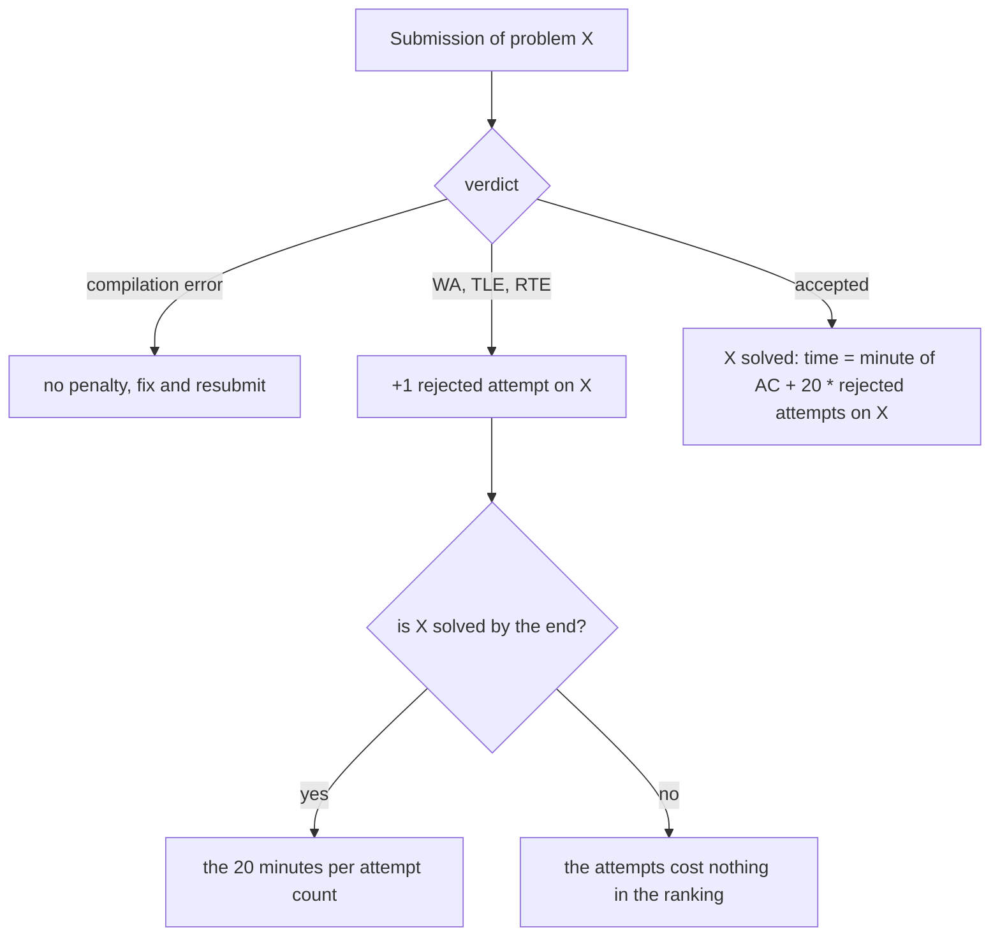

# Zasady i punktacja

> [!abstract] W skrócie
> AMPPZ to polska edycja ICPC: drużyna do 3 osób, jeden komputer, 5 godzin, kilkanaście zadań. Ranking liczy najpierw
> rozwiązane zadania, potem łączny czas z karą 20 minut za każde odrzucone zgłoszenie zadania, które w końcu zostało
> rozwiązane. Z tych dwóch zdań wynikają prawie wszystkie decyzje taktyczne: kolejność zadań, ile testować przed
> wysłaniem i co robić w ostatnich minutach.

## Format (regulamin 2022)

- **Drużyna:** do 3 studentów jednej uczelni. **Czas:** 5 godzin; dzień wcześniej sesja próbna.
- **Sprzęt:** jeden komputer na drużynę z Linuksem (Ubuntu); sieć tylko do wysyłania rozwiązań i drukowania kodu.
- **Języki:** C, C++ (`g++ -std=c++17 -O3 -static`, GCC 9.3.0) i Python 3.8. Jeden plik źródłowy, standardowe wejście
  i wyjście, program kończy się kodem 0.
- **Edytory:** nano, vim, emacs, mcedit, gedit, geany; do tego gdb i man.
- **Materiały:** wolno własne książki, słowniki, wydruki programów i notatki, bez limitu stron; zakaz nośników
  elektronicznych, telefonów, kalkulatorów i laptopów.
- **Pytania do jury:** przez system zgłoszeń; odpowiedź może trafić do wszystkich drużyn.
- **Zadania:** 8-13 (w latach 2017-2025 zwykle 12-13), po polsku albo po angielsku (2023 po angielsku).

> [!question] Do sprawdzenia w regulaminie 2026
> Organizator i miejsce, wersja GCC i flagi kompilacji, limit stron wydruków (czy biblioteczka jest dozwolona),
> system sprawdzający, czas zamrożenia rankingu, język treści, dokumenty wymagane przy wejściu. Źródło:
> https://amppz.edu.pl/ (sekcja Regulamin).

## Ranking i kara

**Intuicja.** Wyobraź sobie, że każde rozwiązane zadanie to "punkt", a remisy rozstrzyga suma minut, w których
punkty zdobyliście, plus mandat 20 minut za każde złe zgłoszenie zadania, które ostatecznie zdobyliście.

**Definicja.** Drużyny porządkuje (1) liczba zaakceptowanych zadań, malejąco, (2) przy remisie łączny czas, rosnąco.
Czas zadania to minuta zaakceptowanego zgłoszenia liczona od startu plus 20 minut za każde wcześniejsze odrzucone
zgłoszenie tego zadania. Do łącznego czasu wchodzą tylko zadania rozwiązane. Błąd kompilacji kary nie daje.
Zgłoszenia zadania już zaakceptowanego nic nie zmieniają.

**Mechanizm.**

Jak czytać diagram: kara nie jest naliczana w chwili odrzucenia, tylko doliczana do czasu zadania w chwili akceptacji.
Odrzucone zgłoszenia zadania, które do końca zostało nierozwiązane, w rankingu nie kosztują nic, kosztowały tylko
czas komputera i ludzi.

**Przykład.** Drużyna rozwiązuje trzy zadania: X w 20. minucie za pierwszym razem, Y w 50. minucie po jednym
odrzuceniu, Z w 110. minucie po dwóch odrzuceniach. Łączny czas: 20 + (50 + 20) + (110 + 40) = 240 minut. Gdyby
Y i Z weszły za pierwszym razem, byłoby 180 minut: trzy odrzucenia kosztowały godzinę w rankingu, a do tego czas
szukania błędów.

## Co z tego wynika

- **Liczba zadań jest ważniejsza niż czas.** Jedno zadanie więcej wygrywa z dowolnie dobrym czasem. Czas rozstrzyga
  tylko remisy, ale przy 4-6 zadaniach remisów jest wiele: w 2018 aż 10 z 51 drużyn miało 5 zadań, a 8 drużyn 6 zadań.
- **Krótsze zadania najpierw.** Każde rozwiązane zadanie wnosi do sumy swój moment ukończenia. Przy jednym
  komputerze to dokładnie szeregowanie z Dnia 3: suma momentów ukończenia jest najmniejsza, gdy krótsze idą pierwsze
  (argument zamiany sąsiadów). Trzy zadania po 10, 30 i 60 minut: w tej kolejności 10 + 40 + 100 = 150 minut,
  w odwrotnej 60 + 90 + 100 = 250.
- **Ile testować przed wysłaniem.** 5 minut sprawdzania kosztuje 5 minut, odrzucenie kosztuje 20 minut kary plus czas
  szukania błędu. Sprawdzenie opłaca się już wtedy, gdy z szansą większą niż 1 na 4 złapie błąd. Przy zadaniach
  z przypadkami brzegowymi, przepełnieniem albo zachłannością bez dowodu tak jest prawie zawsze.
- **Ostatnie minuty: wysyłaj.** Zgłoszenie zadania, które bez niego zostanie nierozwiązane, nie może pogorszyć rankingu.
  W ostatnim kwadransie wysyłacie wszystko, co się kompiluje i przechodzi przykłady.
- **Błąd kompilacji jest darmowy w rankingu, ale nie w czasie.** Kompilujcie lokalnie z tymi samymi flagami co sędzia,
  żeby nie tracić kolejki.

## Zamrożenie rankingu

**Definicja.** Przez pierwsze 4 godziny ranking jest publiczny. W ostatniej godzinie drużyna widzi tylko werdykty
własnych zgłoszeń; ranking innych zatrzymuje się na stanie z 4:00 i jest odsłaniany po zawodach.

**Co z tego wynika.** Ranking w pierwszych godzinach to najlepsza informacja o trudności zadań: zadanie, które
rozwiązało kilkanaście drużyn, jest łatwe, nawet jeśli Wam wydało się trudne (przeczytajcie je jeszcze raz).
Po zamrożeniu nie gonicie konkretnej drużyny, tylko kończycie to, co realne ([przebieg zawodów](przebieg-zawodow.md), sekcja "Ostatnia godzina").

## Werdykty

| Werdykt | Znaczenie | Najczęstsze przyczyny |
|---|---|---|
| AC | zaakceptowane | |
| WA (ANS) | zła odpowiedź | przypadek brzegowy, przepełnienie, źle przeczytana treść, format wyjścia |
| TLE | przekroczony czas | zła złożoność, wolne wejście, pętla nieskończona, `endl` przy dużym wyjściu |
| RTE (RE) | błąd wykonania, także przekroczenie pamięci | indeks poza tablicą, głęboka rekurencja, dzielenie przez 0, za duża tablica |
| CE (CME) | błąd kompilacji, bez kary | inna wersja kompilatora, zapomniany nagłówek, zły język w systemie |
| RUL | naruszenie zasad | otwieranie plików, sieć, procesy; może skończyć się dyskwalifikacją |

Co robić po każdym z nich: [zgłoszenia i debugowanie](zgloszenia-i-debugowanie.md).

## Źródła

- Regulamin AMPPZ 2022 (UJ) i eliminacji UJ 2023 i 2025, streszczone w vaulcie zadania (notatka o zasadach AMPPZ).
- Ranking AMPPZ 2018: https://amppz.ii.uni.wroc.pl/ranking2018/ranking.html (rozkład liczby rozwiązanych zadań).
