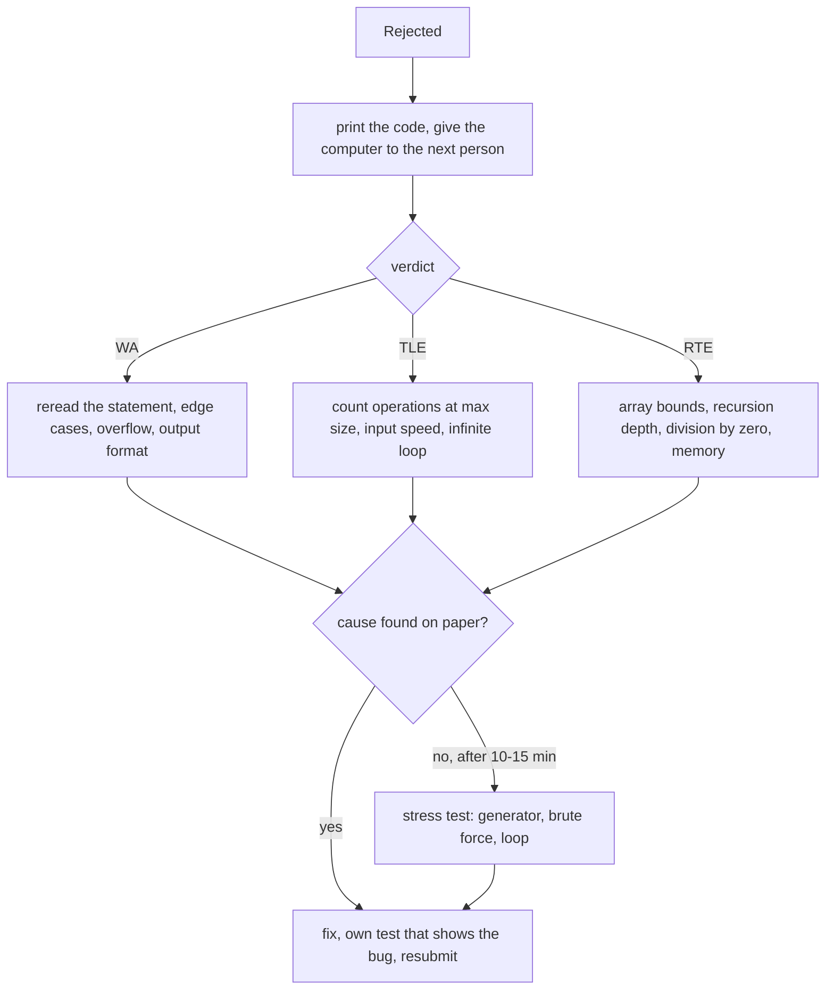

# Zgłoszenia i debugowanie

> [!abstract] W skrócie
> Przed każdym zgłoszeniem dwie minuty z checklistą (przykłady, przypadek najmniejszy i największy, typy, format,
> zerowanie przy wielu testach). Po odrzuceniu: wydruk, komputer dla następnej osoby, szukanie przyczyny według
> werdyktu na papierze; gdy nic nie widać, stress test. Ponowne zgłoszenie dopiero ze znalezioną przyczyną.

## Przed zgłoszeniem

Dwie minuty, które najczęściej oszczędzają 20 minut kary:

- [ ] Wszystkie przykłady z treści, porównane znak po znaku (`diff`), nie na oko.
- [ ] Przypadek najmniejszy: n = 1, pusty wynik, wszystkie elementy równe.
- [ ] Przypadek największy: czy złożoność się mieści (policz operacje), czy iloczyny i sumy mieszczą się w typie
  (`long long`, a przy dwóch liczbach do 10¹⁸ `__int128`).
- [ ] Format wyjścia: wielkość liter (TAK/NIE), spacje i nowe linie, liczba miejsc po przecinku, kolejność.
- [ ] Wiele testów w jednym wejściu: zerowanie tablic i zmiennych globalnych przed każdym testem.
- [ ] Brak wypisywania pomocniczego na standardowe wyjście; szybkie wejście i wyjście (`sync_with_stdio(false)`,
  `"\n"` zamiast `endl`).
- [ ] Kompilacja bez ostrzeżeń z tymi samymi flagami co u sędziego; właściwe zadanie i język w systemie.

## Po odrzuceniu: według werdyktu



Jak czytać diagram: werdykt zawęża poszukiwania, a wydruk pozwala szukać bez blokowania komputera. Zgłoszenie
ponowne następuje dopiero wtedy, gdy przyczyna jest znana i jest test, który ją pokazuje. Gdy przez 10-15 minut nic
nie widać, stress test zwykle znajduje mały kontrprzykład szybciej niż dalsze czytanie.

**WA (zła odpowiedź):**

- Przeczytaj treść jeszcze raz, zdanie po zdaniu, szczególnie wejście, wyjście i limity. Połowa WA to źle przeczytany
  warunek.
- Przypadki brzegowe: n = 1, wszystko równe, wartości 0 i ujemne, wynik 0 albo "nie da się".
- Przepełnienie: każdy iloczyn i każda suma, także liczniki pętli i indeksy.
- Format: wielkie i małe litery, spacje, liczba wierszy; precyzja liczb rzeczywistych.
- Zachłanność bez dowodu: spróbuj kontrprzykładu na kartce albo stress testem.

**TLE (przekroczony czas):**

- Policz operacje dla największych danych (Dzień 1: ok. 10⁸ prostych operacji na sekundę).
- Wolne wejście: brak `sync_with_stdio(false)`, `endl` w pętli, `scanf` z wieloma formatami.
- Pętla nieskończona dla jakiegoś przypadku (wyszukiwanie binarne, które się nie zawęża; warunek stopu przy równych).
- Zbędne kopiowanie (`vector` przekazany przez wartość do funkcji wołanej wiele razy, `std::lower_bound` na `set`).

**RTE (błąd wykonania, w regulaminie 2022 także przekroczenie pamięci):**

- Indeks poza tablicą (pętla do n zamiast n - 1, tablica o rozmiarze n zamiast n + 1).
- Głęboka rekurencja (DFS na ścieżce długości 10⁶): stos bywa mały; zamień na pętlę albo sprawdź stos na dniu próbnym.
- Dzielenie albo modulo przez zero.
- Za duża tablica lokalna w funkcji (przenieś ją na zmienną globalną) albo za duża w ogóle (policz bajty).

**CE (błąd kompilacji, bez kary):** inna wersja kompilatora niż Twoja (w 2022 GCC 9.3: część rzeczy z C++20 nie
działa), brak nagłówka, zły język wybrany w systemie.

## Debugowanie na wydruku

**Intuicja.** Na wydruku widać cały program naraz i nie da się "poprawić na szybko i wysłać". Czytanie kodu z kartką
i ołówkiem zmusza do śledzenia programu krok po kroku, a komputer w tym czasie pracuje nad innym zadaniem.

**Mechanizm.**

1. Wydrukuj kod (najlepiej od razu po zgłoszeniu, zanim przyjdzie werdykt).
2. Wypisz na marginesie mały test, najlepiej przypadek brzegowy, i prześledź program linia po linii, zapisując
   wartości zmiennych.
3. Zaznacz każde miejsce, w którym nie jesteś pewien: indeksy, warunki pętli, typy, inicjalizację.
4. Opowiedz kod drugiej osobie (albo kartce): tłumaczenie na głos często pokazuje błąd.
5. Wracasz do komputera z konkretną poprawką i testem, który ją pokazuje.

## Stress test na zawodach

Gdy błędu nie widać, a zadanie jest ważne: generator małych testów, brute force wprost z treści i pętla, która
porównuje wyniki ([Dzień 5](../dni/05-wyszukiwanie-binarne.md), sekcja 3). Zwykle 10-15 minut przy komputerze; brute
force i generator można napisać najpierw na kartce.

```bash
for i in $(seq 1 1000); do
    ./gen $i > in.txt; ./sol < in.txt > o1.txt; ./brute < in.txt > o2.txt
    if ! cmp -s o1.txt o2.txt; then echo "test $i"; cat in.txt; break; fi
done
```

## Pytania do jury

Gdy treść jest niejednoznaczna, zadaj pytanie przez system: krótko, z odwołaniem do konkretnego zdania i przykładem.
Odpowiedź "przeczytaj treść" też jest informacją (treść jest jednoznaczna, źle ją czytasz). Odpowiedzi rozsyłane
wszystkim czytajcie od razu: często prostują treść albo przykłady.
