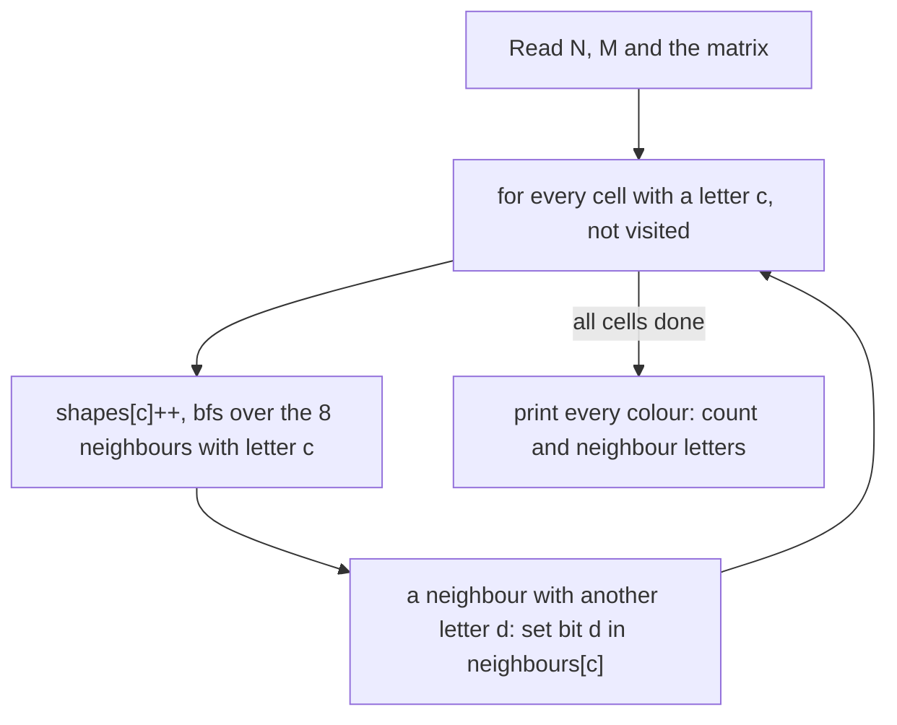

# AMPPZ 1996 C - Shapes

> [!info] Karta zadania
> - Treść (po angielsku): `199X/1996/C/C.pdf` ([PDF na GitHubie](../../../199X/1996/C/C.pdf)); limitów czasu i pamięci
>   treść nie podaje. PDF to zapis strony z 1996 roku razem z rozwiązaniem i testami organizatorów.
> - Technika: grafy: flood fill (BFS) z łącznością 8-kierunkową, składowe spójne, sąsiedztwo kolorów maską bitową.
>   Trudność: ~2 (rankingu 1996 brak).
> - Kod: [c-shapes.cpp](c-shapes.cpp). Złożoność: O(M · N).
> - Dzień kursu: [Dzień 8](../../dni/08-grafy-1.md), ćwiczenie (minimum).

## Treść w skrócie

Macierz M × N (M · N ≤ 60 000) z kropkami (tło) i wielkimi literami (kolory). Litery tego samego koloru sąsiadujące
w jednym z 8 kierunków (także po przekątnej) tworzą jeden kształt. Dwa kształty różnych kolorów są sąsiadami, gdy się
stykają (też po przekątnej). Dla każdego występującego koloru wypisz liczbę jego kształtów i kolory sąsiadujące.
Wejście: N (kolumny), M (wiersze), potem wiersze macierzy.

## Zanim przeczytasz dalej

20 minut. W przykładzie 20 × 9 kolor A ma 2 kształty i sąsiadów B i Q, a F ma 4 kształty bez sąsiadów. Zwróć uwagę na
kolejność N, M w pierwszym wierszu i na to, że mapa może mieć jeden wiersz o długości 60 000.

> [!tip]- Podpowiedź 1
> Kształt to składowa spójna grafu, w którym pola tej samej litery sąsiadujące w 8 kierunkach są połączone. Ile razy
> uruchomisz przeszukiwanie, jeśli zaczynasz je z każdego jeszcze nieodwiedzonego pola z literą?

> [!tip]- Podpowiedź 2
> Sąsiedztwo kolorów nie zależy od kształtów: wystarczy przejrzeć wszystkie pary sąsiednich pól z różnymi literami.
> 26 kolorów zmieści się w masce bitowej `int`.

## Droga myślenia

1. **Graf niejawny:** pola z literą, krawędzie między polami tej samej litery w 8 kierunkach. Kształty to składowe.
2. **Flood fill:** z każdego nieodwiedzonego pola z literą c BFS po polach litery c; licznik kształtów c rośnie o 1.
3. **Sąsiedzi:** przy przeglądaniu 8 sąsiadów pola z literą c każda inna litera d (nie kropka) ustawia bit d w masce c.
   Robimy to w tym samym BFS, bo każde pole z literą i tak jest raz zdejmowane z kolejki.
4. **Wypisanie** kolorów w porządku alfabetycznym; liczniki w `long long` niepotrzebne (najwyżej 60 000 kształtów), ale
   nie szkodzą.



Jak czytać diagram: zewnętrzna pętla to liczenie składowych z sekcji 4 Dnia 8, wewnętrzny BFS zamalowuje jeden kształt.
Sąsiedztwo kolorów zbieramy przy okazji, bo każde pole z literą raz ogląda swoich 8 sąsiadów.

Przykład z treści: litery A tworzą dwa kształty: górny z lewym, których części łączą się tylko po przekątnych
(pojedyncze A w wierszu 4 styka się narożnikami z wierszami 3 i 5), i blok w wierszach 5-7 od kolumny 6. G w drugim
wierszu dotyka B po przekątnej, więc G ma sąsiada B, a B ma sąsiadów A (styk w wierszu 7) i G.

## Rozwiązanie

```cpp
for (int r0 = 0; r0 < rows; r0++)
    for (int c0 = 0; c0 < cols; c0++) {
        char ch = g[r0][c0];
        if (ch == '.' || seen[r0 * cols + c0]) continue;
        shapes[ch - 'A']++;                    // a new shape: fill all of it
        q.assign(1, r0 * cols + c0);
        seen[r0 * cols + c0] = 1;
        for (size_t head = 0; head < q.size(); head++) {
            int r = q[head] / cols, c = q[head] % cols;
            for (int dr = -1; dr <= 1; dr++)
                for (int dc = -1; dc <= 1; dc++) {
                    int nr = r + dr, nc = c + dc;
                    if (nr < 0 || nr >= rows || nc < 0 || nc >= cols) continue;
                    char other = g[nr][nc];
                    if (other == '.') continue;
                    if (other != ch) { neighbours[ch - 'A'] |= 1 << (other - 'A'); continue; }
                    if (!seen[nr * cols + nc]) { seen[nr * cols + nc] = 1; q.push_back(nr * cols + nc); }
                }
        }
    }
```

Pełny program: [c-shapes.cpp](c-shapes.cpp). Format wyjścia ("Results :", kreski, potem wiersze
`Color A - 2	Neighbours: B Q`) odtworzony z przykładu i z programu organizatorów.

## Złożoność i optymalność

- O(M · N): każde pole wchodzi do kolejki raz i ogląda 8 sąsiadów. Wczytanie macierzy kosztuje tyle samo, więc
  szybciej się nie da.
- Rozwiązanie organizatorów (w PDF, opisane po polsku) to ten sam "algorytm malarza": przegląd pól i wypełnianie
  obszaru od każdego pola z kolorem, z zamianą wypełnionych pól na tło i maską bitową sąsiadów. Różnica: ich wypełnianie
  jest rekurencyjne, a test 3 i 4 organizatorów to mapy 60 000 × 1 i 1 × 60 000, na których rekurencja schodzi bardzo
  głęboko (na dzisiejszym sędzi z małym stosem groziłoby to RE). BFS na tablicy tego ryzyka nie ma.

## Pułapki

- **Kolejność wymiarów:** najpierw N (kolumny), potem M (wiersze).
- **Łączność 8-kierunkowa** i dla kształtów, i dla sąsiedztwa kolorów; 4 kierunki dają złą odpowiedź już w przykładzie.
- **Mapa w jednym wierszu albo kolumnie:** rekurencyjny flood fill o głębokości kilkudziesięciu tysięcy.
- **Kolor bez sąsiadów** też trzeba wypisać (F w przykładzie), z pustą listą.

## Weryfikacja

- Kompilacja `g++ -std=c++17 -O2 -Wall -Wextra` bez ostrzeżeń, przykład z treści poprawny.
- Oficjalne testy z PDF: test 1 (40 × 16, przepisany z PDF) i testy 3-4 (60 000 × 1 i 1 × 60 000, wzór "AFKPU."
  powtórzony 10 000 razy) dają dokładnie wyniki organizatorów. Testu 2 nie da się odtworzyć (PDF opisuje go słowami).
- 1500 macierzy losowych (do 6 × 6, alfabety A, AB, ABC, AZ z różną gęstością tła) porównanych z brute force, który
  zamiast przeszukiwania powtarza "weź najmniejszą etykietę sąsiada tej samej litery" aż do ustalenia się etykiet.
  Wszystkie zgodne.
- Testy maksymalne: testy 3 i 4 organizatorów po 0,02 s, losowa macierz 245 × 245 z 26 literami 0,02 s.

## Wspólny mianownik

**Obszary na mapie to składowe spójne grafu niejawnego: pętla po polach i przeszukiwanie z każdego nieodwiedzonego.**
Ten sam ruch to wyspy, pokoje (CSES Counting Rooms), "ile jest spójnych grup" i każde zadanie, w którym mapa rozpada się
na kawałki. Cechy par sąsiadów (tu kolory) zbieraj przy tym samym przeglądzie.
