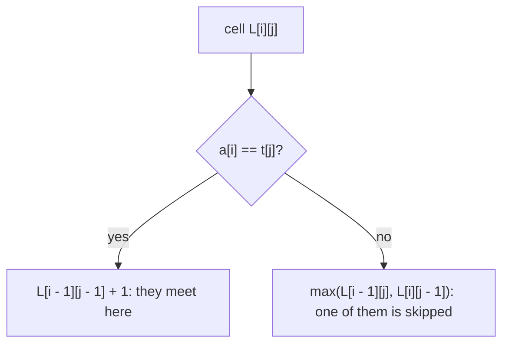

# AMPPZ 1998 B - Cross-country

> [!info] Karta zadania
> - Treść: `199X/1998/B/B.pdf` ([PDF na GitHubie](../../../199X/1998/B/B.pdf)), po angielsku; limitów czasu i pamięci
>   treść nie podaje, dane z pliku `B.IN`, wynik do `B.OUT` (dziś: wejście i wyjście standardowe). Przykład w PDF ma
>   zlepione liczby: wiersz `1234567890` to `1 2 3 4 5 6 7 8 9 0` (wiersz `1 2 35 0` zachował odstępy).
> - Technika: najdłuższy wspólny podciąg (LCS), tablica po prefiksach obu ciągów. Trudność: ~3 (rankingu 1998 brak,
>   szacunek z treści); po rozwiązaniu raczej 2, bo to czysty LCS po jednej obserwacji.
> - Kod: [b-cross-country.cpp](b-cross-country.cpp). Złożoność: O(|A| · |T|) na kartę Toma.
> - Dzień kursu: [Dzień 10](../../dni/10-dp-1.md), ćwiczenie (minimum).

## Treść w skrócie

Agnes biegnie przez punkty kontrolne w kolejności ze swojej karty (od 2 do 2000 numerów z zakresu 1..1000). Tom
wybiera jedną ze swoich kart i biegnie według niej. Punkt dostaje się za spotkanie z Agnes w tym samym punkcie, a po
spotkaniu oboje muszą przejść do dalszych punktów swoich kart, zanim zdobędą następny punkt; między spotkaniami Tom
może przebiec dowolnie dużo punktów. Ile najwięcej spotkań może zdobyć Tom? Karta kończy się zerem, a samotne zero na
początku wiersza kończy zestaw danych; zestawów do 10.

## Zanim przeczytasz dalej

25 minut. Przykład: Agnes `1 3 5 7`, karta Toma `3 7 5 1`, wynik 2. Policz to ręcznie i nazwij, czym są spotkania.

> [!tip]- Podpowiedź 1
> Spotkania to pary (pozycja na karcie Agnes, pozycja na karcie Toma) z tym samym punktem, rosnące w obu kartach.
> Jak nazywa się najdłuższy taki układ?

> [!tip]- Podpowiedź 2
> To najdłuższy wspólny podciąg. L[i][j] = wynik dla pierwszych i punktów Agnes i pierwszych j punktów Toma. Co, jeśli
> ostatnie punkty są równe, a co, jeśli różne?

## Droga myślenia

1. **Spotkania to wspólny podciąg.** Kolejne spotkania leżą na coraz dalszych pozycjach obu kart, a równe punkty
   tworzą ten sam ciąg numerów: to podciąg obu kart. W drugą stronę każdy wspólny podciąg da się zrealizować, bo między
   spotkaniami wolno przebiec dowolnie wiele punktów. Wynik dla karty to LCS(karta Agnes, karta Toma), wynik zestawu to
   maksimum po kartach Toma.
2. **Stan i przejście.** L[i][j] = LCS pierwszych i elementów a i pierwszych j elementów t. Jeśli a[i] = t[j], to
   L[i][j] = L[i - 1][j - 1] + 1 (ostatnie elementy tworzą spotkanie). W przeciwnym razie jeden z nich nie jest
   w spotkaniu: L[i][j] = max(L[i - 1][j], L[i][j - 1]). Brzegi L[0][j] = L[i][0] = 0.
3. **Pamięć.** Wiersz i korzysta tylko z wiersza i - 1, więc wystarczą dwa wiersze (tablica 2000 × 2000 intów to 16 MB:
   też by się zmieściła, ale dwa wiersze są prostsze).
4. **Wczytywanie.** Karta to liczby do zera; pusta karta (samo zero) oznacza koniec zestawu. Czytanie liczb jedna po
   drugiej, bez patrzenia na końce wierszy, wystarcza.



Jak czytać diagram: każda komórka patrzy na trzech sąsiadów z lewej, z góry i po skosie, którzy są już policzeni, gdy
idziemy wierszami z lewej do prawej.

Tablica dla Agnes `1 3 5 7` (wiersze) i Toma `3 7 5 1` (kolumny), bez zerowego wiersza i kolumny:

| | 3 | 7 | 5 | 1 |
|---|---|---|---|---|
| 1 | 0 | 0 | 0 | 1 |
| 3 | 1 | 1 | 1 | 1 |
| 5 | 1 | 1 | 2 | 2 |
| 7 | 1 | 2 | 2 | 2 |

Wynik 2 (na przykład spotkania w 3 i 5 albo w 3 i 7).

## Rozwiązanie

```cpp
int lcs(const vector<int>& a, const vector<int>& b) {
    vector<int> prev(b.size() + 1, 0), cur(b.size() + 1, 0);   // rows i - 1 and i of the table
    for (size_t i = 1; i <= a.size(); i++) {
        for (size_t j = 1; j <= b.size(); j++)
            cur[j] = (a[i - 1] == b[j - 1]) ? prev[j - 1] + 1 : max(prev[j], cur[j - 1]);
        swap(prev, cur);
    }
    return prev[b.size()];
}
```

Pełny program: [b-cross-country.cpp](b-cross-country.cpp).

## Złożoność i optymalność

- O(|A| · |T|) czasu na kartę, O(|T|) pamięci: przy 2000 × 2000 to 4 · 10⁶ komórek na kartę.
- Omówienia jury z 1998 roku nie ma w sieci. LCS dwóch ciągów długości n nie ma znanego algorytmu O(n^(2 - ε)), a przy
  hipotezie SETH taki nie istnieje (Abboud, Backurs, Vassilevska Williams, FOCS 2015); znane przyspieszenia to stały
  czynnik, np. wersja na bitach O(n² / 64). Przy tych limitach tablica O(|A| · |T|) jest rozwiązaniem właściwym.

## Pułapki

- **Podciąg, nie spójny fragment:** spotkania nie muszą być na kolejnych punktach; najdłuższy wspólny fragment
  (substring) to inne zadanie.
- **Zlepiony przykład w PDF:** numery mają do czterech cyfr, a separatorem jest odstęp.
- **Koniec zestawu:** zero na początku wiersza to pusta karta; czytanie "do zera" robi to samo bez analizy wierszy.
- **Wiele kart Toma:** wynik to maksimum, nie suma.

## Weryfikacja

- Kompilacja `g++ -std=c++17 -O2 -Wall -Wextra` bez ostrzeżeń, przykład z treści (z odstępami) daje 6, 2 i 3.
- 1500 wejść losowych po 3 zestawy (karta Agnes od 2 do 10 punktów, 1-3 karty Toma po 2-10 punktów, numery z zakresu
  1..v dla v ≤ 5, żeby powtórzeń było dużo) porównanych z brute force, który przegląda wszystkie podzbiory punktów
  Agnes i zachłannie sprawdza, czy Tom może je kolejno spotkać na swojej karcie. Wszystkie zgodne.
- Testy maksymalne: 10 zestawów po 10 kart Toma, wszystkie karty po 2000 punktów, 0,44 s; jeden zestaw ze 100 kartami
  po 2000 punktów z wartościami 1..3 (długie dopasowania) 0,51 s.

## Wspólny mianownik

**Dwa ciągi, dopasowania w zachowanej kolejności: tablica po prefiksach obu.** "Spotkania", "wspólne etapy",
"zgodne fragmenty", "najmniej poprawek" (odległość edycyjna) to ta sama tablica L[i][j]: ostatnie elementy albo są
dopasowane, albo jeden z nich się pomija.
