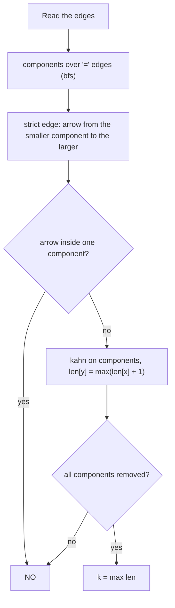

# AMPPZ 1998 F - Relations

> [!info] Karta zadania
> - Treść (po angielsku): `199X/1998/F/F.pdf` ([PDF na GitHubie](../../../199X/1998/F/F.pdf)); limitów czasu i pamięci
>   treść nie podaje.
> - Technika: grafy: składowe po krawędziach "=", graf składowych, wykrywanie cyklu i najdłuższa ścieżka w DAG
>   algorytmem Kahna. Trudność: ~3 (rankingu 1998 brak; szacunek z treści 4).
> - Kod: [f-relations.cpp](f-relations.cpp). Złożoność: O(n + m) na zestaw.
> - Dzień kursu: [Dzień 8](../../dni/08-grafy-1.md), ćwiczenie (wyzwanie).

## Treść w skrócie

Graf skierowany (n ≤ 1000, m ≤ 10 000, bez pętli i krawędzi wielokrotnych) ma na krawędziach relacje <, = albo >
(w wejściu -1, 0, 1). Etykietowanie k-poprawne przypisuje wierzchołkom liczby całkowite z [0, k] tak, że dla każdej
krawędzi u → v liczba u jest w relacji z liczbą v. Znajdź najmniejsze k albo wypisz NO, gdy takiego nie ma. Do 10
zestawów.

## Zanim przeczytasz dalej

45 minut. Przykłady: krawędzie 1 < 2, 2 = 3, 2 < 4, 3 < 4 dają k = 2; 1 < 2 i 2 < 1 dają NO; 1 < 2 i 2 > 1 dają 1;
same równości dają 0. W PDF przykładowe wejście ma zlepione liczby: czytaj je jako d = 4 i cztery zestawy po dwa
wiersze.

> [!tip]- Podpowiedź 1
> Wierzchołki połączone krawędziami "=" (w dowolnym kierunku, także pośrednio) muszą mieć tę samą liczbę. Co zrobić
> z takimi grupami?

> [!tip]- Podpowiedź 2
> Po sklejeniu grup zostają tylko krawędzie ostre. Zapisz każdą jako strzałkę od mniejszego do większego. Kiedy
> etykietowanie nie istnieje? A jeśli istnieje, ile różnych wartości musi pojawić się na najdłuższej ścieżce strzałek?

## Droga myślenia

1. **Równości sklejają wierzchołki.** Krawędzie "=" traktujemy jak nieskierowane; składowe spójne po nich (BFS) to
   grupy, które dostaną tę samą liczbę.
2. **Krawędzie ostre** zamieniamy na strzałki między składowymi, zawsze od mniejszej do większej: u < v daje
   comp(u) → comp(v), u > v daje comp(v) → comp(u). Strzałka wewnątrz jednej składowej to sprzeczność (x < x).
3. **Cykl strzałek to sprzeczność** (a < b < ... < a). Wykrywa go algorytm Kahna: składowe na cyklu nigdy nie dostają
   stopnia 0.
4. **Najmniejsze k to najdłuższa ścieżka.** Na ścieżce o L strzałkach liczby rosną co najmniej o 1 na strzałkę, więc
   k ≥ L. A przypisanie "liczba składowej = długość najdłuższej ścieżki strzałek kończącej się w niej" jest poprawne
   (strzałka x → y daje len[y] ≥ len[x] + 1) i używa liczb od 0 do L. Więc k = L.
5. **Najdłuższa ścieżka w DAG** wychodzi przy okazji Kahna: len[y] = max(len[y], len[x] + 1) przy usuwaniu krawędzi
   x → y; porządek topologiczny gwarantuje, że len[x] jest już ostateczne.



Jak czytać diagram: najpierw graf się kurczy (równości), potem staje się DAG-iem albo okazuje się sprzeczny (cykl),
a na końcu zwykłe DP po porządku topologicznym daje długość najdłuższej ścieżki, czyli najmniejsze k.

Przykład 1: składowe {1}, {2, 3}, {4}. Strzałki: {1} → {2, 3} (1 < 2), {2, 3} → {4} (2 < 4 i 3 < 4). Najdłuższa ścieżka
ma 2 strzałki: k = 2 (np. 1 → 0, 2 i 3 → 1, 4 → 2).

## Rozwiązanie

```cpp
// comp[] = components over '=' edges, C = their number (bfs, section 4 of day 8)
vector<vector<int>> up(C);                     // edge x -> y: number of x < number of y
vector<int> indeg(C, 0);
bool ok = true;
for (int i = 0; i < m; i++) {
    if (rel[i] == 0) continue;
    int lo = comp[u[i]], hi = comp[v[i]];
    if (rel[i] == 1) swap(lo, hi);             // '>' : the end is smaller
    if (lo == hi) { ok = false; break; }       // x < x
    up[lo].push_back(hi);
    indeg[hi]++;
}
int k = 0;
if (ok) {
    vector<int> q, len(C, 0);                  // len = edges on the longest path ending here
    for (int c = 0; c < C; c++) if (indeg[c] == 0) q.push_back(c);
    for (size_t h = 0; h < q.size(); h++) {
        int x = q[h];
        k = max(k, len[x]);
        for (int y : up[x]) {
            len[y] = max(len[y], len[x] + 1);
            if (--indeg[y] == 0) q.push_back(y);
        }
    }
    if ((int)q.size() < C) ok = false;         // a cycle of strict edges
}
```

Pełny program: [f-relations.cpp](f-relations.cpp).

## Złożoność i optymalność

- O(n + m) na zestaw: BFS po równościach, budowa strzałek i Kahn przeglądają każdą krawędź stałą liczbę razy.
  Wczytanie m krawędzi kosztuje tyle samo, więc to rozwiązanie optymalne.
- Omówienia jury dla 1998 nie ma, rozwiązań w sieci nie znalazłem. Dowód z punktu 4 (dolne ograniczenie z najdłuższej
  ścieżki i przypisanie, które je osiąga) uzasadnia, że wynik jest najmniejszy.

## Pułapki

- **Kierunek "=":** krawędź u = v skleja w obie strony; kto zbuduje z niej strzałkę skierowaną, nie skleja pośrednich
  równości.
- **Relacja ">":** liczba u jest większa, więc strzałka idzie od v do u.
- **Strzałka wewnątrz składowej** (np. 1 = 2, 2 = 3, 1 < 3) to NO, choć w grafie składowych nie ma cyklu (to pętla).
- **Kilka strzałek między tą samą parą składowych** jest normalne (przykład 3: 1 < 2 i 2 > 1); stopnie wejściowe liczą
  każdą osobno i wszystko się zgadza.

## Weryfikacja

- Kompilacja `g++ -std=c++17 -O2 -Wall -Wextra` bez ostrzeżeń, przykład z treści poprawny (2, NO, 1, 0).
- 1500 wejść losowych po 10 zestawów (n ≤ 5, m ≤ 7 bez pętli i krawędzi wielokrotnych; 60 % krawędzi zgodnych
  z losowym etykietowaniem, żeby padały wyniki liczbowe), razem 15 000 zestawów, w tym 3396 z NO, porównanych z brute
  force, który przegląda wszystkie przypisania liczb 0..n-1 (wystarczają, bo zastąpienie liczb ich rangami zachowuje
  relacje) i bierze najmniejsze maksimum. Wszystkie zgodne.
- Test maksymalny: 10 zestawów n = 1000, m = 10 000 (pięć DAG-ów ze ścieżką 1 < 2 < ... < 1000, cztery losowe, jeden
  z samymi równościami) 0,06 s; wyniki 999, NO i 0 zgodne z budową testu.

## Wspólny mianownik

**Równości skleja się w jeden wierzchołek (składowe albo Find-Union), a nierówności zostają jako strzałki; na DAG-u
najmniejszy zakres wartości to najdłuższa ścieżka.** Ten sam ruch to "minimalna liczba poziomów" w planowaniu zadań
z zależnościami, numerowanie pięter w budynku z relacjami "wyżej/niżej" i każde zadanie z porządkiem częściowym.
