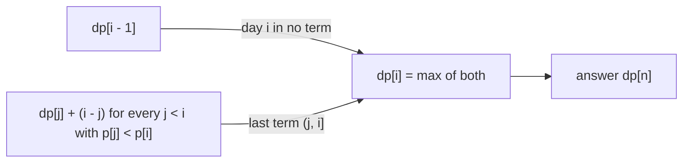

# AMPPZ 2002 H - Słoneczne wczasy

> [!info] Karta zadania
> - Treść: `200X/2002/H/H.pdf` ([PDF na GitHubie](../../../200X/2002/H/H.pdf)); limitów czasu i pamięci treść nie podaje.
> - Technika: programowanie dynamiczne na prefiksach; warunek na odcinku z sumy prefiksowej (Dzień 4).
>   Trudność: ~2 (rankingu 2002 brak, szacunek z treści).
> - Kod: [h-sloneczne-wczasy.cpp](h-sloneczne-wczasy.cpp). Złożoność: O(n) na zestaw (przy n ≤ 200 wystarcza O(n²)).
> - Dzień kursu: [Dzień 10](../../dni/10-dp-1.md), zadanie omówione (minimum).

## Treść w skrócie

Prognoza na n ≤ 200 dni wakacji: każdy dzień słoneczny (1) albo pochmurny (0), podana jako napis bez odstępów. Biuro
wybiera rozłączne turnusy (odcinki kolejnych dni, każdy co najmniej jednodniowy); turnus jest dobry, gdy ma ściśle
więcej dni słonecznych niż pochmurnych. Za każdy dzień w turnusie biuro zarabia 1. Jaki jest największy zysk?
Na wejściu C ≈ 15 zestawów.

## Zanim przeczytasz dalej

25 minut. Przykłady z treści: `100110001010001` daje 9, `0010111101100000` daje 13. Dla pierwszego znajdź ręcznie
turnusy o łącznej długości 9.

> [!tip]- Podpowiedź 1
> Spójrz na ostatni dzień. Albo nie należy do żadnego turnusu, albo kończy ostatni turnus (j, i]. W obu przypadkach to,
> co zostaje po lewej, jest tym samym zadaniem dla krótszego prefiksu. Zdefiniuj dp[i].

> [!tip]- Podpowiedź 2
> Zamień 1 na +1, a 0 na -1 i policz sumy prefiksowe p (Dzień 4). Odcinek (j, i] jest dobry wtedy i tylko wtedy, gdy
> p[i] - p[j] > 0, czyli p[j] < p[i].

## Droga myślenia

1. **Brute force.** Wszystkie zbiory rozłącznych odcinków: wykładniczo wiele. Ale przy wybieraniu ostatniego turnusu
   cała reszta to to samo zadanie na krótszym prefiksie, a prefiksów jest tylko n + 1.
2. **Stan i przejście.** dp[i] = największy zysk z pierwszych i dni. Dzień i albo jest wolny (dp[i - 1]), albo kończy
   turnus (j, i], który musi być dobry (p[j] < p[i]); wtedy zysk to dp[j] + (i - j). Start dp[0] = 0, kolejność rosnąco
   po i, wynik dp[n]. To O(n²), przy n ≤ 200 około 20 000 porównań na zestaw:

   ```cpp
   for (int i = 1; i <= n; i++) {
       dp[i] = dp[i - 1];                     // day i is in no term
       for (int j = 0; j < i; j++)            // last term is (j, i]
           if (p[j] < p[i]) dp[i] = max(dp[i], dp[j] + (i - j));
   }
   ```

3. **Dlaczego to poprawne.** Każde rozwiązanie dla pierwszych i dni ma dzień i wolny albo kończy się turnusem (j, i];
   po jego odjęciu zostaje dowolne rozwiązanie dla pierwszych j dni, a najlepsze z nich ma zysk dp[j]. Przejście
   przegląda wszystkie możliwości ostatniego kroku, więc niczego nie gubi.
4. **Szybciej: O(n).** Przepisz przejście jako i + max(dp[j] - j) po j < i z p[j] < p[i]. Wartość g(j) = dp[j] - j
   nigdy nie rośnie, bo dp[j] ≤ dp[j - 1] + 1 (jeden dzień więcej to co najwyżej 1 zysku więcej). Spośród dobrych j
   najlepsze jest więc najmniejsze. Sumy p zmieniają się o ±1 i startują od p[0] = 0: jeśli p[i] > 0, najmniejsze dobre
   j to 0; jeśli p[i] ≤ 0, to pierwsze miejsce, w którym p spadło do p[i] - 1, o ile było przed i.



Jak czytać diagram: dp[i] ma dwa źródła, odpowiadające dwóm możliwościom dla ostatniego dnia. Oba sięgają tylko po
wartości dla krótszych prefiksów, więc liczenie w kolejności i = 1, 2, ..., n zawsze ma je gotowe.

Pierwszy przykład krok po kroku (p[0] = 0, dp[0] = 0):

| i | dzień | p[i] | najmniejsze j z p[j] < p[i] | dp[i] |
|---|---|---|---|---|
| 1 | 1 | 1 | 0 | 1 |
| 2 | 0 | 0 | brak | 1 |
| 3 | 0 | -1 | brak | 1 |
| 4 | 1 | 0 | 3 | 2 |
| 5 | 1 | 1 | 0 | 5 |
| 6 | 0 | 0 | 3 | 5 |
| 7 | 0 | -1 | brak | 5 |
| 8 | 0 | -2 | brak | 5 |
| 9 | 1 | -1 | 8 | 6 |
| 10 | 0 | -2 | brak | 6 |
| 11 | 1 | -1 | 8 | 8 |
| 12 | 0 | -2 | brak | 8 |
| 13 | 0 | -3 | brak | 8 |
| 14 | 0 | -4 | brak | 8 |
| 15 | 1 | -3 | 14 | 9 |

Turnusy odczytane od końca: (14, 15], potem dp[14] = dp[11], czyli (8, 11], potem dp[8] = dp[5], czyli (0, 5]: dni
1-5, 9-11 i 15, razem 5 + 3 + 1 = 9.

## Rozwiązanie

```cpp
vector<int> dp(n + 1, 0), first(n + 2, -1);   // first[v] = first index with p = -v
int p = 0;
for (int i = 1; i <= n; i++) {
    p += (s[i - 1] == '1') ? 1 : -1;
    if (p < 0 && first[-p] == -1) first[-p] = i;
    dp[i] = dp[i - 1];
    int j = -1;
    if (p > 0) j = 0;
    else if (first[-p + 1] != -1 && first[-p + 1] < i) j = first[-p + 1];
    if (j >= 0) dp[i] = max(dp[i], dp[j] + (i - j));
}
cout << dp[n] << "\n";
```

Pełny program: [h-sloneczne-wczasy.cpp](h-sloneczne-wczasy.cpp).

## Złożoność i optymalność

- O(n) czasu i pamięci na zestaw; samo wczytanie napisu to Ω(n), więc lepiej się nie da. Przy limicie n ≤ 200 wersja
  O(n²) z kroku 2 jest równie dobra na zawodach i szybsza do napisania; O(n) to ćwiczenie z obserwacji "g(j) nie rośnie".
- Omówienia jury z 2002 roku nie ma w sieci (archiwum zawiera tylko treść); poprawność wynika z argumentu w kroku 3,
  optymalność z dolnego ograniczenia na wczytanie danych.

## Pułapki

- **Ściśle więcej:** turnus z równą liczbą dni słonecznych i pochmurnych jest zły, więc warunek to p[j] < p[i], nie ≤.
- **Zapomniane "dzień wolny":** bez dp[i] = dp[i - 1] każdy dzień musiałby kończyć turnus.
- **Brak dobrego turnusu:** same zera dają 0 (pusty zbiór turnusów jest dozwolony).
- **Wejście:** napis bez odstępów, czytany jako `string`, i C zestawów, każdy z własnym n.

## Weryfikacja

- Kompilacja `g++ -std=c++17 -O2 -Wall -Wextra` bez ostrzeżeń, przykłady z treści dają 9 i 13.
- 1500 wejść losowych po 10 zestawów (n od 1 do 12, w każdym zestawie inna proporcja dni słonecznych), czyli 15 000
  zestawów, porównanych z brute force, który rekurencyjnie przegląda wszystkie zbiory rozłącznych dobrych turnusów;
  osobno wersja O(n) z programu i wersja O(n²) z kroku 2. Wszystkie zgodne.
- Test maksymalny: 15 zestawów po n = 200 (losowe, `0101...01`, 199 zer i jedynka na końcu) 0,02 s; dwa ostatnie dają
  199 i 1, zgodnie z rachunkiem ręcznym.

## Wspólny mianownik

**Ostatni element albo jest wolny, albo kończy ostatni kawałek.** Podział ciągu na kawałki z warunkiem na każdy
kawałek to DP po prefiksach: dp[i] z dp[i - 1] i z dp[j] dla dobrych j. Warunek na kawałek (j, i] sprawdza się z sum
prefiksowych, a gdy przejście O(n) jest za wolne, szukaj monotoniczności, która wskazuje najlepsze j od razu.
