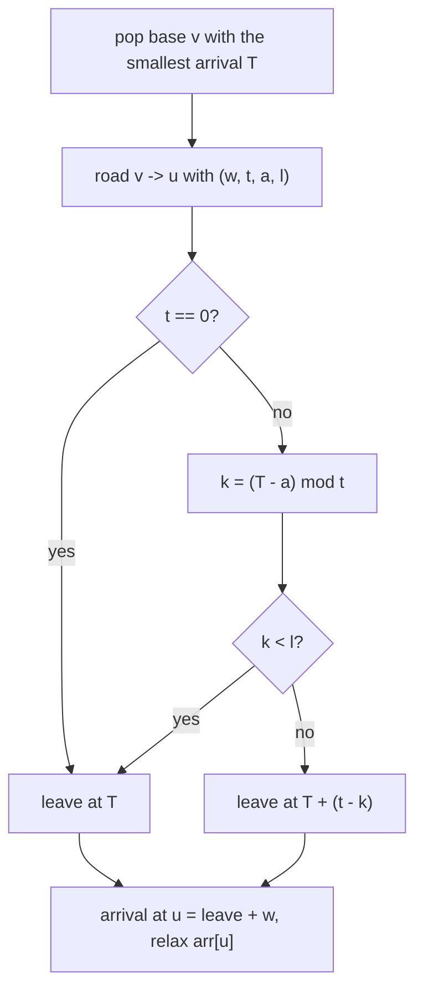

# AMPPZ 2004 I - Obóz Babilon

> [!info] Karta zadania
> - Treść: `200X/2004/I/I - Oboz Babilon.pdf` ([PDF na GitHubie](../../../200X/2004/I/I%20-%20Oboz%20Babilon.pdf));
>   limitów czasu i pamięci treść nie podaje. Przykład w PDF ma zlepione cyfry: wiersz `121201` to `1 2 1 2 0 1`.
> - Technika: najkrótsze ścieżki: Dijkstra na czasach przybycia, krawędzie dostępne w okresowych oknach, czekanie.
>   Trudność: ~4 w katalogu (rankingu 2004 brak, szacunek z treści); po rozwiązaniu raczej 3, bo to jedna obserwacja
>   i zwykły Dijkstra.
> - Kod: [i-oboz-babilon.cpp](i-oboz-babilon.cpp). Złożoność: O((n + m) log n) na zestaw.
> - Dzień kursu: [Dzień 9](../../dni/09-grafy-2.md), ćwiczenie (minimum).

## Treść w skrócie

Graf skierowany: n ≤ 5 · 10⁴ baz, m ≤ 10⁶ dróg. Droga u → v ma czas przejazdu w (0 ≤ w ≤ 10⁴) i wolno nią wyruszyć tylko
w chwilach z przedziałów [it + a, it + a + l) dla całkowitych i (0 ≤ a < t, 1 ≤ l < t ≤ 10⁴); t = a = l = 0 oznacza
drogę zawsze otwartą. W bazach wolno czekać dowolnie długo. Konwój startuje z bazy 1 w chwili 0; podaj najwcześniejszą
chwilę dotarcia do bazy n albo NIE. Do 10⁴ zestawów w jednym wejściu.

## Zanim przeczytasz dalej

35 minut. Przykład: łańcuch 1 → 2 → ... → 10, każda droga trwa 1, a okresy to kolejno 2, 3, 4, 5, 6, 5, 4, 3, 2 (zawsze
a = 0, l = 1); wynik 17. Przejdź go ręcznie, zapisując chwilę przybycia i chwilę wyjazdu z każdej bazy.

> [!tip]- Podpowiedź 1
> Czy opłaca się dotrzeć do bazy później, niż się da? Jeśli dotarłeś wcześniej, zawsze możesz poczekać i udawać, że
> dotarłeś później.

> [!tip]- Podpowiedź 2
> Skoro najwcześniejsze przybycie do każdej bazy jest najlepsze, wystarczy jedna liczba na bazę, jak dist w Dijkstrze.
> Relaksacja: przybyłeś w chwili T, kiedy najwcześniej możesz wyruszyć drogą o oknach (t, a, l)? Policz to resztą
> z dzielenia, bez pętli po oknach.

## Droga myślenia

1. **Wcześniej znaczy lepiej.** Kto jest w bazie w chwili T, może być w niej w każdej chwili T' ≥ T (czekanie). Więc
   najwcześniejsze przybycie do bazy dominuje każde późniejsze i wystarczy je pamiętać: arr[v].
2. **Relaksacja z czekaniem.** Po przybyciu w chwili T droga (w, t, a, l) daje przybycie do v w chwili
   wyjazd(T) + w, gdzie wyjazd(T) to najmniejsza dozwolona chwila ≥ T. Funkcja T → wyjazd(T) + w jest niemalejąca,
   a wartość nie mniejsza niż T, więc działa argument Dijkstry: baza o najmniejszym arr spośród nieostatecznych jest
   ostateczna.
3. **Najbliższe okno w O(1).** k = (T - a) mod t (reszta nieujemna) to położenie T w okresie liczone od początku okna.
   Jeśli k < l, T leży w oknie i wyjazd(T) = T; w przeciwnym razie następne okno zaczyna się w T + (t - k).
4. **Algorytm.** Dijkstra z bazy 1 (arr = 0), relaksacja przez wyjazd(T) + w; arr[n] albo NIE.



Jak czytać diagram: to zwykła relaksacja Dijkstry, w której zamiast "T + w" stoi "najbliższy dozwolony wyjazd + w".
Gałąź k < l obejmuje też okno, które zaczęło się w poprzednim okresie i jeszcze trwa (gdy a + l > t).

Przykład: z bazy 6 (przybycie 7) droga o t = 5, a = 0, l = 1: k = 7 mod 5 = 2 ≥ 1, wyjazd 7 + 3 = 10, przybycie 11.
Dalej t = 4: k = 11 mod 4 = 3, wyjazd 12, przybycie 13; t = 3: k = 1, wyjazd 15, przybycie 16; t = 2: k = 0, wyjazd 16,
przybycie 17.

## Rozwiązanie

```cpp
// first moment >= T at which leaving by road r is safe
long long depart(long long T, const Road& r) {
    if (r.t == 0) return T;                    // t = a = l = 0: always safe
    long long k = ((T - r.a) % r.t + r.t) % r.t;   // position of T inside the period
    if (k < r.l) return T;                     // inside [it + a, it + a + l)
    return T + (r.t - k);                      // start of the next window
}
// in dijkstra: arr = depart(T, r) + r.w; if (arr < dist[r.to]) { dist[r.to] = arr; push }
```

Pełny program: [i-oboz-babilon.cpp](i-oboz-babilon.cpp).

## Złożoność i optymalność

- Dijkstra: O((n + m) log n) na zestaw, relaksacja O(1). Wczytanie m dróg to Ω(m); dla dowolnych wag lepszej ogólnej
  metody niż Dijkstra z kopcem nie ma.
- Omówienia jury z 2004 nie znalazłem (kurs zna oficjalne omówienia od 2011). Poprawność opiera się na własności FIFO:
  wcześniejsze przybycie nigdy nie daje późniejszego wyjazdu, więc najwcześniejsze przybycie do bazy jest optymalne.
  Bez czekania (gdyby w bazie nie wolno było stać) ta własność by nie zachodziła i Dijkstra by nie wystarczył.

## Pułapki

- **Okno przechodzące przez koniec okresu:** przy a + l > t okno z poprzedniego okresu (i = -1) obejmuje chwilę 0.
  Pętla po oknach od i = 0 go nie widzi; reszta z dzielenia widzi. Ten błąd miał brute force tego kursu, wyłapał go
  test losowy.
- **Reszta z ujemnej liczby:** w C++ `(T - a) % t` bywa ujemne, stąd `((T - a) % t + t) % t`.
- **t = a = l = 0:** dzielenie przez zero, jeśli nie obsłużysz tego przypadku osobno.
- **Drogi o czasie 0:** Dijkstra je obsługuje (wagi nieujemne), BFS warstwami już nie.
- **n = 1:** konwój już jest na miejscu, wynik 0.
- **Wiele zestawów:** tablice i kolejka od nowa w każdym; przy m do 10⁶ szybkie wczytywanie.

## Weryfikacja

- Kompilacja `g++ -std=c++17 -O2 -Wall -Wextra` bez ostrzeżeń, przykład z treści daje 17.
- 1500 wejść po 5 zestawów (7500 zestawów: n od 1 do 5, do 8 dróg, także pętle, w od 0 do 3, co czwarta droga zawsze
  otwarta, okresy 2-6) porównanych z brute force napisanym z treści: symulacja chwila po chwili do 400, czekanie
  i wyjazd w każdej dozwolonej chwili, drogi o czasie 0 domykane w tej samej chwili. Wszystkie zgodne, w tym 3670 razy
  NIE. Pierwsza wersja brute force zgłosiła różnicę, bo sprawdzała okna od i = 0; po poprawce (od i = -1, zgodnie
  z treścią "i jest liczbą całkowitą") zgodność pełna.
- Testy maksymalne: n = 5 · 10⁴, m = 10⁶ losowych dróg 1,03 s (głównie wczytywanie); łańcuch 5 · 10⁴ baz z oknami
  o długości 1 na końcu okresu 10⁴ (wynik 499 999 999) 0,07 s.

## Wspólny mianownik

**Gdy wolno czekać, wcześniej znaczy lepiej, więc Dijkstra liczy na czasach.** Wagi zależne od chwili nie psują
Dijkstry, jeśli późniejszy wyjazd nigdy nie daje wcześniejszego przybycia (własność FIFO). Ten sam ruch: rozkłady
jazdy pociągów, światła na skrzyżowaniach, mosty otwierane okresowo.
