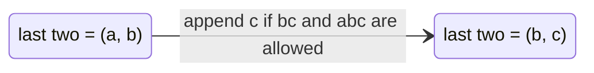

# AMPPZ 2005 D - Szaszłyki

> [!info] Karta zadania
> - Treść: `200X/2005/D/D - Szaszlyki.pdf` ([PDF na GitHubie](../../../200X/2005/D/D%20-%20Szaszlyki.pdf)); limitów
>   czasu i pamięci treść nie podaje.
> - Technika: programowanie dynamiczne liczące sposoby; stan = dwie ostatnie litery. Trudność: ~3 (rankingu 2005 brak,
>   szacunek z treści).
> - Kod: [d-szaszlyki.cpp](d-szaszlyki.cpp). Złożoność: O(n · p³) na zestaw.
> - Dzień kursu: [Dzień 10](../../dni/10-dp-1.md), ćwiczenie (pełna wersja).

## Treść w skrócie

Szaszłyk to napis długości n ≤ 1000 nad alfabetem pierwszych p ≤ 26 małych liter. Dane są zabronione pary i trójki
kolejnych liter (do p² + p³ wpisów, kolejność liter ma znaczenie). Ile jest szaszłyków bez żadnego zabronionego
fragmentu? Wynik modulo m ≤ 1000; kilka zestawów na wejściu.

## Zanim przeczytasz dalej

30 minut. Przykład z treści: p = 2, n = 3, zabronione `aa` i `bbb`: dobre są `aba`, `abb`, `bab`, `bba`, wynik 4. Inne
zestawy: p = 2, n = 24, nic zabronionego, m = 1000 daje 216 (2²⁴ mod 1000); p = 2, n = 2, zabronione `ba`, m = 10
daje 3.

> [!tip]- Podpowiedź 1
> Budujesz szaszłyk od lewej, litera po literze. Co musisz pamiętać o dotychczasowym napisie, żeby wiedzieć, czy
> wolno dopisać literę c?

> [!tip]- Podpowiedź 2
> Tylko dwie ostatnie litery: najdłuższy zakaz patrzy dwa kroki wstecz. ways[a][b] = liczba dobrych napisów obecnej
> długości kończących się na a, b. Dopisanie c przenosi ways[a][b] do ways[b][c].

## Droga myślenia

1. **Brute force.** Wszystkich napisów jest pⁿ, przy p = 26 i n = 1000 nie ma o czym mówić.
2. **Stan.** Napisy różniące się początkiem, ale z tymi samymi dwiema ostatnimi literami, zachowują się identycznie
   przy dopisywaniu: zakaz pary patrzy na ostatnią literę, zakaz trójki na dwie ostatnie. Wystarczy więc liczyć
   napisy w grupach po (przedostatnia, ostatnia): p² stanów zamiast pⁿ napisów.
3. **Przejście.** ways[a][b] dodaje się do next[b][c], gdy para bc i trójka abc nie są zabronione. Start dla długości 2:
   ways[a][b] = 1 dla każdej dozwolonej pary. Wynik to suma wszystkich ways po n - 2 krokach. Długość 1 osobno: p.
4. **Modulo m.** Każde dodawanie bierze resztę z dzielenia przez m; m może być równe 1 (wynik 0).



Jak czytać diagram: stan to para ostatnich liter, a dopisanie litery to przejście, które przesuwa okno o jeden.
Liczba napisów długości L kończących się parą (b, c) to suma po wszystkich a liczb z poprzedniej długości dla (a, b),
z których przejście jest dozwolone.

Przykład (p = 2, zakazy `aa` i `bbb`): długość 2: ways[a][b] = 1, ways[b][a] = 1, ways[b][b] = 1 (`aa` zabronione).
Długość 3: z (a, b) można dopisać a (`aba`) albo b (`abb`); z (b, a) tylko b (`bab`, bo `aa` zabronione); z (b, b) tylko
a (`bba`, bo `bbb` zabronione). Razem 4.

## Rozwiązanie

```cpp
for (int a = 0; a < p; a++)
    for (int b = 0; b < p; b++)
        ways[a][b] = badPair[a][b] ? 0 : 1 % m;      // length 2
for (int len = 3; len <= n; len++) {
    for (auto& row : next) fill(row.begin(), row.end(), 0);
    for (int a = 0; a < p; a++)
        for (int b = 0; b < p; b++) {
            if (ways[a][b] == 0) continue;
            for (int c = 0; c < p; c++)
                if (!badPair[b][c] && !badTriple[(a * p + b) * p + c])
                    next[b][c] = (next[b][c] + ways[a][b]) % m;
        }
    swap(ways, next);
}
```

Pełny program: [d-szaszlyki.cpp](d-szaszlyki.cpp) (długość 1 osobno, zakazy w tablicach indeksowanych literami).

## Złożoność i optymalność

- O(n · p³) czasu, O(p³) pamięci na zakazy trójek: dla n = 1000 i p = 26 to 1,76 · 10⁷ kroków na zestaw.
- Omówienia jury z 2005 roku nie ma w sieci. Przy tych limitach to rozwiązanie właściwe: każdy krok długości musi
  w ogólnym przypadku przejrzeć wszystkie p³ trójek, bo każda może być zabroniona. Gdyby n sięgało 10¹⁸, te same
  przejścia tworzą macierz p² × p² i wtedy potęgowanie macierzy (O(p⁶ log n)); to temat na później.

## Pułapki

- **Stan za mały:** sama ostatnia litera nie wystarczy, bo zakaz trójki patrzy dwa kroki wstecz.
- **n = 1 i n = 2:** dla n = 1 wynik to p mod m (zakazy par nie działają), dla n = 2 trójki nie działają.
- **m = 1:** każda liczba modulo 1 to 0, także start `1 % m`.
- **Zakaz pary w środku trójki:** przy dopisywaniu c sprawdź parę bc, nie tylko trójkę abc; para ab była sprawdzona
  wcześniej.

## Weryfikacja

- Kompilacja `g++ -std=c++17 -O2 -Wall -Wextra` bez ostrzeżeń, przykłady z treści dają 4, 216 i 3.
- 1500 wejść losowych po 5 zestawów (p od 1 do 4, n do 7-9 zależnie od p, do 6 losowych zakazanych par i trójek,
  m z {1, 2, 7, 10, 999, 1000} albo losowe), czyli 7500 zestawów, porównanych z brute force, który przegląda
  wszystkie pⁿ napisów i szuka w nich zakazanych fragmentów. Wszystkie zgodne.
- Test maksymalny: 10 zestawów po n = 1000, p = 26, do 300 losowych zakazów, m = 1000 albo 997: 0,47 s.

## Wspólny mianownik

**Stan = najmniej informacji, która wystarcza do decyzji o następnym kroku.** Zakazy fragmentów długości L wymagają
pamiętania L - 1 ostatnich znaków; reszta historii nie ma znaczenia, więc napisy grupuje się po tym, co jeszcze może
wpłynąć na przyszłość, i liczy grupy zamiast napisów.
