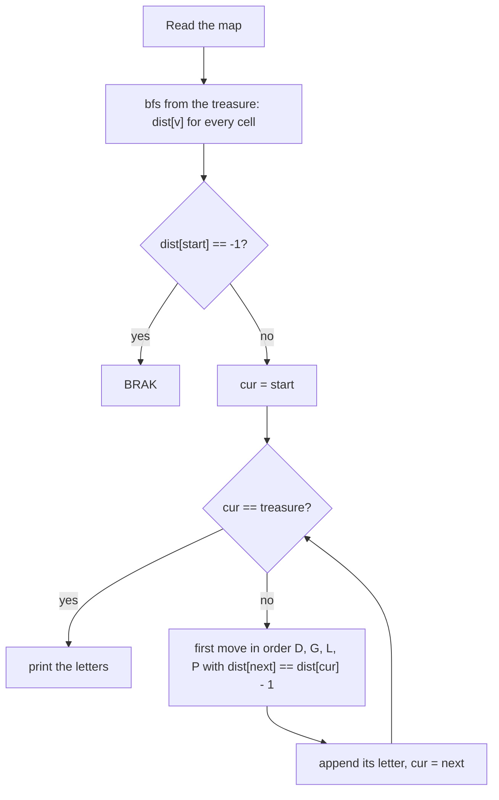

# AMPPZ 2005 G - Skarb

> [!info] Karta zadania
> - Treść: `200X/2005/G/G - Skarb.pdf` ([PDF na GitHubie](../../../200X/2005/G/G%20-%20Skarb.pdf)); limitów czasu
>   i pamięci treść nie podaje.
> - Technika: grafy: BFS na siatce od celu, potem zachłanny wybór najmniejszej litery po polach coraz bliższych celu.
>   Trudność: ~2 (rankingu 2005 brak; szacunek z treści 3 był zawyżony, jak zwykle).
> - Kod: [g-skarb.cpp](g-skarb.cpp). Złożoność: O(w · k) na mapę.
> - Dzień kursu: [Dzień 8](../../dni/08-grafy-1.md), zadanie omówione.

## Treść w skrócie

Mapa w × k (w, k ≤ 1000) z polami wolnymi `.`, rozpadlinami `X`, startem `S` i skarbem `*`. Ruchy o jedno pole: w lewo
(L), w prawo (P), w górę (G), w dół (D). Wypisz najkrótszą drogę od startu do skarbu jako napis z liter L, P, G, D,
a jeśli najkrótszych jest kilka, tę pierwszą w porządku leksykograficznym; gdy drogi nie ma, wypisz BRAK. W wejściu
jest kilka map.

## Zanim przeczytasz dalej

25 minut. Przykład z treści (mapa 5 × 6, start w lewym dolnym rogu wiersza 4) daje GGGPPPP. Zanim napiszesz kod, ustal,
w jakiej kolejności są litery w porządku leksykograficznym, i zastanów się, czy wystarczy BFS od startu, w którym
sąsiadów odwiedzasz w kolejności liter.

> [!tip]- Podpowiedź 1
> Porządek leksykograficzny to porządek słownika, a w alfabecie D < G < L < P. Pierwsza litera drogi ma być najmniejsza
> możliwa wśród ruchów, które leżą na jakiejś najkrótszej drodze. Jak sprawdzić, czy ruch leży na najkrótszej drodze?

> [!tip]- Podpowiedź 2
> Ruch z pola v na pole w leży na najkrótszej drodze do skarbu dokładnie wtedy, gdy odległość w od skarbu jest o 1
> mniejsza niż odległość v. Skąd wziąć odległości do skarbu dla wszystkich pól naraz?

## Droga myślenia

1. **Najkrótsza droga na siatce bez wag to BFS.** Mapa ma do 10⁶ pól, BFS kosztuje O(w · k).
2. **Czy wystarczy BFS od startu z sąsiadami w kolejności D, G, L, P?** Na siatce tak, ale wymaga to dowodu: przez
   indukcję po warstwach kolejka trzyma pola warstwy d w porządku ich najmniejszych napisów, bo pole warstwy d + 1
   zostaje odkryte najpierw z sąsiada o najmniejszym napisie, a z jednego pola do drugiego prowadzi tylko jedna litera.
   Potem drogę trzeba odtworzyć po rodzicach od skarbu i odwrócić. W grafie, w którym z jednego wierzchołka kilka
   krawędzi ma tę samą etykietę, ten argument się sypie. Prostsze do uzasadnienia i do napisania jest odwrócenie
   kierunku.
3. **BFS od skarbu.** dist[v] = odległość pola v od skarbu. Z pola v ruch na w jest "dobry" (leży na pewnej najkrótszej
   drodze), gdy dist[w] = dist[v] - 1.
4. **Zachłanny wybór litery.** Idąc od startu, w każdym kroku wybierz najmniejszą literę (D, potem G, L, P), której ruch
   jest dobry. Napisy najkrótszych dróg mają równą długość, więc o porządku decyduje pierwsza różna litera: wybór
   najmniejszej dobrej litery teraz nigdy nie zamyka drogi do celu (z dobrego pola zawsze jest dobry ruch dalej),
   a każda inna litera dałaby napis większy.
5. **Koszt:** BFS O(w · k), przejście od startu dist[S] kroków po 4 sprawdzenia.



Jak czytać diagram: BFS od skarbu daje mapę odległości, po której droga do skarbu zawsze schodzi o 1 w dół. Pętla od
startu wybiera najmniejszą literę wśród ruchów schodzących. Ściany i pola nieosiągalne mają dist = -1, więc nigdy nie
spełniają warunku "o 1 mniej".

Przykład z treści: skarb w (0, 4), start w (3, 0). dist[start] = 7. Z (3, 0) ruch D prowadzi na (4, 0), które ma
odległość 8, więc nie; G na (2, 0) ma 6, więc G. Z (2, 0) i (1, 0) znowu G (ruch D cofa), z (0, 0) zostaje tylko P
cztery razy: GGGPPPP.

## Rozwiązanie

```cpp
const int dr[4] = {1, -1, 0, 0}, dc[4] = {0, 0, -1, 1};   // D, G, L, P in alphabetical order
const char letter[4] = {'D', 'G', 'L', 'P'};
// bfs from the treasure fills dist (see section 3 of day 8), then:
if (dist[start] == -1) { cout << "BRAK\n"; continue; }
string path;
int cur = start;
while (cur != goal) {                          // every step goes one closer to the treasure
    int r = cur / k, c = cur % k;
    for (int d = 0; d < 4; d++) {
        int nr = r + dr[d], nc = c + dc[d];
        if (nr < 0 || nr >= w || nc < 0 || nc >= k) continue;
        if (dist[nr * k + nc] == dist[cur] - 1) {  // walls have -1, never equal
            path += letter[d];
            cur = nr * k + nc;
            break;
        }
    }
}
```

Pełny program: [g-skarb.cpp](g-skarb.cpp).

## Złożoność i optymalność

- O(w · k) na mapę: BFS odwiedza każde pole raz, wybór drogi to dist[S] ≤ w · k kroków po 4 sprawdzenia. Wczytanie
  mapy też kosztuje O(w · k), więc szybciej się nie da.
- Omówienia jury dla 2005 nie ma (zawody z lat 1996-2006 nie mają opublikowanych omówień), rozwiązań w sieci też nie
  znalazłem. To standardowa technika "BFS od celu i zachłanny wybór krawędzi na najkrótszej ścieżce", ta sama co
  w zadaniach o leksykograficznie najmniejszej najkrótszej drodze w ogólnych grafach (tam zachłanny wybór robi się
  warstwami, bo z jednego pola może prowadzić kilka ruchów tą samą literą; na siatce każda litera to jeden ruch).

## Pułapki

- **BFS od startu z sąsiadami w złej kolejności** (L, P, G, D jak w treści) daje najkrótszą drogę, ale nie
  najmniejszą leksykograficznie; poprawna kolejność to alfabetyczna.
- **Kolejność liter:** alfabet daje D < G < L < P, czyli dół, góra, lewo, prawo, a nie kolejność z treści (L, P, G, D).
- **Odtwarzanie od skarbu po rodzicach** daje napis od końca: trzeba go odwrócić i zamienić kierunki; BFS od skarbu
  z wyborem od startu tego unika.
- **Wiele map:** dist i kolejkę zakładaj od nowa dla każdej mapy.
- **Rekurencja:** DFS po mapie 10⁶ pól przepełni stos; tu wystarcza BFS na tablicy.

## Weryfikacja

- Kompilacja `g++ -std=c++17 -O2 -Wall -Wextra` bez ostrzeżeń, przykład z treści poprawny (GGGPPPP).
- 1500 wejść losowych po 5 map (w · k ≤ 12, ściany z gęstością 0, 20, 35 albo 50 %), razem 7500 map, w tym 1137 bez
  drogi, porównanych z brute force, który sprawdza wszystkie napisy długości 0, 1, 2, ... w porządku leksykograficznym
  i bierze pierwszy prowadzący do skarbu. Wszystkie zgodne.
- Test maksymalny: trzy mapy 1000 × 1000 w jednym wejściu (pusta z drogą 1998 kroków, wąż z drogą 499 500 kroków,
  mapa bez drogi): 0,07 s.

## Wspólny mianownik

**Leksykograficznie najmniejsza wśród optymalnych: najpierw policz odległości od celu, potem idź od startu zachłannie
po krawędziach, które zachowują optymalność.** Ten sam ruch działa w DP (najpierw tablica wyników od końca, potem
odtworzenie odpowiedzi najmniejszym wyborem, który daje optimum) i w każdym zadaniu "wypisz najmniejszą leksykograficznie
odpowiedź optymalną".
