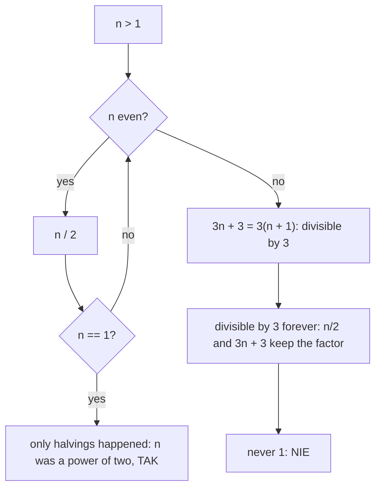

# AMPPZ 2011 C - Czy się zatrzyma?

> [!info] Karta zadania
> - Treść: `201X/2011/C/C.pdf` ([PDF na GitHubie](../../../201X/2011/C/C.pdf)); pamięć 64 MB, limitu czasu treść nie
>   podaje.
> - Technika: matematyka: niezmiennik (podzielność przez 3), potęga dwójki. Trudność: 1/5 (rozwiązało 55 z 55
>   drużyn).
> - Kod: [c-czy-sie-zatrzyma.cpp](c-czy-sie-zatrzyma.cpp). Złożoność: O(1).
> - Dzień kursu: [Dzień 6](../../dni/06-matematyka.md), ćwiczenie (minimum).

## Treść w skrócie

Pętla: dopóki n > 1, parzyste n zamień na n / 2, a nieparzyste na 3n + 3. Liczba n nie ma ograniczenia rozmiaru. Dla
danego n (2 ≤ n ≤ 10¹⁴) rozstrzygnij, czy pętla się zatrzyma (TAK albo NIE).

## Zanim przeczytasz dalej

15 minut. Przykład: n = 4 daje TAK. Prześledź na kartce n = 3, 5, 6, 7. Na którym kroku wiesz już, że się nie zatrzyma?

> [!tip]- Podpowiedź 1
> Spójrz na liczby, przez które przechodzi n = 5: 18, 9, 30, 15, 48, 24, 12, 6, 3, 12, ... Co je łączy?

> [!tip]- Podpowiedź 2
> Jeśli n dzieli się przez 3, to czy n / 2 i 3n + 3 też się dzielą? A czy 1 dzieli się przez 3?

## Droga myślenia

1. **Symulacja nie wystarcza.** Gdy program się nie zatrzymuje, symulacja też się nie skończy, a wartości mogą rosnąć.
   Trzeba udowodnić, kiedy pętla jest nieskończona.
2. **Małe przypadki.** 2 → 1 (TAK), 4 → 2 → 1 (TAK), 3 → 12 → 6 → 3 (cykl), 6 → 3 (cykl), 5 → 18 → ... → 3 (cykl).
   Wszystkie cykle przechodzą przez wielokrotności 3.
3. **Niezmiennik.** Jeśli 3 dzieli n, to 3 dzieli n / 2 (bo 3 nie dzieli 2) i 3 dzieli 3n + 3 = 3(n + 1). Raz zdobyta
   podzielność przez 3 zostaje na zawsze, a 1 nie dzieli się przez 3, więc pętla nigdy nie dojdzie do 1.
4. **Kiedy n trafia na wielokrotność 3?** Każde nieparzyste n > 1 przechodzi w 3(n + 1). Zatem pętla zatrzymuje się
   tylko wtedy, gdy samo połowienie doprowadza do 1, czyli gdy n jest potęgą dwójki.
5. **Test potęgi dwójki.** Potęga dwójki ma w zapisie dwójkowym jedną jedynkę, a n - 1 ma jedynki dokładnie tam, gdzie n
   ma zera na końcu: n & (n - 1) = 0 wtedy i tylko wtedy, gdy n jest potęgą dwójki (dla n ≥ 1).



Jak czytać diagram: dopóki trafiają się liczby parzyste, pętla tylko połowi. Pierwsza nieparzysta liczba większa od 1
wpada w gałąź 3n + 3 i od tej chwili ciąg jest uwięziony wśród wielokrotności 3, do których 1 nie należy. Do TAK prowadzi
więc tylko droga przez same połowienia.

## Rozwiązanie

```cpp
bool stops(ll n) {
    return (n & (n - 1)) == 0;                     // a power of two has a single bit set
}
```

Pełny program: [c-czy-sie-zatrzyma.cpp](c-czy-sie-zatrzyma.cpp).

## Złożoność i optymalność

- O(1): jedna operacja bitowa. Omówienie jury (AMPPZ 2011, MIMUW) ma ten sam dowód (podzielność przez 3 zostaje,
  nieparzysty dzielnik prowadzi do niej) i ten sam wynik: TAK tylko dla potęg dwójki.

## Pułapki

- **Symulacja z limitem kroków** przejdzie przykład, ale to zgadywanie: bez dowodu nie wiesz, ile kroków wystarczy.
- **Typ:** n do 10¹⁴ nie mieści się w `int`; `long long`.
- **Pętla `while (n % 2 == 0) n /= 2`** z porównaniem `n == 1` też jest poprawna i wystarcza; operacja bitowa jest
  krótsza, ale trzeba pamiętać o nawiasach: `(n & (n - 1)) == 0`, bo `==` wiąże silniej niż `&`.

## Weryfikacja

- Kompilacja `g++ -std=c++17 -O2 -Wall -Wextra` bez ostrzeżeń, przykład z treści poprawny (TAK).
- Test wyczerpujący dla n od 2 do 200 000: brute force symuluje pętlę z treści na `__int128` i kończy, gdy n = 1 (TAK)
  albo gdy wartość się powtórzy (NIE, cykl). Każde n rozstrzygnięte, wszystkie zgodne (17 razy TAK: potęgi dwójki).
- Granice: n = 10¹⁴ (NIE), 2⁴⁶ (TAK) i jej sąsiedzi (NIE) zgodne z symulacją.

## Wspólny mianownik

**Niezmiennik: cecha, którą proces zachowuje, a której cel nie ma.** Gdy pytanie brzmi "czy proces dojdzie do celu",
szukaj własności (podzielność, parzystość, reszta, suma), która raz zdobyta nigdy nie znika. Jeśli cel jej nie ma,
każdy stan z tą cechą jest stracony. Ten sam ruch rozstrzyga łamigłówki typu "czy da się przejść z układu A do B".
