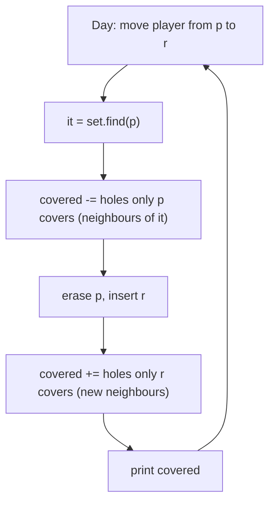

# AMPPZ 2011 E - Eksterminacja świstaków

> [!info] Karta zadania
> - Treść: `201X/2011/E/E.pdf` ([PDF na GitHubie](../../../201X/2011/E/E.pdf)); pamięć 128 MB, limitu czasu treść nie
>   podaje. Tekst PDF ma zepsute czcionki we wzorach: limity czytaj z obrazu strony.
> - Technika: wyszukiwanie binarne w posortowanej tablicy (liczenie w przedziale), `set` i sąsiedzi, liczenie tylko
>   zmiany. Trudność: 3/5 (rozwiązały 24 z 55 drużyn).
> - Kod: [e-eksterminacja-swistakow.cpp](e-eksterminacja-swistakow.cpp). Złożoność: O(n + (m + d) log(n + m)).
> - Dzień kursu: [Dzień 5](../../dni/05-wyszukiwanie-binarne.md), ćwiczenie (minimum).

## Treść w skrócie

Na prostej jest n norek (n ≤ 5 · 10⁵): norka 1 w punkcie 0, kolejne w rosnących punktach do 10⁹. Stoi tam też m
magnetofonów w różnych punktach (m ≤ 5 · 10⁵), a każdy budzi świstaki w norkach odległych od niego co najwyżej o l
(l ≤ 10⁹). Przez d dni (d ≤ 5 · 10⁵) rano jeden magnetofon przenosi się z punktu pᵢ do wolnego punktu rᵢ. Wypisz liczbę
norek w zasięgu jakiegoś magnetofonu przed każdym przeniesieniem i po ostatnim (d + 1 liczb).

## Zanim przeczytasz dalej

30 minut. Przykład z treści: norki 0, 2, 5, 6, 11, magnetofony 2, 4, 8, l = 1; odpowiedzi 2, 3, 3, 5, 3. Policz
najpierw, ile kosztuje przeliczanie wszystkiego od nowa każdego dnia.

> [!tip]- Podpowiedź 1
> Liczbę norek w przedziale [lo, hi] dają dwa wyszukiwania binarne w posortowanej tablicy pozycji:
> `upper_bound(hi) - lower_bound(lo)`. Przeliczanie sumy przedziałów wszystkich magnetofonów co dzień to jednak
> d · m operacji, za dużo.

> [!tip]- Podpowiedź 2
> Trzymaj bieżącą liczbę pokrytych norek. Przeniesienie to usunięcie i dodanie jednego magnetofonu. Które norki
> przestają być pokryte, gdy magnetofon znika? Tylko te, których nie pokrywa żaden inny, a z innych liczą się tylko dwaj
> najbliżsi sąsiedzi (`set` daje ich w O(log m)).

## Droga myślenia

1. **Jeden magnetofon** w punkcie q pokrywa norki z przedziału [q - l, q + l] (odległość co najwyżej l, więc końce
   wliczone). Norki są posortowane, więc ich liczbę w przedziale dają dwa wyszukiwania binarne.
2. **Przeliczanie od nowa jest za wolne:** suma przedziałów m magnetofonów po d dniach to 2,5 · 10¹¹ operacji. Każdy
   dzień zmienia jeden magnetofon, więc liczymy tylko różnicę.
3. **Norki tylko jednego magnetofonu.** Gdy magnetofon q znika, tracimy norki pokryte przez q i przez nikogo innego.
   Wszystkie przedziały mają tę samą długość 2l, więc z magnetofonów na lewo od q najdalej w prawo sięga najbliższy
   sąsiad zl (do zl + l), a z tych na prawo najdalej w lewo sięga najbliższy zr (od zr - l). Norki tylko q to
   przedział [max(q - l, zl + l + 1), min(q + l, zr - l - 1)].
4. **Przeniesienie:** znajdź p w zbiorze, odejmij jego własne norki, usuń; wstaw r, dodaj jego własne norki (liczone
   już z nowymi sąsiadami).
5. **Start:** wstawiamy magnetofony po kolei i dodajemy własne norki każdego. Dzięki temu początkowa suma też liczy
   każdą norkę raz.



Jak czytać diagram: każdy dzień to dwie poprawki bieżącej liczby. "Norki tylko q" to jeden przedział, którego końce
wyznaczają dwaj sąsiedzi q w zbiorze, a jego zawartość liczą dwa wyszukiwania binarne w tablicy norek. Reszta
magnetofonów nie ma wpływu, więc dzień kosztuje O(log n + log m).

Przykład: na starcie magnetofony 2, 4, 8 pokrywają norki 2 i 5, wynik 2. Dzień 1 przenosi 2 na 1. Własne norki
magnetofonu 2 (sąsiad z prawej 4): przedział [1, min(3, 4 - 1 - 1)] = [1, 2], norka 2, więc zostaje 1. Własne norki
magnetofonu 1 (sąsiad z prawej 4): [0, 2], norki 0 i 2, więc 3. Zgadza się z drugą liczbą wyjścia.

## Rozwiązanie

```cpp
ll holes(ll lo, ll hi) {                       // holes in [lo, hi]
    if (lo > hi) return 0;
    return upper_bound(x.begin(), x.end(), hi) - lower_bound(x.begin(), x.end(), lo);
}
ll own(set<ll>::iterator it) {                 // holes covered by *it and by no other player
    ll q = *it, lo = q - l, hi = q + l;
    if (it != z.begin()) lo = max(lo, *prev(it) + l + 1);
    if (next(it) != z.end()) hi = min(hi, *next(it) - l - 1);
    return holes(lo, hi);
}
// one day
auto it = z.find(p);
covered -= own(it);
z.erase(it);
covered += own(z.insert(r).first);
```

Pełny program: [e-eksterminacja-swistakow.cpp](e-eksterminacja-swistakow.cpp).

## Złożoność i optymalność

- Wczytanie O(n + m), start O(m log n), każdy dzień O(log m + log n). Razem O(n + (m + d) log(n + m)), pamięć O(n + m).
- Omówienie jury (AMPPZ 2011) robi to samo: norki w posortowanej tablicy, magnetofony w zbiorze, bieżąca liczba
  pokrytych norek, przy dodawaniu i usuwaniu przedział między sąsiadami liczony wyszukiwaniem binarnym. Złożoność jury
  O(n + m + d(log n + log m)).
- Odpowiedź po każdym dniu wymaga znajomości sąsiadów zmienionego magnetofonu, więc log na dzień jest naturalny dla
  struktury porównującej; szybszego podejścia omówienie nie podaje.

## Pułapki

- **Przed i po:** wypisujesz d + 1 liczb, pierwszą przed jakimkolwiek przeniesieniem.
- **Norka 1 nie jest w wejściu:** drugi wiersz ma n - 1 liczb, norka 1 stoi w punkcie 0.
- **Przepełnienie:** q + l sięga 2 · 10⁹, więcej niż `int`, więc pozycje w `long long`.
- **Końce przedziałów:** "co najwyżej l" to przedział domknięty; norki pokryte przez sąsiada zaczynają się od zl + l
  włącznie, stąd + 1 i - 1 przy własnym przedziale.
- **Wolne wejście i wyjście:** 2,5 · 10⁶ liczb na wejściu i 5 · 10⁵ wierszy na wyjściu; `cin` z
  `sync_with_stdio(false)` i jedno wypisanie zebranego napisu.

## Weryfikacja

- Kompilacja `g++ -std=c++17 -O2 -Wall -Wextra` bez ostrzeżeń, przykład z treści poprawny (2, 3, 3, 5, 3).
- 1500 testów losowych (n do 8, m do 5, d do 6, pozycje do 12, do 30 albo do 10⁹, różne l), porównanych z brute force,
  który po każdym dniu sprawdza każdą norkę z każdym magnetofonem. Wszystkie zgodne.
- Testy maksymalne: n = m = d = 5 · 10⁵, pozycje do 10⁹, l = 1000 i l = 10⁹: 2,0 s i 1,8 s na Windows, z czego ok. 0,45 s
  to samo czytanie 20 MB wejścia, a większość reszty to 10⁶ operacji na `set` z pół milionem elementów.

## Wspólny mianownik

**Liczenie w przedziale to dwa `lower_bound`, a przy zmianach liczysz tylko różnicę wokół zmienionego elementu.**
Posortowana tablica odpowiada "ile jest w [lo, hi]", a `set` podaje sąsiadów, którzy jako jedyni wpływają na zmianę.
Ten sam ruch: CSES Traffic Lights (najdłuższy odcinek po każdym wstawieniu świateł, sąsiedzi w `set`).
