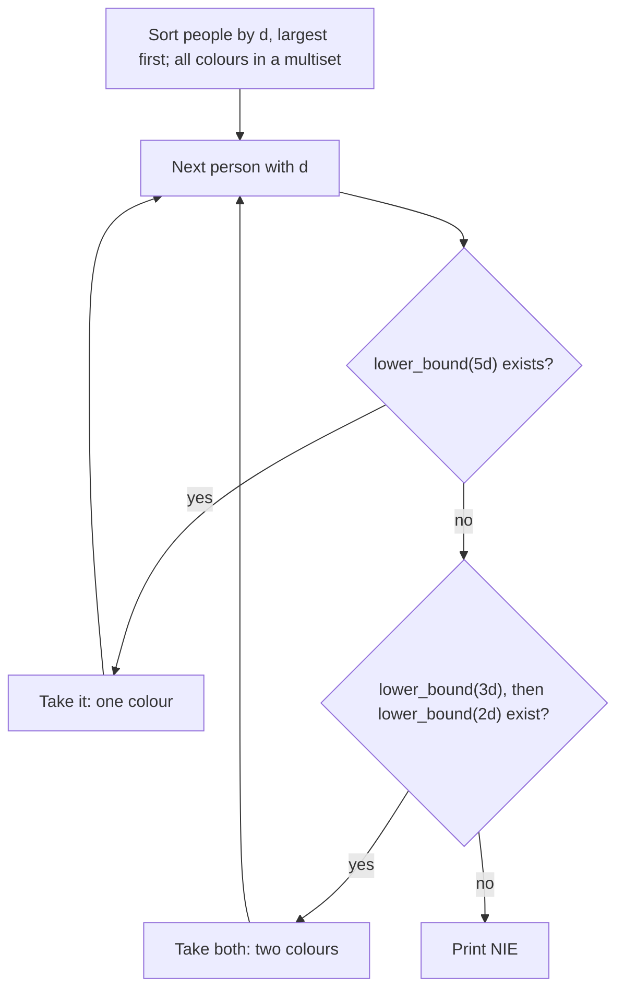

# AMPPZ 2011 F - Frania

> [!info] Karta zadania
> - Treść: `201X/2011/F/F.pdf` ([PDF na GitHubie](../../../201X/2011/F/F.pdf)); pamięć 128 MB, limitu czasu treść nie
>   podaje. Tekst PDF ma zepsute czcionki we wzorach: limity czytaj z obrazu strony.
> - Technika: zachłanne (najtrudniejszy pierwszy, najmniejszy pasujący), `multiset::lower_bound`, test z brute force.
>   Trudność: 3/5 (rozwiązały 24 z 55 drużyn, 135 zgłoszeń).
> - Kod: [f-frania.cpp](f-frania.cpp). Złożoność: O((n + k) log(n + k)).
> - Dzień kursu: [Dzień 5](../../dni/05-wyszukiwanie-binarne.md), zadanie omówione.

## Treść w skrócie

Jest n przyjaciół i k kolorów klamerek (2 ≤ n, k ≤ 10⁶). Przyjaciel i zbierał pranie przez dᵢ dni (dᵢ ≤ 10⁶), czyli ma
2dᵢ skarpetek (klamerka na skarpetkę) i dᵢ koszulek (trzy klamerki na koszulkę). Wszystkie skarpetki jednej osoby
wiszą na klamerkach jednego koloru, wszystkie jej koszulki też; może to być ten sam kolor. Dwie osoby nie dzielą koloru.
Kolorów j jest lⱼ klamerek (lⱼ ≤ 4 · 10⁶). Ile najmniej kolorów trzeba użyć? Jeśli się nie da, wypisz NIE.

## Zanim przeczytasz dalej

30 minut. Przykład: d = 3, 4 i kolory 20, 10, 8, 10, odpowiedź 3 (druga osoba bierze 20 na wszystko, pierwsza 10
i 8). Najpierw zapisz, czego potrzebuje jedna osoba, potem zastanów się, kogo obsłużyć najpierw i jaki kolor mu dać.

> [!tip]- Podpowiedź 1
> Osoba z d dniami potrzebuje jednego koloru z co najmniej 5d klamerkami albo dwóch kolorów: co najmniej 3d i co
> najmniej 2d. Obsłuż najpierw osobę o największym d: jej wymagania są najtrudniejsze, a każdy kolor, który pasuje
> mniejszym, pasowałby i jej.

> [!tip]- Podpowiedź 2
> Dawaj zawsze najmniejszy kolor, który wystarcza (duże zostają dla następnych), i łącz w jeden kolor, gdy tylko się
> da. "Najmniejszy element ≥ x" w zbiorze, z którego usuwasz, to `multiset::lower_bound`. Zanim zaufasz zachłanności,
> porównaj ją z brute force na małych danych.

## Droga myślenia

1. **Wymagania osoby.** 2d klamerek na skarpetki i 3d na koszulki. Jeden kolor wystarcza, gdy ma co najmniej 5d;
   inaczej dwa różne kolory, co najmniej 3d i co najmniej 2d.
2. **Kolejność: najtrudniejszy pierwszy.** Sortujemy osoby malejąco po d. Każde wymaganie późniejszej osoby (5d', 3d',
   2d') jest nie większe niż odpowiednie wymaganie wcześniejszej, więc wcześniejsza nigdy nie zabiera koloru, którego
   późniejsza potrzebowałaby bardziej.
3. **Który kolor: najmniejszy pasujący.** Gdy kilka kolorów wystarcza, bierzemy najmniejszy: większe mogą się przydać
   komuś później, a mniejszy nikomu nie przyda się bardziej niż teraz.
4. **Łączyć czy dzielić: łączyć, gdy się da.** Jeśli istnieje kolor ≥ 5d, osoba dostaje jeden kolor (najmniejszy taki),
   w przeciwnym razie najmniejszy ≥ 3d i najmniejszy ≥ 2d spośród pozostałych. Brak koloru: NIE.
5. **Dowód przez wymianę (szkic).** Niech P ma największe d, a O to dowolne najlepsze przydzielenie.
   - Jeśli istnieje kolor ≥ 5d, zachłanność daje P najmniejszy taki kolor c. Gdy O daje P inny pojedynczy kolor c',
     zamieniamy c z c' (kto miał c, dostaje c' ≥ c). Gdy O dzieli P na u ≥ 3d i v ≥ 2d, kolor c ktoś w O używa (inaczej
     P na samym c oszczędziłby kolor). Ma go osoba Q o dQ ≤ d. Jeśli Q ma tylko c, dajemy Q parę u, v (u ≥ 3d ≥ 3dQ,
     v ≥ 2d ≥ 2dQ), a P samo c: liczba kolorów bez zmian. Jeśli c jest jednym z dwóch kolorów Q, zastępujemy go u albo
     v, a drugi zwalniamy: kolorów jest mniej.
   - Jeśli koloru ≥ 5d nie ma, każde rozwiązanie dzieli P, a te same zamiany zmieniają parę z O na parę zachłanną.
   Po ustaleniu P zostaje to samo zadanie z mniejszą liczbą osób i kolorów (indukcja). Ten sam argument pokazuje, że
   gdy zachłanność mówi NIE, rozwiązania nie ma.
6. **Sprawdzenie brute force.** Dowody zachłanności łatwo zepsuć jednym przypadkiem, więc rozwiązanie porównujemy
   z przeszukaniem wszystkich przydziałów na małych danych (sekcja 3 Dnia 5). Ten sam harness od razu łapie błędną
   kolejność: przy obsłudze od najmniejszego d osoby 2 i 3 z kolorami 6, 14, 5, 8 dostają NIE, bo osoba 2 zabiera 14 na
   jeden kolor, a osobie 3 nie zostaje kolor ≥ 9. Poprawna odpowiedź to 4 (osoba 3: 14 i 6, osoba 2: 8 i 5).



Jak czytać diagram: każda osoba przechodzi przez dwa pytania do zbioru kolorów. `lower_bound(x)` zwraca najmniejszy
kolor z co najmniej x klamerkami, czyli dokładnie "najmniejszy pasujący"; wzięty kolor usuwamy ze zbioru, więc nikt
inny go nie dostanie. Pętla kończy się po ostatniej osobie (wynik to suma użytych kolorów) albo na pierwszym braku.

## Rozwiązanie

```cpp
multiset<int> pegs;                            // colours still free
sort(d.rbegin(), d.rend());                    // largest demand first
auto take = [&](long long need) {              // smallest colour with at least need pegs
    auto it = pegs.lower_bound((int)min(need, (long long)INT_MAX));
    if (it == pegs.end()) return false;
    pegs.erase(it);                            // erase one copy, not all equal values
    return true;
};
long long colours = 0;
for (int x : d) {
    if (take(5LL * x)) { colours += 1; continue; }
    if (!take(3LL * x) || !take(2LL * x)) { puts("NIE"); return 0; }
    colours += 2;
}
printf("%lld\n", colours);
```

Pełny program: [f-frania.cpp](f-frania.cpp).

## Złożoność i optymalność

- Sortowanie osób O(n log n), wstawienie kolorów do `multiset` O(k log k), najwyżej 3n zapytań `lower_bound` i usunięć
  po O(log k). Razem O((n + k) log(n + k)), pamięć O(n + k).
- Omówienie jury (AMPPZ 2011) podaje ten sam algorytm: osoby nierosnąco po d, liczby klamerek w zbiorze, kolor ≥ 5d
  o najmniejszej liczbie klamerek, a gdy go nie ma, najmniejsze kolory ≥ 3d i ≥ 2d. Złożoność jury O(n log n).
- Czas zajmują sortowanie i zapytania o najmniejszy pasujący kolor, po log na każde. Mniejszą stałą (przy tej samej
  złożoności) daje posortowana tablica kolorów i "następny wolny indeks" w strukturze find-union (`lower_bound`
  w tablicy, potem skok do najbliższego niewziętego), bo `multiset` z milionem węzłów jest wolny przez alokacje.

## Pułapki

- **`set` zamiast `multiset`:** liczby klamerek często się powtarzają (w przykładzie dwa razy 10). `set` zgubiłby
  kolory, a `pegs.erase(5)` w `multiset` usuwa wszystkie piątki; usuwaj przez iterator.
- **Kolejność od najmniejszego d:** kontrprzykład wyżej. Ogólna zasada: najpierw ten, komu najtrudniej dogodzić.
- **Największy pasujący zamiast najmniejszego:** zabiera duże kolory osobom, które przyjdą później.
- **Skarpetki to pary:** d dni to 2d skarpetek, więc 2d klamerek, a nie d. Wyjaśnienie przykładu w treści (6 i 9 dla
  d = 3) pozwala to sprawdzić przed pisaniem.

## Weryfikacja

- Kompilacja `g++ -std=c++17 -O2 -Wall -Wextra` bez ostrzeżeń, oba przykłady z treści poprawne (3 i NIE).
- 1500 testów losowych (n do 4, k do 7, d do 2, 4 albo 10, liczby klamerek do 5 · max d + 2, więc dużo remisów
  i przypadków NIE), porównanych z brute force, który przegląda każdy przydział jednego koloru albo uporządkowanej pary
  kolorów każdej osobie. Wszystkie zgodne. Wersja z kolejnością rosnącą odpada na teście opisanym w drodze myślenia.
- Testy maksymalne: n = k = 10⁶ (prawie wszyscy na jednym kolorze) 1,4 s oraz n = 5 · 10⁵, k = 10⁶ (wszyscy na dwóch
  kolorach) 1,3 s, w tym ok. 0,4 s samo czytanie 2 · 10⁶ liczb na Windows.

## Wspólny mianownik

**Przydział zasobów do żądań: najtrudniejsze żądanie pierwsze, najmniejszy pasujący zasób.** Ten szablon (sortowanie
żądań i `lower_bound` w `multiset` zasobów) wraca w CSES Concert Tickets i w każdym zadaniu "przypisz pokoje, bilety,
maszyny". Dowód to wymiana, a gdy go nie widać, test z brute force na małych danych.
