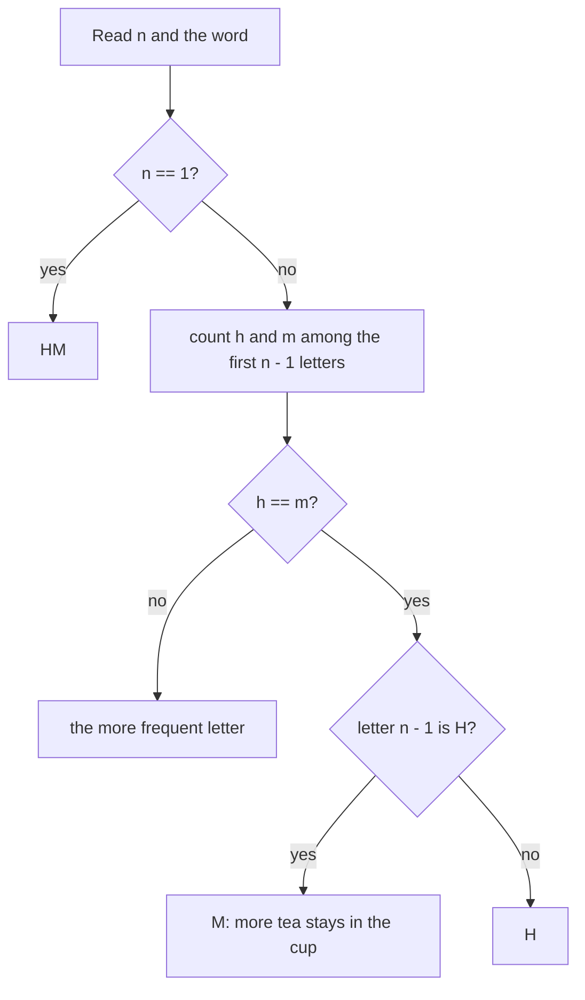

# AMPPZ 2011 H - Herbata z mlekiem

> [!info] Karta zadania
> - Treść: `201X/2011/H/H.pdf` ([PDF na GitHubie](../../../201X/2011/H/H.pdf)); pamięć 32 MB, limitu czasu treść nie
>   podaje.
> - Technika: matematyka: rachunek na ułamkach zamieniony na zliczanie liter, rozstrzygnięcie remisu przez największy
>   składnik. Trudność: 2 (rozwiązały 38 z 55 drużyn).
> - Kod: [h-herbata-z-mlekiem.cpp](h-herbata-z-mlekiem.cpp). Złożoność: O(n).
> - Dzień kursu: [Dzień 8](../../dni/08-grafy-1.md), zadanie bez etykiety (technika z Dnia 6).

## Treść w skrócie

Filiżanka jest pełna: pół herbaty, pół mleka. Dla każdej litery słowa długości n (n ≤ 10⁵, litery H i M) wypija się
połowę zawartości i dolewa do pełna herbaty (H) albo mleka (M). Na końcu resztę się wylewa. Czego wypito więcej:
wypisz H, M albo HM przy równości.

## Zanim przeczytasz dalej

20 minut. Przykład: HMHHM daje H (wypito 1 37/64 filiżanki herbaty i 59/64 mleka). Przelicz na kartce słowa H, M, HM
i MH, zanim zaczniesz pisać. Ułamki mają mianownik 2ⁿ, więc dla n = 10⁵ nie zmieszczą się w żadnym typie.

> [!tip]- Podpowiedź 1
> Co się dzieje z ostatnią dolewką? Ile w sumie płynu wypito i ile każdego składnika do filiżanki trafiło?

> [!tip]- Podpowiedź 2
> Herbaty wypito tyle, ile jej wlano, minus to, co zostało w filiżance na końcu. Ile najwyżej może jej zostać?

## Droga myślenia

1. **Symulacja na ułamkach odpada:** udział herbaty po i krokach ma mianownik 2ⁱ⁺¹, a `double` po ok. 50 krokach gubi
   różnicę między "więcej" i "tyle samo".
2. **Bilans zamiast symulacji.** Ostatniej dolewki nikt nie pije, więc ją pomijamy. Niech h i m to liczby liter H i M
   wśród pierwszych n - 1. Do filiżanki (bez ostatniej dolewki) trafiło (h + 1)/2 herbaty i (m + 1)/2 mleka. Wypito
   wszystko poza połową filiżanki, która zostaje po ostatnim piciu; niech r to herbata w tej połowie (0 < r < 1/2).
   Herbaty wypito (h + 1)/2 - r, mleka (m + 1)/2 - (1/2 - r).
3. **Różnica:** herbata - mleko = (h - m)/2 + (1/2 - 2r), a drugi składnik leży w przedziale (-1/2, 1/2).
4. **Rozstrzygnięcie.** Gdy h ≠ m, |h - m|/2 ≥ 1/2 przeważa, więc wygrywa liczniejsza litera. Gdy h = m, decyduje r.
   Połówka, która zostaje, to w 1/4 filiżanki dolewka nr n - 1, w 1/8 dolewka nr n - 2 itd.: największy kawałek
   pochodzi z przedostatniej dolewki i przeważa nad sumą wszystkich mniejszych. Jeśli była to herbata, więcej herbaty
   zostało, więc wypito więcej mleka (M), i odwrotnie.
5. **n = 1:** brak dolewek przed ostatnią, wypito po 1/4: HM. Dla n ≥ 2 remisu nie ma nigdy.



Jak czytać diagram: ostatnią literę ignorujemy, bo jej dolewka jest wylewana. Liczba liter decyduje, bo każda dolewka
to 1/2 filiżanki, a reszta w filiżance waży mniej niż 1/2. Przy remisie patrzymy na resztę: jej największy kawałek
(1/4) pochodzi z przedostatniej dolewki.

Przykład: HMHHM, pierwsze cztery litery HMHH dają h = 3, m = 1, więc H.

## Rozwiązanie

```cpp
string solve(const string& s) {
    int n = s.size();
    if (n == 1) return "HM";                       // drank 1/4 of each
    int h = 0, m = 0;
    for (int i = 0; i + 1 < n; i++) (s[i] == 'H' ? h : m)++;
    if (h != m) return h > m ? "H" : "M";
    return s[n - 2] == 'H' ? "M" : "H";            // more tea left in the cup, so less drunk
}
```

Pełny program: [h-herbata-z-mlekiem.cpp](h-herbata-z-mlekiem.cpp).

## Złożoność i optymalność

- O(n) czasu i pamięci na słowo; wczytanie słowa i tak kosztuje O(n), więc szybciej się nie da.
- Omówienie jury (AMPPZ 2011, MIMUW) prowadzi tym samym rozumowaniem: pomijamy ostatnią dolewkę, porównujemy h i m,
  przy remisie decyduje przedostatnia litera (H daje M), a n = 1 daje HM. Statystyka ze slajdów: 181 zgłoszeń, 38 z 55
  drużyn z akceptacją, czyli sporo odrzuceń (prawdopodobne przyczyny: symulacja na `double`, pominięty przypadek
  n = 1).

## Pułapki

- **Symulacja na liczbach zmiennoprzecinkowych:** przy remisie różnica to ok. 2⁻ⁿ, poniżej precyzji `double` już dla
  n ≈ 55.
- **Ostatnia litera:** jej dolewki nikt nie pije; kto ją liczy, myli się przy remisie.
- **n = 1:** jedyny przypadek równości.

## Weryfikacja

- Kompilacja `g++ -std=c++17 -O2 -Wall -Wextra` bez ostrzeżeń, przykład z treści poprawny (H).
- Test wyczerpujący jednym procesem (sterownik dołącza plik rozwiązania): ceremonia z treści liczona dokładnie na
  liczbach całkowitych (objętość filiżanki 2ⁿ⁺¹, w typie `__int128`) dla wszystkich słów długości 1-20 i 200 000
  losowych słów długości 21-60 (co trzecie z wymuszonym remisem h = m), razem 2 297 150 słów: wszystkie zgodne.
- Test maksymalny n = 10⁵: poniżej 0,05 s.

## Wspólny mianownik

**Zamiast symulować wielkość, której nie da się zapisać, policz bilans i oszacuj resztę.** Duże składniki (tu dolewki
po 1/2) rozstrzygają, a reszta jest mniejsza od jednego składnika; przy remisie decyduje największy kawałek reszty, bo
1/4 > 1/8 + 1/16 + ... Ten sam ruch to porównywanie liczb dwójkowych od najstarszego bitu i argument "2ᵏ > suma
wszystkich mniejszych potęg".
