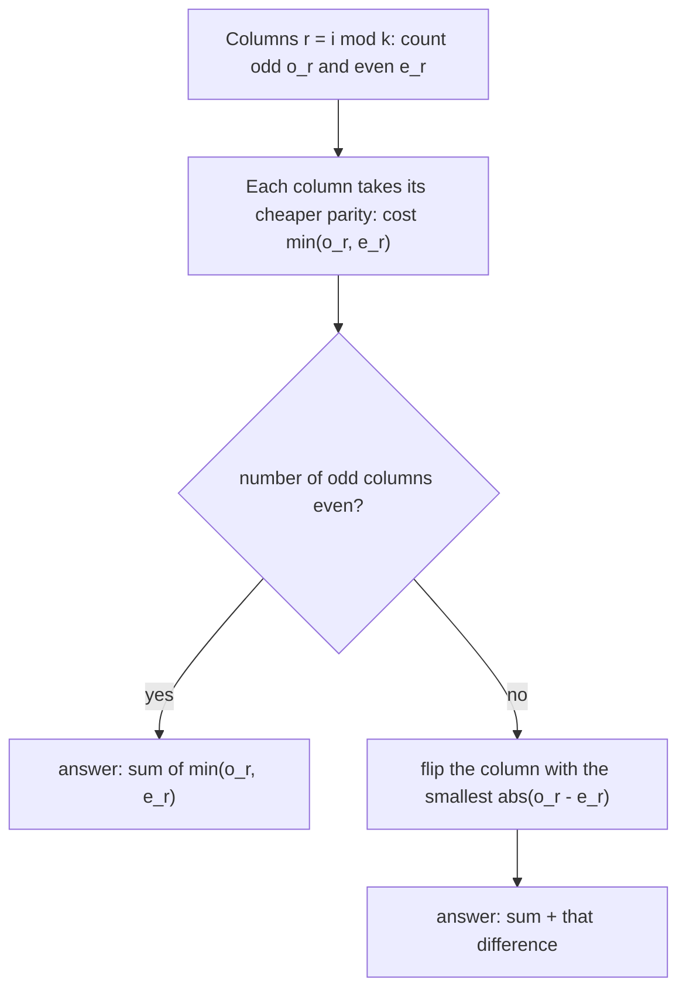

# AMPPZ 2012 C - Ciąg

> [!info] Karta zadania
> - Treść: `201X/2012/C/C.pdf` ([PDF na GitHubie](../../../201X/2012/C/C.pdf)); pamięć 128 MB, limitu czasu treść nie
>   podaje.
> - Technika: parzystość, klasy reszt modulo k, wybór zachłanny z jedną poprawką. Trudność: 3/5 (rozwiązało 28 z 54
>   drużyn).
> - Kod: [c-ciag.cpp](c-ciag.cpp). Złożoność: O(n).
> - Dzień kursu: [Dzień 6](../../dni/06-matematyka.md), ćwiczenie (wyzwanie).

## Treść w skrócie

Ciąg jest k-parzysty, gdy każdy jego spójny fragment długości k ma parzystą sumę. Dla ciągu n liczb (1 ≤ k ≤ n ≤ 10⁶,
wartości od 0 do 10⁹) policz, ile najmniej wyrazów trzeba zmienić (na dowolne liczby całkowite), żeby stał się
k-parzysty.

## Zanim przeczytasz dalej

40 minut. Przykłady: 1 2 3 4 5 6 7 8 przy k = 3 daje 3, a 2 4 2 4 2 4 2 4 daje 0. Zmiana jednego wyrazu psuje albo
naprawia nawet k fragmentów naraz, więc liczenie "zepsutych fragmentów" prowadzi donikąd. Porównaj dwa sąsiednie
fragmenty.

> [!tip]- Podpowiedź 1
> Fragmenty [i, i + k - 1] i [i + 1, i + k] mają k - 1 wspólnych wyrazów. Co musi zachodzić między aᵢ i aᵢ₊ₖ, żeby
> oba miały parzystą sumę?

> [!tip]- Podpowiedź 2
> aᵢ i aᵢ₊ₖ mają tę samą parzystość, więc wszystkie wyrazy o tej samej reszcie pozycji modulo k mają wspólną parzystość.
> Ustaw je w tabelę o k kolumnach. Jaki warunek zostaje dla pierwszego wiersza?

## Droga myślenia

1. **Liczy się tylko parzystość.** Suma jest parzysta, gdy nieparzystych składników jest parzyście wiele, a zmieniony
   wyraz może dostać dowolną parzystość. Ciąg zamieniamy na zera i jedynki.
2. **Sąsiednie fragmenty.** Suma fragmentu od i + 1 to suma fragmentu od i minus aᵢ plus aᵢ₊ₖ. Obie są parzyste
   wtedy i tylko wtedy, gdy pierwsza jest parzysta i aᵢ ≡ aᵢ₊ₖ (mod 2). Indukcja w drugą stronę: jeśli pierwszy fragment
   jest parzysty i każde aᵢ ma parzystość aᵢ₊ₖ, to wszystkie fragmenty są parzyste.
3. **Klasy reszt.** Pozycje i ≡ r (mod k) tworzą klasę (kolumnę tabeli o k kolumnach). W każdej klasie wszystkie wyrazy
   mają mieć jedną parzystość pᵣ. Pierwszy fragment zawiera dokładnie jeden wyraz z każdej klasy, więc warunek na niego
   to: liczba klas z pᵣ = 1 jest parzysta.
4. **Koszt klasy.** Niech klasa r ma oᵣ wyrazów nieparzystych i eᵣ parzystych. Wybór pᵣ = 0 kosztuje oᵣ zmian, wybór
   pᵣ = 1 kosztuje eᵣ. Bez warunku parzystości bierzemy w każdej klasie tańszą możliwość: suma min(oᵣ, eᵣ).
5. **Jedna poprawka.** Jeśli klas nieparzystych wyszło nieparzyście wiele, któraś klasa musi dostać droższą parzystość.
   Zmiana wyboru w klasie r kosztuje dodatkowo |oᵣ - eᵣ|. Każdy poprawny wybór różni się od zachłannego w nieparzystej
   liczbie klas, a każda różnica kosztuje |oᵣ - eᵣ| ≥ 0, więc wystarcza zmienić jedną klasę: tę z najmniejszym |oᵣ - eᵣ|.



Jak czytać diagram: tabela o k kolumnach zamienia warunek na wszystkie fragmenty w dwa proste warunki: kolumna ma
jedną parzystość, a w pierwszym wierszu jest parzyście wiele jedynek. Najpierw każda kolumna wybiera tańszą parzystość
niezależnie od innych. Drugi warunek psuje najwyżej jedno: wtedy najtańsza zmiana decyzji w jednej kolumnie.

Przykład: 1 2 3 4 5 6 7 8, k = 3. Kolumny: {1, 4, 7} (o = 2, e = 1, tańsza nieparzysta, koszt 1), {2, 5, 8} (o = 1,
e = 2, parzysta, koszt 1), {3, 6} (o = 1, e = 1, remis, parzysta, koszt 1). Klas nieparzystych jest 1, czyli
nieparzyście wiele; najmniejsze |o - e| = 0 w trzeciej kolumnie, więc poprawka nic nie kosztuje. Wynik 3.

## Rozwiązanie

```cpp
vector<int> odd(k, 0), total(k, 0);
for (int i = 0; i < n; i++) {
    ll a;
    cin >> a;
    odd[i % k] += a % 2;
    total[i % k]++;
}

ll changes = 0;
int oddClasses = 0, fix = INT_MAX;
for (int r = 0; r < k; r++) {
    int o = odd[r], e = total[r] - odd[r];
    changes += min(o, e);                      // make the class all odd or all even, cheaper way
    if (o > e) oddClasses++;
    fix = min(fix, abs(o - e));                // extra cost of choosing the other parity here
}
if (oddClasses % 2 == 1) changes += fix;       // the first window must hold an even number of odd values
```

Pełny program: [c-ciag.cpp](c-ciag.cpp).

## Złożoność i optymalność

- O(n) czasu i O(k) pamięci: jedno przejście po ciągu i jedno po klasach. Szybciej się nie da, bo każdy wyraz trzeba
  przeczytać.
- Omówienie jury (AMPPZ 2012, MIMUW) prowadzi tą samą drogą: wyrazy aᵢ i aᵢ₊ₖ tej samej parzystości, kolumny tabeli,
  w każdej min(pᵢ, nᵢ) zmian, a przy nieparzystej sumie pierwszego wiersza poprawka w kolumnie o najmniejszym
  max - min. Czas O(n).

## Pułapki

- **Remis w kolumnie** (o = e): obojętne, którą parzystość wybierzesz, ale wtedy poprawka kosztuje 0. Kod liczy ją
  przez |o - e| bez osobnego przypadku.
- **k = n:** jedna "kolumna" na wyraz, tylko jeden fragment; wynik to 0 albo 1. **k = 1:** każdy wyraz musi być
  parzysty; wynik to liczba nieparzystych.
- **Liczenie zepsutych fragmentów** i naprawianie zachłanne od lewej daje złe wyniki: jedna zmiana dotyczy k fragmentów.
- **Szybkie wejście:** 10⁶ liczb, `cin` z `sync_with_stdio(false)`.

## Weryfikacja

- Kompilacja `g++ -std=c++17 -O2 -Wall -Wextra` bez ostrzeżeń, oba przykłady z treści poprawne (3 i 0).
- 1500 testów losowych (n od 1 do 12, k = 1, k = n albo losowe, wartości do 1, do 9 albo do 10⁹) porównanych z brute
  force, który przegląda wszystkie 2ⁿ ciągi parzystości, zostawia te z parzystymi fragmentami i liczy różnice
  z wejściem. Wszystkie zgodne.
- Test maksymalny: n = 10⁶, wartości do 10⁹, k = 1, 2, 1000, 5 · 10⁵, 10⁶: 0,19-0,23 s.

## Wspólny mianownik

**Porównaj dwa sąsiednie okna: różnią się jednym wyrazem z każdego końca.** Warunek "każde okno długości k" zamienia
się w warunek na pary aᵢ, aᵢ₊ₖ, a te dzielą pozycje na k klas reszt modulo k (kolumny tabeli). Potem **wybór zachłanny
w każdej klasie i jedna najtańsza poprawka**, gdy zostaje warunek parzystości na liczbę wyborów.
