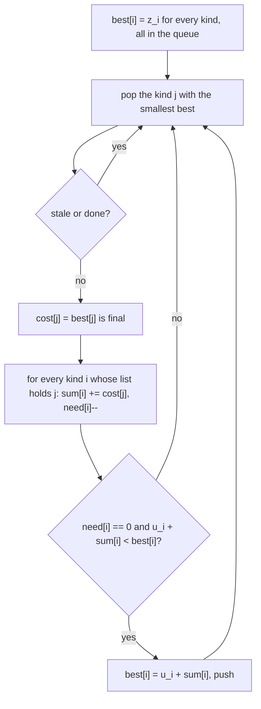

# AMPPZ 2012 H - Hydra

> [!info] Karta zadania
> - Treść: `201X/2012/H/H.pdf` ([PDF na GitHubie](../../../201X/2012/H/H.pdf)); pamięć 128 MB, limitu czasu treść nie
>   podaje.
> - Technika: najkrótsze ścieżki: uogólniony Dijkstra (koszt wierzchołka z kosztów innych, zależności cykliczne).
>   Trudność: 2 (34 z 54 drużyn).
> - Kod: [h-hydra.cpp](h-hydra.cpp). Złożoność: O(n log n + R), R = suma długości list.
> - Dzień kursu: [Dzień 9](../../dni/09-grafy-2.md), zadanie omówione.

## Treść w skrócie

Hydra ma n ≤ 2 · 10⁵ rodzajów głów, na początku jedną głowę rodzaju 1. Głowę rodzaju i można zmasakrować za z_i
machnięć (znika na dobre) albo uciąć za u_i machnięć (1 ≤ u_i < z_i ≤ 10⁹), ale wtedy na jej miejsce odrastają głowy
z listy rodzaju i (lista niepusta, rodzaje mogą się powtarzać, suma długości list do 10⁶). Ile najmniej machnięć trzeba,
żeby hydra nie miała żadnej głowy?

## Zanim przeczytasz dalej

35 minut. Przykład z treści: n = 4; rodzaj 1: u = 4, z = 27, odrastają 2, 3, 2; rodzaj 2: u = 3, z = 5, odrasta 2; rodzaj 3:
u = 1, z = 13, odrastają 4, 2; rodzaj 4: u = 5, z = 6, odrasta 2. Wynik 26. Policz go ręcznie, zanim zaczniesz myśleć
o algorytmie.

> [!tip]- Podpowiedź 1
> Głowy nie wpływają na siebie nawzajem. Niech koszt[i] to najmniejsza liczba machnięć, żeby pozbyć się jednej głowy
> rodzaju i razem ze wszystkim, co z niej odrośnie. Zapisz wzór na koszt[i].

> [!tip]- Podpowiedź 2
> koszt[i] = min(z_i, u_i + suma koszt[j] po liście i). Zależności mają cykle (rodzaj 2 odrasta sam z siebie), więc
> zwykła rekurencja się zapętli. Który rodzaj ma koszt znany od razu? Pomyśl o tym, który wierzchołek Dijkstra zamyka
> jako pierwszy.

## Droga myślenia

1. **Głowy są niezależne.** Każdą głowę zabija się osobno i jej koszt zależy tylko od rodzaju:
   koszt[i] = min(z_i, u_i + Σ koszt[j]), suma po liście rodzaju i z powtórzeniami. Wynik to koszt[1].
2. **Cykle.** Rekurencja z pamięcią zapętla się (2 → 2), a iterowanie wzoru aż do stabilizacji jest poprawne, ale
   może potrzebować n rund po O(n + R): za wolno.
3. **Kolejność jak w Dijkstrze.** Niech każdy rodzaj ma wartość tymczasową: na starcie z_i, a gdy wszystkie rodzaje z jego
   listy są już ostateczne, także u_i + suma ich kosztów. Rodzaj o najmniejszej wartości tymczasowej spośród
   nieostatecznych jest ostateczny: masakra każdego innego nieostatecznego kosztuje co najmniej tyle, a ucięcie
   rodzaju, którego lista zawiera nieostateczny rodzaj j, kosztuje więcej niż koszt[j] (bo u ≥ 1), czyli więcej niż
   minimum. To ten sam argument, co "najmniejszy w kolejce jest ostateczny" z Dnia 9, tylko relaksacja to suma.
4. **Implementacja.** Odwrócone listy (dla j: rodzaje, które go odrastają, z powtórzeniami), licznik need[i] rodzajów
   z listy i, które nie są jeszcze ostateczne, i suma sum[i] ich kosztów. Po zamknięciu j każdy rodzaj i z odwróconej
   listy dostaje sum[i] += koszt[j]; gdy need[i] spadnie do 0, kandydat u_i + sum[i] wchodzi do kolejki.



Jak czytać diagram: to Dijkstra, w którym "krawędź" prowadzi od rodzaju j do rodzajów, które go odrastają, a nowa
wartość pojawia się dopiero wtedy, gdy znane są koszty całej listy (need[i] = 0). Rodzaj na własnej liście jest już
ostateczny, gdy jego wpis się pojawia, więc pętla go pomija.

Przykład z treści, krok po kroku (wartości na starcie: 27, 5, 13, 6):

| Zamknięty | Co się dzieje | best[1..4] |
|---|---|---|
| 2 (5) | rodzaj 1: dwa wystąpienia, sum = 10, need 3 → 1; rodzaj 3: sum = 5, need → 1; rodzaj 4: need → 0, kandydat 5 + 5 = 10 > 6 | 27, 5, 13, 6 |
| 4 (6) | rodzaj 3: sum = 11, need → 0, kandydat 1 + 11 = 12 < 13 | 27, 5, 12, 6 |
| 3 (12) | rodzaj 1: sum = 22, need → 0, kandydat 4 + 22 = 26 < 27 | 26, 5, 12, 6 |
| 1 (26) | koniec, wynik 26 | |

## Rozwiązanie

```cpp
for (int i = 0; i < n; i++) pq.push({best[i], i});   // best[i] = z_i at the start
while (!pq.empty()) {
    auto [c, j] = pq.top(); pq.pop();
    if (done[j] || c != best[j]) continue;     // stale entry
    done[j] = 1;                               // cost[j] = best[j] is final
    for (int p = start[j]; p < start[j + 1]; p++) {
        int i = rev[p];                        // head i regrows head j
        if (done[i]) continue;                 // also skips j growing back on itself
        sum[i] += best[j];
        if (--need[i] == 0 && u[i] + sum[i] < best[i]) {
            best[i] = u[i] + sum[i];
            pq.push({best[i], i});
        }
    }
}
cout << best[0] << "\n";
```

Pełny program: [h-hydra.cpp](h-hydra.cpp). Odwrócone listy leżą w jednej tablicy (zliczanie po rodzaju, jak
w [2015 B](../2015/b-bogacze.md)), bo 10⁶ wystąpień w `vector<vector<int>>` to niepotrzebne alokacje.

## Złożoność i optymalność

- Kolejka ma najwyżej n + n wpisów (start i co najwyżej jedna poprawa na rodzaj), każde wystąpienie na liście jest
  przetwarzane raz: O(n log n + R) czasu, O(n + R) pamięci. Wczytanie danych to Ω(n + R).
- Omówienie jury (AMPPZ 2012, MIMUW, slajdy w web.archive.org) ma ten sam wzór i inną, ale równoważną kolejność:
  fazy, w których rodzaj o najmniejszym z_i spośród nieobliczonych dostaje koszt z_i, a potem obliczane są wzorem
  wszystkie rodzaje, których cała lista jest już obliczona (przejście po grafie odwróconym). Wystarcza sortowanie po z
  i zwykła kolejka, O(n log n + Σ r_i), czyli ta sama złożoność. Statystyka ze slajdów: 70 zgłoszeń, zaakceptowane
  przez 34 z 54 drużyn.

## Pułapki

- **Rekurencja z pamięcią:** zapętla się na cyklu, a przy łańcuchu 2 · 10⁵ rodzajów przepełnia stos.
- **Powtórzenia na liście:** lista 2, 3, 2 to dwie głowy rodzaju 2, więc koszt[2] liczy się dwa razy, a need[1] = 3.
- **Rodzaj odrasta sam z siebie:** ucięcie, po którym odrasta ta sama głowa, nigdy się nie opłaca; kod pomija rodzaj
  już ostateczny.
- **Zakres:** suma kosztów listy to do 10⁶ · 10⁹ = 10¹⁵, więc `long long`. Sam wynik nie przekracza z_1 ≤ 10⁹.

## Weryfikacja

- Kompilacja `g++ -std=c++17 -O2 -Wall -Wextra` bez ostrzeżeń, przykład z treści daje 26.
- 1500 testów losowych (n od 1 do 6, listy długości 1-3 z powtórzeniami i rodzajami odrastającymi z siebie, u od 1 do 8,
  z od u + 1 do 20) porównanych z brute force, który przegląda wszystkie 2ⁿ wyborów "tnij albo masakruj" dla rodzajów,
  liczy machnięcia rekurencją od rodzaju 1 i odrzuca wybory, w których ucinane rodzaje odrastają w kółko. Wszystkie
  zgodne.
- Testy maksymalne, n = 2 · 10⁵, suma list 10⁶: losowe 0,33 s; łańcuch, w którym każdy rodzaj odrasta jako 5 głów
  następnego (wynik 10⁹), 0,25 s.

## Wspólny mianownik

**Wartość wierzchołka z wartości innych, z cyklami: zamykaj najmniejszy.** Jeśli wartość nigdy nie jest mniejsza od
wartości, z których powstaje (koszt części plus dodatnia opłata), to najmniejsza wartość tymczasowa jest ostateczna,
a resztę liczy kolejka jak w Dijkstrze. Zwykła najkrótsza ścieżka to szczególny przypadek: wartość = wartość
poprzednika + waga krawędzi.
