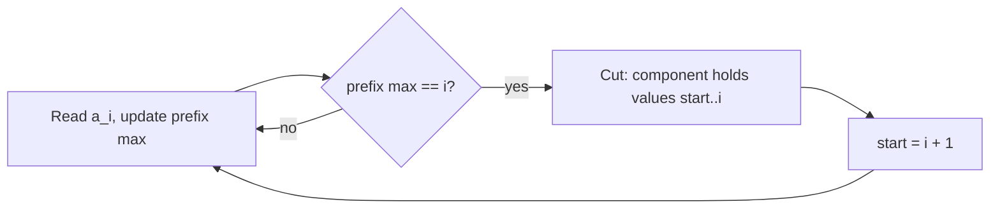

# AMPPZ 2012 I - Inwersje

> [!info] Karta zadania
> - Treść: `201X/2012/I/I.pdf` ([PDF na GitHubie](../../../201X/2012/I/I.pdf)); pamięć 128 MB, limitu czasu treść nie
>   podaje.
> - Technika: maksimum prefiksu (prefiks jako zbiór wartości), spójne składowe bez budowania grafu. Trudność: 2/5
>   (rozwiązało 39 z 54 drużyn).
> - Kod: [i-inwersje.cpp](i-inwersje.cpp). Złożoność: O(n).
> - Dzień kursu: [Dzień 4](../../dni/04-prefiksy-dwa-wskazniki.md), ćwiczenie.

## Treść w skrócie

Dana jest permutacja a₁, ..., aₙ liczb od 1 do n (n ≤ 10⁶). Wierzchołki aᵢ i aⱼ grafu łączy krawędź, gdy (i, j) jest
inwersją: i < j oraz aᵢ > aⱼ. Wypisz spójne składowe grafu: ich liczbę, a potem każdą jako rozmiar i rosnącą listę
wierzchołków, składowe w kolejności najmniejszych wierzchołków.

## Zanim przeczytasz dalej

20 minut. Ile krawędzi może mieć ten graf przy n = 10⁶? Narysuj kilka permutacji (2 3 1 4, 3 1 2 5 4, 1 2 3) i ich
składowe. Jaki kształt mają składowe?

> [!tip]- Podpowiedź 1
> Krawędzi jest tyle, ile inwersji, czyli do n(n - 1)/2 ≈ 5 · 10¹¹: grafu nie wolno budować. W przykładach składowe to
> zawsze spójne kawałki ciągu. Kiedy między pozycją i a pozycją i + 1 nie ma żadnej krawędzi?

> [!tip]- Podpowiedź 2
> Między pierwszymi i pozycjami a resztą nie ma krawędzi dokładnie wtedy, gdy każda liczba z lewej jest mniejsza niż
> każda z prawej, czyli gdy pierwsze i liczb to dokładnie {1, ..., i}. Jak to sprawdzić jedną zmienną?

## Droga myślenia

1. **Grafu nie budujemy.** Inwersji jest do ok. 5 · 10¹¹. Trzeba zrozumieć kształt składowych.
2. **Cięcie.** Między prefiksem a₁..aᵢ a resztą nie ma krawędzi wtedy i tylko wtedy, gdy wszystkie liczby z lewej są
   mniejsze od wszystkich z prawej. W permutacji oznacza to, że prefiks zawiera dokładnie liczby 1..i, a to jest
   równoważne temu, że **maksimum prefiksu równa się i** (i różnych liczb od 1 z maksimum i to właśnie 1..i).
3. **Składowe to kawałki między cięciami.** Pokazujemy dwie rzeczy.
   - Składowa jest spójnym kawałkiem pozycji. Jeśli x < y < z i krawędź łączy pozycje x i z (aₓ > a_z), to a_y jest albo
     mniejsze od aₓ (krawędź x, y), albo większe od a_z (krawędź y, z). Każda krawędź "zagarnia" więc wszystkie pozycje
     między swoimi końcami, a składowa nie może mieć dziur.
   - Kawałek bez cięcia w środku jest jedną składową: gdyby rozpadał się na dwie składowe, to jako kawałki pozycji
     stałyby jedna za drugą, bez krawędzi między nimi, czyli w środku byłoby cięcie.
4. **Wartości.** Kawałek pozycji od l do r leży między dwoma cięciami, więc zawiera dokładnie liczby l..r. Składowa
   to wierzchołki l, l + 1, ..., r, już posortowane, a kolejne kawałki mają rosnące najmniejsze wierzchołki, czyli
   kolejność wypisywania jest za darmo.



Jak czytać diagram: jeden przebieg z bieżącym maksimum. Za każdym razem, gdy maksimum prefiksu równa się liczbie
przeczytanych elementów, kończy się składowa, a jej wierzchołki to kolejne liczby od początku kawałka do i.

Przykład: 2 3 1 4. Maksima prefiksów: 2, 3, 3, 4. Równość z i zachodzi dla i = 3 i i = 4: składowe {1, 2, 3} i {4}.

## Rozwiązanie

```cpp
vector<pair<int, int>> blocks;                 // [first, last] value of each component
int mx = 0, start = 1;
for (int i = 1; i <= n; i++) {
    int x;
    cin >> x;
    mx = max(mx, x);
    if (mx == i) {                             // prefix holds exactly 1..i
        blocks.push_back({start, i});
        start = i + 1;
    }
}
```

Wypisywanie: do 2 · 10⁶ liczb, więc całe wyjście składamy w jednym `string` i wypisujemy raz. Pełny program:
[i-inwersje.cpp](i-inwersje.cpp).

## Złożoność i optymalność

- O(n) czasu, O(liczba składowych) pamięci poza wyjściem. Optymalne: trzeba przeczytać wejście i wypisać n
  wierzchołków.
- Omówienie jury (AMPPZ 2012) podaje najpierw rozwiązanie ze stosem największych elementów składowych i find-union,
  w czasie O(n log* n) albo O(n log n), a potem prostsze: składowa to spójny fragment ciągu i spójny przedział numerów,
  więc zgłaszamy ją, gdy maksimum wczytanych elementów równa się ich liczbie, w czasie O(n). To jest rozwiązanie
  powyżej. Statystyki jury: 114 zgłoszeń, 39 zaakceptowanych drużyn.

## Pułapki

- **Budowanie grafu:** O(n²) krawędzi, czyli przekroczenie czasu i pamięci.
- **Wolne wyjście:** przy n = 10⁶ i permutacji identycznościowej jest 10⁶ składowych i ok. 10 MB tekstu. `endl`
  w pętli opróżnia bufor przy każdym z miliona wierszy; składanie w `string` (albo `'\n'` zamiast `endl`) daje 0,3 s.
- **Format:** w każdym wierszu najpierw rozmiar, potem wierzchołki; pierwszy wiersz to liczba składowych.

## Weryfikacja

- Kompilacja `g++ -std=c++17 -O2 -Wall -Wextra` bez ostrzeżeń, przykład z treści poprawny.
- 1500 testów losowych (n od 1 do 9; połowa to permutacje sklejone z przetasowanych bloków, żeby składowych było
  wiele), porównanych z brute force, który buduje wszystkie krawędzie inwersji i łączy wierzchołki find-union.
  Wszystkie zgodne.
- Testy maksymalne: n = 10⁶, permutacja identycznościowa (10⁶ składowych): 0,29 s; losowa (jedna składowa): 0,24 s.

## Wspólny mianownik

**Maksimum prefiksu jako test "prefiks to dokładnie 1..i".** W permutacji prefiks długości i zawiera liczby 1..i
wtedy i tylko wtedy, gdy jego maksimum to i. Ten sam test dzieli permutację na kawałki, które można sortować
niezależnie (ile kawałków można posortować osobno, żeby całość była posortowana), i rozpoznaje miejsca, w których
"nic nie przechodzi przez granicę".
