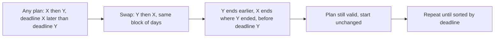

# AMPPZ 2012 J - Jutro

> [!info] Karta zadania
> - Treść: `201X/2012/J/J.pdf` ([PDF na GitHubie](../../../201X/2012/J/J.pdf)); pamięć 128 MB, limitu czasu treść nie
>   podaje.
> - Technika: zachłanne, sortowanie po terminie (najwcześniejszy termin najpierw), argument zamiany. Trudność: 1/5
>   (rozwiązało 50 z 54 drużyn).
> - Kod: [j-jutro.cpp](j-jutro.cpp). Złożoność: O(n log n).
> - Dzień kursu: [Dzień 3](../../dni/03-sortowanie-zachlanne.md), zadanie omówione.

## Treść w skrócie

Jest n zadań (n ≤ 10⁶). Zadanie i zajmuje dᵢ kolejnych dni i musi być skończone najpóźniej w dniu tᵢ, licząc od dziś
(1 ≤ dᵢ, tᵢ ≤ 10⁹). Zadań nie można przerywać ani robić dwóch naraz. Ile co najwyżej dni można odpoczywać na
początku, żeby potem zdążyć ze wszystkim? Treść gwarantuje, że przy starcie od razu się da.

## Zanim przeczytasz dalej

20 minut. Przelicz przykład: zadania (2, 8), (1, 13), (3, 10), odpowiedź 5. W jakiej kolejności je wykonać?

> [!tip]- Podpowiedź 1
> Gdyby kolejność zadań była ustalona, jak policzyć najpóźniejszy start? Pomyśl od końca: ostatnie zadanie kończy się
> najpóźniej w swoim terminie.

> [!tip]- Podpowiedź 2
> Weź dwa sąsiednie zadania, z których pierwsze ma późniejszy termin niż drugie. Co się stanie, gdy je zamienisz
> miejscami?

## Droga myślenia

1. **Przy ustalonej kolejności.** Planujemy od końca. Ostatnie zadanie kończy się w swoim terminie albo wcześniej,
   jeśli następne (w kolejności od końca) zaczyna się przed tym terminem. Jeśli c oznacza dzień, po którym zaczyna się
   blok już zaplanowanych zadań, to dla zadania przed nim: c = min(t, c) - d. Wynik to c po ostatnim (pierwszym
   w czasie) zadaniu.
2. **Która kolejność?** Brute force po n! kolejnościach odpada. Hipoteza: najwcześniejszy termin najpierw.
3. **Argument zamiany.** Weź dowolny plan, w którym obok siebie stoją zadania X, potem Y, a termin X jest późniejszy
   niż termin Y. Oba zajmują razem ten sam odcinek czasu, od s do s + d_X + d_Y. Po zamianie:
   - Y kończy się w s + d_Y, czyli wcześniej niż przed zamianą, więc nadal przed swoim terminem;
   - X kończy się w s + d_X + d_Y, czyli tam, gdzie przedtem Y, a to jest najpóźniej t_Y < t_X.
   Zamiana nie psuje planu i nie przesuwa żadnego innego zadania. Powtarzając ją (jak w sortowaniu bąbelkowym),
   z dowolnego planu dostajemy plan posortowany po terminach z tym samym startem. Zatem kolejność po terminach jest
   optymalna.
4. **Algorytm:** posortuj po terminie i zastosuj wzór z punktu 1 od najpóźniejszego terminu.



Jak czytać diagram: to szkielet każdego argumentu zamiany. Bierzesz dowolne rozwiązanie z "błędem" względem reguły
zachłannej (tu: zła kolejność dwóch sąsiadów), naprawiasz jeden błąd i pokazujesz, że rozwiązanie nie stało się gorsze.
Po skończonej liczbie napraw rozwiązanie jest zachłanne, a nie straciło niczego po drodze.

Przykład: po terminach (2, 8), (3, 10), (1, 13). Od końca: c = 13 - 1 = 12, potem min(10, 12) - 3 = 7, potem
min(8, 7) - 2 = 5. Odpowiedź 5, zgodnie z treścią.

## Rozwiązanie

```cpp
vector<pair<ll, ll>> tasks(n);                 // (deadline t, duration d)
for (auto& [t, d] : tasks) cin >> d >> t;      // the input gives d first
sort(tasks.begin(), tasks.end());

ll start = LLONG_MAX;
for (int i = n - 1; i >= 0; i--) {
    auto [t, d] = tasks[i];
    start = min(start, t) - d;
}
cout << start << "\n";
```

Pełny program: [j-jutro.cpp](j-jutro.cpp). Równoważny wzór bez planowania od końca: po posortowaniu wynik to minimum
po j z tⱼ minus suma d₁ + ... + dⱼ (każdy prefiks musi się zmieścić przed terminem ostatniego zadania prefiksu).

## Złożoność i optymalność

- O(n log n) przez sortowanie, potem O(n). Terminy do 10⁹, więc sortowanie przez zliczanie nie wchodzi w grę,
  a dolne ograniczenie dla sortowania porównaniami to Ω(n log n). Czy da się w ogóle uniknąć sortowania w tym zadaniu,
  nie wiem; przy n = 10⁶ wersja z `sort` działa 0,54 s, więc na zawodach nie ma to znaczenia.
- Omówienie jury (slajdy AMPPZ 2012): ta sama obserwacja o kolejności po terminach i ten sam wzór
  cᵢ = min(tᵢ, cᵢ₊₁) - dᵢ.

## Pułapki

- **Przepełnienie:** suma czasów do 10⁶ · 10⁹ = 10¹⁵, więc `long long`.
- **Kolejność w wejściu:** najpierw d, potem t. Para w kodzie to (t, d), bo sortujemy po terminie.
- **Złe reguły zachłanne:** od najkrótszego albo od najmniejszego zapasu (t - d). Kontrprzykłady są w Dniu 3 w polowaniu
  na kontrprzykłady.
- **Termin włącznie:** zadanie może się skończyć dokładnie w dniu t (w przykładzie trzecie zadanie kończy się
  w dniu 10 przy terminie 10).

## Weryfikacja

- Kompilacja `g++ -std=c++17 -O2 -Wall -Wextra` bez ostrzeżeń, przykład z treści poprawny.
- 1500 testów losowych (n od 1 do 7; 20 % testów z wartościami do 10⁹), porównanych z brute force, który przegląda
  wszystkie n! kolejności i dla każdej liczy najpóźniejszy start. Generator buduje najpierw wykonalny plan, a potem
  dobiera terminy z losowym zapasem, więc dane zawsze spełniają gwarancję z treści. Wszystkie testy zgodne.
- Test maksymalny: n = 10⁶, 0,54 s.

## Wspólny mianownik

**Argument zamiany sąsiadów.** Gdy rozwiązanie to kolejność elementów, porównaj dwa sąsiednie elementy w obu
kolejnościach. Jeśli jedna z nich jest zawsze nie gorsza, to wyznacza porządek sortowania, a dowód to "naprawiaj
sąsiadów, aż będzie posortowane". Ten sam ruch rozwiązuje CSES Tasks and Deadlines (od najkrótszego) i wiele zadań
"w jakiej kolejności ustawić".
