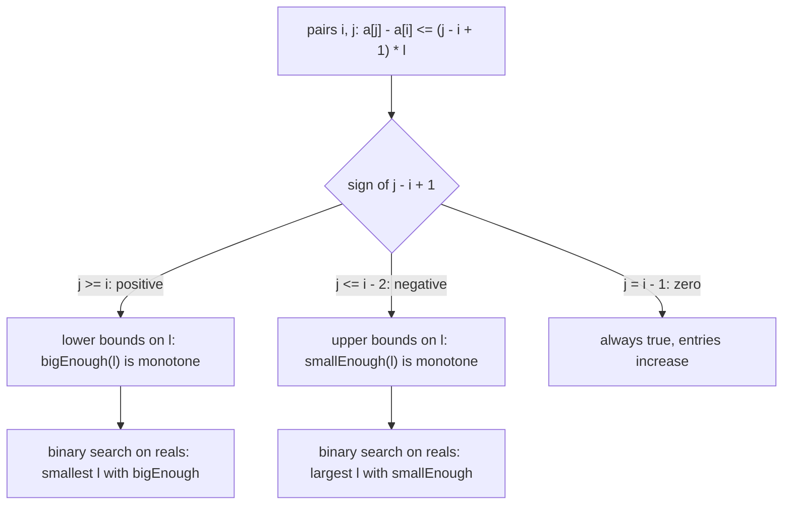

# AMPPZ 2013 A - Autostrada

> [!info] Karta zadania
> - Treść: `201X/2013/A/A.pdf` ([PDF na GitHubie](../../../201X/2013/A/A.pdf)); pamięć 128 MB, limitu czasu treść nie
>   podaje. Tekst PDF ma zepsute czcionki we wzorach: limity czytaj z obrazu strony.
> - Technika: wyszukiwanie binarne po wyniku na liczbach rzeczywistych, eliminacja niewiadomej, rozdzielenie warunków
>   na dolne i górne. Trudność: 5/5 (rozwiązało 6 z 52 drużyn, 64 zgłoszenia).
> - Kod: [a-autostrada.cpp](a-autostrada.cpp). Złożoność: O(n log(M / ε)), M = 10⁹.
> - Dzień kursu: [Dzień 5](../../dni/05-wyszukiwanie-binarne.md), wyzwanie.

## Treść w skrócie

Na autostradzie jest n wjazdów (3 ≤ n ≤ 10⁶) w rosnących punktach całkowitych a₁ < ... < aₙ ≤ 10⁹. Trzeba postawić
n + 1 kas w równych odstępach l: w punktach b₀, b₀ + l, ..., b₀ + nl, tak żeby j-ty wjazd leżał w przedziale
[b₀ + (j - 1)l, b₀ + jl]. Takie rozmieszczenie istnieje. Wypisz najmniejsze i największe możliwe l (liczby rzeczywiste,
błąd względny albo bezwzględny do 10⁻⁸; różnica wyników jest co najmniej 10⁻⁹).

## Zanim przeczytasz dalej

45 minut. Przykład: wjazdy 2, 3, 4, 5, 6, 7, odpowiedź 0,8333 i 1,25. Niewiadome są dwie: b₀ i l. Co wiesz o b₀, gdy
l jest ustalone?

> [!tip]- Podpowiedź 1
> Dla ustalonego l każdy wjazd daje dwa warunki: b₀ ≥ aⱼ - jl i b₀ ≤ aⱼ - (j - 1)l. Dobre b₀ istnieje, gdy największe
> ograniczenie dolne nie przekracza najmniejszego górnego, co sprawdzasz w O(n). Ale "da się dla l" jest prawdziwe
> tylko w środku osi, więc zwykłe wyszukiwanie binarne nie zadziała od razu.

> [!tip]- Podpowiedź 2
> Usuń b₀: dla każdej pary wjazdów i, j musi zachodzić aⱼ - jl ≤ aᵢ - (i - 1)l, czyli aⱼ - aᵢ ≤ (j - i + 1)l. Dla j ≥ i
> to ograniczenie l z dołu, dla j ≤ i - 2 z góry, a j = i - 1 zawsze zachodzi. Każda rodzina z osobna jest monotoniczna.

## Droga myślenia

1. **Ustal l, szukaj b₀.** Warunek "wjazd j w [b₀ + (j - 1)l, b₀ + jl]" to dwa ograniczenia na b₀:
   aⱼ - jl ≤ b₀ ≤ aⱼ - (j - 1)l. Wspólne b₀ istnieje, gdy każde ograniczenie dolne jest nie większe niż każde górne.
2. **Dlaczego nie od razu wyszukiwanie binarne.** Dopuszczalne l tworzą przedział [lmin, lmax]: za małe l nie dosięgnie
   ostatniego wjazdu, za duże przeskoczy dwa wjazdy naraz. Funkcja "da się" jest prawdziwa w środku i fałszywa po obu
   stronach, więc nie dzieli osi na dwie części.
3. **Rozdziel warunki.** Para (i, j) daje aⱼ - aᵢ ≤ (j - i + 1)l. Gdy j ≥ i, współczynnik przy l jest dodatni:
   l ≥ (aⱼ - aᵢ) / (j - i + 1), ograniczenie z dołu. Gdy j ≤ i - 2, współczynnik jest ujemny:
   l ≤ (aᵢ - aⱼ) / (i - j - 1), ograniczenie z góry. bigEnough(l) = "wszystkie dolne spełnione" jest monotoniczne (raz
   prawdziwe, prawdziwe dla większych l), smallEnough(l) = "wszystkie górne spełnione" też (w drugą stronę). lmin
   to próg pierwszej funkcji, lmax próg drugiej: dwa zwykłe wyszukiwania binarne.
4. **Każda funkcja w O(n).** Par jest n², ale dla ustalonego j wystarczy najsilniejsze ograniczenie: bigEnough idzie po j
   i trzyma minimum aᵢ - (i - 1)l po i ≤ j, smallEnough idzie po i i trzyma maksimum aⱼ - jl po j ≤ i - 2.
5. **Liczby rzeczywiste.** Szukamy na [0, 10⁹] przez 100 kroków połowienia, co zwęża przedział do 10⁹ / 2¹⁰⁰.
   Pozycje przesuwamy tak, żeby a₁ = 0: przy l bliskim wyniku wartości aⱼ - jl mają wtedy rząd nl, a błąd zaokrągleń
   około 10⁻¹⁹ · nl (`long double`) jest daleko poniżej wymaganego 10⁻⁸ · l.



Jak czytać diagram: wszystkie warunki zadania po usunięciu b₀ mają jedną postać, a znak współczynnika przy l decyduje,
czy warunek ogranicza l z dołu, czy z góry. Każda z dwóch rodzin daje funkcję monotoniczną, więc dostaje własne
wyszukiwanie binarne; ich wyniki to szukane końce przedziału.

Przykład: wjazdy 2, ..., 7. Najsilniejsze ograniczenie dolne daje para i = 1, j = 6: l ≥ 5 / 6 ≈ 0,8333. Najsilniejsze
górne daje j = 1, i = 6: l ≤ 5 / 4 = 1,25.

## Rozwiązanie

```cpp
bool bigEnough(ld l) {                         // all lower bounds: i <= j
    ld best = 1e30;                            // min over i <= j of a[i] - (i-1)*l
    for (int j = 1; j <= n; j++) {
        best = min(best, a[j] - (j - 1) * l);
        if (a[j] - j * l > best) return false;
    }
    return true;
}
bool smallEnough(ld l) {                       // all upper bounds: j <= i - 2
    ld best = -1e30;                           // max over j <= i - 2 of a[j] - j*l
    for (int i = 3; i <= n; i++) {
        best = max(best, a[i - 2] - (i - 2) * l);
        if (best > a[i] - (i - 1) * l) return false;
    }
    return true;
}
// a[i] shifted so that a[1] = 0; 100 halvings of [0, 1e9] for each end
```

Pełny program: [a-autostrada.cpp](a-autostrada.cpp).

## Złożoność i optymalność

- Każda funkcja to O(n), każde wyszukiwanie 100 kroków: razem 2 · 100 · n = 2 · 10⁸ prostych operacji. Pamięć O(n).
- Omówienie jury (AMPPZ 2013) zamienia zadanie na funkcję f(l) = (najmniejsze górne ograniczenie b₀) - (największe
  dolne), która jest wklęsła. Wyszukiwaniem ternarnym znajduje l*, w którym f jest największa, a potem dwoma
  wyszukiwaniami binarnymi miejsca zerowe f po obu stronach l*. Złożoność O(n log M), jak tutaj. Rozdzielenie warunków
  na dolne i górne usuwa wyszukiwanie ternarne (i kłopot z płaskimi fragmentami f).
- Wynik ma postać ilorazu (aⱼ - aᵢ) / c, więc istnieje też rozwiązanie dokładne bez liczb rzeczywistych: lmin to
  największe nachylenie odcinka z punktu (i - 1, aᵢ) do punktu (j, aⱼ), co daje otoczka wypukła ze stycznymi w
  O(n log n). Do weryfikacji: w kursie nie implementowane, to materiał ścieżki geometrii.

## Pułapki

- **Wyszukiwanie binarne po funkcji, która nie jest monotoniczna:** "da się dla l" jest prawdziwe tylko w środku.
  Przed każdym wyszukiwaniem binarnym zadaj pytanie: czy po prawdzie zawsze jest prawda?
- **Warunek końca pętli:** `while (hi - lo > 1e-9)` na `double` przy wartościach rzędu 10⁹ może się nie skończyć,
  bo sąsiednie liczby `double` różnią się tam o ok. 10⁻⁷. Stała liczba kroków (100) zawsze się kończy.
- **Precyzja:** bez przesunięcia o a₁ wartości mają rząd 10⁹ niezależnie od l; na `double` (odstęp sąsiednich liczb
  ok. 10⁻⁷ przy 10⁹) błąd przy l rzędu 1 przekroczyłby dopuszczalne 10⁻⁸. Przesunięcie i `long double` dają duży zapas.
- **Wypisywanie:** `%Lf` w MinGW na Windows drukuje śmieci; rzutuj na `double` i wypisz `%.12f`.
- **Wolne wczytywanie:** 10⁶ liczb przez `scanf` na Windows to ok. 0,5 s; `cin` z `sync_with_stdio(false)` jest
  szybszy.

## Weryfikacja

- Kompilacja `g++ -std=c++17 -O2 -Wall -Wextra` bez ostrzeżeń, przykład z treści poprawny (0,833333333333
  i 1,250000000000).
- 1500 testów losowych (n od 3 do 8; w 30 % testów odstęp do 10⁸ i pozycje do 10⁹, żeby sprawdzić precyzję),
  porównanych z tolerancją 10⁻⁸ z brute force, który przegląda wszystkie kandydackie odstępy (aⱼ - aᵢ) / c dla c od 1
  do n i każdy sprawdza dokładnie, na liczbach całkowitych, wprost z definicji (czy istnieje b₀). Testy, w których
  lmax - lmin < 10⁻⁹, pomijane zgodnie z treścią. Wszystkie zgodne.
- Test maksymalny: n = 10⁶, pozycje do 10⁹: 1,1 s.

## Wspólny mianownik

**Gdy szukasz przedziału dopuszczalnych wartości, rozdziel warunki na dolne i górne: każda rodzina daje własne
monotoniczne wyszukiwanie binarne.** Usunięcie niewiadomej (b₀) przez porównanie każdego ograniczenia dolnego z każdym
górnym to ten sam ruch co sprawdzanie, czy przedziały mają część wspólną: max(początków) ≤ min(końców).
