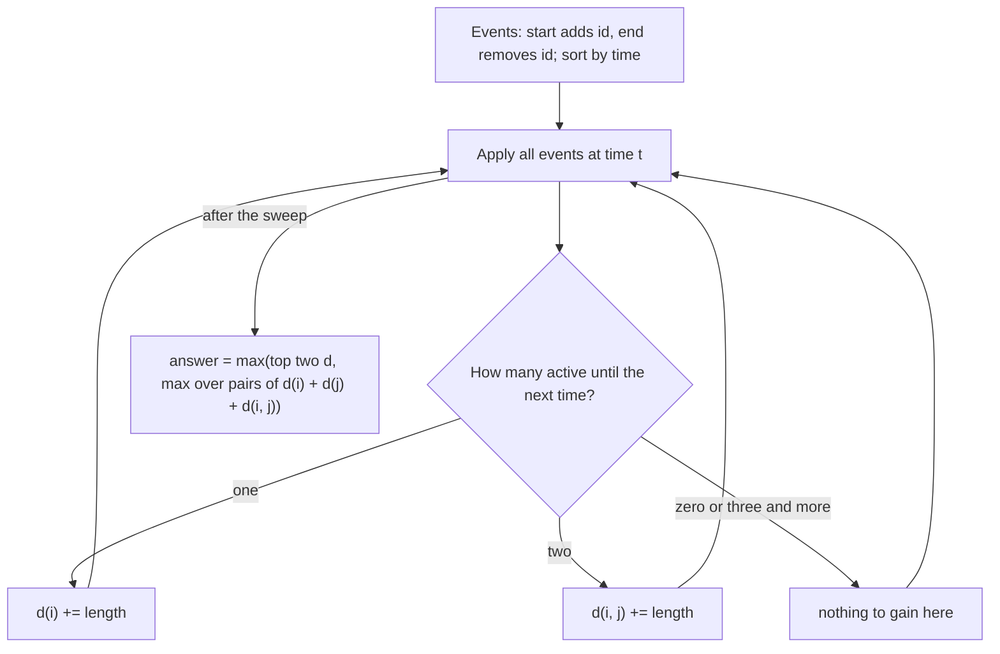

# AMPPZ 2013 D - Demonstracje

> [!info] Karta zadania
> - Treść: `201X/2013/D/D.pdf` ([PDF na GitHubie](../../../201X/2013/D/D.pdf)); pamięć 128 MB, limitu czasu treść nie
>   podaje.
> - Technika: zdarzenia +1/-1 na posortowanych końcach (tablica różnicowa na skompresowanych współrzędnych),
>   przypisanie fragmentów osi do jednego lub dwóch odcinków. Trudność: 3/5 (rozwiązało 27 z 52 drużyn).
> - Kod: [d-demonstracje.cpp](d-demonstracje.cpp). Złożoność: O(n log n).
> - Dzień kursu: [Dzień 4](../../dni/04-prefiksy-dwa-wskazniki.md), ćwiczenie.

## Treść w skrócie

Jest n demonstracji (2 ≤ n ≤ 500 000), każda trwa od aᵢ do bᵢ (0 ≤ aᵢ < bᵢ ≤ 10⁹). Burmistrz odwoła najwyżej dwie.
O ile najwięcej może się skrócić łączny czas, w którym trwa jakakolwiek demonstracja?

## Zanim przeczytasz dalej

35 minut. Przykład: [0, 9], [1, 4], [2, 5], [7, 9], [6, 7], odpowiedź 4. Co dokładnie zyskujesz, odwołując jedną
demonstrację? A dwie?

> [!tip]- Podpowiedź 1
> Odwołanie demonstracji i zwalnia tylko te chwile, w których trwała wyłącznie ona. Odwołanie i oraz j zwalnia chwile,
> w których trwała tylko i, tylko j, albo tylko i oraz j razem. Chwile pokryte przez trzy lub więcej demonstracji
> zostają zajęte zawsze.

> [!tip]- Podpowiedź 2
> Posortowane końce dzielą oś na co najwyżej 2n fragmentów, a na każdym fragmencie zbiór trwających demonstracji jest
> stały. Przejdź po fragmentach, trzymając zbiór trwających (zdarzenia: start dodaje, koniec usuwa), i dopisuj długość
> fragmentu do d(i), gdy trwa jedna, albo do d(i, j), gdy trwają dwie. Ile różnych par (i, j) może się pojawić?

## Droga myślenia

1. **Co daje odwołanie?** Chwila przestaje być zajęta, gdy odwołasz wszystkie demonstracje, które ją pokrywają. Przy
   najwyżej dwóch odwołaniach liczą się tylko chwile pokryte przez jedną albo dwie demonstracje.
2. **Fragmenty.** Wszystkie końce, posortowane, dzielą oś na fragmenty, na których nic się nie zmienia. To ta sama idea
   co tablica różnicowa: start to +1, koniec to -1, a liczba pokrywających fragment to suma prefiksowa zdarzeń. Tu
   oprócz liczby trzymamy też zbiór trwających demonstracji.
3. **Dwa rodzaje zysku.** d(i) to łączna długość fragmentów pokrytych tylko przez i; d(i, j) to długość fragmentów
   pokrytych dokładnie przez i oraz j. Odwołanie i oraz j zwalnia d(i) + d(j) + d(i, j).
4. **Jak wybrać parę?** Par jest n², ale d(i, j) > 0 tylko dla par, które gdzieś pokrywają fragment we dwie, a takich
   par jest najwyżej tyle, ile fragmentów, czyli < 2n. Dla nich liczymy d(i) + d(j) + d(i, j). Dla wszystkich
   pozostałych par zysk to d(i) + d(j), a ten jest największy dla dwóch największych d. Wynik to większa z tych liczb.
   (Jedno odwołanie nigdy nie daje więcej niż dwa, bo d ≥ 0.)



Jak czytać diagram: zamiatanie od lewej do prawej. Po każdej porcji zdarzeń w tym samym momencie zbiór trwających
demonstracji jest stały aż do następnego momentu, więc długość fragmentu trafia do jednego licznika. Na końcu wynik
składa się z dwóch kandydatów: dwóch najlepszych samotnych zysków i najlepszej pary, która coś dzieli.

Przykład: fragment [0, 1] pokrywa tylko demonstracja 1, a [5, 6] też tylko ona, więc d(1) = 2. Fragment [7, 9]
pokrywają 1 i 4: d(1, 4) = 2. Pozostałe pary to d(1, 2) = d(1, 3) = d(1, 5) = 1, a [2, 4] pokrywają trzy demonstracje.
Odwołanie 1 i 4 zwalnia 2 + 0 + 2 = 4, zgodnie z treścią.

## Rozwiązanie

```cpp
for (size_t e = 0; e < ev.size();) {           // ev: (time, +id or -id), sorted
    ll t = ev[e].first;
    for (; e < ev.size() && ev[e].first == t; e++) {
        int id = ev[e].second;
        if (id > 0) { where[id] = act.size(); act.push_back(id); }
        else {                                 // remove in O(1): move the last one into the hole
            id = -id;
            int last = act.back();
            act[where[id]] = last;
            where[last] = where[id];
            act.pop_back();
        }
    }
    if (e == ev.size()) break;
    ll len = ev[e].first - t;
    if (act.size() == 1) solo[act[0]] += len;
    else if (act.size() == 2) shared.push_back({min(act[0], act[1]), max(act[0], act[1]), len});
}
// best = max(two largest solo, max over merged pairs of solo[i] + solo[j] + shared time)
```

Pełny program: [d-demonstracje.cpp](d-demonstracje.cpp). Zbiór trwających trzymamy w tablicy z usuwaniem przez
zamianę z ostatnim (O(1)), bo potrzebujemy tylko odczytać jeden albo dwa elementy, gdy jest ich tak mało. Pary
z fragmentów sortujemy i sumujemy równe, zamiast trzymać `map`.

## Złożoność i optymalność

- Sortowanie 2n zdarzeń i co najwyżej 2n par: O(n log n). Zamiatanie O(n).
- Omówienie jury (AMPPZ 2013): te same wartości d(i) i d(i, j), zbiór pokrywających w `set`, d(i, j) w mapie, ten sam
  podział na pary z d(i, j) > 0 i dwie największe wartości d; O(n log n). Statystyki: 82 zgłoszenia, 27 z 52 drużyn.
- Końce do 10⁹ trzeba posortować, więc O(n log n) w modelu porównań jest naturalną granicą; przy n = 500 000 program
  działa 0,37 s.

## Pułapki

- **Dwie najlepsze pojedyncze, które się pokrywają:** jeśli i oraz j mają też wspólny fragment, ich prawdziwy zysk
  jest większy niż d(i) + d(j); policzy go pętla po parach, więc wzięcie maksimum z obu kandydatów jest poprawne.
- **Zdarzenia w tym samym momencie:** najpierw zastosuj wszystkie, potem licz fragment do następnego momentu. Wtedy
  kolejność startów i końców w jednej chwili nie ma znaczenia.
- **Odcinki domknięte czy otwarte:** długość [a, b] to b - a, punkty nie mają długości, więc styk [1, 4] i [4, 6]
  niczego nie dzieli.
- **Przepełnienie:** długości do 10⁹ mieszczą się w `int`, ale suma kilku już nie zawsze; `long long`.

## Weryfikacja

- Kompilacja `g++ -std=c++17 -O2 -Wall -Wextra` bez ostrzeżeń, przykład z treści poprawny (4).
- 1500 testów losowych (n od 2 do 7, czasy do 6, do 12 albo do 25, odcinki krótkie i długie), porównanych z brute
  force, który dla każdej pary i każdej pojedynczej demonstracji liczy długość sumy pozostałych odcinków po
  jednostkowych chwilach. Wszystkie zgodne.
- Testy maksymalne: n = 500 000 losowych krótkich odcinków: 0,37 s; łańcuch zachodzących na siebie odcinków: 0,26 s.

## Wspólny mianownik

**Zdarzenia na posortowanych końcach to tablica różnicowa bez tablicy.** Gdy współrzędne są duże, zamiast tablicy
różnicowej sortujesz zdarzenia +1/-1 i idziesz po nich, a między zdarzeniami stan jest stały. Do licznika możesz
dołożyć więcej informacji (tu: kto dokładnie trwa, gdy trwa mało osób). Ten sam ruch to "ile najwięcej przedziałów
naraz" (CSES Restaurant Customers) i każda "długość sumy odcinków".
