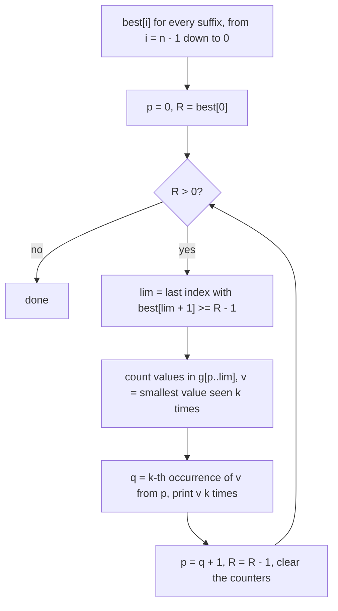

# AMPPZ 2013 I - Inżynieria genetyczna

> [!info] Karta zadania
> - Treść: `201X/2013/I/I.pdf` ([PDF na GitHubie](../../../201X/2013/I/I.pdf)); pamięć 128 MB, limitu czasu treść nie
>   podaje. PDF ma zepsute czcionki we wzorach: najlepiej czytać go jako obraz strony.
> - Technika: programowanie dynamiczne po sufiksach i odtwarzanie najmniejszego leksykograficznie wyniku od początku.
>   Mapa technik z samej treści zgadywała "zachłanne"; po rozwiązaniu katalog ma DP z zachłannym odtwarzaniem.
>   Trudność: 3 (24 z 52 drużyn).
> - Kod: [i-inzynieria-genetyczna.cpp](i-inzynieria-genetyczna.cpp). Złożoność: O(n + V), V = 10⁶ (zakres wartości).
> - Dzień kursu: [Dzień 10](../../dni/10-dp-1.md), zadanie omówione (pełna wersja).

## Treść w skrócie

Dany ciąg n ≤ 10⁶ liczb z zakresu 1..10⁶ i liczba k (2 ≤ k ≤ 10⁶). Poprawny genom to ciąg złożony z bloków po k
kolejnych równych liczb (dla k = 3 na przykład `1 1 1 2 2 2 2 2 2`). Wykreśl z ciągu jak najmniej elementów tak, żeby
został poprawny genom; wypisz jego długość, a w drugim wierszu sam genom, a spośród najdłuższych najmniejszy
leksykograficznie. Pusty genom też jest poprawny (wtedy drugi wiersz jest pusty).

## Zanim przeczytasz dalej

45 minut. Przykład z treści: k = 3, ciąg `3 2 3 1 3 1 1 2 4 2 1 1 2 2 2 2`, wynik 9 i `1 1 1 2 2 2 2 2 2`. Zauważ, że blok
`3 3 3` da się zamknąć wcześniej niż blok `1 1 1`, a mimo to odpowiedź zaczyna się od jedynek.

> [!tip]- Podpowiedź 1
> Najpierw sama długość. Niech best[i] to największa liczba bloków w sufiksie od pozycji i. Element g[i] albo
> wykreślamy, albo zaczyna on blok. Gdzie ten blok najlepiej zakończyć?

> [!tip]- Podpowiedź 2
> Blok wartości v zaczęty w i kończ na k-tym wystąpieniu v licząc od i: wcześniejszy koniec zostawia dłuższy sufiks.
> Do odtwarzania idź od początku: w pozycji p, gdy brakuje jeszcze R bloków, pierwszy blok może się skończyć w q tylko
> wtedy, gdy best[q + 1] = R - 1. Spośród wartości, które się mieszczą, bierz najmniejszą.

## Droga myślenia

1. **Długość to liczba bloków razy k.** Wystarczy zmaksymalizować liczbę bloków B, a wynik to B · k.
2. **Stan: sufiks.** best[i] = najwięcej bloków, które da się wybrać z g[i..n-1]. Element g[i] albo wykreślamy
   (best[i + 1]), albo zaczyna on blok wartości v = g[i]. Ten blok kończymy na k-tym wystąpieniu v licząc od i,
   oznaczmy tę pozycję e(i): każdy późniejszy koniec zostawia krótszy sufiks, a best nie rośnie przy skracaniu sufiksu.
   Przejście: best[i] = max(best[i + 1], 1 + best[e(i) + 1]), gdy e(i) istnieje. Liczymy od i = n - 1 w dół do 0.
3. **Dlaczego sufiksy, a nie prefiksy.** Odpowiedź budujemy od początku (porządek leksykograficzny patrzy na pierwszy
   element), a w każdym kroku pytamy "ile bloków da się jeszcze zrobić od pozycji p". To jest właśnie best[p]. Ogólna
   zasada: DP od końca, odtwarzanie od początku.
4. **e(i) szybko.** Pozycje każdej wartości w jednej tablicy, posortowane po pozycji (zliczanie po wartości, jak
   w [2015 B Bogacze](../2015/b-bogacze.md)), i numer rk[i] pozycji i wśród wystąpień swojej wartości. Wtedy
   e(i) = pos[start[v] + rk[i] + k - 1], o ile ten indeks nie wychodzi poza wystąpienia v.
5. **Odtwarzanie.** Wszystkie najdłuższe genomy mają B bloków, więc porównanie leksykograficzne rozstrzyga pierwszy
   blok, potem drugi i tak dalej. Jesteśmy w p i brakuje R bloków (zawsze best[p] = R). Pierwszy blok może się skończyć
   w q, jeśli best[q + 1] = R - 1; best nie rośnie, więc dozwolone q tworzą przedział [p, lim], gdzie lim to ostatnia
   pozycja z best[lim + 1] ≥ R - 1. Bierzemy najmniejszą wartość v, która ma w [p, lim] co najmniej k wystąpień,
   a blok kończymy na jej k-tym wystąpieniu od p (najwcześniej: zostaje najwięcej możliwości na resztę). Potem p = q + 1
   i R zmniejsza się o 1.
6. **Koszt odtwarzania.** Liczniki wystąpień w kawałku [p, lim] i drugie przejście, które je zeruje. Pozycja j leży
   w kawałku kroku R tylko wtedy, gdy best[j] to R albo R - 1, więc trafia do najwyżej dwóch kawałków: razem O(n).



Jak czytać diagram: górny prostokąt to cała część DP (jedno przejście od końca), reszta to odtwarzanie. Pętla wykonuje
się B razy; w każdym obrocie przedział [p, lim] mówi, gdzie pierwszy blok może się skończyć bez utraty optimum.

Przykład z treści (pozycje od 0): e(0) = 4 (`3 3 3`), e(3) = 6 (`1 1 1` z pozycji 3, 5, 6), e(7) = 12, e(13) = 15.
Tablica best od pozycji 0 do 16:

| i | 0 | 1 | 2 | 3 | 4 | 5 | 6 | 7 | 8 | 9 | 10 | 11 | 12 | 13 | 14 | 15 | 16 |
|---|---|---|---|---|---|---|---|---|---|---|---|---|---|---|---|---|---|
| g[i] | 3 | 2 | 3 | 1 | 3 | 1 | 1 | 2 | 4 | 2 | 1 | 1 | 2 | 2 | 2 | 2 | |
| best[i] | 3 | 3 | 3 | 3 | 2 | 2 | 2 | 2 | 1 | 1 | 1 | 1 | 1 | 1 | 0 | 0 | 0 |

B = 3. Krok R = 3: best[q + 1] ≥ 2 dla q ≤ 6, kawałek [0, 6] = `3 2 3 1 3 1 1`; trzy wystąpienia mają 3 i 1, mniejsza
jest 1, blok kończy się w 6. Krok R = 2: p = 7, lim = 12, kawałek `2 4 2 1 1 2`, tylko 2 ma trzy wystąpienia, koniec
w 12. Krok R = 1: kawałek [13, 15] = `2 2 2`. Wynik `1 1 1 2 2 2 2 2 2`. Gdyby brać blok, który kończy się najwcześniej
(`3 3 3` w pozycji 4), wynik zaczynałby się od 3: też długi na 9, ale nie najmniejszy.

## Rozwiązanie

```cpp
vector<int> best(n + 1, 0);
for (int i = n - 1; i >= 0; i--) {
    best[i] = best[i + 1];                 // g[i] is dropped
    int v = g[i], idx = start[v] + rk[i] + k - 1;
    if (idx < start[v + 1])                // or a block of v starts at i and ends at pos[idx]
        best[i] = max(best[i], 1 + best[pos[idx] + 1]);
}
int p = 0, lim = -1;
for (int R = best[0]; R >= 1; R--) {
    while (lim + 1 < n && best[lim + 2] >= R - 1) lim++;   // lim only moves right
    int v = INT_MAX;
    for (int j = p; j <= lim; j++)
        if (++inPiece[g[j]] == k) v = min(v, g[j]);         // smallest value that fits
    for (int j = p; j <= lim; j++) inPiece[g[j]] = 0;       // clear by a second pass
    int q = p, seen = 0;
    while (!(g[q] == v && ++seen == k)) q++;               // k-th occurrence of v from p
    // print v k times
    p = q + 1;
}
```

Pełny program: [i-inzynieria-genetyczna.cpp](i-inzynieria-genetyczna.cpp) (szybkie wczytywanie przez `fread`, wynik
składany w jednym napisie, bo to do 10⁶ liczb).

## Złożoność i optymalność

- O(n + V) czasu i pamięci: tablice po pozycjach i po wartościach, każda pozycja przetwarzana stałą liczbę razy.
  Wczytanie danych to Ω(n), więc to optimum (V = 10⁶ to stały koszt tablic liczników).
- Omówienie jury (AMPPZ 2013, MIMUW, slajdy w web.archive.org) liczy tę samą tablicę d[i] = największa długość
  poprawnego ciągu w sufiksie od i, zachłannie od końca: liczniki wystąpień i zwiększenie wyniku, gdy któryś dojdzie
  do k. Odtwarzanie jest to samo: pierwszy fragment kończy się w największym i z d[i + 1] = b - 1, a spośród liczb
  występujących co najmniej k razy przed nim bierze się najmniejszą; liczniki czyści się drugim przejściem, razem O(n).
  Statystyka ze slajdów: 115 zgłoszeń, zaakceptowane przez 24 z 52 drużyn.
- Pierwsza wersja kursu trzymała wartości gotowe w oknie w `std::set` i szukała k-tego wystąpienia binarnie
  (O(n log n)); przeszła te same testy, ale omówienie pokazało prostsze O(n), więc w kursie jest wersja z omówienia.

## Pułapki

- **Najwcześniej kończący się blok to nie najmniejszy leksykograficznie:** w przykładzie `3 3 3` kończy się przed
  `1 1 1`. Liczy się najmniejsza wartość spośród tych, które nie psują optimum.
- **Liczniki po wartościach, nie mapy:** wartości do 10⁶ mieszczą się w tablicy; `map` przy 10⁶ elementów jest kilka
  razy wolniejsza.
- **Czyszczenie liczników:** zerowanie całej tablicy 10⁶ w każdym kroku to O(n · V); zeruj tylko to, co zwiększyłeś.
- **k > n albo brak bloku:** wynik 0 i pusty drugi wiersz.
- **Wyjście:** do 10⁶ liczb; `cout` bez `sync_with_stdio(false)` albo `endl` po każdej liczbie to za wolno.

## Weryfikacja

- Kompilacja `g++ -std=c++17 -O2 -Wall -Wextra` bez ostrzeżeń, przykład z treści daje `9` i `1 1 1 2 2 2 2 2 2`.
- 1500 wejść losowych (n od 1 do 12, k od 2 do 4, wartości z zakresu 1..v dla v ≤ 4; w 432 wynik to pusty genom)
  i 500 dłuższych (n od 12 do 16, k 2 albo 3, wartości 1..3) porównanych z brute force, który przegląda wszystkie 2ⁿ
  podciągów, zostawia poprawne genomy i wybiera najdłuższy, a spośród nich najmniejszy. Wszystkie zgodne, zarówno
  dla wersji z omówienia, jak i dla wcześniejszej wersji z `std::set`.
- Testy maksymalne, n = 10⁶: k = 2 i wartości do 10⁶ 0,12 s; k = 2 i wartości do 10 (428 870 liczb na wyjściu)
  0,09 s; k = 5 i wartości do 1000 0,08 s; k = 10⁶ i wszystkie równe (jeden blok) 0,09 s; pary w kolejności malejącej
  (500 000 bloków, wynik od 500000) 0,15 s.

## Wspólny mianownik

**Najmniejsza leksykograficznie odpowiedź: DP od końca, budowa od początku.** DP po sufiksach mówi, ile da się
jeszcze osiągnąć od pozycji p. Odpowiedź buduje się od przodu, w każdym kroku biorąc najmniejszy wybór, po którym
reszta wciąż osiąga optimum, a przy równym wyborze ten, który zostawia najwięcej miejsca na resztę.
