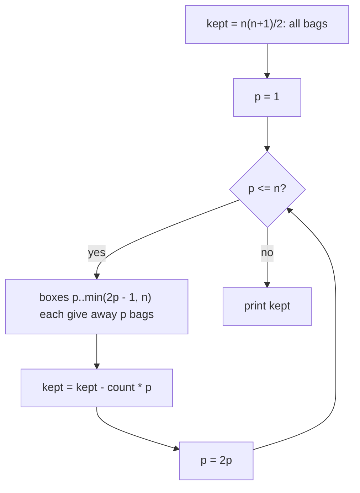

# AMPPZ 2013 J - Janosik

> [!info] Karta zadania
> - Treść: `201X/2013/J/J.pdf` ([PDF na GitHubie](../../../201X/2013/J/J.pdf)); pamięć 128 MB, limitu czasu treść nie
>   podaje.
> - Technika: matematyka: zapis dwójkowy, największa potęga dwójki, sumowanie blokami. Trudność: 1/5 (rozwiązało 48
>   z 52 drużyn).
> - Kod: [j-janosik.cpp](j-janosik.cpp). Złożoność: O(log n).
> - Dzień kursu: [Dzień 6](../../dni/06-matematyka.md), ćwiczenie.

## Treść w skrócie

Jest n szkatułek (n ≤ 10⁹), w i-tej jest i mieszków. Janosik zawsze bierze niepustą szkatułkę z najmniejszą liczbą
mieszków: jeden mieszek oddaje biedakowi, z nieparzystej liczby większej od 1 chowa jeden do kieszeni, a parzystą
liczbę dzieli po połowie na dwie szkatułki. Ile mieszków zostanie mu w kieszeni, gdy wszystkie szkatułki będą puste?

## Zanim przeczytasz dalej

20 minut. Przykład: n = 5 daje 2. Policz ręcznie, ile zostaje w kieszeni z jednej szkatułki z i mieszkami dla
i = 1, ..., 8. Czy kolejność obsługi szkatułek ma znaczenie?

> [!tip]- Podpowiedź 1
> Szkatułki nie wpływają na siebie. Zamiast liczyć, ile Janosik chowa, policz, ile mieszków trafia do biedaków z jednej
> szkatułki. Ile szkatułek z jednym mieszkiem powstaje z szkatułki z i mieszkami?

> [!tip]- Podpowiedź 2
> Połowienie podwaja liczbę szkatułek, a chowanie mieszka jej nie zmienia. Ile połowień przechodzi liczba i? Zapisz i
> w systemie dwójkowym.

## Droga myślenia

1. **Szkatułki są niezależne.** Każdy krok zmienia tylko jedną szkatułkę (i ewentualnie tworzy jej połówkę), więc los
   mieszków z i-tej szkatułki nie zależy od innych. Reguła "najmniejsza pierwsza" ustala tylko kolejność. Wynik to suma
   po i wyników dla jednej szkatułki.
2. **Jedna szkatułka.** Zamiast chowanych mieszków licz oddane: każda szkatułka kończy jako jedna szkatułka z jednym
   mieszkiem, a połowienie zamienia jedną szkatułkę w dwie. Z i mieszków powstaje więc 2^(liczba połowień) szkatułek
   z jednym mieszkiem.
3. **Liczba połowień.** Na liczbie i proces robi: nieparzysta, więc odejmij 1 (zgaś ostatni bit); parzysta, więc
   podziel przez 2 (przesuń bity w prawo). Każde połowienie skraca zapis dwójkowy o jedną cyfrę, a odejmowanie go nie
   zmienia, więc połowień jest tyle, ile cyfr ma i w zapisie dwójkowym, minus jedna. Oddane mieszki to 2^⌊log₂ i⌋,
   czyli największa potęga dwójki nie większa niż i, a w kieszeni zostaje i - 2^⌊log₂ i⌋. Dla i = 1..8: 0, 0, 1, 0,
   1, 2, 3, 0.
4. **Suma.** Wynik = (1 + ... + n) - Σ 2^⌊log₂ i⌋. Liczby i z przedziału [2^j, 2^(j+1) - 1] mają tę samą największą
   potęgę 2^j, więc drugą sumę liczysz blokami: dla każdego j dodajesz (liczba i z bloku nie większych niż n) · 2^j.
   Bloków jest ok. 30.



Jak czytać diagram: zaczynamy od wszystkich mieszków i odejmujemy te, które trafią do biedaków. Szkatułki dzielimy na
bloki o tej samej największej potędze dwójki; w bloku zaczynającym się od p każda szkatułka oddaje dokładnie p mieszków.
Pętla wykonuje się ⌊log₂ n⌋ + 1 razy.

Przykład: n = 5. Wszystkich mieszków 15. Blok p = 1: szkatułka 1 oddaje 1. Blok p = 2: szkatułki 2, 3 oddają po 2.
Blok p = 4: szkatułki 4, 5 (do n) oddają po 4. Oddane 1 + 4 + 8 = 13, w kieszeni 2.

## Rozwiązanie

```cpp
ll solve(ll n) {
    ll kept = n * (n + 1) / 2;                     // all bags, up to 5 * 10^17
    for (ll p = 1; p <= n; p *= 2) {               // boxes p..2p-1 give away p bags each
        ll last = min(2 * p - 1, n);
        kept -= (last - p + 1) * p;
    }
    return kept;
}
```

Pełny program: [j-janosik.cpp](j-janosik.cpp).

## Złożoność i optymalność

- O(log n) kroków pętli. Pętla po wszystkich i z `__builtin_clzll` (O(n)) przy n = 10⁹ zajmuje ok. 1-2 s i jest na
  granicy, a symulacja procedury jest beznadziejna (mieszków jest do 5 · 10¹⁷).
- Omówienie jury (AMPPZ 2013, MIMUW) ma tę samą obserwację (szkatułki niezależne, rozdane 2^⌊lg i⌋) i ten sam wzór
  z sumą po blokach potęg dwójki. Slajdy podają 158 zgłoszeń przy 48 drużynach z akceptacją, czyli dużo odrzuceń.

## Pułapki

- **Przepełnienie:** n · (n + 1) dla n = 10⁹ to 10¹⁸, poza `int`; całe liczenie w `long long` (wynik do 5 · 10¹⁷).
  To najpewniej główne źródło odrzuconych zgłoszeń.
- **Ostatni blok niepełny:** koniec bloku to min(2p - 1, n), nie 2p - 1.
- **Liczenie chowanych zamiast oddanych** prowadzi do rekurencji f(i) = f(i - 1) + 1 dla nieparzystych i f(i) = 2f(i/2)
  dla parzystych. Poprawne, ale dla n = 10⁹ tablica i pętla są za wolne i za duże; liczenie oddanych od razu daje wzór.

## Weryfikacja

- Kompilacja `g++ -std=c++17 -O2 -Wall -Wextra` bez ostrzeżeń, przykład z treści poprawny (2).
- Test wyczerpujący dla n od 1 do 400 oraz n = 1000, 1023, 1024, 1025, 2047, 3000: brute force symuluje procedurę z treści
  (kolejka priorytetowa szkatułek, zawsze najmniejsza niepusta). Wszystkie zgodne.
- n = 10⁹: wynik 155 282 672 064 270 251, taki sam jak z prostej pętli O(n) po wszystkich i; czas rozwiązania pomijalny.

## Wspólny mianownik

**Zapisz liczbę dwójkowo; połowienie to przesunięcie bitów, odjęcie jedynki od nieparzystej to zgaszenie ostatniego
bitu.** Proces "połów albo odejmij 1" trwa tyle, ile jest cyfr i jedynek w zapisie dwójkowym. Do tego **licz to, co
łatwiejsze** (oddane mieszki zamiast schowanych) i **sumuj blokami [2^j, 2^(j+1))**, w których wyrażenie jest stałe.
