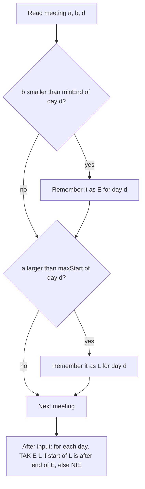

# AMPPZ 2014 A - Adwokat

> [!info] Karta zadania
> - Treść: `201X/2014/A/A.pdf` ([PDF na GitHubie](../../../201X/2014/A/A.pdf)); pamięć 256 MB, limitu czasu treść nie
>   podaje.
> - Technika: skrajne elementy (zamiast sortowania), przedziały. Trudność: 1/5 (rozwiązały 52 z 57 drużyn).
> - Kod: [a-adwokat.cpp](a-adwokat.cpp). Złożoność: O(n + m).
> - Dzień kursu: [Dzień 3](../../dni/03-sortowanie-zachlanne.md), zadanie omówione.

## Treść w skrócie

Terminarz ma n spotkań (2 ≤ n ≤ 500 000) rozłożonych na m dni (m ≤ 20). Spotkanie to dzień d oraz początek a i koniec
b w milisekundach (1 ≤ a < b ≤ 8 · 10⁷). Dla każdego dnia wypisz `TAK` i numery dwóch spotkań tego dnia, które na
siebie nie nachodzą (drugie zaczyna się ściśle po końcu pierwszego, pierwsze zaczyna się wcześniej), albo `NIE`.
Gdy par jest wiele, dowolną.

## Zanim przeczytasz dalej

15 minut. Narysuj spotkania pierwszego dnia z przykładu jako odcinki na osi czasu.

> [!tip]- Podpowiedź 1
> Dni są od siebie niezależne. Wystarczy umieć odpowiedzieć dla jednego dnia, a potem zrobić to m razy (albo wszystko
> w jednym przebiegu po spotkaniach).

> [!tip]- Podpowiedź 2
> Jeśli jakaś para (pierwsze, drugie) jest dobra, to czy para (spotkanie kończące się najwcześniej, spotkanie
> zaczynające się najpóźniej) też jest dobra?

## Droga myślenia

1. **Przeformułowanie.** Spotkanie to odcinek [a, b] na osi czasu. Para jest dobra, gdy początek drugiego jest
   większy niż koniec pierwszego: a₂ > b₁. Warunek "pierwsze zaczyna się wcześniej" wynika z tego sam:
   a₁ < b₁ < a₂.
2. **Limity.** n do 500 000, więc sprawdzanie wszystkich par, O(n²), odpada. Potrzeba O(n log n) albo O(n).
3. **Pomysł z sortowaniem (działa, ale da się prościej).** Posortuj spotkania dnia po końcu; dla spotkania
   o najwcześniejszym końcu szukaj dowolnego, które zaczyna się później. To już prowadzi do obserwacji.
4. **Skrajne elementy.** Niech E to spotkanie o najmniejszym końcu, a L to spotkanie o największym początku.
   - Jeśli jakaś para (X, Y) jest dobra, to a_L ≥ a_Y > b_X ≥ b_E, więc para (E, L) też jest dobra.
   - Jeśli a_L > b_E, to E i L to różne spotkania (każde spotkanie ma a < b) i tworzą dobrą parę.
   - Zatem odpowiedź `TAK` jest dokładnie wtedy, gdy a_L > b_E, a parą jest (E, L).
5. **Implementacja.** Jeden przebieg po spotkaniach i dla każdego dnia dwie liczby z numerami: najmniejszy koniec
   i największy początek. Dzień bez spotkań albo z jednym daje `NIE` (warunek się nie spełni).



Jak czytać diagram: każde spotkanie aktualizuje najwyżej dwa rekordy swojego dnia. Po wczytaniu wszystkiego każdy
dzień ma gotowe kandydatki E i L, a odpowiedź to jedno porównanie. Nie trzeba nic sortować ani pamiętać całego wejścia.

## Rozwiązanie

```cpp
vector<int> minEnd(m + 1, INT_MAX), minEndId(m + 1, -1);
vector<int> maxStart(m + 1, INT_MIN), maxStartId(m + 1, -1);
for (int i = 1; i <= n; i++) {
    int a, b, d;
    cin >> a >> b >> d;
    if (b < minEnd[d]) minEnd[d] = b, minEndId[d] = i;
    if (a > maxStart[d]) maxStart[d] = a, maxStartId[d] = i;
}
for (int d = 1; d <= m; d++) {
    if (minEndId[d] != -1 && maxStart[d] > minEnd[d])
        out += "TAK " + to_string(minEndId[d]) + " " + to_string(maxStartId[d]) + "\n";
    else
        out += "NIE\n";
}
```

Pełny program: [a-adwokat.cpp](a-adwokat.cpp). Wynik zbieramy w jednym napisie i wypisujemy raz.

## Złożoność i optymalność

- O(n + m) czasu i O(m) pamięci. Lepiej się nie da: każde spotkanie trzeba przeczytać, bo każde może być jednym
  z dwóch skrajnych.
- Wersja z sortowaniem, O(n log n), też by przeszła; skrajne elementy są krótsze i nie mają miejsca na błąd
  w komparatorze.
- Omówienie jury (slajdy AMPPZ 2014): to samo rozwiązanie, "odcinek o minimalnym prawym końcu oraz odcinek
  o maksymalnym lewym końcu", O(n).

## Pułapki

- **Ściśle po zakończeniu:** warunek to `a > b`, nie `a >= b`. Spotkania [3, 5] i [5, 7] nachodzą na siebie.
- **Kolejność numerów w odpowiedzi:** najpierw spotkanie, które zaczyna się wcześniej, czyli E, potem L.
- **Dzień bez spotkań:** `minEndId` zostaje -1, trzeba wypisać `NIE`, a nie śmieci.
- **Szybkie wejście:** pół miliona wierszy, więc `ios::sync_with_stdio(false)` z szablonu jest potrzebne.

## Weryfikacja

- Kompilacja `g++ -std=c++17 -O2 -Wall -Wextra` bez ostrzeżeń, przykład z treści poprawny.
- 1500 testów losowych (n od 2 do 12, do 5 dni, trzy zakresy czasu, w tym bardzo krótkie, żeby było dużo remisów
  i styków końca z początkiem). Odpowiedzi sprawdzała sprawdzaczka, bo par może być wiele: dla każdego dnia brute
  force po wszystkich parach ustala, czy para istnieje, a dla `TAK` sprawdza numery, dzień, kolejność i warunek
  rozłączności. Wszystkie testy zgodne.
- Test maksymalny: n = 500 000, m = 20, 0,32 s.

## Wspólny mianownik

**Skrajny element.** Zanim cokolwiek posortujesz, zapytaj: jeśli jakieś rozwiązanie istnieje, czy istnieje też
rozwiązanie z elementów skrajnych (najmniejszego, największego, najwcześniej kończącego się)? Jeśli tak, wystarcza
jeden przebieg z minimum i maksimum. To ten sam ruch myślowy co w argumencie zamiany, tylko wykonany od razu: zamieniasz
elementy dowolnej pary na skrajne i pokazujesz, że para nadal działa.
