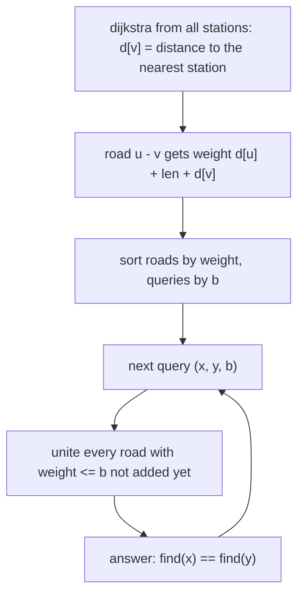

# AMPPZ 2014 B - Benzyna

> [!info] Karta zadania
> - Treść: `201X/2014/B/B.pdf` ([PDF na GitHubie](../../../201X/2014/B/B.pdf)); pamięć 256 MB, limitu czasu treść nie
>   podaje.
> - Technika: Dijkstra z wieloma źródłami (odległość do najbliższej stacji), potem Find-Union i zapytania offline
>   posortowane po progu (Kruskal). Trudność: 4 (15 z 57 drużyn).
> - Kod: [b-benzyna.cpp](b-benzyna.cpp). Złożoność: O((n + m) log n + q log q).
> - Dzień kursu: [Dzień 9](../../dni/09-grafy-2.md), wyzwanie.

## Treść w skrócie

Graf nieskierowany: n ≤ 2 · 10⁵ skrzyżowań, m ≤ 2 · 10⁵ dróg o długościach do 10⁴, na s skrzyżowaniach stacje
benzynowe. Cysterna z bakiem b przejeżdża bez tankowania najwyżej b kilometrów, a tankuje tylko na stacjach. Dla
q ≤ 2 · 10⁵ zapytań (x, y, b), gdzie x i y to stacje, a b ≤ 2 · 10⁹: czy cysterna z bakiem b przejedzie z x do y? TAK
albo NIE.

## Zanim przeczytasz dalej

50 minut. Przykład: stacje 1, 5, 2, 6; drogi 1-3 (1), 2-3 (2), 3-4 (3), 4-5 (5), 6-4 (5); zapytania (1, 2, 4), (2, 6, 9),
(1, 5, 9), (6, 5, 8) dają TAK, TAK, TAK, NIE. Zanim zaczniesz, odpowiedz: dlaczego graf "stacja-stacja, jeśli
odległość ≤ b" jest dobrym modelem, ale złym algorytmem?

> [!tip]- Podpowiedź 1
> Odległości między wszystkimi parami stacji to s² liczb, a zapytania mają różne b. Zamiast par stacji pomyśl
> o pojedynczej drodze u-v: kiedy cysterna w ogóle może nią przejechać? Co wiesz o najbliższej stacji od u i od v?

> [!tip]- Podpowiedź 2
> Niech d[v] to odległość v od najbliższej stacji (Dijkstra ze wszystkich stacji naraz). Drogą u-v da się przejechać
> z bakiem b wtedy i tylko wtedy, gdy d[u] + długość + d[v] ≤ b. Zostaje pytanie, czy x i y łączą drogi o wadze ≤ b:
> posortuj zapytania po b.

## Droga myślenia

1. **Model.** Trasa to ciąg stacji, między kolejnymi tankowaniami najwyżej b kilometrów. Graf stacji z krawędzią, gdy
   odległość ≤ b, jest poprawny, ale wymaga odległości między wszystkimi parami stacji i osobnego grafu na każde b.
2. **Najbliższa stacja.** Dijkstra z wieloma źródłami daje d[v], odległość od v do najbliższej stacji, dla wszystkich
   v naraz w O((n + m) log n).
3. **Waga drogi.** Niech droga u-v ma wagę W(u, v) = d[u] + długość + d[v]. Teza: stacje x i y są osiągalne z bakiem b
   wtedy i tylko wtedy, gdy łączą je drogi o wagach ≤ b.
   - W jedną stronę: drogę o wadze ≤ b cysterna przejeżdża tak: najbliższa stacja u, potem u, droga, v, najbliższa
     stacja v, razem W(u, v) ≤ b kilometrów. Ciąg takich dróg od x do y to ciąg skoków między stacjami (dla stacji
     d = 0, więc zaczyna się w x i kończy w y).
   - W drugą: na prawdziwej trasie każda droga u-v leży na odcinku między dwoma tankowaniami, stacjami A i B. Od A do u
     jest co najmniej d[u], od v do B co najmniej d[v], więc W(u, v) ≤ długość odcinka ≤ b. Wszystkie drogi trasy mają
     wagę ≤ b i łączą x z y.
4. **Zapytania z progiem.** "Czy x i y łączą krawędzie o wadze ≤ b" przy wielu b: zapytania rosnąco po b, drogi
   rosnąco po W, przed zapytaniem dodaj do Find-Union wszystkie drogi o W ≤ b i porównaj find(x) z find(y). To Kruskal
   przerywany zapytaniami.



Jak czytać diagram: pierwsze dwa kroki zamieniają warunek o paliwie na wagę jednej drogi, reszta to zapytania
o spójność przy rosnącym progu. Wskaźnik na drogi tylko rośnie, więc każda droga trafia do Find-Union raz.

Przykład: d = 0 dla stacji 1, 2, 5, 6; d[3] = 1 (do stacji 1), d[4] = 4 (przez 3 do 1). Wagi dróg: 1-3: 2, 2-3: 3, 3-4: 8,
4-5: 9, 6-4: 9. Zapytanie (6, 5, 8): drogi o wadze ≤ 8 łączą tylko {1, 2, 3, 4}, więc NIE. Z bakiem 9 dochodzą 4-5 i 6-4:
TAK.

## Rozwiązanie

```cpp
// roads that touch a vertex with no station in reach never help
for (int i = 0; i < m; i++) {
    auto [u, v, len] = roads[i];
    if (d[u] == LLONG_MAX || d[v] == LLONG_MAX) continue;
    byWeight.push_back({d[u] + len + d[v], i});
}
sort(byWeight.begin(), byWeight.end());
// queries sorted by b
for (int i : qord) {
    auto [b, x, y] = qs[i];
    while (e < byWeight.size() && byWeight[e].first <= b) {   // roads usable with tank b
        auto [u, v, len] = roads[byWeight[e].second];
        dsu.unite(u, v);
        e++;
    }
    ans[i] = dsu.find(x) == dsu.find(y);
}
```

Pełny program: [b-benzyna.cpp](b-benzyna.cpp) (Dijkstra z wieloma źródłami i Find-Union jak na karcie
[grafów z wagami](../../wzorce/grafy-z-wagami.md)).

## Złożoność i optymalność

- Dijkstra O((n + m) log n), sortowania O(m log m + q log q), Find-Union prawie O(1) na operację. Pamięć O(n + m + q).
- Omówienie jury (AMPPZ 2014, MIMUW, slajdy w web.archive.org): ten sam pomysł, najbliższa stacja s_x dla każdego
  wierzchołka Dijkstrą, waga krawędzi d(s_x, x) + w(xy) + d(y, s_y), krawędzie i zapytania posortowane, dodawanie
  krawędzi z utrzymaniem składowych; O(m log m + q log q) poza Dijkstrą. Statystyka ze slajdów: 51 zgłoszeń,
  zaakceptowane przez 15 z 57 drużyn. Odpowiedzi offline wymagają przeczytania wszystkich zapytań, a sortowanie progów
  jest tu naturalnym kosztem; szybszego rozwiązania nie znam.

## Pułapki

- **Zakres:** d[v] sięga 2 · 10⁵ · 10⁴ = 2 · 10⁹, waga drogi ok. 4 · 10⁹, b do 2 · 10⁹: wszystko w `long long`.
- **Skrzyżowania bez stacji w zasięgu:** d = nieskończoność; dodanie długości do `LLONG_MAX` to przepełnienie, więc takie
  drogi pomijamy (i tak nikt nimi nie pojedzie).
- **Dijkstra z każdej stacji osobno** albo BFS na każde zapytanie: O(s · m log n) albo O(q · (n + m)), za wolno.
- **Odpowiedzi w złej kolejności:** zapytania przetwarzamy posortowane, a wypisujemy w kolejności wejścia.
- **Warunek ≤ b, nie < b:** cysterna przejeżdża dokładnie b kilometrów (test maksymalny poniżej sprawdza próg co do
  jedności).

## Weryfikacja

- Kompilacja `g++ -std=c++17 -O2 -Wall -Wextra` bez ostrzeżeń, przykład z treści daje TAK, TAK, TAK, NIE.
- 1500 testów losowych (n od 2 do 7, do 10 dróg o długościach 1-6, do 8 zapytań z b od 1 do 20; razem 6592 zapytania:
  4288 TAK, 2304 NIE) porównanych z brute force napisanym z treści: Floyd-Warshall na wszystkich skrzyżowaniach
  i dla każdego zapytania BFS po stacjach, z krawędzią s-t, gdy odległość ≤ b. Wszystkie zgodne.
- Testy maksymalne, n = m = q = 2 · 10⁵: losowy graf spójny z 2000 stacjami 0,38 s; ścieżka 2 · 10⁵ skrzyżowań ze
  stacjami tylko na końcach (odległość 1 999 990 000) 0,24 s, przy czym 10⁵ zapytań z b = 1 999 990 000 dało TAK,
  a 10⁵ z b o jeden mniejszym NIE.

## Wspólny mianownik

**Warunek na całej trasie zamień na wagę jednej krawędzi, a wiele progów obsłuż offline.** Odległość do najbliższej
stacji (Dijkstra z wieloma źródłami) przenosi warunek "dojadę do stacji" na drogę u-v. Potem pytania "czy da się przy
progu b" sortuje się po b i dokłada krawędzie do Find-Union, jak w algorytmie Kruskala.
