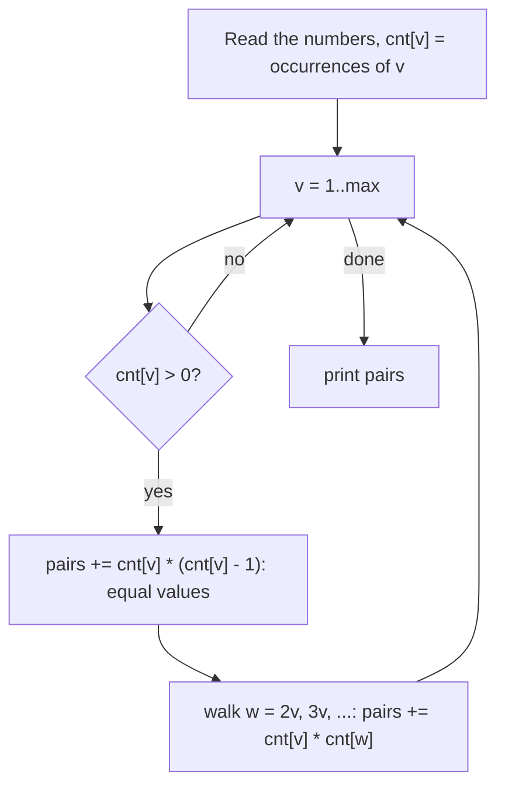

# AMPPZ 2014 D - Dzielniki

> [!info] Karta zadania
> - Treść: `201X/2014/D/D.pdf` ([PDF na GitHubie](../../../201X/2014/D/D.pdf)); pamięć 256 MB, limitu czasu treść nie
>   podaje.
> - Technika: teoria liczb: tablica liczników i przejście po wielokrotnościach (suma harmoniczna, jak w sicie).
>   Trudność: 2/5 (rozwiązały 44 z 57 drużyn).
> - Kod: [d-dzielniki.cpp](d-dzielniki.cpp); wariant szybszy asymptotycznie: [d-dzielniki-pierwsze.cpp](d-dzielniki-pierwsze.cpp).
>   Złożoność: O(n + M log M), gdzie M to największa wartość (wariant: O(n + M log log M)).
> - Dzień kursu: [Dzień 6](../../dni/06-matematyka.md), zadanie omówione.

## Treść w skrócie

Dany jest ciąg n liczb (n ≤ 2 · 10⁶, każda od 1 do 2 · 10⁶). Policz uporządkowane pary pozycji (i, j), i ≠ j, w których
aᵢ jest dzielnikiem aⱼ.

## Zanim przeczytasz dalej

25 minut. Przykład: 2 4 5 2 6 daje 6 par. Zanim napiszesz cokolwiek, policz, ile kosztuje sprawdzenie wszystkich par,
a ile wypisanie dzielników każdej liczby próbowaniem do √aⱼ.

> [!tip]- Podpowiedź 1
> Pozycje nie mają znaczenia, liczą się tylko wartości. Ile razy występuje każda wartość? Ile par daje para wartości
> v | w?

> [!tip]- Podpowiedź 2
> Zamiast szukać dzielników każdej liczby, wyjdź od dzielnika: dla v przejdź po v, 2v, 3v, ... Ile kroków to razem dla
> wszystkich v od 1 do M?

## Droga myślenia

1. **Wszystkie pary:** n² = 4 · 10¹², o wiele za dużo.
2. **Dzielniki każdej liczby przez próbowanie do √a:** n · √M ≈ 2 · 10⁶ · 1415 ≈ 2,8 · 10⁹ dzieleń, też za dużo.
3. **Tablica liczników.** Kolejność nie gra roli, więc liczymy cnt[v] = liczba wystąpień v. Para wartości v | w, v ≠ w,
   daje cnt[v] · cnt[w] par pozycji, a para v = w daje cnt[v] · (cnt[v] - 1) par (bez i = j).
4. **Odwróć pętlę.** Dla każdego v przechodzimy po wielokrotnościach 2v, 3v, ... ≤ M: to ⌊M / v⌋ kroków. Razem
   M/1 + M/2 + ... + M/M = M · (1 + 1/2 + ... + 1/M) ≈ M ln M ≈ 2 · 10⁶ · 14,5 ≈ 2,9 · 10⁷ prostych kroków. To szereg
   harmoniczny: suma odwrotności rośnie jak logarytm.
5. **Typ wyniku.** Gdy wszystkie liczby są równe, wynik to n(n - 1) ≈ 4 · 10¹², więc `long long`.



Jak czytać diagram: zewnętrzna pętla idzie po możliwych dzielnikach, wewnętrzna po ich wielokrotnościach. Każda para
wartości v | w zostaje odwiedzona dokładnie raz, z mniejszej strony. Wartości, których nie ma w ciągu, pomijamy, choć
nawet bez tego łączna praca to O(M log M).

Przykład: 2 4 5 2 6, czyli cnt[2] = 2, cnt[4] = cnt[5] = cnt[6] = 1. Dla v = 2: równe wartości dają 2 · 1 = 2 pary,
wielokrotności 4 i 6 dają 2 · (1 + 1) = 4 pary. Dla v = 4, 5, 6 nic (brak wielokrotności w ciągu). Razem 6.

## Rozwiązanie

```cpp
vector<int> cnt(mx + 1, 0);                    // cnt[v] = how many times v occurs
for (int x : a) cnt[x]++;

ll pairs = 0;
for (int v = 1; v <= mx; v++) {
    if (cnt[v] == 0) continue;                 // absent divisors add nothing
    pairs += (ll)cnt[v] * (cnt[v] - 1);        // equal values, ordered, i != j
    ll multiples = 0;
    for (int w = 2 * v; w <= mx; w += v) multiples += cnt[w];
    pairs += cnt[v] * multiples;
}
```

Pełny program: [d-dzielniki.cpp](d-dzielniki.cpp).

## Złożoność i optymalność

- Wczytanie O(n), liczniki O(n + M), wielokrotności O(M log M). Omówienie jury (AMPPZ 2014, MIMUW) ma dokładnie to
  rozwiązanie: c[i] · c[j] po wielokrotnościach, O(n + M log M). Slajdy podają 186 zgłoszeń przy 44 drużynach
  z akceptacją, czyli sporo odrzuceń (przepełnienie, pary i = j, wolne n√M).
- **Szybciej asymptotycznie: O(n + M log log M).** Niech div[v] = liczba elementów podzielnych przez v (suma cnt po
  wielokrotnościach v). Wielokrotność w = v · p₁ · p₂ · ... dochodzi się do v, mnożąc po jednej liczbie pierwszej, więc
  div liczymy liczba pierwsza po liczbie pierwszej: dla każdej pierwszej p i v od M/p w dół div[v] += div[v · p]
  (kolejność w dół sprawia, że div[v · p] zawiera już wszystkie potęgi p). Każda pierwsza kosztuje M/p, a suma M/p po
  pierwszych to O(M log log M), jak w sicie Eratostenesa. Wynik to Σ cnt[v] · div[v] - n (każdy element sparowany
  z samym sobą). Kod: [d-dzielniki-pierwsze.cpp](d-dzielniki-pierwsze.cpp).
- W praktyce oba warianty mieszczą się z zapasem, a czas zjada wczytanie 2 · 10⁶ liczb (pomiary niżej). Wczytania nie da
  się uniknąć, więc to rozwiązanie optymalne co do rzędu dla tych limitów.

## Pułapki

- **Przepełnienie:** cnt[v] · (cnt[v] - 1) w `int` przepełnia się już dla cnt[v] > 46 341; rzutuj na `long long`.
- **Pary i = j:** równe wartości dają cnt · (cnt - 1), nie cnt²; w wariancie z div trzeba na końcu odjąć n.
- **Pary uporządkowane:** (1, 4) i (4, 1) w przykładzie to dwie pary, bo obie pozycje mają wartość 2.
- **Wczytywanie:** 2 · 10⁶ liczb to ok. 16 MB tekstu; `cin` z `sync_with_stdio(false)` (na Windows `scanf` jest ok. 3 razy
  wolniejszy, na Linuksie sędziego oba wystarczą).

## Weryfikacja

- Kompilacja `g++ -std=c++17 -O2 -Wall -Wextra` bez ostrzeżeń (oba warianty), przykład z treści poprawny (6).
- 1500 testów losowych (n od 1 do 10, wartości do 2, 4, 10, 30 albo 2 · 10⁶, co piąty test same jedynki) porównanych
  z brute force, który sprawdza wszystkie uporządkowane pary i ≠ j. Wszystkie zgodne, dla obu wariantów.
- Testy maksymalne, n = 2 · 10⁶: wartości losowe 0,38 s, wszystkie różne (najwięcej wielokrotności) 0,37 s, same jedynki
  0,26 s (wynik 3 999 998 000 000), wartości do 1000 0,27 s; wariant z liczbami pierwszymi 0,28-0,37 s. Czasy prawie
  się nie różnią, więc decyduje wczytanie, nie pętla po wielokrotnościach.

## Wspólny mianownik

**Odwróć pętlę: zamiast szukać dzielników każdej liczby, z każdego dzielnika przejdź po jego wielokrotnościach.**
Praca M/1 + M/2 + ... + M/M = O(M log M) (szereg harmoniczny). Ten sam ruch to sito Eratostenesa, dzielniki wszystkich
liczb do 10⁶ naraz (CSES Counting Divisors) i "dla każdego d policz elementy podzielne przez d" (CSES Common Divisors).
