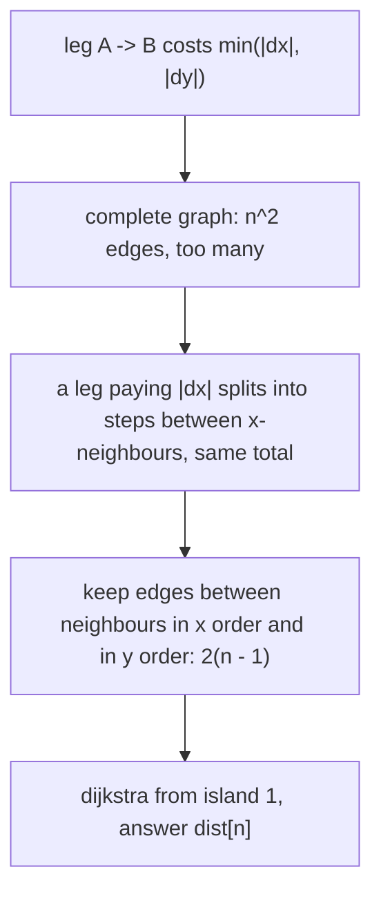

# AMPPZ 2014 K - Kapitan

> [!info] Karta zadania
> - Treść: `201X/2014/K/K.pdf` ([PDF na GitHubie](../../../201X/2014/K/K.pdf)); pamięć 256 MB, limitu czasu treść nie
>   podaje.
> - Technika: najkrótsze ścieżki: odchudzenie grafu pełnego do krawędzi między sąsiadami po posortowaniu, Dijkstra.
>   Trudność: 3 (28 z 57 drużyn).
> - Kod: [k-kapitan.cpp](k-kapitan.cpp). Złożoność: O(n log n).
> - Dzień kursu: [Dzień 9](../../dni/09-grafy-2.md), zadanie omówione.

## Treść w skrócie

Na płaszczyźnie jest n ≤ 2 · 10⁵ wysp (punkty o współrzędnych całkowitych do 10⁹). Statek płynie z wyspy 1 na wyspę n
tylko w czterech kierunkach świata. Przy sterze stoi kapitan albo oficer, a przy każdym skręcie o 90° się zmieniają;
na każdej wyspie, na której statek się zatrzyma, kapitan wybiera od nowa, czy zaczyna on. Długość trasy nie gra
roli. Ile najmniej godzin (jednostek drogi) kapitan musi sterować?

## Zanim przeczytasz dalej

30 minut. Przykład z treści: wyspy (2, 2), (1, 1), (4, 5), (7, 1), (6, 7), wynik 2: z (2, 2) na (7, 1) kapitan steruje
tylko godzinę na południe, z (7, 1) na (6, 7) tylko godzinę na zachód. Zanim zaczniesz, odpowiedz: ile kosztuje
kapitana jeden odcinek z wyspy na wyspę bez postoju?

> [!tip]- Podpowiedź 1
> Na odcinku bez postoju jeden marynarz steruje zawsze w pionie, drugi zawsze w poziomie. Kapitan wybiera, który
> kierunek bierze. Ile co najmniej trzeba przepłynąć w pionie, a ile w poziomie?

> [!tip]- Podpowiedź 2
> Odcinek z A do B kosztuje min(|dx|, |dy|), więc to najkrótsza ścieżka w grafie pełnym. Krawędzi jest jednak n².
> Weź trzy wyspy A, B, C posortowane po x. Czy odcinek A-C o koszcie |dx| może być tańszy niż A-B i B-C razem?

## Droga myślenia

1. **Jeden odcinek.** Między dwiema wyspami statek musi przepłynąć w pionie co najmniej |dy|, w poziomie co najmniej
   |dx|, a trasa w kształcie litery L osiąga oba minima naraz. Kapitan steruje albo całym pionem, albo całym poziomem,
   więc odcinek kosztuje go min(|dx|, |dy|). Postój na wyspie pozwala wybrać od nowa, a trasa może być dowolnie długa.
2. **Graf.** Wierzchołki to wyspy, krawędź między każdą parą z wagą min(|dx|, |dy|), szukamy najkrótszej ścieżki
   z 1 do n. Ale n² = 4 · 10¹⁰ krawędzi: tyle nie da się nawet zbudować.
3. **Które krawędzie są zbędne?** Niech xA ≤ xB ≤ xC. Odcinek A-C kosztuje co najwyżej xC - xA, a droga A-B-C co
   najwyżej (xB - xA) + (xC - xB) = xC - xA. Każdy odcinek, na którym kapitan płaci |dx|, da się więc rozbić na kroki
   między **sąsiadami w porządku po x** bez straty; tak samo |dy| w porządku po y.
4. **Algorytm.** Dwa sortowania, krawędzie między kolejnymi wyspami (najwyżej 2(n - 1) krawędzi nieskierowanych)
   z wagą min(|dx|, |dy|), Dijkstra z wyspy 1.



Jak czytać diagram: dwa pierwsze kroki to model (graf pełny), trzeci to obserwacja, która go odchudza. Odchudzony graf
ma te same odległości: każda jego krawędź jest prawdziwym odcinkiem (odległość nie maleje), a każdy odcinek grafu
pełnego da się zastąpić drogą po krawędziach odchudzonych o tym samym koszcie (odległość nie rośnie).

Przykład: po x wyspy idą w kolejności (1, 1), (2, 2), (4, 5), (6, 7), (7, 1), po y: (1, 1), (7, 1), (2, 2), (4, 5),
(6, 7). Trasa z treści używa dwóch krawędzi odchudzonego grafu: (2, 2)-(7, 1) to sąsiedzi po y (koszt min(5, 1) = 1),
a (7, 1)-(6, 7) sąsiedzi po x (koszt min(1, 6) = 1). Wynik 2. Krawędzi (2, 2)-(6, 7) o koszcie min(4, 5) = 4 w grafie
nie ma i nie trzeba: droga (2, 2)-(4, 5)-(6, 7) między sąsiadami po x kosztuje 2 + 2 = 4.

## Rozwiązanie

```cpp
auto cost = [&](int a, int b) { return min(llabs(x[a] - x[b]), llabs(y[a] - y[b])); };
for (int axis = 0; axis < 2; axis++) {
    const vector<long long>& c = (axis == 0 ? x : y);
    sort(ord.begin(), ord.end(), [&](int a, int b) { return c[a] < c[b]; });
    for (int k = 0; k + 1 < n; k++) {          // neighbours in this order
        int a = ord[k], b = ord[k + 1];
        adj[a].push_back({b, cost(a, b)});
        adj[b].push_back({a, cost(a, b)});
    }
}
// then plain dijkstra from index 0, answer dist[n - 1]
```

Pełny program: [k-kapitan.cpp](k-kapitan.cpp).

## Złożoność i optymalność

- Dwa sortowania O(n log n), Dijkstra na n wierzchołkach i najwyżej 4(n - 1) krawędziach skierowanych O(n log n).
  Pamięć O(n).
- Omówienie jury (AMPPZ 2014, MIMUW, slajdy w web.archive.org): ten sam model kosztu min(|dx|, |dy|), ten sam argument
  z trzema punktami i krawędzie do najbliższego punktu w każdym z czterech kierunków po dwóch sortowaniach; Dijkstra,
  O(n log n). Statystyka ze slajdów: 105 zgłoszeń, zaakceptowane przez 28 z 57 drużyn. Szybszego rozwiązania nie
  znam; samo sortowanie współrzędnych jest tu naturalnym kosztem.

## Pułapki

- **Dijkstra albo Floyd na grafie pełnym:** O(n²) krawędzi przy n = 2 · 10⁵ to TLE i brak pamięci.
- **Tylko jedno sortowanie:** sąsiedzi po x nie zastąpią odcinka, na którym kapitan płaci |dy|.
- **Minimalizacja długości trasy:** treść mówi wprost, że długość nie gra roli; liczy się tylko czas kapitana.
- **Wyspy o tej samej współrzędnej:** krawędź z wagą 0 to poprawny przypadek, wynik może wynosić 0.
- **Typy:** odległości do 10⁹ mieszczą się w `int`, ale suma w relaksacji przed porównaniem bywa większa; `long long`
  nic nie kosztuje.

## Weryfikacja

- Kompilacja `g++ -std=c++17 -O2 -Wall -Wextra` bez ostrzeżeń, przykład z treści daje 2.
- 1500 testów losowych (n od 2 do 6, współrzędne od 0 do 3, 5 albo 7) porównanych z brute force napisanym z treści,
  bez modelu min(|dx|, |dy|): statek idzie po kratkach (współrzędne od -1 do max + 1), stan to (pole, oś sterowana
  przez kapitana), krok wzdłuż osi kapitana kosztuje 1, zmiana osi tylko na wyspie, BFS 0-1. Wszystkie zgodne.
- Testy maksymalne, n = 2 · 10⁵: losowe punkty 0,36 s; punkty na przekątnej co 5000 (wynik 999 995 000) 0,16 s;
  schody, w których kolejne wyspy mają wspólną współrzędną (wynik 0) 0,17 s.

## Wspólny mianownik

**Graf pełny z punktów odchudza się do sąsiadów po posortowaniu.** Gdy koszt krawędzi to różnica jednej współrzędnej
(albo minimum z takich różnic), długą krawędź da się rozbić na kroki przez punkty pośrednie bez straty, więc
zostają tylko krawędzie między kolejnymi punktami. Ten sam ruch w metryce |dx| + |dy| daje krawędzie do najbliższych
punktów w ćwiartkach, a w zadaniach "skacz na najbliższy wyższy" sąsiadów z monotonicznego stosu.
