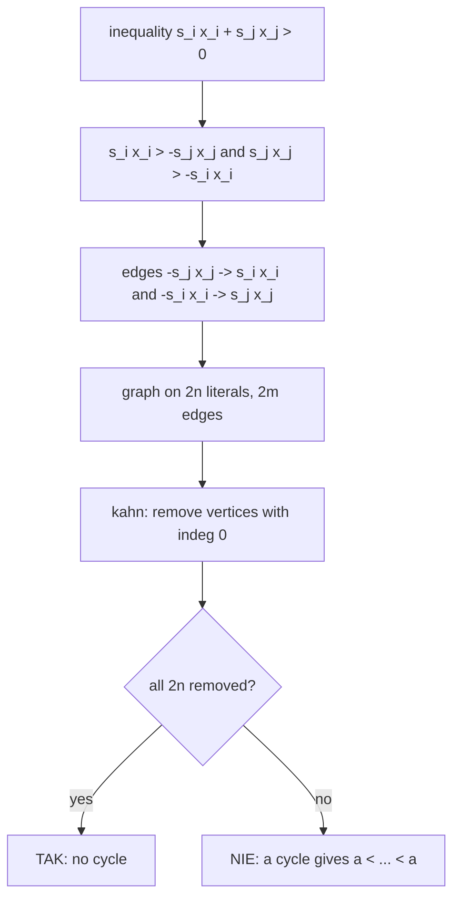

# AMPPZ 2015 B - Bogacze

> [!info] Karta zadania
> - Treść: `201X/2015/B/B.pdf` ([PDF na GitHubie](../../../201X/2015/B/B.pdf)); pamięć 128 MB, limitu czasu treść nie
>   podaje.
> - Technika: grafy: nierówności jako krawędzie grafu skierowanego na 2n literałach, wykrywanie cyklu algorytmem
>   Kahna. Trudność: ~3 (rankingu 2015 brak; jury: 41 zaakceptowanych zgłoszeń na 93).
> - Kod: [b-bogacze.cpp](b-bogacze.cpp). Złożoność: O(n + m).
> - Dzień kursu: [Dzień 8](../../dni/08-grafy-1.md), zadanie omówione.

## Treść w skrócie

Dane jest m nierówności postaci ±xᵢ ± xⱼ > 0 (n ≤ 10⁵ zmiennych, m ≤ 5 · 10⁵, może być i = j). Czy istnieją liczby
rzeczywiste x₁, ..., xₙ spełniające wszystkie naraz? Wypisz TAK albo NIE.

## Zanim przeczytasz dalej

35 minut. Przykłady: x₁ - x₂ > 0, -x₃ + x₁ > 0, x₂ - x₃ > 0 daje TAK (np. 3, 2, 1); x₁ - x₂ > 0, x₃ - x₁ > 0,
x₂ - x₃ > 0 daje NIE. Zanim zaczniesz, przepisz każdą nierówność w postaci "coś > coś" i narysuj strzałki.

> [!tip]- Podpowiedź 1
> Nierówność xᵢ - xⱼ > 0 to xᵢ > xⱼ: strzałka między dwiema zmiennymi. A xᵢ + xⱼ > 0? To xᵢ > -xⱼ. Co, jeśli
> potraktujesz -xⱼ jak osobną "zmienną"?

> [!tip]- Podpowiedź 2
> Wierzchołki: xᵢ i -xᵢ dla każdego i (2n wierzchołków). Kiedy strzałki "mniejsze → większe" na pewno dają sprzeczność?
> A czy brak takiej sytuacji wystarcza? Zauważ, że a > b oznacza też -b > -a.

## Droga myślenia

1. **Każda nierówność to porównanie dwóch "literałów".** ±xᵢ ± xⱼ > 0 to sᵢxᵢ > -sⱼxⱼ, czyli literał sᵢxᵢ jest większy
   od literału -sⱼxⱼ. Literałów jest 2n: x₁, -x₁, ..., xₙ, -xₙ.
2. **Graf.** Krawędź od mniejszego literału do większego. Nierówność a > b daje też -b > -a (pomnożenie przez -1), więc
   każda nierówność to dwie krawędzie: -sⱼxⱼ → sᵢxᵢ oraz -sᵢxᵢ → sⱼxⱼ. Graf ma symetrię: krawędź u → v pociąga
   -v → -u.
3. **Cykl to sprzeczność:** idąc po cyklu, dostajemy a < ... < a. Także i = j się mieści: x₁ - x₁ > 0 daje pętlę
   x₁ → x₁ (cykl długości 1), a x₁ + x₁ > 0 daje krawędź -x₁ → x₁, czyli x₁ > 0, bez sprzeczności.
4. **Brak cyklu wystarcza.** Graf bez cyklu (DAG) ma porządek topologiczny, ale trzeba przypisać liczby tak, żeby
   wartość -x była przeciwna do wartości x. Niech g(v) to długość najdłuższej ścieżki kończącej się w v, a h(v)
   zaczynającej się w v; z symetrii g(-v) = h(v). Wartość w(v) = g(v) - h(v) spełnia w(-v) = -w(v), a dla krawędzi
   u → v mamy g(v) ≥ g(u) + 1 i h(u) ≥ h(v) + 1, więc w(v) ≥ w(u) + 2 > w(u). To jest poprawne przypisanie.
5. **Algorytm:** wykryj cykl w grafie z 2n wierzchołkami i 2m krawędziami. Kahn: zabieraj wierzchołki o stopniu
   wejściowym 0; jeśli zabierzesz wszystkie, TAK, inaczej NIE.



Jak czytać diagram: każda nierówność daje dwie krawędzie, bo a > b to także -b > -a. Graf jest symetryczny względem
negacji, dlatego sam brak cyklu wystarcza do zbudowania wartości (punkt 4).

Przykład 2: x₁ > x₂, x₃ > x₁, x₂ > x₃ dają krawędzie x₂ → x₁, x₁ → x₃, x₃ → x₂: cykl, NIE. Przykład 1: x₁ > x₂,
x₁ > x₃, x₂ > x₃ to krawędzie x₂ → x₁, x₃ → x₁, x₃ → x₂ (plus symetryczne na negacjach): DAG, TAK.

## Rozwiązanie

```cpp
int V = 2 * n;                                 // literal +x_i is 2i, -x_i is 2i + 1, negation is ^1
for (int e = 0; e < m; e++) {
    char si, sj; int i, j;
    cin >> si >> i >> sj >> j;
    int li = 2 * (i - 1) + (si == '-'), lj = 2 * (j - 1) + (sj == '-');
    from[2 * e] = lj ^ 1; to[2 * e] = li;      // -lj < li
    from[2 * e + 1] = li ^ 1; to[2 * e + 1] = lj;  // -li < lj
}
// adjacency in one array sorted by source, then kahn's algorithm
for (int v = 0; v < V; v++) if (indeg[v] == 0) q.push_back(v);
for (size_t head = 0; head < q.size(); head++) {
    int v = q[head];
    for (int p = start[v]; p < start[v + 1]; p++)
        if (--indeg[adj[p]] == 0) q.push_back(adj[p]);
}
cout << ((int)q.size() == V ? "TAK" : "NIE") << "\n";
```

Pełny program: [b-bogacze.cpp](b-bogacze.cpp). Wczytywanie `cin >> char >> int` działa i dla zapisu "+ 1 - 2"
(z odstępami, jak w treści), i dla "+1 -2".

## Złożoność i optymalność

- O(n + m) czasu i pamięci: graf ma 2n wierzchołków i 2m krawędzi, Kahn przegląda każdą raz. Wczytanie m nierówności
  kosztuje Ω(m), więc to rozwiązanie optymalne.
- Omówienie jury (AMPPZ 2015, Uniwersytet Wrocławski) buduje ten sam graf na zmiennych i ich przeciwieństwach i dowodzi
  twierdzenia "sprzeczny wtedy i tylko wtedy, gdy graf ma cykl" indukcją: wierzchołek x o stopniu wejściowym 0 ma
  parę -x o stopniu wyjściowym 0, więc obie da się usunąć i wartość x dobrać na końcu. Dowód z punktu 4 (najdłuższe
  ścieżki) daje wprost wzór na wartości. Statystyka ze slajdów: 93 zgłoszenia, w tym 41 zaakceptowanych, 2 WA,
  6 TLE i 44 RE. Tyle błędów wykonania to najpewniej rekurencyjny DFS na 2 · 10⁵ wierzchołków (przepełnienie stosu);
  slajdy przyczyny nie podają.

## Pułapki

- **Rekurencyjny DFS:** ścieżka może mieć 2 · 10⁵ wierzchołków; algorytm Kahna nie ma rekurencji.
- **Tylko jedna krawędź na nierówność:** bez krawędzi symetrycznej graf gubi informację (np. x₁ + x₂ > 0
  i -x₁ - x₂ > 0 to sprzeczność, którą widać tylko z obiema krawędziami każdej nierówności).
- **i = j:** x₁ - x₁ > 0 musi dać NIE (pętla), a x₁ + x₁ > 0 tylko x₁ > 0.
- **Pamięć 128 MB:** `vector<vector<int>>` dla 2 · 10⁵ wierzchołków i 10⁶ krawędzi mieści się, ale jedna tablica
  sąsiadów jest szybsza i oszczędniejsza.

## Weryfikacja

- Kompilacja `g++ -std=c++17 -O2 -Wall -Wextra` bez ostrzeżeń, oba przykłady z treści poprawne (TAK, NIE).
- 1500 testów losowych (n ≤ 4, m ≤ 6, także i = j; połowa nierówności prawdziwa dla losowych wartości, żeby padały
  odpowiedzi TAK) porównanych z brute force, który przegląda wszystkie przypisania liczb całkowitych z [-n, n]
  (wystarczają, bo liczy się tylko porządek wartości ±xᵢ, a zastąpienie każdej |wartości| jej rangą go zachowuje).
  Wszystkie zgodne: 583 razy TAK, 917 razy NIE.
- Testy maksymalne, n = 10⁵: m = 5 · 10⁵ nierówności prawdziwych dla losowych wartości (TAK) 0,20 s, losowe (NIE)
  0,16 s, łańcuch x₁ > x₂ > ... > xₙ 0,04 s, jeden cykl przez wszystkie zmienne 0,05 s.

## Wspólny mianownik

**Ograniczenia "a > b" to krawędzie grafu, a sprzeczność to cykl.** Gdy zmienne mają też wersje przeciwne (-x), dodaj
je jako osobne wierzchołki i każdą krawędź u → v uzupełnij o -v → -u. Ten sam ruch to 2-SAT (literały i ich negacje,
implikacje w obie strony) i układy różnic xⱼ - xᵢ ≤ c (najkrótsze ścieżki, Dzień 9).
