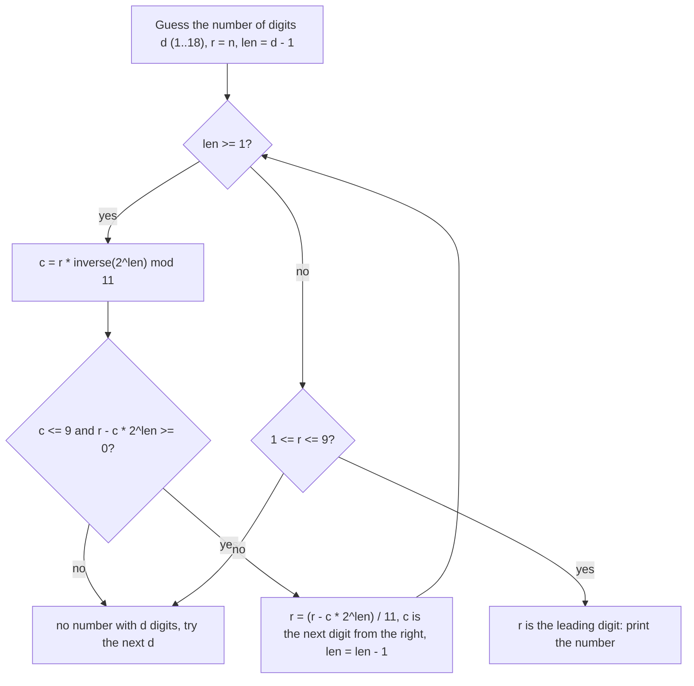

# AMPPZ 2017 F - Funkcja szyfrująca

> [!info] Karta zadania
> - Treść: `201X/2017/F/F.pdf` ([PDF na GitHubie](../../../201X/2017/F/F.pdf)); pamięć 64 MB, limitu czasu treść nie
>   podaje.
> - Technika: matematyka: rekurencja przez dopisanie ostatniej cyfry, reszta modulo 11, odwrotność modulo liczby
>   pierwszej z szybkiego potęgowania. Trudność: 2/5 (rozwiązała 31 z 44 drużyn).
> - Kod: [f-funkcja-szyfrujaca.cpp](f-funkcja-szyfrujaca.cpp). Złożoność: O(d²) dla d ≤ 18 cyfr, czyli stała.
> - Dzień kursu: [Dzień 6](../../dni/06-matematyka.md), zadanie omówione.

## Treść w skrócie

Funkcja f bierze liczbę m jako ciąg cyfr, wybiera każdy niepusty podzbiór pozycji, czyta wybrane cyfry (w tej samej
kolejności, zera wiodące dozwolone) jako liczbę i sumuje wszystkie te liczby. Dla danego n (1 ≤ n ≤ 10¹⁸) trzeba
znaleźć dowolne m z f(m) = n albo wypisać NIE.

## Zanim przeczytasz dalej

35 minut. Przykład z treści: f(123) = 1 + 2 + 3 + 12 + 13 + 23 + 123 = 177, a dla 42 odpowiedź to NIE. Policz na kartce
f(12), f(10) i f(99). Czy widzisz związek między f(12) a f(123)?

> [!tip]- Podpowiedź 1
> Jak zmienia się f, gdy do liczby x dopiszesz na końcu cyfrę c? Podziel podzbiory pozycji nowej liczby na te, które
> nie biorą ostatniej pozycji, i te, które ją biorą.

> [!tip]- Podpowiedź 2
> Wychodzi f(10x + c) = 11 · f(x) + c · 2^len, gdzie len to liczba cyfr x. Spójrz na tę równość modulo 11. Ile cyfr c
> może pasować do danego n?

## Droga myślenia

1. **Przeglądanie m nie wchodzi w grę.** f(m) ≥ m (pełny podzbiór to sama liczba m), więc m ≤ 10¹⁸. Za dużo.
2. **Ile cyfr może mieć m?** Pierwsza cyfra (co najmniej 1) stoi w każdym podzbiorze, który ją bierze, na pozycji
   wyznaczonej przez wybrane cyfry na prawo od niej: każda z d - 1 pozostałych pozycji jest wybrana (mnoży przez 10)
   albo nie (mnoży przez 1). Jej wkład to więc co najmniej (10 + 1)^(d-1) = 11^(d-1). Ponieważ 11¹⁷ ≈ 5 · 10¹⁷ ≤ 10¹⁸
   < 11¹⁸, m ma najwyżej 18 cyfr.
3. **Dopisanie ostatniej cyfry.** Niech x ma len cyfr, a m = 10x + c. Podzbiory pozycji m bez ostatniej pozycji to
   dokładnie podzbiory pozycji x: razem f(x). Podzbiory z ostatnią pozycją to dowolny podzbiór S pozycji x (także
   pusty) z dopisanym c, czyli liczba 10 · val(S) + c. Takich S jest 2^len, a suma val(S) po nich to f(x) (pusty daje
   0). Razem:

   f(10x + c) = f(x) + 10 · f(x) + c · 2^len = 11 · f(x) + c · 2^len.

   Sprawdzenie: f(1) = 1, f(12) = 11 · 1 + 2 · 2 = 15, f(123) = 11 · 15 + 3 · 4 = 177.
4. **Modulo 11 ostatnia cyfra jest wymuszona.** Z równości wyżej n ≡ c · 2^len (mod 11). Liczba 11 jest pierwsza,
   a 2^len nie dzieli się przez 11, więc 2^len ma odwrotność modulo 11 i c ≡ n · (2^len)⁻¹ (mod 11). To jedna reszta
   z 0..10: gdy wychodzi 10, żadna cyfra nie pasuje; w przeciwnym razie cyfra jest jedna.
5. **Dalej tak samo.** Po ustaleniu c znamy f(x) = (n - c · 2^len) / 11 (dzielenie jest dokładne) i powtarzamy krok dla
   x z len - 1 cyframi. Gdy zostaje jedna cyfra, f(x) = x, więc reszta musi być cyfrą od 1 do 9 (pierwsza cyfra nie jest
   zerem).
6. **Długość zgadujemy.** Dla każdej długości d od 1 do 18 przebieg jest wyznaczony jednoznacznie, więc sprawdzamy
   wszystkie i wypisujemy pierwszą udaną.



Jak czytać diagram: dla ustalonej długości każda cyfra od końca wynika z reszty modulo 11, więc nie ma żadnego
wyboru ani cofania się. Pętla kończy się albo odrzuceniem tej długości (cyfra 10, ujemna reszta, zła pierwsza cyfra),
albo gotową liczbą. Zewnętrzna pętla po d to najwyżej 18 przebiegów.

Przykład: n = 177, d = 3. Dla len = 2: 2² = 4, odwrotność 4 modulo 11 to 3 (4 · 3 = 12 ≡ 1), 177 ≡ 1, więc c = 3,
a r = (177 - 12) / 11 = 15. Dla len = 1: odwrotność 2 to 6, 15 ≡ 4, c = 24 mod 11 = 2, r = (15 - 4) / 11 = 1. Zostaje
pierwsza cyfra 1, wynik 123. (Dla d = 2 wychodzi c = 6 i reszta 15, która nie jest cyfrą, więc d = 2 odpada.)

## Rozwiązanie

```cpp
// a^e mod m by repeated squaring, O(log e)
ll power(ll a, ll e, ll m) {
    ll r = 1 % m;
    a %= m;
    while (e > 0) {
        if (e & 1) r = r * a % m;
        a = a * a % m;
        e >>= 1;
    }
    return r;
}

// the number with exactly d digits whose value of f is n, or "" if there is none
string withDigits(ll n, int d) {
    string rev;                                    // digits from the last one
    ll r = n;
    for (int len = d - 1; len >= 1; len--) {       // len = digits in front of the current one
        ll p2 = 1LL << len;
        ll c = r % 11 * power(p2 % 11, 11 - 2, 11) % 11;   // inverse by fermat, 11 is prime
        if (c > 9) return "";
        r -= c * p2;
        if (r < 0) return "";
        r /= 11;                                   // exact, r is divisible by 11 now
        rev += char('0' + c);
    }
    if (r < 1 || r > 9) return "";                 // what is left is the leading digit
    rev += char('0' + r);
    reverse(rev.begin(), rev.end());
    return rev;
}

string solve(ll n) {
    for (int d = 1; d <= 18; d++) {                // the leading digit alone gives 11^(d-1) <= n <= 10^18
        string m = withDigits(n, d);
        if (!m.empty()) return m;
    }
    return "NIE";
}
```

Pełny program: [f-funkcja-szyfrujaca.cpp](f-funkcja-szyfrujaca.cpp). Odwrotność można też znaleźć bez potęgowania:
spróbować dziesięciu cyfr c i wziąć tę, dla której n - c · 2^len dzieli się przez 11 (tak robi omówienie jury).

## Złożoność i optymalność

- 18 długości, w każdej najwyżej 17 kroków, krok to potęgowanie modulo 11 w O(log 11): razem kilkaset operacji, czyli
  O(1) wobec wejścia. Lepiej się nie da, bo trzeba choćby przeczytać n.
- Omówienie jury (AMPPZ 2017, Uniwersytet Wrocławski) ma ten sam wzór f(x) = 11 · f(x div 10) + 2^(len) · (x mod 10)
  i to samo odgadywanie długości oraz cyfr od końca; ostatnią cyfrę znajduje przez sprawdzenie 10 możliwości.
  Jednoznaczność uzasadnia tym, że potęgi dwójki generują resztę modulo 11; wystarczy słabszy fakt, że 2^len nie
  dzieli się przez 11.

## Pułapki

- **Ujemna reszta.** Gdy c · 2^len > r, dalsze r byłoby ujemne, a `%` w C++ dla liczby ujemnej daje wynik ujemny.
  Odrzucaj długość od razu.
- **Pierwsza cyfra.** Na końcu reszta musi być od 1 do 9; zero oznaczałoby liczbę krótszą, a tę sprawdza mniejsze d.
- **Wiele odpowiedzi.** Różne długości mogą dać różne m; treść przyjmuje dowolne, więc wypisujemy pierwsze.
- **Brute force po m "do jakiejś granicy"** przechodzi przykłady, ale nie limity: dla n ≈ 10¹⁸ liczba m ma 18 cyfr.

## Weryfikacja

- Kompilacja `g++ -std=c++17 -O2 -Wall -Wextra` bez ostrzeżeń, oba przykłady z treści poprawne (123 i NIE).
- Test wyczerpujący: brute force liczy f(m) wprost z definicji (wszystkie niepuste podzbiory pozycji) dla każdego
  m < 10⁶. Ponieważ f(m) ≥ m, to są wszystkie kandydaty dla n < 10⁶. Dla każdego n od 1 do 999 999 rozwiązanie albo
  podaje m, dla którego brute force potwierdza f(m) = n, albo mówi NIE i brute force też nie zna żadnego m. Wszystkie
  zgodne (567 890 wartości n ma odpowiedź).
- 400 losowych liczb m od 7 do 18 cyfr (także z samymi zerami i dziewiątkami) z f(m) ≤ 10¹⁸: rozwiązanie zawsze znajduje
  m' z f(m') = f(m).
- Granice: n = 10¹⁸ daje NIE, n = 10¹⁸ - 1 daje 18-cyfrową liczbę potwierdzoną przez brute force; czas pomijalny.

## Wspólny mianownik

**Dopisz ostatni element i zapisz, jak zmienia się wynik; reszta modulo wymusza ten element.** To uogólnienie
zwykłej zamiany na system dziesiętny: tam ostatnia cyfra to n mod 10, a reszta liczby to (n - c) / 10. Tu rolę 10
gra 11, a cyfra jest pomnożona przez 2^len, którą zdejmuje odwrotność modulo. Ten sam ruch odtwarza liczbę z reszt
i rozwiązuje zadania typu "odwróć funkcję liczoną po cyfrach".
