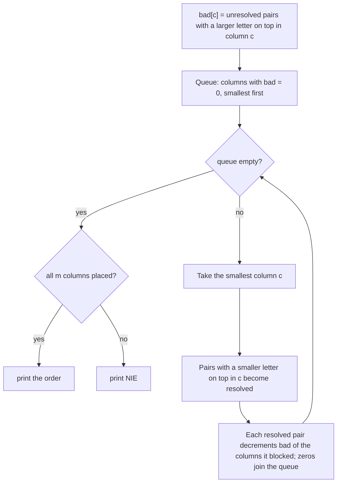

# AMPPZ 2017 H - Hasła

> [!info] Karta zadania
> - Treść: `201X/2017/H/H.pdf` ([PDF na GitHubie](../../../201X/2017/H/H.pdf)); pamięć 64 MB, limitu czasu treść nie
>   podaje.
> - Technika: zachłanne (zawsze najmniejsza dozwolona kolumna), liczniki blokad, kolejka priorytetowa. Trudność: 3/5
>   (rozwiązało 17 z 44 drużyn).
> - Kod: [h-hasla.cpp](h-hasla.cpp). Złożoność: O(nm + m log m).
> - Dzień kursu: [Dzień 5](../../dni/05-wyszukiwanie-binarne.md), zadanie bez etykiety (technika z Dnia 3).

## Treść w skrócie

Jest n parami różnych haseł, każde z m wielkich liter (n · m ≤ 10⁶), zapisanych jedno pod drugim. Kolumny liter
pomieszano. Znajdź permutację kolumn, po której wiersze są w porządku alfabetycznym; jeśli jest ich wiele, wypisz
najmniejszą leksykograficznie, a jeśli nie ma żadnej, wypisz NIE.

## Zanim przeczytasz dalej

30 minut. Przykład: TOMEK nad KASIA, odpowiedź 3 1 2 4 5 (słowa MTOEK i SKAIA). Przykład z NIE: CAB, CBA, BAC. Kiedy
dwa sąsiednie wiersze są już "rozstrzygnięte" i dalsze kolumny ich nie obchodzą?

> [!tip]- Podpowiedź 1
> Wystarczy pilnować par sąsiednich wierszy. Para jest rozstrzygnięta, gdy pierwsza (w nowej kolejności) kolumna,
> w której się różnią, ma mniejszą literę u góry. Kolumnę wolno postawić jako następną, gdy w żadnej
> nierozstrzygniętej parze nie ma u góry większej litery.

> [!tip]- Podpowiedź 2
> Postawienie dozwolonej kolumny nigdy nie szkodzi: rozstrzyga pary, a rozstrzygnięta para przestaje blokować inne
> kolumny. Bierz więc zawsze najmniejszą dozwoloną. Dla każdej kolumny trzymaj licznik par, które ją blokują; gdy para
> się rozstrzyga, zmniejsz liczniki kolumn, które blokowała.

## Droga myślenia

1. **Tylko sąsiednie pary.** Lista jest posortowana, gdy każda para sąsiednich wierszy jest w dobrej kolejności. Para
   (i, i + 1) porównuje się po kolumnach w nowej kolejności; pierwsza kolumna, w której litery się różnią, rozstrzyga ją
   na dobre.
2. **Kiedy kolumna jest dozwolona.** Jako następną można postawić kolumnę c, gdy żadna nierozstrzygnięta para nie ma
   w c większej litery u góry. Równe litery nie szkodzą (para czeka dalej), mniejsza u góry rozstrzyga parę dobrze.
3. **Zachłanność.** Dozwolona kolumna pozostaje dozwolona, bo zbiór nierozstrzygniętych par tylko maleje. A postawienie
   dozwolonej kolumny nie zamyka żadnej drogi: jeśli jakaś permutacja dobrych kolumn istniała, to jej pierwsza kolumna
   spoza już wziętych jest teraz dozwolona (dla mniejszego zbioru par tym bardziej). Najmniejsza dozwolona kolumna jest
   więc zawsze bezpieczna, a jej wybór daje permutację najmniejszą leksykograficznie.
4. **Kiedy NIE.** Jeśli zostały kolumny, ale żadna nie jest dozwolona, permutacji nie ma (z argumentu wyżej). Gdy
   wszystkie pary są rozstrzygnięte, każda kolumna jest dozwolona, więc utknięcie zawsze oznacza nierozstrzygalną parę.
5. **Szybko: liczniki.** bad[c] = liczba nierozstrzygniętych par z większą literą u góry w kolumnie c. Kolumny z bad = 0
   czekają w kolejce priorytetowej (najmniejszy numer pierwszy). Po wzięciu kolumny c przechodzimy po
   nierozstrzygniętych parach; para z mniejszą literą u góry w c staje się rozstrzygnięta i zmniejsza bad każdej
   kolumny, którą blokowała.



Jak czytać diagram: to sortowanie topologiczne, w którym kolumnę blokują pary wierszy. Kolumna wchodzi do kolejki, gdy
licznik blokad spadnie do zera, i nigdy z niej nie wypada. Każda para rozstrzyga się raz i wtedy raz przechodzi po
wszystkich m kolumnach, więc cała praca na licznikach to O(nm).

Przykład: TOMEK nad KASIA. Kolumny 1, 2 i 5 mają większą literę u góry (T > K, O > A, K > A), kolumny 3 i 4 mniejszą.
Dozwolone na start: 3 i 4. Bierzemy 3, para się rozstrzyga, liczniki kolumn 1, 2 i 5 spadają do zera. Dalej po kolei
najmniejsze: 1, 2, 4, 5. Wynik 3 1 2 4 5.

## Rozwiązanie

```cpp
vector<int> bad(m, 0);                         // unresolved pairs blocking each column
for (int i = 0; i + 1 < n; i++)
    for (int c = 0; c < m; c++)
        if (s[i][c] > s[i + 1][c]) bad[c]++;
vector<char> resolved(max(n - 1, 0), 0);
priority_queue<int, vector<int>, greater<int>> ready;
for (int c = 0; c < m; c++) if (bad[c] == 0) ready.push(c);
vector<int> perm;
while (!ready.empty()) {
    int c = ready.top(); ready.pop();
    perm.push_back(c);
    for (int i = 0; i + 1 < n; i++) {
        if (resolved[i] || s[i][c] >= s[i + 1][c]) continue;
        resolved[i] = 1;                       // ordered by column c for good
        for (int c2 = 0; c2 < m; c2++)
            if (s[i][c2] > s[i + 1][c2] && --bad[c2] == 0) ready.push(c2);
    }
}
if ((int)perm.size() < m) puts("NIE");         // otherwise print perm, 1-indexed
```

Pełny program: [h-hasla.cpp](h-hasla.cpp).

## Złożoność i optymalność

- Liczniki na starcie O(nm). Każda wzięta kolumna przechodzi po n - 1 parach (razem O(nm)), każda para rozstrzyga się
  raz i przechodzi po m kolumnach (razem O(nm)). Kolejka: m wstawień i zdjęć po O(log m). Razem O(nm + m log m), czyli
  liniowo względem wejścia z dokładnością do kolejki.
- Omówienie jury (AMPPZ 2017): graf z wierzchołkami wierszy i kolumn, krawędź wiersz → kolumna, gdy kolumna ma u góry
  większą literę, i kolumna → wiersz, gdy mniejszą; permutacja to sortowanie topologiczne z kolejką priorytetową,
  O(nm + m log m). To ten sam algorytm, z jedną uwagą: wierzchołek pary znika już po pierwszej kolumnie, która ją
  rozstrzyga (nie po wszystkich poprzednikach, jak w zwykłym sortowaniu topologicznym); liczniki bad robią to wprost.
- Szybciej się nie da: trzeba przeczytać wszystkie nm liter.

## Pułapki

- **Ostra nierówność zamiast nieostrej:** kolumna z równymi literami w parze jest dozwolona, tylko pary nie rozstrzyga.
- **Wybór "kolumna, która rozstrzyga najwięcej par":** daje jakąś poprawną permutację, ale nie najmniejszą
  leksykograficznie. Bezpieczeństwo każdej dozwolonej kolumny pozwala brać po prostu najmniejszą.
- **Sprawdzanie wszystkich kolumn od nowa po każdym kroku:** O(m · nm), przy n = 2 i m = 5 · 10⁵ za wolne. Liczniki
  zmieniają się tylko przy rozstrzygnięciu pary.
- **Jeden wymiar może mieć 10⁶:** n = 1 (każda permutacja dobra, wynik 1 2 ... m) albo m = 1. Rozwiązanie nie potrzebuje
  osobnych przypadków, ale tablice par trzeba założyć dla n - 1 ≥ 0.

## Weryfikacja

- Kompilacja `g++ -std=c++17 -O2 -Wall -Wextra` bez ostrzeżeń, oba przykłady z treści poprawne (3 1 2 4 5 i NIE).
- 1500 testów losowych (m od 1 do 6, do 7 słów nad alfabetem 2-4 liter; połowa to posortowane słowa z pomieszanymi
  kolumnami, żeby często istniała odpowiedź), porównanych z brute force, który przegląda permutacje kolumn w porządku
  leksykograficznym i wypisuje pierwszą dobrą. Wszystkie zgodne.
- Testy maksymalne (n · m = 10⁶: 1000 × 1000, 10⁵ × 10 i 2 × 5 · 10⁵): do 0,11 s.

## Wspólny mianownik

**Najmniejsza leksykograficznie kolejność z blokadami: licznik blokad każdego elementu i kolejka priorytetowa
elementów odblokowanych.** To sortowanie topologiczne (Dzień 8) w przebraniu, a zachłanność działa, bo dozwolony ruch
nigdy nie zamyka drogi. Zanim weźmiesz najmniejszy dostępny element, sprawdź właśnie to: czy branie nie może zaszkodzić.
